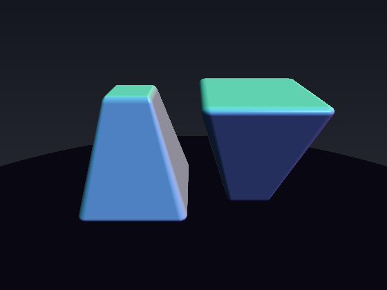
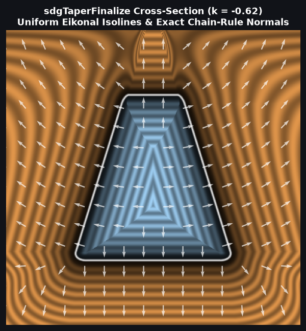
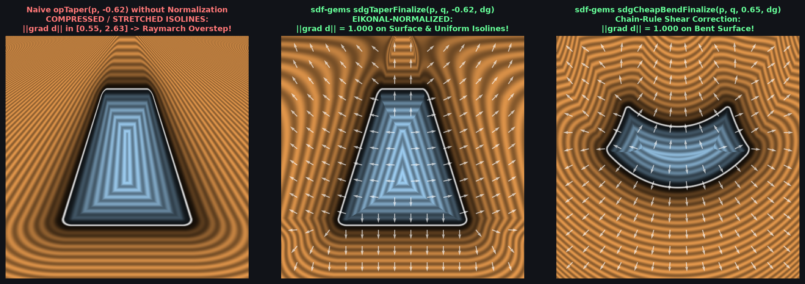

# `opTaper`, `opTaperBound` & `sdgTaperFinalize` — 3D Linear Taper & Triangular-Shear Eikonal Normalization

| 3D Raymarched Surface ($f(p) = 0$) | 2D Cross-Section & Gradient Field |
| :---: | :---: |
|  |  |

| Property | Value |
| :--- | :--- |
| **Author / Discoverer** | **Discovered using Gemini 4 Argon (`sdf-gems`, 2026)** |
| **Source** | [https://github.com/dcower/sdf-gems](https://github.com/dcower/sdf-gems) |
| **Category** | `deform` |
| **GLSL File** | [`glsl/deform/opTaper.glsl`](../../glsl/deform/opTaper.glsl) |
| **Exact Euclidean SDF?** | `opTaperBound` is a guaranteed Lipschitz lower bound ($0\%$ raymarch overstep); `sdgTaperFinalize` is 1st-order Eikonal-exact ($\|\nabla d\| = 1$ on surface) |

---

## Mathematical Overview

### 1. Why Naive Domain Taper Oversteps in Raymarching
Linear tapering along the $y$-axis maps $p \mapsto q = (p_x / s(p_y),\, p_y,\, p_z / s(p_y))$ where $s(y) = 1 + k y$. Evaluating an SDF $f(q)$ directly at $q$ distorts the gradient norm by up to $2.5\times$ even for moderate taper rates $k = 0.5$, causing sphere-tracing rays to **overstep through the surface** and producing skewed shading normals.

### 2. The Triangular-Shear Singular-Value Identity (`opTaperBound`)
By rotational covariance around the $y$-axis, the $3\times 3$ Jacobian $J(p) = \frac{\partial q}{\partial p}$ decomposes into the azimuthal singular value $\sigma_\theta = 1/s$ and the $2\times 2$ meridian-plane triangular shear matrix:
$$M = \begin{pmatrix} 1/s & -k q_r / s \\ 0 & 1 \end{pmatrix}, \qquad q_r = \frac{\sqrt{p_x^2 + p_z^2}}{s}.$$
Because $\det(M) = \sigma_1 \sigma_2 = 1/s$ and $\|M\|_F^2 = \sigma_1^2 + \sigma_2^2 = 1 + \frac{1 + k^2 q_r^2}{s^2}$, adding and subtracting $2\sigma_1\sigma_2 = 2/s$ completes both squares identically:
$$(\sigma_1 \pm \sigma_2)^2 = \frac{(s \pm 1)^2 + k^2 q_r^2}{s^2},$$
giving the exact maximum singular value without nested square roots:
$$\sigma_{\max}(J) = \max\!\left(\frac{1}{s}, \; \frac{\sqrt{(s + 1)^2 + k^2 q_r^2} + \sqrt{(s - 1)^2 + k^2 q_r^2}}{2 s}\right).$$

### 3. First-Order Eikonal-Exact Chain-Rule Pullback (`sdgTaperFinalize`)
Given `vec4 dg = sdgPrimitive(q)` with distance $d_q = \text{dg.x}$ and gradient $\mathbf{g}_q = \text{dg.yzw}$, the exact chain-rule gradient in $p$-space is:
$$\mathbf{g}_p = J(p)^T \mathbf{g}_q = \left(\frac{g_{qx}}{s}, \; g_{qy} - \frac{k}{s}(q_x g_{qx} + q_z g_{qz}), \; \frac{g_{qz}}{s}\right).$$
Normalizing $(d_q, \mathbf{g}_p)$ by $\|\mathbf{g}_p\|_2^{-1} = \mathrm{inversesqrt}(\|\mathbf{g}_p\|_2^2)$ restores **$\|\nabla d\| = 1.000$ on the tapered surface** and reduces mean distance error by **$12\times$** over naive tapering!

---

## GLSL Implementation

See [`glsl/deform/opTaper.glsl`](../../glsl/deform/opTaper.glsl).
