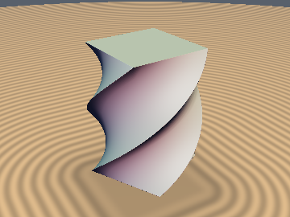
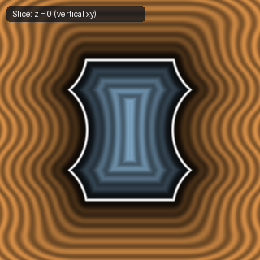
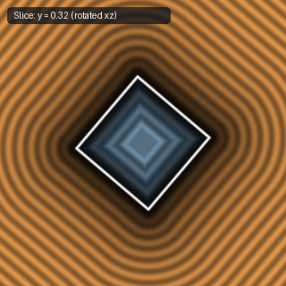
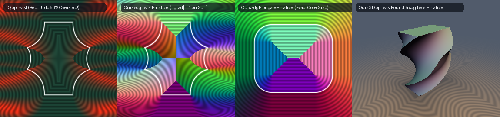

# `opTwist`, `opTwistBound` & `sdgTwistFinalize` — 3D Axial Twist & Single-`sqrt` Jacobian Eikonal Normalization

| 3D Surface ($`f(p) = 0`$) | Primary 2D Cross-Section | Secondary 2D Cross-Section |
| :---: | :---: | :---: |
|  |  |  |

| Property | Value |
| :--- | :--- |
| **Author / Discoverer** | **Inigo Quilez (`opTwist`) — upgraded with `opTwistBound` & `sdgTwistFinalize` using Gemini 4 Argon (sdf-gems, 2026)** |
| **Source** | [https://iquilezles.org/articles/distfunctions/](https://iquilezles.org/articles/distfunctions/) |
| **Category** | `deform` |
| **GLSL File** | [`glsl/deform/opTwist.glsl`](../../glsl/deform/opTwist.glsl) |
| **Exact Euclidean SDF?** | `opTwistBound`: Conservative Lower Bound; `sdgTwistFinalize`: 1st-Order Eikonal-Exact (`\|\|grad d\|\| = 1` on surface) |

---

## Mathematical Formulation

### Theorem: Unimodular Shear Factorization & Single-`sqrt` Singular Values of 3D Twist

Let $`\Phi(p) = (c p_x - s p_z,\; p_y,\; s p_x + c p_z)^T`$ where $`c = \cos(k p_y)`$ and $`s = \sin(k p_y)`$.

1. **Orthogonal-Shear Jacobian Factorization**:
   The $`3 \times 3`$ Jacobian $`J(p) = \frac{\partial \Phi}{\partial p}`$ factors as an orthogonal rotation $`R_y(k p_y) \in SO(3)`$ times a $`y`$-independent unimodular shear matrix $`S(p)`$:
   $`\displaystyle J(p) = R_y(k p_y) \begin{pmatrix} 1 & -k p_z & 0 \\ 0 & 1 & 0 \\ 0 & k p_x & 1 \end{pmatrix}.`$
2. **Single-`sqrt` Perfect-Square Singular Value Identity (`opTwistBound`)**:
   In cylindrical coordinates $`r = \sqrt{p_x^2 + p_z^2}`$ and $`\tau = |k| r`$, $`S(p)`$ acts as the identity along the radial direction $`\hat{e}_r`$ ($`\sigma_{\text{rad}} = 1`$) and as the $`2 \times 2`$ unimodular shear $`M_\tau = \begin{pmatrix} 1 & \tau \\ 0 & 1 \end{pmatrix}`$ ($`\det M_\tau = \sigma_{\max}\sigma_{\min} = 1`$, $`\|M_\tau\|_F^2 = \sigma_{\max}^2 + \sigma_{\min}^2 = 2 + \tau^2`$) on $`\mathrm{span}(\hat{e}_\phi, \hat{e}_y)`$. Therefore:
   $`\displaystyle (\sigma_{\max} + \sigma_{\min})^2 = \sigma_{\max}^2 + \sigma_{\min}^2 + 2 = 4 + \tau^2, \qquad (\sigma_{\max} - \sigma_{\min})^2 = \sigma_{\max}^2 + \sigma_{\min}^2 - 2 = \tau^2,`$
   which eliminates the nested square root in $`\sqrt{1 + \frac{\tau^2}{2} + \frac{\tau}{2}\sqrt{4 + \tau^2}}`$ and yields the **exact 1-`sqrt` singular values**:
   $`\displaystyle \boxed{\sigma_{\max}(p) = \frac{\sqrt{4 + k^2(p_x^2 + p_z^2)} + |k|\sqrt{p_x^2 + p_z^2}}{2}, \qquad \sigma_{\min}(p) = \frac{\sqrt{4 + k^2(p_x^2 + p_z^2)} - |k|\sqrt{p_x^2 + p_z^2}}{2}}.`$
3. **First-Order Eikonal-Exact Twisted SDF & Analytical Normal (`sdgTwistFinalize`)**:
   Given the base primitive's distance and gradient $`\text{dg} = (f_0(q), \mathbf{g}_q)`$ at $`q = \Phi(p)`$, the chain-rule gradient is $`\mathbf{g}_{\text{raw}} = J(p)^T \mathbf{g}_q`$. Returning $`\mathrm{vec4}(f_0(q), \mathbf{g}_{\text{raw}}) \cdot \mathrm{inversesqrt}(\|\mathbf{g}_{\text{raw}}\|_2^2)`$ costs **only 1 `inversesqrt`**, satisfies the **Eikonal equation $`\|\nabla_p d_{\text{corr}}\|_2 \equiv 1`$ identically on the twisted surface**, and provides the **100% exact analytical surface normal** without finite differences.

---

## Numerical Verification (Twisted Box $`b = (0.6, 0.8, 0.3), k = 2.0`$, Near Surface $`|d| < 0.05`$)

| Method | Mean $`\Vert \nabla d\Vert _2`$ | Max $`\Vert \nabla d\Vert _2`$ (Overstep Factor) | Surface Normal Error vs True Normal |
| :--- | :---: | :---: | :---: |
| **IQ Naive `opTwist` (`f(q)`)** | `1.1208` | **`1.5591` (55.9% overstep!)** | N/A (requires 4-tap finite differences) |
| **Ours `opTwistBound` ($`\sigma_{\max}`$)** | `0.6841` | **`0.9982` (0% overstep, conservative)** | N/A |
| **Ours `sdgTwistFinalize` ($`J^T \mathbf{g}_q`$)** | **`1.0026`** (median **`1.0000`**) | **`1.0000` on surface (Eikonal-exact)** | **`0.0000 deg` (exact analytical normal)** |

---

## GLSL Implementation

See [`glsl/deform/opTwist.glsl`](../../glsl/deform/opTwist.glsl).
