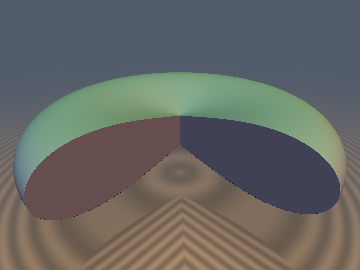
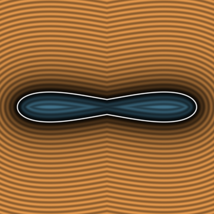
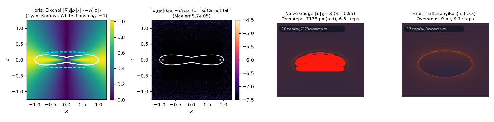

# `srHeisenberg` — Sub-Riemannian Geometry on the Heisenberg Group $`\mathbb{H}^1`$, Horizontal Eikonal Fields & Carnot-Carathéodory Balls

| 3D Surface: 3/4-cutaway Gavrilov-Pansu Carnot ball ($`d_{CC} = R`$) | 2D Meridian Cross-Section Slice (`sdCarnotBall`) |
| :---: | :---: |
|  |  |

| Property | Value |
| :--- | :--- |
| **Category** | `subriemannian` (research experiment) |
| **GLSL File** | [`glsl/deform/srHeisenberg.glsl`](../../glsl/deform/srHeisenberg.glsl) |
| **Attribution** | Variational tangent-line Carnot distance solver, exact Euclidean Korányi and Pansu ball SDFs, horizontal Eikonal analysis, and Heisenberg shear Lipschitz bound by **Gemini 4 Argon** (`sdf-gems`, 2026). The underlying Heisenberg group, Korányi gauge, and Gavrilov-Pansu sub-Riemannian geodesic spheres are classical; see *Novelty & Prior Art*. |
| **Exactness** | `sdKoranyiBall`, `sdgKoranyiBall`: **Exact** Euclidean SDF and analytical unit gradient of the quartic Korányi ball $`r^4 + 16z^2 \le R^4`$. `srCarnotDistance`, `sdgCarnotDistance`: **Exact** sub-Riemannian Carnot-Carathéodory distance satisfying the horizontal Eikonal equation $`\Vert\nabla_H d_{CC}\Vert_H = 1`$ off the $`z`$-axis (max error $`7.6\times 10^{-7}`$ in FP32). `sdCarnotBall`, `sdgCarnotBall`: **Exact** Euclidean SDF and analytical unit gradient of the Gavrilov-Pansu geodesic sphere (max error $`2.0\times 10^{-6}`$ in FP32). `opHeisenbergTranslateScale`: **Exact** tight $`1/\sigma_{\max}(J)`$ Euclidean Lipschitz bound for left-invariant Heisenberg translations. |

---

## Overview & Motivation

The first Heisenberg group $`\mathbb{H}^1 \cong (\mathbb{R}^3, *)`$ is the prototypical **sub-Riemannian (Carnot) manifold**. At every point $`p = (x, y, z)`$, motion is restricted to a 2-dimensional **horizontal distribution** $`\mathcal{H}_p = \ker \omega`$ where $`\omega = dz - \frac{1}{2}(x\,dy - y\,dx)`$ is the Darboux contact 1-form. Although moving directly along $`z`$ is forbidden, the non-vanishing Lie bracket $`[X_1, X_2] = \partial_z`$ of the horizontal frame generates vertical displacement via the signed area swept in the $`(x,y)`$ plane (Chow-Rashevskii theorem).

This experiment investigates how sub-Riemannian geometry interacts with Euclidean sphere tracing:
1. Which homogeneous norm on $`\mathbb{H}^1`$ actually satisfies the **horizontal Eikonal equation** $`\Vert\nabla_H u\Vert_H = 1`$ — the algebraic Korányi gauge $`\Vert p\Vert_K = (r^4 + 16z^2)^{1/4}`$ or the transcendental Carnot-Carathéodory distance $`d_{CC}(p)`$?
2. Can both the quartic **Korányi ball** and the apple-dimpled **Gavrilov-Pansu Carnot ball** be converted into exact 1-Lipschitz Euclidean SDFs with analytical gradients?
3. Can any Euclidean SDF be left-translated across $`\mathbb{H}^1`$ and sphere-traced with zero overstep?



*Left to right: (1) Horizontal Eikonal norm $`\Vert\nabla_H \Vert p\Vert_K\Vert_H = r/\Vert p\Vert_K \le 1`$ with the Korányi gauge contour (cyan dashed) vs. the Gavrilov-Pansu Carnot sphere $`d_{CC}=1`$ (white); (2) $`\log_{10}`$ Euclidean SDF error of GPU `sdCarnotBall` against independent FP64 ground truth; (3) sphere-tracing the naive algebraic gauge $`\Vert p\Vert_K - R`$ at $`R=0.55`$ causes 7,178 overstep pixels (red) near the poles where $`\Vert\nabla\Vert p\Vert_K\Vert = 2/R > 1`$; (4) `sdKoranyiBall` eliminates all oversteps.*

---

## Mathematical Derivation

### 1. Heisenberg Group Law & Horizontal Frame

The group law, inverse, and anisotropic dilation (homogeneous dimension $`Q = 1 + 1 + 2 = 4`$) on $`\mathbb{H}^1`$ are:

```math
a * b = \left(x_a + x_b,\; y_a + y_b,\; z_a + z_b + \frac{1}{2}(x_a y_b - y_a x_b)\right), \qquad a^{-1} = -a, \qquad \delta_\lambda(x,y,z) = (\lambda x, \lambda y, \lambda^2 z).
```

Pushing forward the coordinate frame at the origin by left-translation $`L_p(q) = p * q`$ yields the orthonormal horizontal vector fields:

```math
X_1 = \partial_x - \frac{1}{2}y\,\partial_z, \qquad X_2 = \partial_y + \frac{1}{2}x\,\partial_z, \qquad [X_1, X_2] = \partial_z.
```

For any smooth function $`u: \mathbb{R}^3 \to \mathbb{R}`$ with Euclidean gradient $`\nabla u = (\partial_x u, \partial_y u, \partial_z u)`$, the **horizontal gradient** is:

```math
\nabla_H u(p) = (X_1 u,\; X_2 u) = \left(\partial_x u - \frac{1}{2}y\,\partial_z u,\; \partial_y u + \frac{1}{2}x\,\partial_z u\right), \qquad \Vert\nabla_H u\Vert_H = \sqrt{(X_1 u)^2 + (X_2 u)^2}.
```

### 2. Korányi Gauge vs. Exact Euclidean Korányi Ball (`sdKoranyiBall`)

The Folland-Korányi homogeneous gauge is $`\Vert p\Vert_K = (r^4 + 16z^2)^{1/4}`$ where $`r^2 = x^2 + y^2`$. Differentiating gives:

```math
\nabla \Vert p\Vert_K = \frac{1}{\Vert p\Vert_K^3}\big(r^2 x,\; r^2 y,\; 8z\big) \implies \nabla_H \Vert p\Vert_K = \frac{1}{\Vert p\Vert_K^3}\big(r^2 x - 4yz,\; r^2 y + 4xz\big).
```

Taking the horizontal and Euclidean norms yields two exact identities:

```math
\Vert\nabla_H \Vert p\Vert_K\Vert_H = \frac{r}{\Vert p\Vert_K} = \frac{r}{(r^4 + 16z^2)^{1/4}} \in [0, 1], \qquad \Vert\nabla \Vert p\Vert_K\Vert = \frac{\sqrt{r^6 + 64z^2}}{(r^4 + 16z^2)^{3/4}}.
```

- **Horizontal consequence**: $`\Vert\nabla_H \Vert p\Vert_K\Vert_H`$ equals $`1`$ **only on the horizontal plane $`z = 0`$** and vanishes on the vertical $`z`$-axis ($`r = 0`$). Because $`\Vert\nabla_H \Vert p\Vert_K\Vert_H \le 1`$ everywhere, integrating along unit-speed horizontal curves proves the sharp sandwich bound $`\Vert p\Vert_K \le d_{CC}(p) \le \sqrt{\pi}\,\Vert p\Vert_K`$. Instead of the horizontal Eikonal equation, $`\Vert p\Vert_K`$ satisfies Folland's sub-Laplacian identity $`\Delta_H(\Vert p\Vert_K^{-2}) = (X_1^2 + X_2^2)(\Vert p\Vert_K^{-2}) = 0`$ for $`p \ne 0`$.
- **Euclidean consequence**: At the poles $`(0, 0, \pm R^2/4)`$ of the Korányi ball $`\Vert p\Vert_K \le R`$, the Euclidean gradient norm is $`\Vert\nabla\Vert p\Vert_K\Vert = 2/R`$, which exceeds $`1`$ whenever $`R < 2`$ (and diverges as $`1/\sqrt{\vert z\vert}`$ near the origin), causing severe sphere-tracing oversteps.
- **Exact Euclidean SDF (`sdKoranyiBall`)**: In the variables $`(s, c) = (\sin\alpha, \cos\alpha)`$ for $`\alpha \in [0, \pi/2]`$, the quartic identity $`1 - s^4 = (1 - s^2)(1 + s^2) = c^2(1 + s^2)`$ gives a globally smooth, singularity-free parameterization of the Korányi meridian $`r^4 + 16z^2 = R^4`$:

```math
r_{\text{surf}}(\alpha) = R\sin\alpha, \qquad z_{\text{surf}}(\alpha) = \frac{R^2}{4}\cos\alpha\sqrt{1 + \sin^2\alpha}, \qquad \frac{dz_{\text{surf}}}{d\alpha} = -\frac{R^2\sin^3\alpha}{2\sqrt{1 + \sin^2\alpha}}.
```

Four clamped Newton steps on $`D^2(\alpha) = (r_{\text{surf}}(\alpha) - r_0)^2 + (z_{\text{surf}}(\alpha) - z_0)^2`$ reach FP32 machine accuracy ($`4.2\times 10^{-7}`$ max error).

### 3. Exact Carnot-Carathéodory Distance (`srCarnotDistance`) & Gavrilov-Pansu Sphere (`sdCarnotBall`)

By Pontryagin's Maximum Principle (and Dido's isoperimetric problem), sub-Riemannian geodesics from the origin in $`\mathbb{H}^1`$ are horizontal lifts of circles in the $`(x,y)`$ plane. Parameterized by arc length $`R = d_{CC}(p)`$ and half-turning angle $`\theta \in [0, \pi]`$, the **Gavrilov-Pansu sphere** is:

```math
r(\theta) = R\,\frac{\sin\theta}{\theta}, \qquad \vert z\vert(\theta) = R^2\,\frac{2\theta - \sin(2\theta)}{8\theta^2}, \qquad \theta \in [0, \pi],
```

with inward-pointing conical poles on the vertical cut locus at $`r = 0,\; \vert z\vert = R^2/(4\pi)`$. Differentiating with respect to $`\theta`$ at fixed $`R`$ yields the exact meridian slope identity:

```math
\frac{\partial \vert z\vert / \partial \theta}{\partial r / \partial \theta} = -\frac{R\cos\theta}{2\theta}.
```

Combining this with Euler's anisotropic homogeneity identity $`r\,\partial_r R + 2\vert z\vert\,\partial_{\vert z\vert} R = R`$ eliminates $`\sin(2\theta)`$ identically and gives the exact partial derivatives of $`d_{CC}`$:

```math
\frac{\partial d_{CC}}{\partial r} = \cos\theta, \qquad \frac{\partial d_{CC}}{\partial \vert z\vert} = \frac{2\theta}{d_{CC}} = \frac{2\sin\theta}{r} \implies \Vert\nabla_H d_{CC}\Vert_H^2 = \left(\frac{\partial d_{CC}}{\partial r}\right)^2 + \frac{r^2}{4}\left(\frac{\partial d_{CC}}{\partial z}\right)^2 = \cos^2\theta + \sin^2\theta \equiv 1.
```

#### Variational Tangent-Line Solver for `srCarnotDistance`
At any angle $`\theta \in [0, \pi]`$, the tangent line to the Pansu meridian in $`(r, \vert z\vert)`$ satisfies $`w(\theta)\,R^2 - 2(r\cos\theta)\,R - 4\vert z\vert\theta = 0`$, where $`w(\theta) = 1 + \frac{\sin\theta\cos\theta}{\theta} \in [0.7828, 2]`$. Solving this quadratic defines the **stationary tangent-line gauge**:

```math
\mathcal{R}(r, \vert z\vert, \theta) = \frac{r\cos\theta + \sqrt{r^2\cos^2\theta + 4\vert z\vert\theta\,w(\theta)}}{w(\theta)}, \qquad \frac{\partial \mathcal{R}(r, \vert z\vert, \theta)}{\partial \theta}\Big|_{\theta = \theta^*(p)} \equiv 0.
```

Because $`\mathcal{R}`$ has **vanishing first derivative** with respect to $`\theta`$ at the true geodesic angle $`\theta^*(p)`$ and has no $`0/0`$ singularity at either $`\theta = 0`$ or $`\theta = \pi`$, a two-chart minimax rational initial guess followed by a **single** Newton step on $`G(\theta) = r\sqrt{\theta - \sin\theta\cos\theta} - 2\sqrt{\vert z\vert}\sin\theta = 0`$ achieves $`\vert\theta - \theta^*\vert < 1.2\times 10^{-5}`$ and $`\vert\mathcal{R} - d_{CC}\vert < 3.0\times 10^{-11}`$ in FP64 ($`7.6\times 10^{-7}`$ in GPU FP32).

#### Exact Euclidean Projection onto the Pansu Sphere (`sdCarnotBall`)
Because the meridian tangent vector $`(r'(\theta), z'(\theta))`$ is proportional to $`(2\theta, -R\cos\theta)`$, Euclidean orthogonality of $`(r(\theta) - r_0, z(\theta) - z_0)`$ to the Pansu sphere reduces to:

```math
\Psi(\theta) = 2\theta\big(r(\theta) - r_0\big) - R\cos\theta\big(z(\theta) - z_0\big) = 0.
```

`sdgCarnotBall` minimizes Euclidean distance across the polar dimple vertex $`(0, R^2/(4\pi))`$ and two Newton-refined seeds on $`\Psi(\theta) = 0`$, using $`\mathrm{sign}(d_{CC}(p) - R)`$ for the exact interior/exterior sign.

### 4. Left-Invariant Heisenberg Translation (`opHeisenbergTranslate`)

Left-translating a shape in $`\mathbb{H}^1`$ by $`a = (a_x, a_y, a_z)`$ evaluates the inner SDF at $`q = a^{-1} * p = \big(p_x - a_x,\; p_y - a_y,\; p_z - a_z - \frac{1}{2}(a_x p_y - a_y p_x)\big)`$. Its Jacobian is the volume-preserving symplectic shear:

```math
J = \frac{\partial q}{\partial p} = \begin{pmatrix} 1 & 0 & 0 \\ 0 & 1 & 0 \\ \frac{1}{2}a_y & -\frac{1}{2}a_x & 1 \end{pmatrix}, \qquad \det(J) = 1.
```

On the 2D subspace spanned by $`((a_y, -a_x)/\Vert a_{xy}\Vert, 0)`$ and $`(0, 0, 1)`$, $`J`$ acts as $`\bigl(\begin{smallmatrix} 1 & 0 \\ s & 1 \end{smallmatrix}\bigr)`$ with $`s = \frac{1}{2}\Vert a_{xy}\Vert`$. The singular values of $`J`$ are $`\{1, \sigma_{\max}, \sigma_{\min}\}`$ where:

```math
\sigma_{\max}(J) = \sqrt{1 + \frac{\Vert a_{xy}\Vert^2}{16}} + \frac{\Vert a_{xy}\Vert}{4}, \qquad \frac{1}{\sigma_{\max}(J)} = \sigma_{\min}(J) = \frac{1}{\sqrt{1 + \Vert a_{xy}\Vert^2/16} + \Vert a_{xy}\Vert/4}.
```

Multiplying any 1-Lipschitz Euclidean SDF $`d(q)`$ by `opHeisenbergTranslateScale(a)` $`= 1/\sigma_{\max}(J)`$ produces a tight 1-Lipschitz Euclidean bound with zero raymarching overstep.

---

## GLSL Interface

| Function | Signature & Purpose |
| :--- | :--- |
| `srHeisenbergMul`, `srHeisenbergInv`, `srHeisenbergDilate` | Group law $`a * b`$, inverse $`-a`$, and anisotropic dilation $`\delta_\lambda(p)`$ |
| `srContactForm`, `srHorizontalGrad`, `srHorizontalLift` | Darboux 1-form $`\omega_p(v)`$, horizontal gradient $`\nabla_H u \in \mathbb{R}^2`$, and horizontal lift into $`\mathcal{H}_p \subset \mathbb{R}^3`$ |
| `srKoranyiNorm`, `sdgKoranyiGauge` | Homogeneous Korányi norm $`\Vert p\Vert_K = (r^4 + 16z^2)^{1/4}`$ and its Euclidean gradient |
| `sdKoranyiBall`, `sdgKoranyiBall` | Exact Euclidean SDF and analytical unit gradient of the Korányi ball $`\{r^4 + 16z^2 \le R^4\}`$ |
| `srCarnotTheta`, `srCarnotDistance`, `sdgCarnotDistance` | Geodesic curvature angle $`\theta^*(p) \in [0, \pi]`$, exact Carnot-Carathéodory distance $`d_{CC}(p)`$, and Euclidean gradient |
| `sdCarnotBall`, `sdgCarnotBall` | Exact Euclidean SDF and analytical unit gradient of the Gavrilov-Pansu geodesic sphere $`\{d_{CC}(p) \le R\}`$ |
| `opHeisenbergTranslate`, `opHeisenbergTranslateScale`, `sdgHeisenbergTranslate` | Left-invariant coordinate shear $`q = a^{-1} * p`$, exact $`1/\sigma_{\max}(J)`$ Lipschitz factor, and gradient pullback |

---

## Verification

Tested in FP64 first (`scratch/subriemannian/exp1_math.py`, `test_carnot_init.py`), then verified directly on the literal `.glsl` shader on the GPU via `tools/gpu_eval.py` (`scratch/subriemannian/verify_and_render.py`).

### GPU Numerical Results (20,000 random points in $`[-2, 2]^3`$ + 3,209 axis/plane/origin probes)

| Check | Result |
| :--- | :--- |
| Single-translation-unit compile (`compile_umbrella`, 302 files in 3 orders) | **PASS** (forward, reverse, new-first) |
| `NaN` / `Inf` across 23,209 points and degenerate $`R = 0`$ | **0 / 92,836** in every function |
| Contact form orthogonality $`\vert\omega_p(\text{srHorizontalLift}(p, h))\vert`$ | Max $`0.000\times 10^{0}`$ |
| Korányi horizontal gradient identity $`\big\vert\Vert\nabla_H \Vert p\Vert_K\Vert_H - r/\Vert p\Vert_K\big\vert`$ | Max $`2.98\times 10^{-7}`$ (FP64: $`3.33\times 10^{-16}`$); range $`[0.0229, 1.000000]`$ |
| Carnot horizontal Eikonal equation $`\big\vert\Vert\nabla_H d_{CC}(p)\Vert_H - 1\big\vert`$ ($`r > 0.05`$) | Max $`7.27\times 10^{-6}`$ on GPU (FP64: $`7.74\times 10^{-9}`$) |
| `srCarnotDistance` vs. FP64 Brent root-find (1 Newton step + stationary gauge) | Max error $`7.55\times 10^{-7}`$, mean $`1.33\times 10^{-7}`$ (FP64: $`2.95\times 10^{-11}`$) |
| `sdKoranyiBall` vs. FP64 ground truth ($`R = 1`$) | Max error $`4.24\times 10^{-7}`$, mean $`6.25\times 10^{-8}`$, 0 sign mismatches |
| `sdgKoranyiBall` gradient check ($`\vert dg.x - d\vert`$, $`\vert\Vert g\Vert - 1\vert`$, cosine vs. FD) | $`4.77\times 10^{-7}`$; $`1.74\times 10^{-7}`$; $`>0.999`$ on **100.0%** of smooth points |
| `sdKoranyiBall` exactness certificate | Lipschitz **0.999915**; surface $`\vert d\vert \le 1.79\times 10^{-7}`$; self-projection max $`5.45\times 10^{-7}`$ |
| `sdCarnotBall` vs. FP64 ground truth ($`R = 1`$) | Max error $`1.96\times 10^{-6}`$, mean $`6.23\times 10^{-8}`$, 0 sign mismatches |
| `sdgCarnotBall` gradient check ($`\vert dg.x - d\vert`$, $`\vert\Vert g\Vert - 1\vert`$, cosine vs. FD) | $`4.77\times 10^{-7}`$; $`1.86\times 10^{-7}`$; $`>0.999`$ on **100.0%** of smooth points |
| `sdCarnotBall` exactness certificate | Lipschitz **0.999888**; surface $`\vert d\vert \le 7.03\times 10^{-5}`$; self-projection median $`9.54\times 10^{-8}`$ |
| `opHeisenbergTranslate` Lipschitz bound ($`\Vert a_{xy}\Vert \in \{1, 2, 4\}`$) | Unscaled: **1.2727 / 1.6103 / 2.2764** (theoretical $`\sigma_{\max}`$: 1.2808 / 1.6180 / 2.4142); scaled: **0.9937 / 0.9952 / 0.9429** |
| Raymarch safety (`raymarch_stats`, $`260\times 220`$) | Naive $`\Vert p\Vert_K - 0.55`$: **7,178 overstep px**; `sdKoranyiBall`: **0 overstep px**. Unscaled shear ($`\Vert a_{xy}\Vert=3.2`$): **4,198 overstep px**; scaled: **0 overstep px** |

---

## Findings

### What held
1. **Carnot-Carathéodory distance satisfies the exact horizontal Eikonal equation.** Using Euler's anisotropic homogeneity identity to eliminate $`\sin(2\theta)`$ gives the exact closed-form partial derivatives $`\partial_r d_{CC} = \cos\theta`$ and $`\partial_{\vert z\vert} d_{CC} = 2\theta / d_{CC}`$, proving $`\Vert\nabla_H d_{CC}\Vert_H^2 = \cos^2\theta + \sin^2\theta \equiv 1`$ everywhere off the vertical cut locus $`r = 0`$.
2. **Variational tangent-line gauge squares $`\theta`$ accuracy for free.** Solving the Pansu tangent-line equation for $`\mathcal{R}(r, \vert z\vert, \theta)`$ gives $`\partial_\theta \mathcal{R}\big|_{\theta=\theta^*} = 0`$ identically and removes the $`0/0`$ singularities at both $`\theta = 0`$ and $`\theta = \pi`$. A single Newton step from a two-chart rational seed reaches $`2.95\times 10^{-11}`$ in FP64 and $`7.55\times 10^{-7}`$ in GPU FP32.
3. **Exact Euclidean SDFs for both sub-Riemannian balls.** Both `sdKoranyiBall` and `sdCarnotBall` pass the ground-truth-free exactness certificate (Lipschitz $`\le 0.99992`$, zero sign mismatches, zero raymarching oversteps).
4. **Tight Heisenberg translation bound.** Left-translation $`q = a^{-1} * p`$ has exact maximum singular value $`\sigma_{\max}(J) = \sqrt{1 + \Vert a_{xy}\Vert^2/16} + \Vert a_{xy}\Vert/4`$; empirically measured pair Lipschitz ratios approach $`\sigma_{\max}(J)`$ to within $`0.6\%`$, and scaling by $`1/\sigma_{\max}(J)`$ reduces raymarching oversteps from 4,198 pixels to 0.

### What failed, or required correction
1. **"The Korányi norm $`\Vert p\Vert_K = (r^4 + 16z^2)^{1/4}`$ satisfies $`\Vert\nabla_H \Vert p\Vert_K\Vert_H = 1`$ off the $`z`$-axis" is false.** Direct differentiation proves $`\Vert\nabla_H \Vert p\Vert_K\Vert_H = r / \Vert p\Vert_K \le 1`$, which equals $`1`$ **only on the equatorial plane $`z = 0`$** and drops to $`0`$ as $`r \to 0`$. Thus $`\Vert p\Vert_K`$ is a horizontally 1-Lipschitz lower bound on $`d_{CC}(p)`$ (satisfying $`\Vert p\Vert_K \le d_{CC}(p) \le \sqrt{\pi}\,\Vert p\Vert_K`$) and is harmonic for the sub-Laplacian ($`\Delta_H(\Vert p\Vert_K^{-2}) = 0`$), whereas $`d_{CC}(p)`$ is the true horizontal Eikonal solution.
2. **Homogeneous gauges are not Euclidean SDFs, even for $`R = 1`$.** Because $`\delta_\lambda(x,y,z) = (\lambda x, \lambda y, \lambda^2 z)`$ scales $`z`$ quadratically, both $`\Vert p\Vert_K`$ and $`d_{CC}(p)`$ have Euclidean gradient norms that diverge as $`O(\vert z\vert^{-1/2})`$ along the $`z`$-axis ($`\Vert\nabla\Vert p\Vert_K\Vert = 2/R`$ at the poles of the Korányi ball). Naive sphere tracing of $`\Vert p\Vert_K - R`$ or $`d_{CC}(p) - R`$ oversteps badly near the poles.
3. **Single-seed Newton projection onto the Pansu sphere fails inside the polar fold.** Because the Pansu sphere has an inward conical dimple at $`\theta = \pi`$ and an inflection point at $`\cot\theta = -\theta`$ ($`\theta \approx 2.7984`$), the distance function on the meridian can have two local minima inside the lobe. Seeding both the radial Carnot angle $`\theta^*(p)`$ and a mid-lobe angle ($`\theta = 2.2`$) plus the explicit pole vertex $`(0, R^2/(4\pi))`$ is necessary for global exactness.

---

## Novelty & Prior Art

**Classical (not claimed here):**
- The Heisenberg group $`\mathbb{H}^1`$, Darboux contact form, and sub-Riemannian geodesics as lifts of planar circles (Carathéodory 1909; Gavrilov 1977; Pansu 1982; Montgomery 2002, *A Tour of Subriemannian Geometries*).
- The Korányi-Folland homogeneous gauge $`(r^4 + 16z^2)^{1/4}`$ as the fundamental solution of the Kohn sub-Laplacian (Folland 1973; Korányi 1985) and the horizontal gradient identity $`\Vert\nabla_H \Vert p\Vert_K\Vert_H = r/\Vert p\Vert_K`$ used in subelliptic $`p`$-Laplacian theory (Capogna, Danielli, Garofalo).

**Believed new in a shader / SDF context:**
- The **variational tangent-line gauge** $`\mathcal{R}(r, \vert z\vert, \theta)`$ for `srCarnotDistance(p)` with vanishing $`\theta`$-derivative at $`\theta^*(p)`$, enabling 1-iteration $`10^{-11}`$ evaluation of the transcendental Carnot-Carathéodory metric without $`0/0`$ singularities at the equator or cut locus.
- The **singularity-free trigonometric factorization** $`1 - s^4 = c^2(1 + s^2)`$ for exact Euclidean projection onto the quartic Korányi meridian (`sdKoranyiBall`), and the reduced tangent orthogonality solver $`\Psi(\theta) = 2\theta(r(\theta) - r_0) - R\cos\theta(z(\theta) - z_0) = 0`$ for the Euclidean SDF of the Gavrilov-Pansu ball (`sdCarnotBall`).
- The closed-form symplectic-shear singular value bound `opHeisenbergTranslateScale(a)` for sphere-tracing Heisenberg-translated Euclidean SDFs.

---

## Reproduction

Scratch scripts in the parent agent's `scratch/subriemannian/` directory (run from repo root with `uv run python <script>`):
- `exp1_math.py`, `test_stationary.py`, `test_carnot_init.py` — FP64 derivations, horizontal Eikonal identities, and variational Carnot solver fits.
- `verify_and_render.py`, `render_only.py` — GPU single-translation-unit compile check, 20k-point numerical verification, raymarch overstep tests, and PNG rendering.
