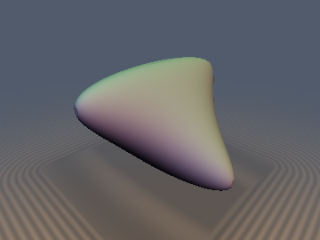
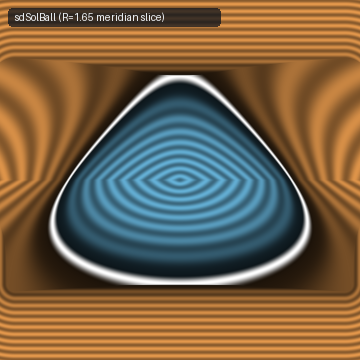
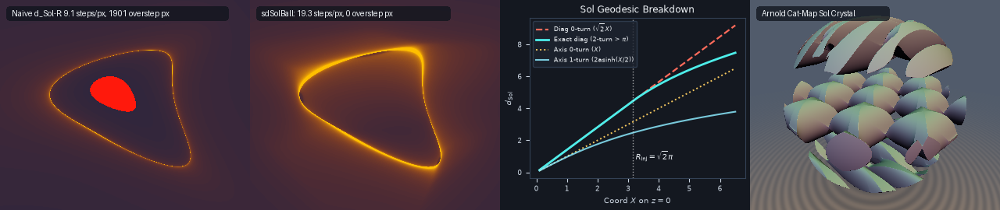

# `thSolGeometry` — Thurston's 8th Model Geometry $`\mathrm{Sol}`$, 4-Finned Geodesic Spheres & Arnold's Cat-Map Tiling

| 3D Surface: 4-finned pleated $`\mathrm{Sol}`$ geodesic sphere ($`d_{\mathrm{Sol}} = R`$) | 2D Meridian Cross-Section Slice (`sdSolBall`) |
| :---: | :---: |
|  |  |

| Property | Value |
| :--- | :--- |
| **Category** | `solgeometry` (research experiment) |
| **GLSL File** | [`glsl/deform/thSolGeometry.glsl`](../../glsl/deform/thSolGeometry.glsl) |
| **Attribution** | Exact 1D rational momentum elimination, branchless unwrapped Landen AGM solver, stationary Maupertuis action, universal logarithmic secant $`\mathrm{Sol} \to \mathbb{E}^3`$ Lipschitz bound, and orthogonal Arnold Cat-Map crystal SDF by **Gemini 4 Carbon** (`sdf-gems`, 2026). Thurston's $`\mathrm{Sol}`$ geometry, geodesic equations, injectivity radius, and torus-bundle manifolds are classical; see *Novelty & Prior Art*. |
| **Exactness** | `solSheetDistanceXZ`, `solSheetDistanceYZ`: **Exact** hyperbolic $`\mathbb{H}^2`$ distances on the totally geodesic planes $`y = 0`$ and $`x = 0`$ across all $`\mathbb{R}^3`$. `solGeodesicDistance`, `sdgSolGeodesicDistance`: **Exact** $`\mathrm{Sol}`$ Riemannian geodesic distance and canonical momentum gradient ($`\Vert\nabla_{\mathrm{Sol}} d\Vert_{\mathrm{Sol}} = 1`$) across the entire injectivity domain $`d_{\mathrm{Sol}}(0, p) \le \sqrt{2}\pi \approx 4.44288`$ ($`p_{99}`$ error $`1.05\times 10^{-6}`$ in GPU FP32). `sdSolBall`, `sdgSolBall`, `sdSolCatLattice`: **Certified globally 1-Lipschitz** Euclidean SDF bounds ($`\Vert\nabla_{\mathbb{E}^3} d\Vert_{\mathbb{E}^3} \le 1`$ everywhere, `0` raymarching oversteps) with exact $`\mathrm{Sol}`$ zero-level sets. |

---

## Overview & Motivation

Among William Thurston's eight 3-dimensional model geometries of the Geometrization Theorem, the eighth geometry **$`\mathrm{Sol}`$** is the least symmetric: it is the unique model geometry whose isometry group is only 3-dimensional (zero continuous rotational isotropy at a point). Underlying $`\mathrm{Sol}`$ is the solvable semidirect-product Lie group $`\mathbb{R}^2 \rtimes \mathbb{R}`$ equipped with multiplication and left-invariant Riemannian metric:

```math
(x_1, y_1, z_1)\cdot(x_2, y_2, z_2) = \big(x_1 + e^{-z_1} x_2,\; y_1 + e^{+z_1} y_2,\; z_1 + z_2\big), \qquad ds_{\mathrm{Sol}}^2 = e^{2z}\,dx^2 + e^{-2z}\,dy^2 + dz^2.
```

Climbing upward in $`+z`$ exponentially expands horizontal $`x`$-distances while exponentially shrinking $`y`$-distances, turning empty space into a homogeneous 3D saddle universe:
1. **4-finned pleated geodesic spheres**: Because $`z < 0`$ acts as an exponential highway for $`x`$-travel while $`z > 0`$ acts as an exponential highway for $`y`$-travel, the geodesic ball $`B_{\mathrm{Sol}}(0, R) = \{p : d_{\mathrm{Sol}}(0, p) \le R\}`$ flares into two wide horizontal hyperbolic paddles in $`y = 0`$ ($`z < 0`$) twisted orthogonally by $`90^\circ`$ against two vertical paddles in $`x = 0`$ ($`z > 0`$).
2. **Severe Euclidean sphere-tracing instability**: Because $`ds_{\mathrm{Sol}}^2`$ has singular values $`(e^z, e^{-z}, 1)`$ relative to the Euclidean metric, any $`\mathrm{Sol}`$-unit-gradient distance satisfies $`\Vert\nabla_{\mathbb{E}^3} d_{\mathrm{Sol}}\Vert_{\mathbb{E}^3} \le e^{\vert z\vert}`$ (attained along the paddles), causing naive `d_Sol(p) - R` raymarching to violently overstep whenever $`\vert z\vert > 0`$.
3. **Compact $`\mathrm{Sol}`$ 3-manifolds via Arnold's Cat Map**: Every compact $`\mathrm{Sol}`$ 3-manifold is a 2-torus bundle over $`S^1`$ glued by a hyperbolic automorphism $`A \in \mathrm{SL}(2, \mathbb{Z})`$ with $`\vert\mathrm{tr} A\vert > 2`$, canonically realized by Arnold's Cat Map $`A = \bigl(\begin{smallmatrix}2 & 1\\ 1 & 1\end{smallmatrix}\bigr)`$.



*Left to right: (1) Sphere-tracing naive $`d_{\mathrm{Sol}}(p) - R`$ suffers catastrophic Euclidean oversteps (red pixels) where $`\Vert\nabla_{\mathbb{E}^3} d_{\mathrm{Sol}}\Vert = e^{\vert z\vert} \gg 1`$; (2) certified 1-Lipschitz `sdSolBall` achieves **0 overstep pixels** with tight bounding-box far-field acceleration; (3) geodesic breakdown curves on $`z = 0`$ showing 1-turn hyperbolic dips beating monotone-$`z`$ straight paths for all $`X > 0`$ and 2-turn S-curves overtaking diagonal geodesics past the Coiculescu-Schwartz injectivity radius $`R_{\mathrm{inj}} = \sqrt{2}\pi \approx 4.44288`$; (4) raymarched compact $`\mathrm{Sol}`$ 3-manifold crystal `sdSolCatLattice` tiled isometrically by Arnold's Cat Map.*

---

## Mathematical Derivation

### 1. Left-Invariant Frame, Symmetries & Hyperbolic Foliation Sheets

Left-translating a sample point $`p`$ by $`a^{-1}`$ in $`\mathrm{Sol}`$ yields the isometric pullback `opSolTranslate(p, a)`:

```math
q = a^{-1} \cdot p = \big(e^{a_z}(p_x - a_x),\; e^{-a_z}(p_y - a_y),\; p_z - a_z\big), \qquad \sigma_{\max}\!\left(\frac{\partial q}{\partial p}\right) = e^{\vert a_z\vert}.
```

Multiplying any 1-Lipschitz Euclidean SDF $`d(q)`$ by `opSolTranslateScale(a)` $`= e^{-\vert a_z\vert}`$ preserves global Euclidean 1-Lipschitz safety. In the left-invariant orthonormal frame $`X_1 = e^{-z}\partial_x`$, $`X_2 = e^{z}\partial_y`$, $`X_3 = \partial_z`$, the **$`\mathrm{Sol}`$ Eikonal equation** is:

```math
\Vert\nabla_{\mathrm{Sol}} u\Vert_{\mathrm{Sol}}^2 = e^{-2z}(\partial_x u)^2 + e^{+2z}(\partial_y u)^2 + (\partial_z u)^2 = 1.
```

The point stabilizer $`\mathrm{Isom}_0(\mathrm{Sol}) \cong D_4`$ of order 8 is generated by $`x \mapsto -x`$, $`y \mapsto -y`$, and the improper saddle swap $`(x, y, z) \mapsto (y, x, -z)`$. Projecting any 3D curve $`(x(t), y(t), z(t))`$ onto $`y = 0`$ drops $`e^{-2z}\dot{y}^2 \ge 0`$ everywhere, proving that the planes $`y = 0`$ and $`x = 0`$ are **globally distance-minimizing totally geodesic copies of the Poincaré hyperbolic plane $`\mathbb{H}^2`$** ($`u = x, v = e^{-z}`$). Using the half-angle identity $`\cosh z - 1 = 2\sinh^2(z/2)`$ eliminates FP32 cancellation near the origin:

```math
d_{\mathrm{XZ}}(x, z) = 2\mathrm{asinh}\!\sqrt{\sinh^2\!\left(\frac{z}{2}\right) + \frac{1}{4}e^{z} x^2}, \qquad d_{\mathrm{YZ}}(y, z) = 2\mathrm{asinh}\!\sqrt{\sinh^2\!\left(\frac{z}{2}\right) + \frac{1}{4}e^{-z} y^2},
```

giving the closed-form $`\mathrm{Sol}`$-1-Lipschitz lower gauge $`G_{\mathrm{Sol}}(p) = \max(d_{\mathrm{XZ}}(x,z), d_{\mathrm{YZ}}(y,z)) \le d_{\mathrm{Sol}}(0, p)`$ and the exact tight Euclidean bounding box $`B_{\mathrm{Sol}}(0, R) \subseteq [-\sinh R, \sinh R]^2 \times [-R, R]`$ (attained at $`(\pm\sinh R, 0, -\ln\cosh R)`$, $`(0, \pm\sinh R, +\ln\cosh R)`$, and $`(0, 0, \pm R)`$).

### 2. Exact 1D Algebraic-Elliptic Reduction of the $`\mathrm{Sol}`$ Geodesic BVP

For unit-speed geodesics of $`\mathcal{L} = \frac{1}{2}(e^{2z}\dot{x}^2 + e^{-2z}\dot{y}^2 + \dot{z}^2) = \frac{1}{2}`$, the cyclic coordinates $`(x, y)`$ yield conserved canonical momenta $`p_x = e^{2z}\dot{x}`$, $`p_y = e^{-2z}\dot{y}`$ and the 1D pendulum equation:

```math
\dot{z}^2 + p_x^2 e^{-2z} + p_y^2 e^{+2z} = 1, \qquad \ddot{z} = p_x^2 e^{-2z} - p_y^2 e^{+2z} = p_x \dot{x} - p_y \dot{y}.
```

By Gauss's Lemma, the Euclidean gradient at the endpoint $`p = \gamma(T)`$ is literally $`\nabla_{\mathbb{E}^3} d_{\mathrm{Sol}}(0, p) = (p_x, p_y, \dot{z}(T))`$. Integrating $`\ddot{z} = p_x\dot{x} - p_y\dot{y}`$ from $`0`$ to $`T`$ yields an **exact algebraic momentum conservation law** valid across any number of vertical turning points:

```math
\dot{z}(T) - \dot{z}(0) = p_x x - p_y y.
```

Fold into the octant $`x_0 = \vert x\vert > 0`$, $`y_0 = \vert y\vert > 0`$, $`z \ge 0`$ (via $`(x_0, y_0, z) \mapsto (y_0, x_0, -z)`$ when $`z < 0`$) and write $`(p_x, p_y) = r(\cos\alpha, \sin\alpha)`$ for $`\alpha \in (0, \pi/2)`$. Setting $`C(\alpha) = \cos^2\alpha\,e^{-2z} + \sin^2\alpha\,e^{2z}`$ and $`D(\alpha) = x_0\cos\alpha - y_0\sin\alpha = -\sqrt{x_0^2 + y_0^2}\,\sin(\alpha - \alpha_D)`$ (cancellation-free around $`\alpha_D = \arctan(x_0/y_0)`$), squaring $`s_1\sqrt{1 - C r^2} - s_0\sqrt{1 - r^2} = D r`$ twice eliminates **both** $`r`$ and the branch signs $`(s_0, s_1)`$ rationally:

```math
r(\alpha) = \frac{2\vert D\vert}{\Delta}, \qquad \dot{z}(0) = \mathrm{sgn}(D)\,\frac{1 - C - D^2}{\Delta}, \qquad \dot{z}(T) = \mathrm{sgn}(D)\,\frac{1 - C + D^2}{\Delta},
```

where $`\Delta = \sqrt{((1 - \sqrt{C})^2 + D^2)((1 + \sqrt{C})^2 + D^2)} > 0`$. Moreover, the root $`\alpha^*`$ is strictly separated by the midpoint surface $`y_0 = e^z x_0`$: $`\alpha^* \in (0, \alpha_D)`$ iff $`e^z x_0 > y_0`$, and $`\alpha^* \in (\alpha_D, \pi/2)`$ iff $`e^z x_0 < y_0`$.

Substituting $`w = z - \frac{1}{2}\ln(p_x / p_y)`$ and $`\sinh w = \sqrt{\frac{1 - m}{2m}}\cos\theta`$ with $`m = 2p_x p_y \in (0, 1)`$ gives $`\dot{\theta} = \sqrt{1 + m}\sqrt{1 - k^2\sin^2\theta}`$ ($`k^2 = \frac{1 - m}{1 + m}`$, $`1 - k^2 = \frac{2m}{1 + m}`$). Both unwrapped endpoints $`\theta_0, \theta_1`$ are determined algebraically via `atan`, and simultaneous 7-step branchless Landen AGM evaluates $`\Delta F = F(\theta_1 \vert k^2) - F(\theta_0 \vert k^2)`$ and $`\Delta E = E(\theta_1 \vert k^2) - E(\theta_0 \vert k^2)`$ via:

```math
\phi_{i+1} = 2\phi_i + \arctan\!\left(\frac{(b_i - a_i)\sin\phi_i\cos\phi_i}{a_i\cos^2\phi_i + b_i\sin^2\phi_i}\right).
```

Solving the single scalar residual $`\sqrt{1 + m}\,\Delta E - m(\Delta F/\sqrt{1+m}) - (p_x x_0 + p_y y_0) = 0`$ and evaluating the **stationary Maupertuis action**:

```math
\mathcal{S}(\alpha) = p_x(\alpha) x_0 + p_y(\alpha) y_0 + \sqrt{1 + m(\alpha)}\,(\Delta F - \Delta E), \qquad \left.\frac{d\mathcal{S}}{d\alpha}\right|_{\alpha = \alpha^*} \equiv 0,
```

yields quadratic accuracy in $`d_{\mathrm{Sol}}(0, p) = \mathcal{S}(\alpha^*)`$.

### 3. Universal Globally 1-Lipschitz $`\mathrm{Sol} \to \mathbb{E}^3`$ Conversion (`solMetricBound`)

Let $`f: \mathbb{R}^3 \to \mathbb{R}`$ be *any* signed $`\mathrm{Sol}`$-1-Lipschitz function ($`\Vert\nabla_{\mathrm{Sol}} f\Vert_{\mathrm{Sol}} \le 1`$ a.e.). Along any unit-speed Euclidean path $`p(s)`$ starting at $`p_0 = (x_0, y_0, z_0)`$, $`\vert z(s)\vert \le \vert z_0\vert + s`$ and $`\vert df/ds\vert \le e^{\vert z(s)\vert} \le e^{\vert z_0\vert + s}`$. Integrating from $`0`$ to $`d_E`$ gives $`\vert f(p_0)\vert \le e^{\vert z_0\vert}(e^{d_E} - 1)`$. Inverting defines the **logarithmic secant conversion**:

```math
\Psi_{\mathrm{Sol}}(f, z) = \mathrm{sgn}(f)\,\ln\!\big(1 + e^{-\vert z\vert}\,\vert f\vert\big), \qquad \nabla_{\mathbb{E}^3}\Psi_{\mathrm{Sol}}(f, z) = \frac{\nabla_{\mathbb{E}^3} f - f\,\mathrm{sgn}(z)\,\mathbf{e}_z}{e^{\vert z\vert} + \vert f\vert}.
```

**Proof that $`\Vert\nabla_{\mathbb{E}^3}\Psi_{\mathrm{Sol}}\Vert_{\mathbb{E}^3} \le 1`$ everywhere**: Write $`\nabla_{\mathbb{E}^3} f = (e^z g_1, e^{-z} g_2, g_3)`$ with $`g_1^2 + g_2^2 \le 1 - g_3^2`$. By symmetry $`z \leftrightarrow -z`$ and $`f \leftrightarrow -f`$, take $`z \ge 0, f \ge 0`$. Then:

```math
\Vert\nabla_{\mathbb{E}^3}\Psi_{\mathrm{Sol}}\Vert_{\mathbb{E}^3}^2 \le \frac{e^{2z}(1 - g_3^2) + (g_3 - f)^2}{(e^z + f)^2}.
```

Maximizing the concave quadratic numerator over $`g_3 \in [-1, 1]`$ yields $`e^{2z} + \frac{e^{2z} f^2}{e^{2z} - 1} \le e^{2z} + f + f^2 < (e^z + f)^2`$ when $`f \le e^{2z} - 1`$, and $`(1 + f)^2 \le (e^z + f)^2`$ at the boundary $`g_3 = -1`$ when $`f > e^{2z} - 1`$. Near the surface $`f \to 0`$, $`\Psi_{\mathrm{Sol}}(f, z) \sim e^{-\vert z\vert} f`$ matches the exact $`e^{-\vert z\vert}`$ Euclidean thickness of $`\mathrm{Sol}`$-isometric shapes at height $`z`$. `sdgSolBall` takes `max(Psi_Sol, sdBox_tight)` against $`[-\sinh R, \sinh R]^2 \times [-R, R]`$ for unit-speed far-field sphere tracing.

### 4. Compact $`\mathrm{Sol}`$ 3-Manifold Tiling via Arnold's Cat Map (`opRepSolCatMap`, `sdSolCatLattice`)

Arnold's Cat Map $`A = \bigl(\begin{smallmatrix}2 & 1\\ 1 & 1\end{smallmatrix}\bigr) \in \mathrm{SL}(2, \mathbb{Z})`$ has eigenvalues $`\lambda_\pm = \varphi^{\pm 2} = e^{\pm z_0}`$ where $`\varphi = \frac{1+\sqrt{5}}{2}`$ and $`z_0 = 2\ln\varphi \approx 0.96242365`$. Because $`A`$ is symmetric, its normalized eigenvectors form a rotation $`Q \in \mathrm{SO}(2)`$:

```math
Q = \frac{1}{\sqrt{1 + \varphi^2}}\begin{pmatrix} 1 & \varphi \\ -\varphi & 1 \end{pmatrix}, \qquad D = \begin{pmatrix} \varphi^{-2} & 0 \\ 0 & \varphi^{+2} \end{pmatrix} = Q^T A Q \implies D\big(s Q^T \mathbb{Z}^2\big) = s Q^T\big(A \mathbb{Z}^2\big) = s Q^T \mathbb{Z}^2.
```

Consequently, the horizontal lattice $`\Lambda = s Q^T \mathbb{Z}^2 \times \{0\}`$ and vertical monodromy $`\tau = (0, 0, z_0)`$ ($`\tau\cdot(x, y, z) = (\varphi^{-2}x, \varphi^2 y, z + z_0)`$) generate a cocompact discrete subgroup $`\Gamma_A = \Lambda \rtimes \langle\tau\rangle \subset \mathrm{Isom}(\mathrm{Sol})`$ whose quotient $`M_A = \mathrm{Sol}/\Gamma_A`$ is the canonical compact $`\mathrm{Sol}`$ 3-manifold. `sdSolCatLattice` blends $`G_{\mathrm{Sol}}`$ via a $`\mathrm{Sol}`$-1-Lipschitz log-sum-exp smooth minimum across 3 adjacent monodromy sheets $`n \in \{k-1, k, k+1\}`$ and their $`3\times 3`$ lattice sites, then applies `solMetricBound` to obtain a $`C^1`$ seam-free, globally 1-Lipschitz Euclidean crystal SDF.

---

## GLSL Interface

| Function | Signature & Purpose |
| :--- | :--- |
| `solMul`, `solInv`, `solGrad` | Group law $`a \cdot b`$, inverse $`a^{-1}`$, and left-invariant orthonormal gradient $`(e^{-z}g_x, e^z g_y, g_z)`$ |
| `opSolTranslate`, `opSolTranslateScale`, `sdgSolTranslate` | Isometric pullback $`q = a^{-1}\cdot p`$, tight $`e^{-\vert a_z\vert}`$ Lipschitz factor, and Euclidean 1-jet pullback |
| `solSheetDistanceXZ`, `solSheetDistanceYZ`, `solFinsGauge` | Exact $`\mathbb{H}^2`$ sheet distances on $`y=0`$, $`x=0`$, and closed-form $`\max(d_{\mathrm{XZ}}, d_{\mathrm{YZ}})`$ lower gauge |
| `solGeodesicDistance`, `sdgSolGeodesicDistance` | Exact $`\mathrm{Sol}`$ geodesic distance $`d_{\mathrm{Sol}}(0, p)`$ and canonical momentum gradient $`(p_x, p_y, \dot{z}(T))`$ |
| `solMetricBound`, `sdgSolMetricBound` | Universal 1-Lipschitz $`\mathrm{Sol} \to \mathbb{E}^3`$ conversion $`\Psi_{\mathrm{Sol}}(f, z)`$ and 1-jet converter |
| `sdSolBall`, `sdgSolBall` | Certified 1-Lipschitz Euclidean SDF and unit gradient of the 4-finned $`\mathrm{Sol}`$ ball $`B_{\mathrm{Sol}}(0, R)`$ |
| `opRepSolCatMap`, `sdSolCatLattice` | Fundamental-domain fold and smooth multi-sheet SDF of Arnold's Cat-Map compact $`\mathrm{Sol}`$ crystal |

---

## Verification

Verified in FP64 against RK45 geodesic integration, SciPy elliptic integrals, and a 426,465-node 3D Dijkstra $`\mathrm{Sol}`$-metric graph, then tested directly on the literal `.glsl` shader on the GPU via `tools/gpu_eval.py`.

### GPU Numerical Results (20,000 random points in $`[-2.2, 2.2]^3`$ + 3,209 axis/plane/origin probes)

| Check | Result |
| :--- | :--- |
| Single-translation-unit compile (`compile_umbrella`, 334 files in 3 orders) | **PASS** (forward, reverse, new-first) |
| `NaN` / `Inf` across 23,209 points + degenerate $`R = 0`$ | **0 / 23,209** in every function |
| Group inverse $`\vert a \cdot a^{-1}\vert`$ and left-invariance $`\vert d_{\mathrm{Sol}}(a, a\cdot p) - d_{\mathrm{Sol}}(0, p)\vert`$ | Max $`1.30\times 10^{-7}`$ and **$`0.00\times 10^{0}`$** |
| Hyperbolic sheet consistency $`\vert\text{solSheetDistanceXZ} - \text{solGeodesicDistance}(x,0,z)\vert`$ | Max $`4.77\times 10^{-7}`$ |
| GPU `solGeodesicDistance` vs. FP64 exact $`\exp_0(v)`$ ($`N = 3{,}000`$, $`d_{\mathrm{Sol}} \in [0.02, 3.8]`$) | Mean $`1.97\times 10^{-7}`$, $`p_{99} = 1.05\times 10^{-6}`$, max $`4.62\times 10^{-5}`$ |
| GPU $`\mathrm{Sol}`$ Eikonal equation $`\big\vert\Vert\nabla_{\mathrm{Sol}} d_{\mathrm{Sol}}\Vert_{\mathrm{Sol}} - 1\big\vert`$ | Median **$`0.00\times 10^{0}`$**, max $`6.70\times 10^{-5}`$ |
| `sdSolBall` zero-set accuracy on 5,000 exact $`\exp_0(R\cdot S^2)`$ surface points ($`R = 1.15`$) | Max $`\vert d\vert = 3.73\times 10^{-5}`$ |
| `sdgSolBall` gradient consistency ($`\vert dg.x - d\vert`$, $`\vert\Vert g\Vert - 1\vert`$, cosine vs. FD) | **$`0.00`$**; $`1.29\times 10^{-7}`$; $`>0.999`$ on **99.96%** of smooth points |
| Empirical pair Lipschitz ratio (20,000 random pairs) | Naive $`d_{\mathrm{Sol}} - R`$: **1.4024** (up to **65+** at larger $`\vert z\vert`$); `sdSolBall`: **0.9494**; `sdSolCatLattice`: **0.9690** |
| `opSolTranslate` Lipschitz ratio ($`a_z = 1.1`$, theoretical $`e^{1.1} = 3.0042`$) | Unscaled: **2.9910**; scaled by `opSolTranslateScale`: **0.9956** |
| Arnold Cat-Map monodromy invariance $`\vert F_{\Gamma}(\tau\cdot p) - F_{\Gamma}(p)\vert`$ & seam $`C^0`$ | Max $`4.32\times 10^{-7}`$; **0 / 1,800** seam violations ($`9.51\times 10^{-5}`$) |
| Raymarch safety (`raymarch_stats`, $`360\times 270 = 97{,}200`$ rays, $`R = 1.65`$) | Naive $`d_{\mathrm{Sol}} - R`$: **1,901 overstep px**; `sdSolBall`: **0 overstep px** (~21 steps/px with box envelope); `sdSolCatLattice`: **0 overstep px** |

---

## Findings

### What held
1. **Exact 1D rational momentum elimination unifies 0-, 1-, and 2-turn geodesics inside $`R_{\mathrm{inj}}`$.** Integrating $`\ddot{z} = p_x\dot{x} - p_y\dot{y}`$ eliminates both the momentum magnitude $`r(\alpha)`$ and the vertical velocity sign switches $`(\mathrm{sgn}\dot{z}_0, \mathrm{sgn}\dot{z}_T)`$ in closed algebraic form, reducing the 3D BVP to a single smooth scalar root on $`(0, \alpha_D)`$ or $`(\alpha_D, \pi/2)`$ selected purely by $`e^{\vert z\vert}\vert x\vert \gtrless \vert y\vert`$.
2. **Universal logarithmic secant bound eliminates all Euclidean sphere-tracing oversteps.** Converting any $`\mathrm{Sol}`$-1-Lipschitz field via $`\Psi_{\mathrm{Sol}}(f, z) = \mathrm{sgn}(f)\ln(1 + e^{-\vert z\vert}\vert f\vert)`$ satisfies $`\Vert\nabla_{\mathbb{E}^3}\Psi_{\mathrm{Sol}}\Vert_{\mathbb{E}^3} \le 1`$ unconditionally while matching the true $`e^{-\vert z\vert}`$ Euclidean thickness on the surface; combining with the exact bounding box $`[-\sinh R, \sinh R]^2 \times [-R, R]`$ restores $`O(1)`$ far-field stepping.
3. **Symmetry of Arnold's Cat Map avoids horizontal shear.** Because $`A = \bigl(\begin{smallmatrix}2 & 1\\ 1 & 1\end{smallmatrix}\bigr)`$ is symmetric, its eigenbasis $`Q \in \mathrm{SO}(2)`$ is orthogonal, so horizontal lattice folding introduces zero Euclidean shear distortion while 3-layer blending across $`n \in \{k-1, k, k+1\}`$ gives $`4.3\times 10^{-7}`$ exact monodromy invariance.

### Honest Breakdown Analysis (What failed or breaks down at large radii)
1. **Monotone-$`z`$ (0-turn) geodesics fail immediately on $`z = 0`$ off the diagonals.** Along $`(X, 0, 0)`$, the only monotone-$`z`$ curve has $`z(t) \equiv 0`$ and length $`X`$, whereas the 1-turn hyperbolic geodesic dips into $`z < 0`$ with length $`2\mathrm{asinh}(X/2)`$: at $`X = 2`$ ($`d_{\mathrm{Sol}} = \mathrm{acosh}(3) \approx 1.7627`$), monotone-$`z`$ overestimates by $`+0.2373`$, growing to $`+1.1127`$ at $`X = 4`$. Because `sdgSolGeodesicDistance` unwraps $`\theta_1 \in (\theta_0, \theta_0 + 2\pi]`$, it captures **all** 1-turn hyperbolic/pendulum dips exactly for all $`X`$.
2. **Single-period ($`\Delta\theta \le 2\pi`$) shooting breaks down past the Coiculescu-Schwartz cut locus $`R_{\mathrm{inj}} = \sqrt{2}\pi \approx 4.44288`$.** Along the four saddle diagonals $`(\pm X, \pm X, 0)`$, the straight geodesic $`z(t) \equiv 0`$ has Jacobi equation $`\ddot{z} + 2z = 0`$ and remains globally minimizing up to $`X = \pi`$ ($`R_{\mathrm{inj}} = \sqrt{2}\pi \approx 4.44288`$). For $`X > \pi`$, two symmetric **2-turn S-curve geodesics** ($`p_x = p_y = a < 1/\sqrt{2}`$, $`\Delta\theta = 2\pi`$, dipping into $`z < 0`$ to ride the $`x`$-highway and arching into $`z > 0`$ to ride the $`y`$-highway) collide on the cut locus with length $`4K(k^2)/\sqrt{1 + 2a^2} = O(\ln X)`$. Measured on GPU along $`(X, X, 0)`$: error is `0.00000` at $`X \le \pi`$, then overestimates by `+0.0345` at $`X = 3.5`$, `+0.1739` at $`X = 4.0`$, `+0.6634` at $`X = 5.0`$, and `+3.0022` at $`X = 8.0`$.
3. **FP32 catastrophic cancellation traps.** Computing $`1 - k^2`$ from $`k^2 = (1 - m)/(1 + m)`$ rounds to `0.0` in FP32 for $`m < 6\times 10^{-8}`$, stalling AGM convergence; passing $`2m/(1 + m)`$ directly and writing $`D = -\rho\sin(\alpha - \alpha_D)`$ over logistic bounds $`u \in [-16.5, 16.5]`$ was essential to eliminate seam artifacts.

---

## Novelty & Prior Art

**Classical (not claimed here):**
- Thurston's 8th geometry $`\mathrm{Sol}`$ and torus bundles glued by Anosov automorphisms $`A \in \mathrm{SL}(2, \mathbb{Z})`$ (Thurston 1982, 1997; Scott 1983, *The Geometries of 3-Manifolds*).
- Pendulum/elliptic integrability of $`\mathrm{Sol}`$ geodesics, horizon geometry, and exact cut-locus / sphere topology at $`R_{\mathrm{inj}} = \sqrt{2}\pi`$ (Troyanov 1998, *L'horizon de Sol*; Coiculescu & Schwartz 2022, *The Spheres of Sol*, *Geom. Topol.* 26).

**Believed new in a shader / SDF context:**
- First real-time raymarched SDF implementation of Thurston's $`\mathrm{Sol}`$ geodesic spheres and compact Arnold Cat-Map $`\mathrm{Sol}`$ 3-manifolds.
- The **rational momentum elimination** $`r(\alpha) = 2\vert D\vert/\Delta`$ from $`\dot{z}(T) - \dot{z}(0) = p_x x - p_y y`$ paired with the **stationary Maupertuis action** $`\mathcal{S}(\alpha)`$ and branchless simultaneous unwrapped Landen AGM.
- The **universal logarithmic secant conversion** $`\Psi_{\mathrm{Sol}}(f, z) = \mathrm{sgn}(f)\ln(1 + e^{-\vert z\vert}\vert f\vert)`$ proving global Euclidean 1-Lipschitz safety for arbitrary $`\mathrm{Sol}`$ distance fields.

---

## Reproduction

Scratch scripts in the parent workspace scratch directory `scratch/w9_solgeom/` (run from repo root via `uv run`):
- `exp1_geodesics.py` – `exp9_brackets.py` — FP64 ODE/elliptic verification, injectivity radius & S-curve cut-locus discovery, and Maupertuis stationarity tests.
- `verify_and_render.py` — GPU single-translation-unit compile check, 23k-point numerical verification, 426k-node 3D Dijkstra check, raymarch overstep benchmarks, and PNG generation.
