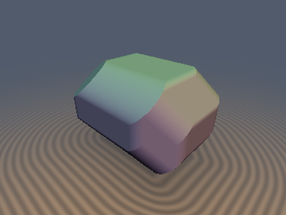
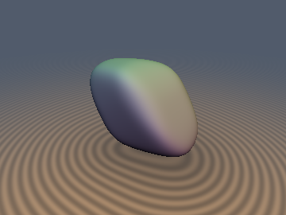
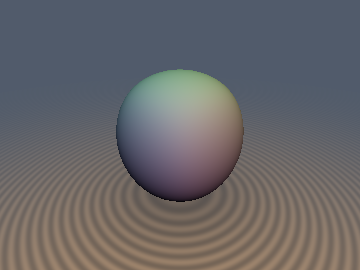
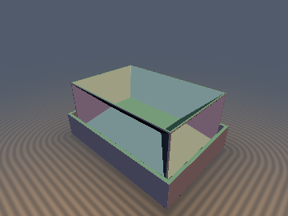
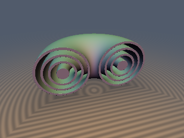
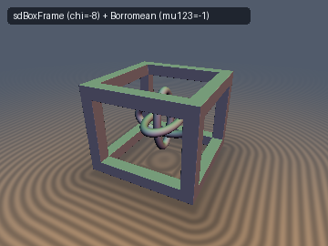
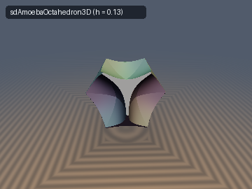
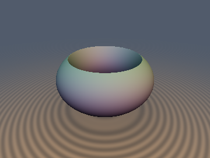
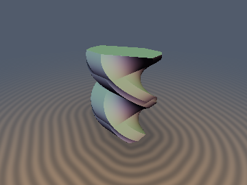

# 11. Convex Duality, Medial Axis, Topology & C-Space

[**← Back to Main `sdf-gems` README**](../../README.md) · **GLSL Headers**: [`glsl/duality/`](../../glsl/duality/) (9 headers)

Dual and global geometric structures attached to SDFs: Legendre–Fenchel support functions, bipolar Firey gauges, spherical-harmonic hedgehogs, closed-form medial-axis radii, Steiner intrinsic volumes, Gauss–Bonnet topological invariants, tropical amoebas, complexified Grauert tubes, and configuration-space obstacles.

## Contents

- **Support Duality, Polar Gauges & Envelopes** (3)
- **Medial Axis, Intrinsic Measure, Topology, Amoebas & Configuration Space** (6)

## Support Duality, Polar Gauges & Envelopes

| Preview | Function | Summary |
| :---: | :--- | :--- |
|  | [**`suSupport`**](suSupport.md) [`glsl`](../../glsl/duality/suSupport.glsl) · Bound (box ⊕ box interior **Exact**) | **Also**: `sdMinkowskiBoxBox`, `sdgMinkowskiBoxCylinder`, `sdMinkowskiEllipsoidBox`, `sdgHullSphereBox`, `suRayStep`. Support-point library for 15 convex primitives (Minkowski sum, hull, offset) with a 3-point GJK that returns a certified bracket; every iterate is a conservative sphere-tracing step, and warm starts cut cost to about 3.7 support evaluations per pixel. Generic interior is approximate |
|  | [**`bpEulerGauge`**](bpEulerGauge.md) [`glsl`](../../glsl/duality/bpEulerGauge.glsl) · Certified Bound / **Exact** ($`k=8`$) | **Also**: `bpPolarMinkowski`, `bpFireyIntersect`, `sdBpEllipsoid`, `sdBpFireyCubeOctahedron`, `sdBpPolarDualBoxes`, `sdgBp*`. Bipolar Euler-Legendre supporting-plane theorem ($`h_K(\nabla\gamma_K(\mathbf{z})) \equiv 1`$) and Weingarten-secant cascade for polar duals of Minkowski sums and Firey $`L_p`$ intersections |
|  | [**`evSupportEnvelope`**](evSupportEnvelope.md) [`glsl`](../../glsl/duality/evSupportEnvelope.glsl) · **Exact** (convex & deltoid) | **Also**: `sdSupportRotor2D`, `sdgSupportRotor2D`, `sdHedgehogHypocycloid2D`, `sdgHedgehogHypocycloid2D`, `evSupportCurvatureRadii`, `sdSupportHarmonic3D`, `sdgSupportHarmonic3D`. Basis-free Cayley-Hamilton Riemannian Newton support-function solver on $`S^2`$ (0 trig), constant-width rotors, and Steiner's 3-cusped deltoid hedgehog via a depressed cubic in $`\sin^2\theta`$ |

## Medial Axis, Intrinsic Measure, Topology, Amoebas & Configuration Space

| Preview | Function | Summary |
| :---: | :--- | :--- |
|  | [**`mdMedialRadius`**](mdMedialRadius.md) [`glsl`](../../glsl/duality/mdMedialRadius.glsl) · **Exact** (ellipsoids less firmly) | **Also**: `mdBox`, `mdCylinder`, `mdTorus`, `mdCone`, `mdSpheroid`, `mdOffsetIsExact`, `mdThickness`. `vec2(d, rho)`: closed-form medial radius (inscribed-ball radius at the foot point) beside the SDF, giving local thickness $`2\rho`$ and a pointwise exactness test for inward offsets; not an opening operator, and $`\rho + d`$ is only an upper bound on distance to the medial axis |
|  | [**`msSteinerTube`**](msSteinerTube.md) [`glsl`](../../glsl/duality/msSteinerTube.glsl) · Closed form (valid inside the reach) | **Also**: `msSphere` … `msSpheroid`, `msOffset`, `msOnion`, `msTubeVolume`, `msGlowExp`, `msMeanProjectedArea`. Intrinsic volumes $`(V, A, M, \chi)`$ of 13 primitives, Steiner/Weyl tube polynomial, and closed-form integrals of $`g(d)`$ over space; Monte Carlo verified to about 1e-4, not a bound outside the reach |
|  | [**`tpGaussBonnet`**](tpGaussBonnet.md) [`glsl`](../../glsl/duality/tpGaussBonnet.glsl) · **Exact** quantized integers (Kuhn-tet & linking) / MC coarea | **Also**: `tpSphericalGaussTri`, `tpTetGaussDegree`, `tpTetEulerContribution`, `tpKuhnVoxelEuler`, `tpMilnorTripleLink`, `tpMilnorBorromean`, `tpGaussCurvatureImplicit`, `tpLinkingSegSeg`. Integer invariants from SDFs and curves: distributional Kuhn-tetrahedra Gauss-map degree recovering exact $`\chi`$ on sharp non-convex shapes (`sdBoxFrame` $`-8.000000`$, level-2 Menger $`-160.000003`$, fixing coarea Gauss–Bonnet's crease failure), polygonal Gauss linking, and $`O(N^2)`$ `0`-SFU Milnor triple-linking $`\bar{\mu}_{123}`$ on Borromean rings |
|  | [**`trAmoeba`**](trAmoeba.md) [`glsl`](../../glsl/duality/trAmoeba.glsl) · **Exact** (spines) / 1-Lipschitz (amoebas) | **Also**: `sdTropicalLine2D`, `sdTropicalPlane3D`, `sdTropicalEllipticCurve2D`, `sdTropicalQuartic3D`, `sdAmoebaLine2D`, `sdAmoebaPlane3D`, `sdAmoebaOctahedron3D`. Exact tropical hypersurface spines via De Morgan convex-vacuum duality and phase-free Maslov-dequantized algebraic amoebas |
|  | [**`cxGrauertTube`**](cxGrauertTube.md) [`glsl`](../../glsl/duality/cxGrauertTube.glsl) · **Exact** (rings/disks) / 1-Lipschitz | **Also**: `cxSqrt`, `sdComplexSphereSlice3D`, `sdgComplexSphereSlice3D`, `sdComplexQuadricIntersection3D`, `sdComplexNullRing3D`, `sdRiemannSqrtSurface3D`. Analytic continuation of SDFs to $`\mathbb{C}^3`$, bifocal Eikonal partition $`\Vert\nabla a\Vert^2 + \Vert\nabla c\Vert^2 \equiv 1`$ (`0` oversteps vs `66.3%` for raw $`\mathrm{Re}\sqrt{\mathbf{z}\cdot\mathbf{z}}`$), and Riemann surface branch sheets |
|  | [**`sdCSpaceRect`**](sdCSpaceRect.md) [`glsl`](../../glsl/duality/sdCSpaceRect.glsl) · **Exact** slice / Bound in 3D | **Also**: `sdgCSpaceRectRectPose`, `sdCSpaceRectRect`, `stepCSpaceRectRectCA`. Piano-mover configuration-space obstacle (rotating rectangle vs rectangle) in $`(x, y, \rho\theta)`$: exact slice SDF with pose gradient, conservative 3D bound with the tight Lipschitz constant, and continuous collision detection by sphere tracing (0 tunnelling measured) |
