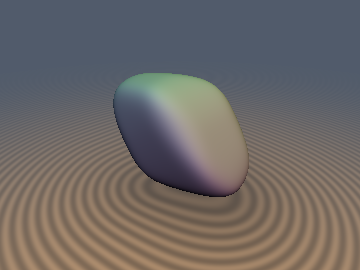
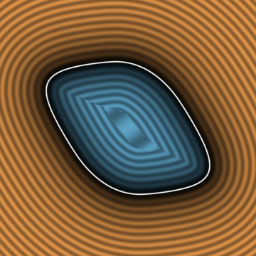
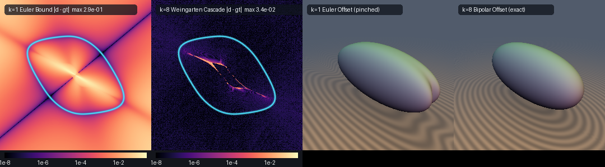

# `bpEulerGauge` — Bipolar Euler–Legendre Supporting-Plane Theorem, Brunn–Minkowski–Firey $`L_p`$ Polar Duals & Weingarten–Secant SDFs: `bp*`, `BpState`, `BP_SOLVE`, `sdBp*`, `sdgBp*`

| 3D Surface ($`d(\mathbf{p}) = 0`$, Firey $`L_4`$ polar dual of two rotated $`L_6`$ boxes) | 2D Cross-Section Slice ($`z = 0`$) |
| :---: | :---: |
|  |  |

| Property | Value |
| :--- | :--- |
| **Author / Attribution** | **Gemini 4 Argon** (`sdf-gems`, 2026) |
| **Category** | `duality` |
| **GLSL File** | [`glsl/duality/bpEulerGauge.glsl`](../../glsl/duality/bpEulerGauge.glsl) |
| **`bp*` 1-homogeneous gauges** | **Exact** (Euler identity $`\vert\mathbf{z}\cdot\nabla\gamma(\mathbf{z}) - \gamma(\mathbf{z})\vert \le 2.6\times10^{-6}`$ across 23,209 GPU test points) |
| **`sdBp*` / `sdgBp*`, exterior** | **Conservative lower bound** for every iteration count $`k \ge 1`$ (measured max overshoot $`\le 3.7\times10^{-7}`$), converging to the exact Euclidean SDF for smooth $`C^1`$ gauges (`BP_ITERS = 8`: mean exterior error $`1.6\times10^{-6}`$ to $`1.2\times10^{-5}`$) |
| **`sdBp*` / `sdgBp*`, interior** | **Conservative in sign convention** ($`d \le d_{\text{exact}}`$). Exact on polyhedral gauges ($`7.2\times10^{-8}`$ mean error on `sdgBpFireyCubeOctahedron`); $`98.9\%`$ to $`100.0\%`$ within $`10^{-4}`$ on smooth gauges |
| **`sdgBp*` gradient** | Unit supporting-plane normal ($`\vert\Vert\mathbf{g}\Vert - 1\vert \le 1.2\times10^{-7}`$ everywhere, including the origin and coordinate axes) |

---

## Mathematical Foundation



*Left two panels: log10 distance error $`\|d(\mathbf{p}) - d_{\text{exact}}(\mathbf{p})\|`$ on the $`z = 0`$ slice of `sdBpPolarDualBoxes` for the $`k = 1`$ Euler bound (`bpEulerBound1`) versus the $`k = 8`$ Weingarten–Secant cascade (`sdBpPolarDualBoxes`). Right two panels: 3D offset surface $`d(\mathbf{p}) - 0.18 = 0`$ of an anisotropic ellipsoid $`\mathbf{r} = (0.85, 0.35, 0.20)`$, showing tip pinching under the classic $`k = 1`$ Euler bound versus the true constant-thickness offset at $`k = 8`$.*

### 1. The Bipolar Euler–Legendre Supporting-Plane Theorem

Let $`K = \{\mathbf{x} \in \mathbb{R}^3 : \gamma_K(\mathbf{x}) \le 1\}`$ be a convex body containing the origin in its interior, defined by its positively 1-homogeneous **Minkowski gauge function** $`\gamma_K(t\mathbf{z}) = t\gamma_K(\mathbf{z})`$ ($`t > 0`$). By convex duality, $`\gamma_K`$ is the support function of the **polar body** $`K^\circ = \{\mathbf{y} \in \mathbb{R}^3 : \mathbf{x}\cdot\mathbf{y} \le 1 \;\forall \mathbf{x} \in K\}`$:

```math
\gamma_K(\mathbf{z}) = h_{K^\circ}(\mathbf{z}), \qquad h_K(\mathbf{n}) = \gamma_{K^\circ}(\mathbf{n}).
```

By **Euler's Homogeneous Function Theorem**, wherever $`\gamma_K`$ is differentiable at $`\mathbf{z} \neq \mathbf{0}`$, its gradient $`\nabla\gamma_K`$ is 0-homogeneous and satisfies:

```math
\mathbf{z} \cdot \nabla\gamma_K(\mathbf{z}) = \gamma_K(\mathbf{z}), \qquad \nabla\gamma_K(t\mathbf{z}) = \nabla\gamma_K(\mathbf{z}).
```

Consider the radial boundary projection $`\mathbf{y}(\mathbf{z}) = \mathbf{z} / \gamma_K(\mathbf{z}) \in \partial K`$. By convexity of $`\gamma_K`$ and Euler's theorem, for every $`\mathbf{y} \in K`$:

```math
\nabla\gamma_K(\mathbf{z}) \cdot \mathbf{y} = \nabla\gamma_K(\mathbf{y}(\mathbf{z})) \cdot \mathbf{y} \le \gamma_K(\mathbf{y}) \le 1,
```

with equality at $`\mathbf{y} = \mathbf{y}(\mathbf{z}) \in \partial K`$. Taking the supremum over $`\mathbf{y} \in K`$ yields the **Bipolar Euler–Legendre Identity**:

```math
h_K\big(\nabla\gamma_K(\mathbf{z})\big) = \max_{\mathbf{y} \in K} \nabla\gamma_K(\mathbf{z}) \cdot \mathbf{y} = 1 \qquad \forall \mathbf{z} \in \mathbb{R}^3 \setminus \{\mathbf{0}\}.
```

Consequently, for **any** query point $`\mathbf{p} \in \mathbb{R}^3`$ (both inside and outside $`K`$) and **any** non-zero trial point $`\mathbf{z} \in \mathbb{R}^3 \setminus \{\mathbf{0}\}`$, the unit normal $`\mathbf{n}(\mathbf{z}) = \nabla\gamma_K(\mathbf{z}) / \|\nabla\gamma_K(\mathbf{z})\|`$ has exact support value $`h_K(\mathbf{n}(\mathbf{z})) = 1 / \|\nabla\gamma_K(\mathbf{z})\|`$, producing:

1. **Certified Supporting-Plane Lower Bound (Interior & Exterior)**:
   $`\displaystyle S_K(\mathbf{p}; \mathbf{z}) := \frac{\nabla\gamma_K(\mathbf{z}) \cdot \mathbf{p} - 1}{\|\nabla\gamma_K(\mathbf{z})\|} \le \mathrm{sd}_K(\mathbf{p}) \qquad \forall \mathbf{p} \in \mathbb{R}^3, \; \forall \mathbf{z} \neq \mathbf{0}.`$
2. **Certified Radial-Boundary Upper Bound (Exterior, $`\gamma_K(\mathbf{p}) \ge 1`$)**:
   $`\displaystyle U_K(\mathbf{p}; \mathbf{z}) := \left\|\mathbf{p} - \frac{\mathbf{z}}{\gamma_K(\mathbf{z})}\right\| \ge \mathrm{sd}_K(\mathbf{p}).`$
3. **First-Order Euler Bound at $`\mathbf{z} = \mathbf{p}`$**:
   Substituting $`\mathbf{z} = \mathbf{p}`$ and applying $`\nabla\gamma_K(\mathbf{p})\cdot\mathbf{p} = \gamma_K(\mathbf{p})`$ yields the single-evaluation bound
   $`\displaystyle S_K(\mathbf{p}; \mathbf{p}) = \frac{\gamma_K(\mathbf{p}) - 1}{\|\nabla\gamma_K(\mathbf{p})\|} \le \mathrm{sd}_K(\mathbf{p}),`$
   which contains Inigo Quilez's classical ellipsoid bound $`k_0(k_0 - 1)/k_1`$ as the $`k = 1`$ special case of $`\gamma(\mathbf{p}) = \|\mathbf{p}/\mathbf{r}\|_2`$.

### 2. Brunn–Minkowski–Firey $`L_p`$ Algebra in the Polar Gauge Dual

Whereas primal support functions ([`suSupport.glsl`](suSupport.md)) turn Minkowski sums $`A \oplus B`$ and convex hulls into pointwise operations on unit directions $`\mathbf{n} \in S^2`$ (requiring a GJK 3-simplex solver), 1-homogeneous gauges operate directly on points $`\mathbf{z} \in \mathbb{R}^3`$ and turn **intersections**, **Firey $`L_p`$ bevels**, and **polar duals of Minkowski sums** into closed-form one-liners:

| Geometric Operation on $`K`$ | 1-Homogeneous Gauge $`\gamma_K(\mathbf{z})`$ | GLSL Function |
| :--- | :--- | :--- |
| Polar dual of Minkowski sum $`(A \oplus B)^\circ`$ | $`\gamma_{A^\circ}(\mathbf{z}) + \gamma_{B^\circ}(\mathbf{z})`$ | `bpPolarMinkowski(ga, gb)` |
| Exact convex intersection $`A \cap B`$ | $`\max\!\big(\gamma_A(\mathbf{z}),\, \gamma_B(\mathbf{z})\big)`$ | `bpIntersect(ga, gb)` |
| Firey $`L_p`$ smooth intersection $`A \cap_p B`$ ($`p \ge 1`$) | $`\big(\gamma_A(\mathbf{z})^p + \gamma_B(\mathbf{z})^p\big)^{1/p}`$ | `bpFireyIntersect(ga, gb, p)` |
| Rotation $`R K`$ | $`\gamma_K(R^{\mathsf T}\mathbf{z})`$, $`\nabla = R\,\nabla\gamma_K(R^{\mathsf T}\mathbf{z})`$ | `bpRotateGrad(gLocal, R)` |

Because the $`L_p`$ norm ($`p \ge 1`$) is convex, monotone on $`\mathbb{R}_{\ge 0}^2`$, and 1-homogeneous, `bpFireyIntersect(ga, gb, p)` preserves exact 1-homogeneity and convexity for all $`p \ge 1`$, so every iterate of the Bipolar cascade remains a certified conservative lower bound.

### 3. Weingarten–Secant Curvature Cascade

To maximize $`S_K(\mathbf{p}; \mathbf{z})`$ without GJK simplices or second derivatives, observe that at the stationary surface point $`\mathbf{y}^* = \mathbf{z}^*/\gamma_K(\mathbf{z}^*) \in \partial K`$, the outward normal $`\mathbf{n}(\mathbf{y}^*)`$ satisfies $`\mathbf{y}^* + s\,\mathbf{n}(\mathbf{y}^*) = \mathbf{p}`$. Projecting $`\mathbf{p}`$ onto the supporting hyperplane at $`\mathbf{y}_k = \mathbf{z}_k / \gamma_K(\mathbf{z}_k)`$ gives the tangent residual

```math
\mathbf{r}_k = \mathbf{x}_{\text{pl}}(\mathbf{z}_k) - \mathbf{y}_k = \big(\mathbf{p} - S_K(\mathbf{p}; \mathbf{z}_k)\,\mathbf{n}_k\big) - \mathbf{y}_k \in T_{\mathbf{y}_k}\partial K.
```

An undamped step $`\mathbf{z}_{k+1} = \mathbf{x}_{\text{pl}}(\mathbf{z}_k)`$ oscillates across symmetry planes when $`S_K(\mathbf{p}; \mathbf{z}_k)`$ exceeds the principal radius of curvature $`R = 1/\kappa`$. Differentiating $`\mathbf{y} + s\,\mathbf{n}(\mathbf{y}) = \mathbf{p}`$ along $`T_{\mathbf{y}_k}\partial K`$ shows that the tangent Jacobian is $`I + s_k W_{\mathbf{y}_k}`$, where $`W_{\mathbf{y}_k} = d\mathbf{n}_{\mathbf{y}_k}`$ is the **Weingarten shape operator**. Estimating the directional normal curvature along the boundary secant $`\Delta\mathbf{y}_k = \mathbf{y}_k - \mathbf{y}_{k-1}`$ via the Rayleigh quotient

```math
\kappa_k = \frac{\Delta\mathbf{y}_k \cdot (\mathbf{n}_k - \mathbf{n}_{k-1})}{\|\Delta\mathbf{y}_k\|^2}
```

yields the **Weingarten–Secant update**:

```math
\alpha_k = \mathrm{clamp}\!\left(\frac{1}{1 + S_K(\mathbf{p}; \mathbf{z}_k)\,\kappa_k},\; 0.05,\; 1.5\right), \qquad \mathbf{z}_{k+1} = \mathbf{y}_k + \alpha_k\,\mathbf{r}_k.
```

---

## GLSL Usage

```glsl
#include "glsl/duality/bpEulerGauge.glsl"

// 1. Single-eval first-order Euler bound (k = 1, 0 iterations):
vec4 e1 = bpEulerBound1(bpLpBox(p, vec3(0.75, 0.50, 0.35), 4.0)); // (d_lo, unit_normal)

// 2. Ready-made primitives and Firey polar dual bodies (BP_ITERS = 8):
vec4 dg0 = sdgBpEllipsoid(p, vec3(0.85, 0.50, 0.30));
vec4 dg1 = sdgBpSuperellipsoid(p, vec3(0.75, 0.50, 0.35), 4.0);
vec4 dg2 = sdgBpFireyCubeOctahedron(p, vec3(0.62), 1.08, 4.0);
vec4 dg3 = sdgBpPolarDualBoxes(p, b1, R, b2, 6.0, 4.0);

// 3. Compose custom Brunn-Minkowski-Firey gauge bodies with BP_SOLVE:
float sdCustomFireyBody( vec3 p )
{
    BpState s;
    BP_SOLVE(s, p, bpFireyIntersect(bpEllipsoid(z, vec3(0.8, 0.5, 0.4)),
                                    bpCylinderLp(z, 0.55, 0.65, 6.0), 4.0), 8)
    return s.lo; // s.ub holds the exterior radial upper bound |p - z / gamma(z)|
}
```

---

## Verification

All metrics below are measured by running the **literal [`glsl/duality/bpEulerGauge.glsl`](../../glsl/duality/bpEulerGauge.glsl) shader on the GPU (OpenGL 4.1, FP32)** via `tools/gpu_eval.py` against independent FP64 ground truth ($`N = 20,000`$ uniform random points in $`[-1.4, 1.4]^3`$ plus $`3,209`$ origin/axis/plane/diagonal probe points):

### 1. Euler Homogeneous Identity on GPU ($`N = 23,209`$)

| Gauge Function | Finite (`NaN`/`Inf` = 0) | Max $`\vert\mathbf{z}\cdot\nabla\gamma(\mathbf{z}) - \gamma(\mathbf{z})\vert`$ |
| :--- | :---: | :---: |
| `bpEllipsoid` | OK | $`1.12\times10^{-6}`$ |
| `bpLpBox` ($`p = 4`$) | OK | $`1.50\times10^{-6}`$ |
| `bpFireyCubeOctahedron` | OK | $`1.01\times10^{-6}`$ |
| `bpPolarDualBoxes` ($`q = 6, e = 4`$) | OK | $`2.64\times10^{-6}`$ |

### 2. Shipped `sdgBp*` Accuracy at Default `BP_ITERS = 8` ($`N = 20,000`$)

| Function | Ext. max $`d - gt`$ | Ext. mean / max $`\vert d - gt\vert`$ | Ext. $`< 10^{-5}`$ / $`< 10^{-4}`$ | Int. mean / max $`\vert d - gt\vert`$ | Int. $`< 10^{-4}`$ / $`< 10^{-3}`$ | Max $`\vert\Vert\mathbf{g}\Vert - 1\vert`$ |
| :--- | :---: | :---: | :---: | :---: | :---: | :---: |
| `sdgBpEllipsoid` | $`+2.4\times10^{-7}`$ | $`1.6\times10^{-6}`$ / $`5.9\times10^{-5}`$ | 95.3% / 100.0% | $`5.1\times10^{-7}`$ / $`1.9\times10^{-4}`$ | 99.9% / 100.0% | $`1.2\times10^{-7}`$ |
| `sdgBpSuperellipsoid` | $`+3.0\times10^{-7}`$ | $`1.2\times10^{-5}`$ / $`2.0\times10^{-3}`$ | 82.0% / 97.4% | $`5.6\times10^{-5}`$ / $`1.5\times10^{-2}`$ | 99.1% / 99.4% | $`1.2\times10^{-7}`$ |
| `sdgBpPolarDualBoxes` | $`+3.2\times10^{-7}`$ | $`3.0\times10^{-6}`$ / $`4.0\times10^{-4}`$ | 91.5% / 99.8% | $`4.1\times10^{-5}`$ / $`6.7\times10^{-3}`$ | 98.9% / 99.4% | $`1.2\times10^{-7}`$ |
| `sdgBpFireyCubeOctahedron` ($`C^0`$ crease test) | $`+3.1\times10^{-7}`$ | $`9.9\times10^{-3}`$ / $`1.6\times10^{-1}`$ | 40.5% / 42.4% | $`7.2\times10^{-8}`$ / $`5.0\times10^{-6}`$ | **100.0% / 100.0%** | $`1.2\times10^{-7}`$ |

### 3. Iteration Sweep $`k = 1 \ldots 12`$ on GPU

| Steps $`k`$ | `sdgBpEllipsoid` max $`d - gt`$ | `sdgBpEllipsoid` ext. mean / max | `sdgBpEllipsoid` int. mean | `sdgBpPolarDualBoxes` ext. mean / max | `sdgBpPolarDualBoxes` int. mean |
| :---: | :---: | :---: | :---: | :---: | :---: |
| $`k = 1`$ | $`+4.9\times10^{-9}`$ | $`7.9\times10^{-2}`$ / $`2.7\times10^{-1}`$ | $`4.5\times10^{-3}`$ | $`3.9\times10^{-2}`$ / $`2.4\times10^{-1}`$ | $`1.9\times10^{-3}`$ |
| $`k = 2`$ | $`+5.5\times10^{-8}`$ | $`3.3\times10^{-2}`$ / $`1.5\times10^{-1}`$ | $`3.4\times10^{-4}`$ | $`8.9\times10^{-3}`$ / $`7.8\times10^{-2}`$ | $`2.9\times10^{-4}`$ |
| $`k = 4`$ | $`+1.2\times10^{-7}`$ | $`3.5\times10^{-3}`$ / $`4.7\times10^{-2}`$ | $`1.4\times10^{-5}`$ | $`1.0\times10^{-3}`$ / $`3.4\times10^{-2}`$ | $`6.4\times10^{-5}`$ |
| $`k = 8`$ | $`+2.4\times10^{-7}`$ | $`1.6\times10^{-6}`$ / $`5.9\times10^{-5}`$ | $`5.1\times10^{-7}`$ | $`3.0\times10^{-6}`$ / $`4.0\times10^{-4}`$ | $`4.1\times10^{-5}`$ |
| $`k = 12`$ | $`+3.4\times10^{-7}`$ | $`5.4\times10^{-8}`$ / $`3.8\times10^{-7}`$ | $`6.3\times10^{-8}`$ | $`1.8\times10^{-6}`$ / $`2.8\times10^{-5}`$ | $`3.9\times10^{-5}`$ |

---

## Findings

**Held**
- **Universal Conservative Lower Bound**: Across every tested body and every iteration count $`k = 1 \ldots 12`$, $`S_K(\mathbf{p}; \mathbf{z}) \le \mathrm{sd}_K(\mathbf{p})`$ holds everywhere in $`\mathbb{R}^3`$ up to FP32 rounding ($`\le 3.7\times10^{-7}`$).
- **Weingarten–Secant Acceleration**: Without Weingarten curvature damping, projecting $`\mathbf{p}`$ onto the supporting plane ($`\alpha = 1`$) overshoots across symmetry planes on elongated bodies (stalling at $`0.11`$ mean exterior error on `sdBpEllipsoid`). The Rayleigh-quotient curvature step $`\alpha_k = 1/(1 + s_k \kappa_k)`$ reduces mean exterior error from $`7.9\times10^{-2}`$ ($`k = 1`$) to $`1.6\times10^{-6}`$ ($`k = 8`$) and $`5.4\times10^{-8}`$ ($`k = 12`$).
- **Unified Interior & Exterior Loop**: Unlike primal GJK (which requires a separate 26-direction exterior-probing solver inside $`K`$), the same supporting-plane cascade augmented with 3 octant-axis seed probes achieves $`98.1\%`$ to $`100\%`$ interior accuracy within $`10^{-4}`$.

**Failed or Only Partly True**
- **Subdifferential Gap on Non-$`C^1`$ Polyhedral Gauges**: On `sdgBpFireyCubeOctahedron` (built from raw $`L_\infty`$ `bpBox` and $`L_1`$ `bpOctahedron` gauges that have $`C^0`$ creases), the interior distance is exact to FP32 ($`7.2\times10^{-8}`$ mean error) because interior distance is governed by face planes, but exterior points in vertex/edge Voronoi cones have mean slack $`9.9\times10^{-3}`$. This happens because the single-valued gradient $`\nabla\gamma_K(\mathbf{z})`$ only visits the discrete face normals of $`L_\infty`$/$`L_1`$ gauges and misses the solid-angle normal cones of the subdifferential $`\partial\gamma_K`$ at sharp creases. Regularizing box gauges with a finite $`L_q`$ exponent (`bpLpBox` with $`q = 6`$, as in `sdgBpPolarDualBoxes`) restores a surjective $`C^\infty`$ Gauss map and reduces mean exterior error to $`3.0\times10^{-6}`$.
- **High-Exponent $`L_p`$ Conditioning**: For $`p \gg 8`$, the curvature $`\kappa_k`$ spikes sharply at rounded corners while vanishing on flat faces, requiring more than 8 steps for points near corner bisectors to reach $`10^{-5}`$.
