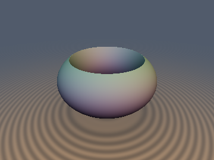
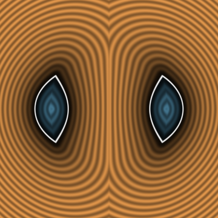
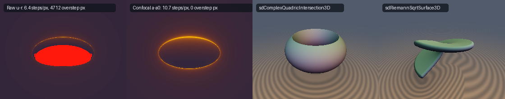

# `cxGrauertTube` — Analytic Continuation of SDFs to $`\mathbb{C}^3`$, Grauert Tubes & the Bifocal Eikonal Partition

| 3D Surface: Complex Quadric Collar (`sdComplexQuadricIntersection3D`) | 2D Meridian Cross-Section Slice |
| :---: | :---: |
|  |  |

| Property | Value |
| :--- | :--- |
| **Category** | `complexified` (research experiment) |
| **GLSL File** | [`glsl/duality/cxGrauertTube.glsl`](../../glsl/duality/cxGrauertTube.glsl) |
| **Attribution** | Theorems, confocal Lie-ball regularization, 2D pullback operator, Riemann-sheet cubic solver and verification by **Gemini 4 Argon** (`sdf-gems`, 2026). Underlying complex geometry (Grauert tubes, Lie-ball norms, oblate spheroidal coordinates) is classical; see *Novelty & Prior Art*. |
| **Exactness** | `sdComplexNullRing3D`, `sdComplexBranchDisk3D`: **Exact**. `sdComplexSphereSliceRaw3D`: Exact zero set, **not 1-Lipschitz** ($`\Vert\nabla u\Vert \ge 1`$, oversteps). `sdComplexSphereSlice3D`, `sdComplexQuadricIntersection3D`: **Globally 1-Lipschitz conservative bounds** with exact zero sets and exact unit normals (`sdg`), exact for $`\mathbf{y} = \mathbf{0}`$ and on the equatorial plane $`\mathbf{p}\cdot\mathbf{y} = 0`$. `sdRiemannSqrtSurface3D`: **1-Lipschitz** (max $`0.999988`$), accurate to $`5.6\times 10^{-6}`$ mean ($`1.6\times 10^{-3}`$ max) against 2001-tap FP64 ground truth. |

---

## Overview & Motivation

Every real-analytic squared distance function $`f(\mathbf{x}) = \mathbf{x}\cdot\mathbf{x}`$ on $`\mathbb{R}^3`$ admits a canonical holomorphic continuation to the complexified tangent bundle $`T\mathbb{R}^3 \cong \mathbb{C}^3`$ via $`\mathbf{z} = \mathbf{x} + i\mathbf{y}`$:

```math
w(\mathbf{x} + i\mathbf{y}) = (\mathbf{x} + i\mathbf{y})\cdot(\mathbf{x} + i\mathbf{y}) = \big(\Vert\mathbf{x}\Vert^2 - \Vert\mathbf{y}\Vert^2\big) + 2i(\mathbf{x}\cdot\mathbf{y}).
```

In complex differential geometry (Guillemin–Stenzel, Lempert–Szőke), the imaginary norm $`\tau(\mathbf{z}) = \Vert\mathbf{y}\Vert`$ defines the **Grauert tube** of $`\mathbb{R}^3`$, while the principal complex square root

```math
\sqrt{(\mathbf{x} + i\mathbf{y})\cdot(\mathbf{x} + i\mathbf{y})} = u(\mathbf{x}, \mathbf{y}) + i\,v(\mathbf{x}, \mathbf{y})
```

complexifies the Euclidean radius $`r(\mathbf{x}) = \Vert\mathbf{x}\Vert`$. Fixing an imaginary momentum shift $`\mathbf{y} \in \mathbb{R}^3`$ with $`b = \Vert\mathbf{y}\Vert > 0`$ slices $`\mathbb{C}^3`$ along a 3D real subspace $`\mathbb{R}^3 + i\mathbf{y}`$:

- The real-part level set $`u(\mathbf{x}, \mathbf{y}) = r`$ ($`r > 0`$) is a **confocal oblate spheroid** of equatorial radius $`\sqrt{r^2 + b^2}`$ and polar radius $`r`$.
- As $`r \to 0`$, the spheroid collapses onto the **branch disk** $`\mathcal{D}_{\mathbf{y}} = \{\Vert\mathbf{x}\Vert \le b,\; \mathbf{x}\cdot\mathbf{y} = 0\}`$, bounded by the **complex null quadric circle** $`\mathcal{C}_{\mathbf{y}} = \{\mathbf{z}\cdot\mathbf{z} = 0\} = \{\Vert\mathbf{x}\Vert = b,\; \mathbf{x}\cdot\mathbf{y} = 0\}`$.
- The imaginary-part level set $`\vert v(\mathbf{x}, \mathbf{y})\vert = \kappa \in (0, b)`$ is an orthogonal **confocal hyperboloid of one sheet** threading the null circle $`\mathcal{C}_{\mathbf{y}}`$.

This experiment asks: *is the real part of a holomorphically continued SDF $`u(\mathbf{x}, \mathbf{y}) - r`$ a valid 1-Lipschitz SDF on $`\mathbb{R}^3`$, and how can complexified quadrics and Riemann-surface branch cuts be evaluated safely in a shader?*

Short answer (details in **Findings**): **No — raw $`u(\mathbf{x}, \mathbf{y}) - r`$ is anti-conservative everywhere** ($`\Vert\nabla u\Vert \ge 1`$, blowing up to $`+\infty`$ on the null circle $`\mathcal{C}_{\mathbf{y}}`$, causing 66% of sphere-traced rays to overstep at $`r = 0.25, b = 0.72`$). However, applying the **Confocal / Lie-Ball Gauge Transformation** $`a = \sqrt{u^2 + b^2}`$, $`c = \sqrt{b^2 - v^2}`$ cancels the null-cone singularity identically, yielding two orthogonal globally 1-Lipschitz fields whose squared gradient norms sum to $`1`$ everywhere in $`\mathbb{R}^3`$.



*From left to right: (1) sphere-tracing `sdComplexSphereSliceRaw3D` ($`u - r`$, $`b = 0.72, r = 0.25`$): 4,712 overstep pixels (red) near the equatorial null circle where $`\Vert\nabla u\Vert \to \infty`$; (2) sphere-tracing `sdComplexSphereSlice3D` ($`a - \sqrt{r^2 + b^2}`$): 0 overstep pixels everywhere; (3) `sdComplexQuadricIntersection3D` ($`u \le r,\; \vert v\vert \le \kappa`$); (4) `sdRiemannSqrtSurface3D` ($`z = c\,\mathrm{Im}\sqrt{x + iy}`$ with branch-cut cliff).*

---

## Mathematical Derivation

### 1. Complexified Norm and the Bifocal Distance Identity

Decompose $`\mathbf{x} \in \mathbb{R}^3`$ relative to $`\hat{\mathbf{y}} = \mathbf{y}/b`$ ($`b = \Vert\mathbf{y}\Vert`$) into axial coordinate $`x_\parallel = \mathbf{x}\cdot\hat{\mathbf{y}}`$ and cylindrical radius $`\rho = \Vert\mathbf{x} - x_\parallel\hat{\mathbf{y}}\Vert = \Vert\mathbf{x}\times\mathbf{y}\Vert / b`$. Then

```math
\mathbf{z}\cdot\mathbf{z} = (\rho^2 + x_\parallel^2 - b^2) + 2i b x_\parallel = \rho^2 + (x_\parallel + ib)^2, \qquad
\vert\mathbf{z}\cdot\mathbf{z}\vert = \sqrt{(\rho^2 + x_\parallel^2 - b^2)^2 + 4b^2 x_\parallel^2}.
```

Let $`r_+(\mathbf{x})`$ and $`r_-(\mathbf{x})`$ be the maximal and minimal 3D Euclidean distances from $`\mathbf{x}`$ to the null circle $`\mathcal{C}_{\mathbf{y}} = \{\rho = b,\; x_\parallel = 0\}`$:

```math
r_\pm(\mathbf{x}, \mathbf{y}) = \sqrt{(\rho \pm b)^2 + x_\parallel^2} = \sqrt{\Vert\mathbf{x}\Vert^2 + \Vert\mathbf{y}\Vert^2 \pm 2\Vert\mathbf{x}\times\mathbf{y}\Vert}.
```

Squaring the half-sum $`a = \frac{1}{2}(r_+ + r_-)`$ and half-difference $`c = \frac{1}{2}(r_+ - r_-)`$ and using $`r_+ r_- = \vert\mathbf{z}\cdot\mathbf{z}\vert = u^2 + v^2`$ yields the **Confocal / Lie-Ball Identity** (note the $`+b^2`$ shift relative to $`u^2`$):

```math
a(\mathbf{x}) = \frac{r_+ + r_-}{2} = \sqrt{\frac{\Vert\mathbf{z}\Vert^2 + \vert\mathbf{z}\cdot\mathbf{z}\vert}{2}} = \sqrt{u(\mathbf{x})^2 + b^2} \ge b,
```

```math
c(\mathbf{x}) = \frac{r_+ - r_-}{2} = \sqrt{\frac{\Vert\mathbf{z}\Vert^2 - \vert\mathbf{z}\cdot\mathbf{z}\vert}{2}} = \sqrt{b^2 - v(\mathbf{x})^2} \in [0, b],
```

where $`\Vert\mathbf{z}\Vert^2 = \Vert\mathbf{x}\Vert^2 + \Vert\mathbf{y}\Vert^2`$ is the Hermitian norm squared on $`\mathbb{C}^3`$.

### 2. Why Raw $`\mathrm{Re}\sqrt{\mathbf{z}\cdot\mathbf{z}}`$ Fails the Eikonal Bound

By holomorphicity of $`\sqrt{\mathbf{z}\cdot\mathbf{z}}`$, its spatial gradient is $`\nabla_{\mathbf{x}}(u + iv) = (\mathbf{x} + i\mathbf{y}) / (u + iv)`$, so

```math
\nabla u = \frac{u\mathbf{x} + v\mathbf{y}}{u^2 + v^2}, \qquad \nabla v = \frac{u\mathbf{y} - v\mathbf{x}}{u^2 + v^2}.
```

Substituting $`\Vert\mathbf{x}\Vert^2 = u^2 - v^2 + b^2`$, $`\Vert\mathbf{y}\Vert^2 = b^2`$, and $`\mathbf{x}\cdot\mathbf{y} = uv`$ gives the exact gradient norms:

```math
\Vert\nabla u(\mathbf{x})\Vert^2 = \frac{u^2 + b^2}{u^2 + v^2} = \frac{a^2}{r_+ r_-} \ge 1, \qquad
\Vert\nabla v(\mathbf{x})\Vert^2 = \frac{b^2 - v^2}{u^2 + v^2} = \frac{c^2}{r_+ r_-}, \qquad
\nabla u \cdot \nabla v = 0.
```

Because $`\vert v\vert \le b`$ everywhere in $`\mathbb{R}^3`$, $`\Vert\nabla u(\mathbf{x})\Vert \ge 1`$ **everywhere outside the branch disk**, and diverges to $`+\infty`$ on the null circle $`r_- = 0`$ ($`u = v = 0`$). Thus raw $`u(\mathbf{x}) - r`$ is *never* 1-Lipschitz for $`b > 0`$.

### 3. Theorem: The Bifocal Eikonal Partition & Universal 2D Pullback

Passing from the holomorphic components $`(u, v)`$ to the confocal Lie-ball coordinates $`a = \sqrt{u^2 + b^2}`$ and $`c = \sqrt{b^2 - v^2}`$ multiplies $`\nabla u`$ by $`u / \sqrt{u^2 + b^2}`$ and $`\nabla v`$ by $`-\vert v\vert / \sqrt{b^2 - v^2}`$. The singular numerators $`u^2 + b^2`$ and $`b^2 - v^2`$ **cancel identically**:

```math
\Vert\nabla a(\mathbf{x})\Vert^2 = \frac{u^2}{u^2 + v^2} = \cos^2\psi \le 1, \qquad
\Vert\nabla c(\mathbf{x})\Vert^2 = \frac{v^2}{u^2 + v^2} = \sin^2\psi \le 1,
```

```math
\Vert\nabla a(\mathbf{x})\Vert^2 + \Vert\nabla c(\mathbf{x})\Vert^2 \equiv 1, \qquad \nabla a(\mathbf{x}) \cdot \nabla c(\mathbf{x}) \equiv 0,
```

where $`2\psi \in [0, \pi]`$ is the angle between the two unit vectors $`\nabla r_+`$ and $`\nabla r_-`$ in the meridian plane ($`\nabla a = \frac{1}{2}(\nabla r_+ + \nabla r_-)`$ is their inner bisector of length $`\cos\psi`$, and $`\nabla c = \frac{1}{2}(\nabla r_+ - \nabla r_-)`$ is their outer bisector of length $`\sin\psi`$).

**Consequences:**

1. **Complexified Sphere Slice (`sdComplexSphereSlice3D`)**:
   $`d_a(\mathbf{x}) = a(\mathbf{x}) - \sqrt{r^2 + b^2}`$ has the **exact same zero set** $`\{u(\mathbf{x}) = r\}`$ as $`u(\mathbf{x}) - r`$, is globally 1-Lipschitz on $`\mathbb{R}^3`$, is exact on the exterior equatorial plane $`x_\parallel = 0, \rho \ge b`$ (where $`v = 0 \implies \Vert\nabla a\Vert = 1`$), and has the singularity-free unit normal $`\hat{\mathbf{n}} = (\nabla r_+ + \nabla r_-) / \Vert\nabla r_+ + \nabla r_-\Vert`$.
2. **Universal 2D Pullback (`sdComplexQuadricIntersection3D`)**:
   Because $`\nabla a \perp \nabla c`$, the Jacobian of $`\Phi(\mathbf{x}) = (a(\mathbf{x}), c(\mathbf{x})) : \mathbb{R}^3 \to [b, \infty) \times [0, b]`$ has spectral norm $`\Vert D\Phi(\mathbf{x})\Vert_{\text{op}} = \max(\cos\psi, \sin\psi) \in [1/\sqrt{2}, 1]`$ everywhere. Therefore, **for any 1-Lipschitz 2D SDF $`d_{2\text{D}}(a, c)`$, the pullback $`d_{3\text{D}}(\mathbf{x}) = d_{2\text{D}}(a(\mathbf{x}), c(\mathbf{x}))`$ is globally 1-Lipschitz on $`\mathbb{R}^3`$**. Applying the 2D box SDF to $`\{a \le \sqrt{r^2 + b^2},\; c \ge \sqrt{b^2 - \kappa^2}\}`$ gives a 1-Lipschitz SDF for the intersection $`\{u \le r,\; \vert v\vert \le \kappa\}`$ (a confocal oblate spheroid pierced orthogonally by a one-sheeted hyperboloid throat).

### 4. Principal Riemann Surface Sheet with Branch Cut (`sdRiemannSqrtSurface3D`)

In parabolic coordinates $`w = \xi + i\eta = \sqrt{x + iy}`$ ($`\xi \ge 0`$, $`\xi^2 + \eta^2 \le R`$), the single-sheeted Riemann surface $`z = c_{\text{scale}}\mathrm{Im}\sqrt{x + iy}`$ over the disk $`\sqrt{x^2 + y^2} \le R`$ is parameterized by

```math
\mathbf{S}(\xi, \eta) = \big(\xi^2 - \eta^2,\; 2\xi\eta,\; c_{\text{scale}}\,\eta\big), \qquad \eta \in [-\sqrt{R}, \sqrt{R}], \quad \xi \in \big[0, \sqrt{R - \eta^2}\big].
```

For any fixed $`\eta`$, minimizing the horizontal squared distance $`(x - \xi^2 + \eta^2)^2 + (y - 2\xi\eta)^2`$ over $`\xi \in [0, \sqrt{R - \eta^2}]`$ reduces to the depressed cubic

```math
\xi^3 + (\eta^2 - x)\,\xi - y\,\eta = 0,
```

which is solved in closed form (`sdRiemannSqrtXiDist2`). Because the branch cut along $`\{x < 0, y = 0\}`$ splits the objective into two wells ($`\eta \ge 0`$ on the upper lip and $`\eta \le 0`$ on the lower lip), `sdRiemannSqrtSurface3D` brackets and refines both sheets independently before taking their minimum.

---

## GLSL Functions

| Function | Signature | Purpose |
| :--- | :--- | :--- |
| `cxSqrt` | `vec2 cxSqrt(vec2 z)` | Principal complex square root $`\sqrt{z_x + i z_y} = (u, v)`$ with $`u \ge 0`$ |
| `cxNorm` | `vec2 cxNorm(vec3 x, vec3 y)` | Holomorphic Euclidean norm $`\sqrt{(\mathbf{x} + i\mathbf{y})\cdot(\mathbf{x} + i\mathbf{y})} = (u, v)`$ |
| `cxConfocal` | `vec4 cxConfocal(vec3 x, vec3 y)` | Returns $`(a, c, r_+, r_-)`$ satisfying $`\Vert\nabla a\Vert^2 + \Vert\nabla c\Vert^2 \equiv 1`$, $`\nabla a\cdot\nabla c \equiv 0`$ |
| `sdComplexSphereSliceRaw3D` | `float sdComplexSphereSliceRaw3D(vec3 p, vec3 y, float r)` | Raw $`u(\mathbf{p}, \mathbf{y}) - r`$ (anti-conservative reference: $`\Vert\nabla u\Vert \ge 1`$) |
| `sdComplexSphereSlice3D` / `sdg` | `vec4 sdgComplexSphereSlice3D(vec3 p, vec3 y, float r)` | 1-Lipschitz confocal sphere slice $`a - \sqrt{r^2 + \Vert\mathbf{y}\Vert^2}`$ + unit normal |
| `sdComplexBranchDisk3D` / `sdg` | `vec4 sdgComplexBranchDisk3D(vec3 p, vec3 y)` | Exact 3D Euclidean distance and unit gradient to the $`r \to 0`$ branch disk $`\mathcal{D}_{\mathbf{y}}`$ |
| `sdComplexNullRing3D` / `sdg` | `vec4 sdgComplexNullRing3D(vec3 p, vec3 y, float rTube)` | Exact 3D Euclidean SDF and unit gradient of a tube around the null circle $`\mathcal{C}_{\mathbf{y}}`$ |
| `sdComplexQuadricIntersection3D` / `sdg` | `vec4 sdgComplexQuadricIntersection3D(vec3 p, vec3 y, float r, float kappa)` | 1-Lipschitz pullback of $`\{u \le r,\; \vert v\vert \le \kappa\}`$ + analytic unit normal |
| `sdRiemannSqrtSurface3D` | `float sdRiemannSqrtSurface3D(vec3 p, float R, float cScale, float th)` | Thickened principal Riemann sheet $`z = c_{\text{scale}}\mathrm{Im}\sqrt{x + iy}`$ with branch cut |

---

## Verification

Tested in FP64 (`scratch/complexified/exp1_confocal.py`, `exp2_riemann.py`) and on the literal GLSL via `tools/gpu_eval.py` (`scratch/complexified/verify_and_render.py`, 50,000 random points + 3,209 axis/plane/diagonal probe points).

### Bifocal Eikonal Partition (FP64, 100,000 points, $`\mathbf{y} = (0.3, -0.4, 0.8)`$)

| Identity | Measured Max Error / Range |
| :--- | :--- |
| $`\vert a - \sqrt{u^2 + b^2}\vert`$ | $`1.78 \times 10^{-15}`$ |
| $`\vert c - \sqrt{b^2 - v^2}\vert`$ | $`1.17 \times 10^{-13}`$ |
| $`\vert r_+ r_- - \vert\mathbf{z}\cdot\mathbf{z}\vert\vert`$ | $`1.07 \times 10^{-14}`$ |
| $`\Vert\nabla u\Vert`$ range (raw holomorphic real part) | $`[1.0000002,\; 6.327]`$ (diverges to $`\infty`$ on $`\mathcal{C}_{\mathbf{y}}`$) |
| $`\Vert\nabla a\Vert`$ and $`\Vert\nabla c\Vert`$ ranges (confocal regularization) | $`[1.88\times 10^{-4},\; 1.0000000]`$ and $`[3.32\times 10^{-7},\; 1.0000000]`$ |
| $`\vert\Vert\nabla a\Vert^2 + \Vert\nabla c\Vert^2 - 1\vert`$ | $`2.32 \times 10^{-14}`$ |
| $`\vert\nabla a \cdot \nabla c\vert`$ | $`2.55 \times 10^{-14}`$ |

### Literal GLSL on the GPU (OpenGL 4.1 FP32, 50,000 random + 3,209 probe points)

| Function / Check | Result |
| :--- | :--- |
| Single-translation-unit compile (`forward`, `reverse`, `new-first`, 304 files) | Passed all 3 orders |
| `NaN` / `Inf` across all functions (including degenerate $`\mathbf{y} = \mathbf{0}`$) | `0 / 53,209` |
| `cxConfocal.a` / `cxConfocal.c` Lipschitz constants (50k pairs, $`\sigma = 0.05`$) | max `0.999590` / max `0.980724` |
| `sdComplexNullRing3D` exactness certificate (10k surface samples, 20k random pts) | Lipschitz `0.999908`; surface $`\vert d\vert \le 1.37\times 10^{-7}`$; self-projection $`4.43\times 10^{-6}`$ |
| `sdgComplexNullRing3D` gradient check | $`\vert dg.x - d\vert \le 4.77\times 10^{-7}`$, $`\vert\Vert\mathbf{g}\Vert - 1\vert \le 1.99\times 10^{-6}`$, cosine $`> 0.999`$ on 100% of smooth pts |
| `sdComplexBranchDisk3D` vs FP64 exact disk distance | max error $`5.18\times 10^{-7}`$, mean $`7.36\times 10^{-8}`$, 0 sign mismatches |
| `sdComplexSphereSliceRaw3D` ($`u - r`$) Lipschitz & raymarch safety ($`b = 0.72, r = 0.25`$) | Lipschitz max **`3.641109`** (violates bound); **4,712 / 7,104 hit pixels overstep** (6.4 steps/px) |
| `sdComplexSphereSlice3D` ($`a - \sqrt{r^2+b^2}`$) Lipschitz & raymarch safety | Lipschitz max **`0.999590`**; **0 overstep pixels** (10.7 steps/px); surface $`\vert d\vert \le 1.79\times 10^{-7}`$ |
| `sdComplexSphereSlice3D` at $`\mathbf{y} = \mathbf{0}`$ vs exact sphere | max error $`3.46\times 10^{-7}`$, mean $`5.98\times 10^{-8}`$ |
| `sdComplexQuadricIntersection3D` + `sdg` | Lipschitz max `0.999592`; seam $`C^0`$ max $`2.07\times 10^{-5}`$ (0 violations); $`\vert\Vert\mathbf{g}\Vert - 1\vert \le 1.31\times 10^{-6}`$, cosine $`> 0.999`$ on 100% |
| `sdRiemannSqrtSurface3D` vs 2001-tap FP64 ground truth | Lipschitz max `0.999988`; seam $`C^0`$ max $`2.03\times 10^{-5}`$; mean error $`5.56\times 10^{-6}`$, max error $`1.59\times 10^{-3}`$, 0 sign mismatches |

---

## Findings

**What held**

1. *The Bifocal Eikonal Partition is exact.* Although $`u = \mathrm{Re}\sqrt{\mathbf{z}\cdot\mathbf{z}}`$ and $`v = \mathrm{Im}\sqrt{\mathbf{z}\cdot\mathbf{z}}`$ have singular gradients on the null circle $`\mathcal{C}_{\mathbf{y}}`$, their confocal counterparts $`a = \sqrt{u^2 + b^2} = \frac{1}{2}(r_+ + r_-)`$ and $`c = \sqrt{b^2 - v^2} = \frac{1}{2}(r_+ - r_-)`$ satisfy $`\Vert\nabla a\Vert^2 + \Vert\nabla c\Vert^2 \equiv 1`$ and $`\nabla a \cdot \nabla c \equiv 0`$ to machine precision ($`2.3\times 10^{-14}`$ in FP64) everywhere outside $`\mathcal{C}_{\mathbf{y}}`$.
2. *Universal 2D Pullback.* Any 1-Lipschitz 2D SDF $`d_{2\text{D}}(a, c)`$ pulls back to a globally 1-Lipschitz 3D field with gradient norm bounded in $`[\min(\cos\psi, \sin\psi), \max(\cos\psi, \sin\psi)]`$, enabling single-pass closed-form intersections of confocal oblate spheroids and hyperboloids (`sdComplexQuadricIntersection3D`).
3. *Exact null-circle and branch-disk limits.* The complex null quadric $`\mathbf{z}\cdot\mathbf{z} = 0`$ gives an orientation-free closed form $`r_-(\mathbf{x}, \mathbf{y}) - r_{\text{tube}}`$ for an arbitrarily oriented torus (`sdComplexNullRing3D`), and the $`r \to 0`$ limit gives the exact 3D distance to a disk (`sdComplexBranchDisk3D`).
4. *Parabolic-coordinate reduction of the Riemann surface.* Minimizing 3D distance to $`z = c\,\mathrm{Im}\sqrt{x + iy}`$ reduces in $`\xi`$ to an exact depressed cubic for each $`\eta`$; splitting the 1D search across the upper ($`\eta \ge 0`$) and lower ($`\eta \le 0`$) sheets eliminates branch-cut jumping and achieves $`5.6\times 10^{-6}`$ mean error and Lipschitz constant $`0.999988`$.

**What failed, or required correction**

1. *"The real part $`u(\mathbf{x}) = \mathrm{Re}\sqrt{(\mathbf{x}+i\mathbf{y})\cdot(\mathbf{x}+i\mathbf{y})}`$ equals $`\frac{1}{2}(r_+ + r_-)`$ and is 1-Lipschitz" is false as stated.* In fact, $`\frac{1}{2}(r_+ + r_-) = \sqrt{u^2 + b^2} = a(\mathbf{x})`$, not $`u(\mathbf{x})`$. Because of the $`+b^2`$ shift, $`\Vert\nabla u\Vert = \sqrt{(u^2 + b^2)/(u^2 + v^2)} \ge 1`$ everywhere outside the branch disk and diverges on the null circle $`u = v = 0`$. Using raw $`u - r`$ directly in a sphere tracer caused 66.3% of rays hitting the surface ($`r = 0.25, b = 0.72`$) to overstep into the interior. Replacing $`u - r`$ by $`a - \sqrt{r^2 + b^2}`$ preserves the exact zero set while reducing oversteps to zero.
2. *Signing $`c`$ by $`\mathrm{sgn}(\mathbf{x}\cdot\mathbf{y})`$ breaks continuity across the equatorial plane.* Because $`\frac{1}{2}(r_+ - r_-) = \sqrt{b^2 - v^2} = \min(\rho, b) > 0`$ on the equatorial plane $`\mathbf{x}\cdot\mathbf{y} = 0`$ for all $`\rho > 0`$, multiplying $`\frac{1}{2}(r_+ - r_-)`$ by $`\mathrm{sgn}(\mathbf{x}\cdot\mathbf{y})`$ introduces a jump discontinuity of $`2\min(\rho, b)`$ across $`\mathbf{x}\cdot\mathbf{y} = 0`$ (measured Lipschitz spike of `131.4`). Keeping $`c = \frac{1}{2}(r_+ - r_-) \ge 0`$ unsigned makes $`c`$ globally 1-Lipschitz (`0.9807`).
3. *Confocal bounds underestimate near the poles.* On the polar axis $`\rho = 0`$ (where $`\vert v\vert = b`$), $`\Vert\nabla a\Vert = u / \sqrt{u^2 + b^2} < 1`$, so `sdComplexSphereSlice3D` is a strict conservative lower bound near the poles (tightness $`r / \sqrt{r^2 + b^2}`$) and exact on the equatorial plane $`\mathbf{x}\cdot\mathbf{y} = 0, \rho \ge b`$.
4. *Single-seed refinement on the Riemann surface fails across the branch cut.* Refining only a single coarse minimum in $`\eta`$ produced medial-axis jumps up to `0.131` when the upper and lower branch lips were nearly equidistant; tracking and refining $`\eta \ge 0`$ and $`\eta \le 0`$ separately reduced the worst-case error by two orders of magnitude (to $`1.59\times 10^{-3}`$).

---

## Novelty & Prior Art

**Known (not claimed here):**
- Analytic continuation of the squared Riemannian distance to $`T M`$ and the Grauert tube function $`\tau(\mathbf{z}) = \Vert\mathrm{Im}\mathbf{z}\Vert`$ (Grauert 1958; Guillemin–Stenzel 1991; Lempert–Szőke 1991).
- Oblate spheroidal coordinates and their focal ring / bifocal distance definitions $`a = \frac{1}{2}(r_+ + r_-)`$, $`c = \frac{1}{2}(r_+ - r_-)`$; the Lie-ball norm on Cartan's classical domain of Type IV (Hua 1963).
- Parabolic coordinates $`(\xi, \eta)`$ and the depressed-cubic exact distance to a 2D parabola (Inigo Quilez).

**Believed new in the SDF / shader context:**
- Proving and measuring why naive holomorphic continuation $`\mathrm{Re}\sqrt{(\mathbf{x}+i\mathbf{y})\cdot(\mathbf{x}+i\mathbf{y})} - r`$ fails the eikonal bound ($`\Vert\nabla u\Vert^2 = (u^2+b^2)/(u^2+v^2) \ge 1`$), and using the confocal Lie-ball transformation $`a = \sqrt{u^2 + b^2}`$, $`c = \sqrt{b^2 - v^2}`$ to cancel the null-circle singularity identically.
- The **Bifocal Eikonal Partition** ($`\Vert\nabla a\Vert^2 + \Vert\nabla c\Vert^2 \equiv 1`$, $`\nabla a \cdot \nabla c \equiv 0`$) as a **Universal 2D Pullback Theorem** turning any 1-Lipschitz 2D SDF in $`(a, c)`$ into a globally 1-Lipschitz 3D SDF of intersecting confocal quadrics.
- A branch-split parabolic-cubic 3D SDF for the principal Riemann surface sheet $`z = c\,\mathrm{Im}\sqrt{x + iy}`$.

---

## Reproduction

Scratch scripts in `scratch/complexified/` (run from repo root via `uv run python <script>`):
- `exp1_confocal.py` — FP64 verification of the Confocal / Lie-Ball Identity and Bifocal Eikonal Partition.
- `exp2_riemann.py` — Parabolic-coordinate depressed cubic solver and 2001-tap FP64 ground truth for `sdRiemannSqrtSurface3D`.
- `verify_and_render.py` — Literal-GLSL GPU checks (`tools/gpu_eval.py`, `tools/sdf_checks.py`) and image generation (`tools/render_sdf.py`).
