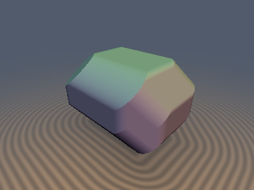
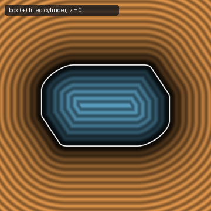
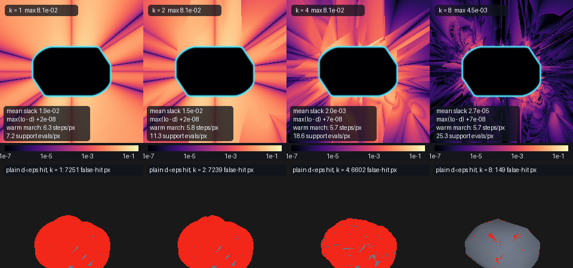

# `suSupport` — Support-Function (Legendre) Duality for Convex Distance Bounds: `su*`, `SuState`, `SU_SOLVE`, `sdMinkowski*`, `sdHullSphereBox`

| 3D Surface ($`d(\mathbf{p}) = 0`$, box ⊕ tilted cylinder) | 2D Cross-Section Slice ($`z = 0`$) |
| :---: | :---: |
|  |  |

| Property | Value |
| :--- | :--- |
| **Author / Attribution** | **Claude Fable 5.2** (`sdf-gems`, 2026). Research experiment; the algorithms are classical (see [Novelty & Prior Art](#novelty--prior-art)). |
| **Category** | `duality` |
| **GLSL File** | [`glsl/duality/suSupport.glsl`](../../glsl/duality/suSupport.glsl) |
| **`su*` support points** (15 primitives, `suHull`) | **Exact** (FP32 rounding, $`\le 1.0\times10^{-7}`$ against an FP64 reference and against the repository SDFs) |
| **`sd*` / `sdg*`, exterior** | **Conservative bound** for every iteration count (measured overshoot $`\le 2.2\times10^{-7}`$), converging to the exact distance. **Not exact to** $`10^{-5}`$ at the default `SU_ITERS = 16`: worst slack $`4.5\times10^{-5}`$ to $`3.4\times10^{-4}`$ depending on the body |
| **`sdMinkowskiBoxBox`, interior** | **Exact** (15 separating axes; error $`\le 8.7\times10^{-8}`$) |
| **Other `sd*`, interior** | **Approximate**, conservative in sign convention only ($`d \le d_{\text{exact}}`$, i.e. depth over-estimated). $`94.6\%`$ to $`100\%`$ of interior points within $`10^{-4}`$, worst $`2.7\times10^{-2}`$ |
| **`sdg*` gradient** | Supporting-plane normal of the reported bound (unit length); equals the true gradient only where the bound is tight. Not separately verified |

---

## Idea



*Top: slack $`d_{\text{exact}} - lo_k`$ (log scale) of the lower bound after $`k = 1, 2, 4, 8`$ solver iterations on the slice $`z = 0`$ of box ⊕ tilted cylinder (interior masked). Bottom: pixels (red) where a plain `d < eps` hit test with a cold-started $`k`$-iteration bound stops more than $`3\,\mathrm{eps}`$ away from the surface.*

A convex body $`K`$ is determined by its **support function**

```math
h_K(\mathbf{n}) = \max_{\mathbf{x} \in K} \mathbf{n}\cdot\mathbf{x}, \qquad \mathbf{x}_K(\mathbf{n}) = \arg\max_{\mathbf{x} \in K} \mathbf{n}\cdot\mathbf{x} = \nabla h_K(\mathbf{n}).
```

The signed distance and the support function are Legendre duals restricted to unit vectors:

```math
d_K(\mathbf{p}) = \max_{\|\mathbf{n}\| = 1} \big( \mathbf{n}\cdot\mathbf{p} - h_K(\mathbf{n}) \big).
```

Consequences used in the file:

1. **Every unit direction is a conservative bound.** For any unit $`\mathbf{n}`$ and any $`\mathbf{p}`$, $`\mathbf{n}\cdot(\mathbf{p} - \mathbf{x}_K(\mathbf{n})) \le d_K(\mathbf{p})`$ (a supporting half-space contains $`K`$). So an *unconverged* search over $`\mathbf{n}`$ is still a safe sphere-tracing step.
2. **Operations that have no closed-form SDF are one-liners in the dual.**

   | Operation | Support point |
   | :--- | :--- |
   | Minkowski sum $`A \oplus B`$ | $`\mathbf{x}_A(\mathbf{n}) + \mathbf{x}_B(\mathbf{n})`$ |
   | Rotation and translation $`RK + \mathbf{t}`$ | $`R\,\mathbf{x}_K(R^{\mathsf T}\mathbf{n}) + \mathbf{t}`$ |
   | Offset by $`r`$ | $`\mathbf{x}_K(\mathbf{n}) + r\,\mathbf{n}`$ |
   | Convex hull of $`A \cup B`$ | whichever of $`\mathbf{x}_A, \mathbf{x}_B`$ has the larger $`\mathbf{n}\cdot\mathbf{x}`$ |

3. **Exterior: a convex problem with a bracket.** The search is GJK restricted to simplices of at most three support points (enough for an exterior query point). The point $`\mathbf{v}`$ of the simplex closest to $`\mathbf{p}`$ lies in $`K`$, so

   ```math
   lo = \max_k\, \mathbf{n}_k\cdot(\mathbf{p} - \mathbf{x}_K(\mathbf{n}_k)) \;\le\; d_K(\mathbf{p}) \;\le\; \|\mathbf{p} - \mathbf{v}\| = ub ,
   ```

   and the next direction is $`\mathbf{n} = (\mathbf{p} - \mathbf{v}) / \|\mathbf{p} - \mathbf{v}\|`$. `ub < eps` is a *certified* hit test; `lo < eps` is not.
4. **Warm start along a ray.** When the query point moves to $`\mathbf{p}'`$, the simplex is still inside $`K`$ and the old plane is still valid: $`lo' = lo + \mathbf{n}\cdot(\mathbf{p}' - \mathbf{p})`$ with zero support evaluations (`suRestart`).
5. **Ray step from the plane** (`suRayStep`): a ray with unit direction $`\mathbf{r}`$ cannot reach $`K`$ before $`t = lo / (-\mathbf{n}\cdot\mathbf{r}) \ge lo`$; if $`\mathbf{n}\cdot\mathbf{r} \ge 0`$ the ray misses $`K`$ entirely.
6. **Interior: non-convex.** Inside $`K`$ the same formula holds, $`d_K(\mathbf{p}) = -\min_{\mathbf{n}} (h_K(\mathbf{n}) - \mathbf{n}\cdot\mathbf{p})`$, but the objective has several local minima on the sphere (one per face-like region). Any $`\mathbf{n}`$ still gives $`\mathbf{n}\cdot\mathbf{p} - h_K(\mathbf{n}) \le d_K(\mathbf{p})`$, which *over*-estimates the depth: the wrong side for interior marching. `SU_INTERIOR` is a heuristic local search (best 3 of 26 fixed directions, each refined by up to `SU_PROBES = 4` "step outside, solve the exterior problem there, reuse its plane" rounds).
7. **Mean width.** $`w(K) = 2\langle h_K\rangle_{S^2} = M(K) / (2\pi)`$ where $`M`$ is the integrated mean curvature, and $`w(A \oplus B) = w(A) + w(B)`$. Used only as a cross-check against [`glsl/measure/msSteinerTube.glsl`](../../glsl/measure/msSteinerTube.glsl).

### FP32 stall (a failure that was found and handled)

Within about $`10^{-4}`$ of the surface the difference $`\mathbf{p} - \mathbf{v}`$ loses its digits in FP32. Two measures are in the shipped code: `suDir` takes the direction from the closest *feature* (face normal or edge-orthogonal component) rather than from $`\mathbf{p} - \mathbf{v}`$, and `suStep` detects a step that neither raises $`lo`$ nor changes the simplex, tries the normal of the full candidate feature once, and otherwise lets `suDone` end the loop. The bound stays valid in all cases; what is lost is tightness (see the slack figures below).

## GLSL Usage

```glsl
#include "glsl/duality/suSupport.glsl"

// Ready-made examples (cold start, SU_ITERS iterations):
float d0 = sdMinkowskiBoxBox(p, b1, R, b2);              // exact inside, conservative bound outside
vec4  dg = sdgMinkowskiBoxCylinder(p, b, R, h, r);       // (bound, plane normal)
float d2 = sdMinkowskiEllipsoidBox(p, re, b);
float d3 = sdMinkowskiCapsuleCone(p, a, b, ra, c, h);
float d4 = sdHullSphereBox(p, cs, rs, cb, b);

// Compose your own: SUP is any expression of the unit direction `n`.
float sdMine( vec3 p )
{
    SuState s;
    SU_SOLVE(s, p, suBox(n, vec3(0.3, 0.2, 0.1)) + suEllipsoid(n, vec3(0.2, 0.1, 0.3)), 16)
    return s.lo;                                         // exterior only; see SU_INTERIOR for p inside
}

// Warm-started march with a certified hit and the plane-clipped ray step:
SuState s;
for( int i = 0; i < 64; i++ )
{
    vec3 p = ro + t * rd;
    if( i == 0 ) { SU_SOLVE(s, p, MY_SUPPORT, 1) } else { SU_RESUME(s, p, MY_SUPPORT, 1) }
    if( s.ub < eps ) break;                              // certified: a point of K is within eps
    t += max(suRayStep(s, rd), 0.0);
    if( t > tmax ) break;
}
```

`SU_ITERS` (default 16), `SU_TOL`, `SU_PROBES` and `SU_WEIGHT_EPS` can be overridden with `#define` before the include. The query point is assumed to be expressed in a frame whose origin is in or near $`K`$ (first direction is $`\mathbf{p}/\|\mathbf{p}\|`$). Curved bodies need unit $`\mathbf{n}`$.

## Verification

All rows are the **literal GLSL on the GPU (FP32)**, re-run for this document unless marked otherwise. Ground truth: FP64 distance to a dense vertex hull built from the *definition* of each body (independent of the solver), with stated discretisation error `GT eps`. $`N = 20000`$ points per body in exp3.

**Support points** (`exp10`, 20022 directions incl. 22 tie directions): 0 non-finite; $`|h_{\text{GLSL}} - h_{\text{FP64}}| \le 1.0\times10^{-7}`$ for all 15 primitives; fed into the repository SDFs, $`|sd(\mathbf{x}(\mathbf{n}))| \le 1.4\times10^{-7}`$ and $`|sd(\mathbf{x} + t\mathbf{n}) - t| \le 3.5\times10^{-7}`$. One excluded outlier: `sdCone` at exactly $`\mathbf{n} = (0,-1,0)`$ (a seam of the repository SDF according to the previous agent's note in `exp10`; not investigated further here).

**Shipped `sd*` at `SU_ITERS = 16`** (`exp3`; `d` = shipped value, `gt` = ground truth):

| Body | exterior max $`d - gt`$ | exterior max $`gt - d`$ | ext. within $`10^{-5}`$ / $`10^{-4}`$ | interior max $`gt - d`$ | int. within $`10^{-4}`$ | sign flips |
| :--- | :---: | :---: | :---: | :---: | :---: | :---: |
| box ⊕ tilted box | $`2.0\times10^{-7}`$ | $`4.5\times10^{-5}`$ | 99.56% / 100% | $`8.7\times10^{-8}`$ | 100% | 0 |
| box ⊕ tilted cylinder | $`1.4\times10^{-7}`$ | $`1.0\times10^{-4}`$ | 99.94% / 99.99% | $`6.2\times10^{-4}`$ | 99.8% | 1 |
| ellipsoid ⊕ box (GT only good to $`\sim 5\times10^{-5}`$) | $`-1.4\times10^{-7}`$ | $`2.1\times10^{-4}`$ | (19.6%) / 99.95% | $`8.7\times10^{-4}`$ | 99.4% | 31 |
| capsule ⊕ cone | $`2.0\times10^{-7}`$ | $`5.0\times10^{-6}`$ | 100% / 100% | $`4.1\times10^{-5}`$ | 100% | 0 |
| hull{sphere, box} | $`2.2\times10^{-7}`$ | $`1.7\times10^{-4}`$ | 96.62% / 99.89% | $`3.2\times10^{-3}`$ | 98.6% | 4 |
| tetrahedron ⊕ sphere, **exterior solver only** (test body, no `SU_INTERIOR`) | $`9.3\times10^{-8}`$ | $`2.3\times10^{-4}`$ | 97.58% / 99.96% | $`2.4\times10^{-1}`$ | 13.1% | 16 |

Notes on this table:
- 0 NaN/Inf on all bodies and on 3209 probe points (origin, axes, symmetry planes, diagonals) per body.
- "Sign flips" are points with $`gt > 0`$ and $`d \le 0`$: exterior points so close to the surface that $`lo`$ could not certify them, all within the exterior slack ($`\le 2.3\times10^{-4}`$) of the surface. No point had $`d > 0`$ inside the body.
- The ellipsoid ⊕ box ground truth is an inscribed hull of 40000 ellipsoid samples and over-estimates distances by up to about $`2\times10^{-5}`$ (`exp11` measures $`2.2\times10^{-5}`$), so its $`10^{-5}`$ column and most of its 31 flips measure the ground truth, not the shader. Against the FP64 solver run to a $`5\times10^{-9}`$ bracket (`exp11`; **not** an independent reference, same algorithm in higher precision) the shipped function is within $`10^{-5}`$ on 97.37% and within $`10^{-4}`$ on 99.98% of exterior points, worst $`1.8\times10^{-4}`$.
- Second seed (`exp11`, re-run): exterior worst slack $`4.7\times10^{-5}`$, $`3.4\times10^{-4}`$, $`1.8\times10^{-4}`$, $`5.6\times10^{-6}`$, $`1.6\times10^{-4}`$ for the five shipped bodies; maximum overshoot $`2.2\times10^{-7}`$.
- Iteration sweep (generic solver, `exp3`): overshoot $`\max(lo - gt) \le 2.0\times10^{-7}`$ for $`k = 1 \ldots 64`$ on all bodies; mean exterior slack at $`k = 1, 4, 8, 16`$ for box ⊕ cylinder: $`1.8\times10^{-2}`$, $`3.1\times10^{-3}`$, $`8.7\times10^{-5}`$, $`8.5\times10^{-7}`$. Polytopes terminate in about 3 iterations on average, curved bodies in 7 to 8.

**Interior, uniformly sampled interior points** (`exp8`, depth $`> 10^{-3}`$):

| Body | $`N`$ | max $`d - gt`$ | mean / p99 / max $`gt - d`$ | within $`10^{-4}`$ / $`10^{-3}`$ |
| :--- | :---: | :---: | :---: | :---: |
| box ⊕ tilted box (exact SAT) | 12662 | $`5.4\times10^{-8}`$ | $`4.7\times10^{-9}`$ / $`4.5\times10^{-8}`$ / $`7.4\times10^{-8}`$ | 100% / 100% |
| box ⊕ tilted cylinder | 9731 | $`3.3\times10^{-8}`$ | $`6.5\times10^{-5}`$ / $`3.8\times10^{-4}`$ / $`2.7\times10^{-2}`$ | 97.8% / 99.3% |
| ellipsoid ⊕ box (GT-limited) | 10208 | $`-3.8\times10^{-7}`$ | $`2.8\times10^{-5}`$ / $`4.1\times10^{-4}`$ / $`1.6\times10^{-3}`$ | 94.6% / 100% |
| capsule ⊕ cone | 1214 | $`5.9\times10^{-8}`$ | $`1.9\times10^{-6}`$ / $`2.4\times10^{-5}`$ / $`7.9\times10^{-4}`$ | 99.7% / 100% |
| hull{sphere, box} | 5413 | $`2.4\times10^{-8}`$ | $`5.6\times10^{-5}`$ / $`5.8\times10^{-4}`$ / $`2.1\times10^{-2}`$ | 96.7% / 99.4% |

**Ray marching** (`exp5`, 360×270, hit `eps` $`= 10^{-3}`$, box ⊕ tilted cylinder; the other three bodies behave alike):

| Configuration | steps/px | support evals/px | false hits (px) | lost rays |
| :--- | :---: | :---: | :---: | :---: |
| cold, $`k = 16`$, plain `lo < eps`, sphere step ("use it like an SDF") | 5.70 | 31.9 | 0 | 0 |
| cold, $`k = 4`$, plain hit | 5.47 | 21.7 | **6602** | 0 |
| warm, $`k = 1`$, plain hit | 6.23 | 7.1 | **1145** | 0 |
| warm, $`k = 1`$, certified `ub < eps`, sphere step | 6.34 | 7.2 | 0 | 0 |
| warm, $`k = 1`$, certified, `suRayStep` | 2.71 | 3.7 | 0 | 0 |
| warm, adaptive (iterate until $`lo \ge 0.5\,ub`$), certified, `suRayStep` | 2.42 | 3.1 | 0 | 0 |

**Overstep check for `suRayStep`** (`exp9`, re-run on the shipped file). `exp5` counts an "overstep" when the *lower bound* at the end point is below $`-10^{-3}`$; it flagged 1 pixel (hull{sphere, box}, $`k = 2`$). Classified with the independent ground truth instead: over all ray-step configurations ($`k = 1, 2, 4, 8`$ and two adaptive rules) on three bodies, **0 hits end deeper than** $`10^{-3}`$ **inside; the deepest end point is** $`4.4\times10^{-7}`$ **inside** (FP32 rounding), and 0 hits are further than $`3\times10^{-3}`$ outside. The flagged pixel has $`gt = +1.0\times10^{-6}`$, $`lo = -3.8\times10^{-3}`$, $`ub = 2.6\times10^{-6}`$: a loose lower bound next to an edge, not a penetration. Verdict: no overstep was found; the flag is an artefact of using $`lo`$ as a reference.

**Mean width** (`exp12`, 640000-node quadrature of the GLSL `su*` vs `msMeanWidth` of `msSteinerTube.glsl`): agreement to $`\le 1.4\times10^{-6}`$ for sphere, box, round box, capsule, capped cylinder, capped cone, cone and torus hull; additivity under ⊕ to $`1.4\times10^{-6}`$ for the three composed bodies tested.

**Single-translation-unit compile**: `uv run tools/gpu_eval.py --new glsl/duality/suSupport.glsl --call "..."` passes in forward, reverse and new-first order (295 files).

Reproduce (from the repository root; `S` is the scratch directory `.../brain/2080793b-1902-4ba7-a47c-ee098158ed7f/scratch/duality`):

```
uv run python $S/exp10_glsl_support.py     # support points
uv run python $S/exp3_gpu.py               # shipped sd* and iteration sweep vs ground truth
uv run python $S/exp8_interior_gpu.py      # interior
uv run python $S/exp9_overstep_check.py    # ray-step end points vs ground truth
uv run python $S/exp5_march.py             # marching cost table (about 2 minutes)
uv run python $S/exp11_seed.py             # second seed, FP64 bracket reference
uv run python $S/exp12_meanwidth_glsl.py   # mean width vs msSteinerTube
uv run python $S/render_all.py             # the three images
```

Logs of the runs quoted here are in `$S/t3/`.

## Findings

**Held**
- Every iterate is a conservative bound: maximum overshoot $`2.2\times10^{-7}`$ over 6 bodies, $`k = 1 \ldots 64`$, two seeds.
- Support points are exact to FP32 rounding, and Minkowski sum, rotation, offset and hull compose as stated (also confirmed through mean-width additivity).
- The upper bound $`ub`$ is valid to FP32 rounding for $`k \le 16`$ ($`ub - gt \ge -3.4\times10^{-7}`$ on the five bodies with an accurate ground truth), with one measured exception: on hull{sphere, box} at $`k = 32`$ and $`64`$ the minimum of $`ub - gt`$ is $`-4.8\times10^{-6}`$ (cause not investigated; far below any practical hit `eps`). It makes hit tests safe at any iteration count: 0 false hits with `ub < eps`, against thousands with `lo < eps` at small $`k`$.
- Warm start plus `suRayStep` cuts the cost from about 32 to about 3 to 4 support evaluations per pixel on these single-body scenes, with 0 lost rays and no measured overstep.
- The box ⊕ box interior via 15 separating axes is exact.

**Failed or only partly true**
- "Converges to the exact SDF" does **not** give an Exact label in FP32. At 16 iterations 96.6% to 100% of exterior points are within $`10^{-5}`$, but the worst slack is $`4.5\times10^{-5}`$ to $`3.4\times10^{-4}`$, concentrated within about $`10^{-3}`$ of the surface near edges, and more iterations do not remove it for polytopes (the search stalls on rounding; slack is identical for $`k = 8 \ldots 64`$ on box ⊕ box). A few exterior points per 20000 this close to the surface are returned with $`d \le 0`$.
- A truncated bound used as a drop-in SDF with a `d < eps` hit test is unusable below about 8 to 16 iterations (false hits on most of the silhouette region); the bracket is required.
- The generic interior value is not reliable: worst errors $`2.1\times10^{-2}`$ and $`2.7\times10^{-2}`$ on bodies of size about 1, always in the unsafe direction for interior marching. Without `SU_INTERIOR` the exterior solver is useless inside (13% within $`10^{-4}`$, worst $`0.24`$).
- Cost: a cold 16-iteration evaluation is 20 to 38 support evaluations per pixel in a march, far more than a closed-form SDF, and `SU_INTERIOR` runs up to 26 + 12 solver calls.

**Open questions**
- Whether the near-surface stall can be removed (not just detected) in FP32, e.g. by a relative-coordinate formulation.
- An exact interior for general sums (the interior is an enumeration over face-like features; only the box ⊕ box case is solved here).
- Behaviour in real scenes: the state is per body, so unions of several bodies need one `SuState` each; not measured.
- Timing in milliseconds on a GPU was not measured, only support-evaluation counts.
- The `sdCone` seam at $`\mathbf{n} = (0,-1,0)`$ noted by `exp10` belongs to an existing repository file and was left untouched.

## Novelty & Prior Art

Prior art was mostly written **from memory, not checked**; one web search was run for this document and confirmed only the general picture (support mappings and GJK are standard in collision detection; conservative advancement is the same idea as sphere tracing).

- Support mappings and their algebra (sum, hull, affine image): standard convex geometry; Gilbert, Johnson & Keerthi (1988); van den Bergen's work on GJK for general convex objects (1999) and his GJK-based ray cast with supporting-plane clipping (2004), from memory.
- The closest-point-on-triangle routine follows Ericson, *Real-Time Collision Detection*, section 5.1.5 (from memory).
- Frank–Wolfe lower/upper bracket for the distance to a convex set: classical.
- Support-function ray marching in shaders has been done informally before (from memory; no specific Shadertoy was verified).

**Nothing here is a new algorithm.** What this entry adds is a packaging and a set of measurements: a single-header GLSL support-point library matching the repository's primitive conventions, a three-point GJK with a certified bracket and warm restart written for FP32 fragment shaders, the FP32 stall diagnosis, and measured tightness, cost and failure rates against independent ground truth.

## Not done

- No extra web searches beyond the one above; no check of specific prior shaders.
- `sdg*` gradients were not verified against finite differences.
- No degenerate-parameter sweep (zero radii, zero extents, $`\mathbf{p}`$ far from the origin frame) beyond the probe points.
- The capsule ⊕ cone marching case and the polar-body / fixed-direction-set side experiments in the old logs (`exp6`, `exp7`) were not re-run and are not claimed here.
- Not added to `README.md` or `sdf_gems.glsl` (left to the integrator).
