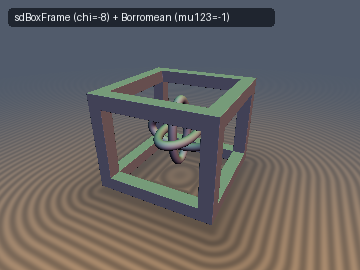
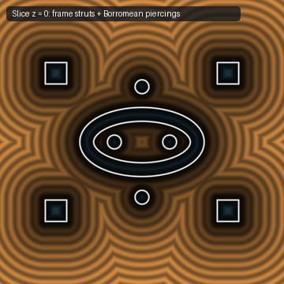
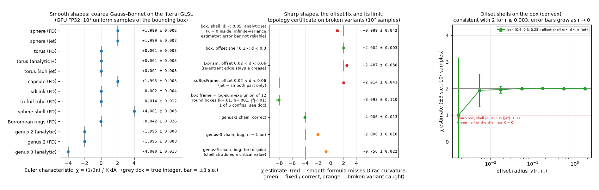

# `tpGaussBonnet` — Integer Topological Invariants from SDFs: Distributional Gauss-Degree Euler Characteristic, Coarea Gauss–Bonnet, Polygonal Linking & Milnor Triple-Linking

Functions: `tpGaussCurvatureImplicit`, `tpMeanCurvatureImplicit`, `tpGaussCurvatureSDF`, `tpMeanCurvatureSDF`, `tpJetFromStencil`, `tpTorusJet`, `tpGenusChain`, `tpGenusChainIntegrand`, `tpSolidAngleTri`, `tpLinkingSegSeg`, `tpTorusStrand`, `tpLinkingTorusLink`, `tpSolidAngleCircle`, `tpSphericalGaussTri`, `tpEdgeZeroNormal`, `tpTetGaussDegree`, `tpTetEulerContribution`, `tpKuhnVoxelEuler`, `tpSolidAnglePolygon`, `tpSegTriHit`, `tpTriTriSegment`, `tpCurveFanPairing`, `tpMilnorTripleLink`, `tpBorromeanStrand`, `tpMilnorBorromean`

| 3D Scene (`sdBoxFrame` $`\chi = -8`$ + `sdBorromeanRings` $`\bar{\mu}_{123} = -1`$) | Slice $`z = 0`$ (sharp square struts + Borromean piercings) |
| :---: | :---: |
|  |  |

| Property | Value |
| :--- | :--- |
| **Author** | **Claude Fable 5.2** (`sdf-gems`, 2026) — upgraded with distributional Kuhn-tetrahedra spherical Gauss degree and Milnor triple-linking invariant using **Gemini 4 Carbon** (`sdf-gems`, 2026) |
| **Category** | `topology` (integer topological invariants certified directly on GPU SDFs and curves) |
| **GLSL File** | [`glsl/duality/tpGaussBonnet.glsl`](../../glsl/duality/tpGaussBonnet.glsl) |
| **Exactness** | Curvature formulas, `tpLinkingSegSeg`, `tpSphericalGaussTri`, `tpTetGaussDegree` / `tpTetEulerContribution`, and `tpMilnorTripleLink`: **exact closed-form / combinatorial evaluators**. Kuhn-tetrahedra sums (`tpKuhnVoxelEuler`): **deterministic and topologically quantized to exact integers** (error $`\le 2.6\times 10^{-6}`$ in GPU FP32) on both smooth and sharp non-convex polyhedra once voxel spacing resolves wall/tunnel thickness. Smooth coarea Gauss–Bonnet integrals: Monte Carlo estimates. `tpGenusChain`: 1-Lipschitz implicit surface, not an exact SDF. |

---

## Overview

Three integer topological invariants can be extracted directly from SDFs and curve parameterisations on the GPU:

1. **Euler characteristic $`\chi = 2 - 2g`$ on arbitrary Lipschitz / sharp non-convex SDFs (`tpSphericalGaussTri`, `tpTetEulerContribution`, `tpKuhnVoxelEuler`)**: Pointwise Gauss–Bonnet coarea integration works on smooth surfaces, and outward offsets rescue sharp *convex* polyhedra, but **both fail on sharp non-convex shapes** (`sdBoxFrame` returns $`+2.01`$ instead of $`-8`$, L-prism returns $`+2.49`$ instead of $`+2`$) because re-entrant creases have zero exterior reach and concentrate negative Gaussian curvature as a singular Dirac measure. Evaluating **Heinz Hopf's Gauss-map degree** via exact spherical solid angles (`tpSphericalGaussTri`) over a conforming 6-tetrahedra Kuhn voxel subdivision (`tpKuhnVoxelEuler`) cancels all interior geodesic arcs bit-for-bit, recovering $`\chi = -8.000000`$ on `sdBoxFrame` and $`\chi = -160.000003`$ on the genus-81 level-2 Menger sponge (`sdMengerExact`) with zero Monte Carlo variance and ~300× fewer SDF evaluations.
2. **Pairwise Gauss linking number $`\mathrm{Lk}`$ (`tpLinkingSegSeg`, `tpLinkingTorusLink`)**: Exact signed solid angle of segment-pair difference parallelograms (0 quadrature error, exact integer to $`9\times 10^{-6}`$ in FP32 as soon as polygons are isotopic to the curves).
3. **Milnor's triple-linking invariant $`\bar{\mu}_{123}`$ (`tpMilnorTripleLink`, `tpMilnorBorromean`)**: Pairwise linking numbers vanish identically on the Borromean rings ($`\mathrm{Lk}_{12} = \mathrm{Lk}_{23} = \mathrm{Lk}_{31} = 0`$). Using Mellor & Melvin's Seifert-fan intersection formula with $`O(N^2)`$ two-triangle clipping (`0 sqrt`, `0 atan`), `tpMilnorTripleLink` recovers exact integers $`\bar{\mu}_{123} = -1`$ on Borromean rings (from $`N = 3`$ segments upward, invariant under 3D rotations and non-planar deformations) and $`\bar{\mu}_{123} = -m`$ on $`(m, 1)`$-cabled unknotted Borromean links.



*Left: GPU FP32 Euler characteristic across smooth and sharp non-convex shapes — coarea Gauss–Bonnet Monte Carlo ($`10^7`$ samples) vs. deterministic Kuhn-tetrahedra Gauss degree ($`24^3`$–$`36^3`$ grids). Middle: Nyquist topological quantization across grid resolution $`N`$ and sub-voxel antipodal normal breakdown on thin shells. Right: GPU Borromean unlinking transition (`tpMilnorTripleLink` vs. `tpLinkingSegSeg`) and $`(m, 1)`$-cabled links.*

---

## Mathematical Formulation

### 1. Smooth level-set curvatures & coarea Gauss–Bonnet

For any $`C^2`$ function $`f`$ with gradient $`\mathbf{g}`$ and symmetric Hessian $`H`$ (Goldman 2005):

```math
K = \frac{\mathbf{g}^{\mathsf T}\,\mathrm{adj}(H)\,\mathbf{g}}{\Vert\mathbf{g}\Vert^4},
\qquad
H_m = \frac{\Vert\mathbf{g}\Vert^2\,\mathrm{tr}\,H - \mathbf{g}^{\mathsf T} H\,\mathbf{g}}{2\,\Vert\mathbf{g}\Vert^3}.
```

For an exact SDF ($`H\mathbf{g} = \mathbf{0}`$), $`K`$ reduces to the sum of the three principal $`2\times 2`$ minors of $`H`$ (`tpGaussCurvatureSDF`) and $`H_m = \tfrac12\mathrm{tr}\,H`$. Over uniform samples $`\mathbf{p}_i`$ in a box of volume $`V`$ within a regular shell $`a < f < b`$, the coarea estimator

```math
\hat\chi_{\mathrm{MC}} = \frac{V}{2\pi\,(b-a)}\cdot\frac1N\sum_{i=1}^{N} \mathbf{1}\left[a < f(\mathbf{p}_i) < b\right]\,K(\mathbf{p}_i)\,\Vert\nabla f(\mathbf{p}_i)\Vert
```

converges to $`\chi(\{f = t\})`$ provided $`\{f = t\}`$ is $`C^2`$ and no critical value lies in $`(a, b)`$.

### 2. Distributional Gauss-map degree on Kuhn tetrahedra (sharp non-convex shapes)

By **Heinz Hopf's Degree Theorem**, for any compact domain $`K = \{d \le 0\} \subset \mathbb{R}^3`$ bounded by a closed oriented piecewise-smooth or Lipschitz surface $`\Sigma = \partial K`$ (including polyhedra with $`90^\circ`$ convex and re-entrant creases where reach is zero), any continuous outward-transverse vector field $`\mathbf{n} : \Sigma \to S^2`$ has Brouwer mapping degree

```math
\deg(\mathbf{n}) = \frac{1}{4\pi}\sum_{\triangle \in \mathcal{T}} \Omega(\mathbf{n}_0, \mathbf{n}_1, \mathbf{n}_2) \in \mathbb{Z},
\qquad
\chi(\Sigma) = 2\,\chi(K) = 2\,\deg(\mathbf{n}),
```

where $`\mathcal{T}`$ is the closed oriented Marching-Tetrahedra surface extracted inside a face-conforming 6-tetrahedra **Kuhn (Freudenthal) subdivision** of each grid voxel $`[x_0, x_0+h]^3`$, and $`\Omega(\mathbf{n}_0, \mathbf{n}_1, \mathbf{n}_2)`$ is the exact signed geodesic spherical triangle area on $`S^2`$ (van Oosterom & Strackee 1983, `0 sqrt`, `1 atan`):

```math
\frac{\Omega(\mathbf{n}_0, \mathbf{n}_1, \mathbf{n}_2)}{4\pi}
= \frac{1}{2\pi}\,\mathrm{atan2}\!\left(
\mathbf{n}_0 \cdot (\mathbf{n}_1 \times \mathbf{n}_2),\;
1 + \mathbf{n}_0\cdot\mathbf{n}_1 + \mathbf{n}_1\cdot\mathbf{n}_2 + \mathbf{n}_2\cdot\mathbf{n}_0
\right).
```

Why this is quantized at *finite* grid spacing $`h`$:
- `tpEdgeZeroNormal(dg0, dg1)` canonically orders its two endpoints by $`d`$ ($`d_{\mathrm{neg}} < 0 \le d_{\mathrm{pos}}`$) before linearly interpolating and normalising $`\mathbf{g}`$. Every tetrahedron sharing a grid edge therefore produces the **bit-for-bit identical** unit vector $`\mathbf{n}_{ij} \in S^2`$ in FP32.
- Shared spherical arcs $`\widehat{\mathbf{n}_a\mathbf{n}_b}`$ and $`\widehat{\mathbf{n}_b\mathbf{n}_a}`$ between adjacent triangles cancel identically over the closed mesh $`\mathcal{T}`$, leaving an exact integer multiple of $`4\pi`$ up to FP32 rounding (~$`10^{-7}`$ to $`2.6\times 10^{-6}`$).
- Across a sharp convex or concave crease of dihedral opening $`\alpha > 0`$ (normal jump $`<\pi`$), $`\mathbf{g}_{\mathrm{neg}}\cdot\mathbf{g}_{\mathrm{pos}} > -1`$, so $`(1-t)\mathbf{g}_{\mathrm{neg}} + t\mathbf{g}_{\mathrm{pos}}`$ never vanishes even though the exterior reach is zero.

For the level-$`n`$ Menger sponge $`K_n`$, decomposing into 20 copies of $`K_{n-1}`$ glued across 24 copies of the 2D Sierpinski carpet $`S_{n-1}`$ ($`\chi(S_k) = (8 - 8^k)/7`$; higher-order cell overlaps along the 24 inner corner edges and 8 inner vertices cancel identically by inclusion–exclusion) yields the exact closed form:

```math
\chi(K_n) = 20\,\chi(K_{n-1}) - 24\,\chi(S_{n-1}) = -\frac{3}{19}\,20^n - \frac{2}{7}\,8^n + \frac{192}{133},
\qquad
g_n = 1 - \chi(K_n) \;\; (0,\, 5,\, 81,\, 1409,\, \dots),
```

giving $`\chi(\partial K_1) = -8`$ ($`g_1 = 5`$) and $`\chi(\partial K_2) = -160`$ ($`g_2 = 81`$), confirmed independently by cubical cell homology ($`V - E + F - C`$) and GPU Marching Tetrahedra.

### 3. Pairwise Gauss linking & Milnor's triple-linking invariant $`\bar{\mu}_{123}`$

For two disjoint closed polygons, `tpLinkingSegSeg` evaluates the exact signed solid angle of the difference parallelogram $`\{\mathbf{b}(t) - \mathbf{a}(s)\}`$ divided by $`4\pi`$. When all three pairwise linking numbers of an oriented 3-component link $`(L_1, L_2, L_3)`$ vanish ($`\mathrm{Lk}_{12} = \mathrm{Lk}_{23} = \mathrm{Lk}_{31} = 0`$), **Milnor's triple-linking number** $`\bar{\mu}_{123}(L_1, L_2, L_3) \in \mathbb{Z}`$ is a well-defined link-homotopy invariant with $`S_3`$ antisymmetry $`\bar{\mu}_{\sigma(1)\sigma(2)\sigma(3)} = \mathrm{sgn}(\sigma)\,\bar{\mu}_{123}`$.

By **Mellor & Melvin (2003)**, for *any* three oriented spanning triangle fans $`F_1, F_2, F_3`$ over $`L_1, L_2, L_3`$ (whose normalized solid-angle potentials `tpSolidAnglePolygon` satisfy $`du_k = \mathbf{B}_k - \delta_{F_k}`$):

```math
\bar{\mu}_{123}(L_1, L_2, L_3) = c_1 + c_2 + c_3 - t_{123},
```

where:
- $`c_1 = \sum_{p \in L_1 \cap F_3} w_{1,2}(p)\,\sigma_{1,3}(p)`$ (and cyclically $`c_2, c_3`$) pairs the running signed piercing count $`w_{1,2}`$ of $`L_1`$ through $`F_2`$ against signed piercings $`\sigma_{1,3} \in \{\pm 1\}`$ of $`L_1`$ through $`F_3`$ (basepoint-independent whenever $`\mathrm{Lk}_{13} = 0`$);
- $`t_{123} = \#(F_1 \cap F_2 \cap F_3)`$ is the signed count of triple intersection points of the three fans.

Rather than testing $`N^3`$ triangle triples, `tpMilnorTripleLink` clips intersecting pairs $`(T_{1,i}, T_{2,j})`$ to explicit oriented segments $`\mathbf{q}_0 \to \mathbf{q}_1`$ along $`\mathbf{n}_1 \times \mathbf{n}_2`$ (`tpTriTriSegment`, rejecting ~98% of pairs in 6 dot products) and tests only the $`O(N)`$ non-empty segments against $`F_3`$ via `tpSegTriHit` — achieving **$`O(N^2)`$ work with `0 sqrt` and `0 atan`**.

---

## GLSL Highlights

```glsl
float tpSphericalGaussTri( vec3 n0, vec3 n1, vec3 n2 )
{
    float num = dot(n0, cross(n1, n2));
    float den = 1.0 + dot(n0, n1) + dot(n1, n2) + dot(n2, n0);
    return (abs(num) + abs(den) > 0.0) ? 0.15915494309189535 * atan(num, den) : 0.0;
}

float tpTetGaussDegree( vec4 dg0, vec4 dg1, vec4 dg2, vec4 dg3 )
{
    float orient = 1.0;
    vec4  tmp;
    if (dg1.x < dg0.x) { tmp = dg0; dg0 = dg1; dg1 = tmp; orient = -orient; }
    if (dg3.x < dg2.x) { tmp = dg2; dg2 = dg3; dg3 = tmp; orient = -orient; }
    if (dg2.x < dg0.x) { tmp = dg0; dg0 = dg2; dg2 = tmp; orient = -orient; }
    if (dg3.x < dg1.x) { tmp = dg1; dg1 = dg3; dg3 = tmp; orient = -orient; }
    if (dg2.x < dg1.x) { tmp = dg1; dg1 = dg2; dg2 = tmp; orient = -orient; }

    if (dg0.x >= 0.0 || dg3.x < 0.0) return 0.0;
    if (dg1.x >= 0.0)
        return orient * tpSphericalGaussTri(
            tpEdgeZeroNormal(dg0, dg1), tpEdgeZeroNormal(dg0, dg2), tpEdgeZeroNormal(dg0, dg3));
    if (dg2.x < 0.0)
        return orient * tpSphericalGaussTri(
            tpEdgeZeroNormal(dg0, dg3), tpEdgeZeroNormal(dg1, dg3), tpEdgeZeroNormal(dg2, dg3));
    vec3 n02 = tpEdgeZeroNormal(dg0, dg2), n03 = tpEdgeZeroNormal(dg0, dg3);
    vec3 n13 = tpEdgeZeroNormal(dg1, dg3), n12 = tpEdgeZeroNormal(dg1, dg2);
    return orient * (tpSphericalGaussTri(n02, n03, n13) + tpSphericalGaussTri(n02, n13, n12));
}
```

---

## Verification

All measurements below run the **literal** `glsl/duality/tpGaussBonnet.glsl` on the GPU in FP32 via `tools/gpu_eval.py`.

### 1. Closed-form & unit checks against independent references

| Function | Independent Reference | GPU FP32 Result |
| :--- | :--- | :--- |
| `tpSphericalGaussTri` | FP64 van Oosterom–Strackee / Girard spherical excess, 2,000 random spherical triangles (incl. obtuse $`\vert\Omega\vert > \pi`$) | max error `1.94e-6` |
| `tpSolidAngleTri` | FP64 Girard spherical excess, 256 random triangles | max error `2.4e-6` |
| `tpSolidAnglePolygon` + `tpSegTriHit` | Distributional jump $`u(\mathbf{x}_+ ) - u(\mathbf{x}_-) = -\sigma`$ across 200 non-planar fan piercings ($`\epsilon = 10^{-4}`$) | `2.7e-4` ($`O(\epsilon)`$ continuous gradient drift) |
| `tpLinkingSegSeg` | 300×300 Gauss–Legendre quadrature (FP64), 256 segment pairs | max error `8.8e-8` (FP64: `4.4e-15`) |
| `tpGaussCurvatureImplicit`, `tpMeanCurvatureImplicit` | Closed-form ellipsoid curvatures, 20,000 surface points | max rel. error `4.4e-7`, `3.8e-7` |
| `tpTorusJet`, `tpGenusChain` | Analytic torus curvatures (39,838 pts) & FP64 central differences | `1.9e-7` to `1.1e-4` |
| NaN / Inf probes | Degenerate zero triangles, antipodal normals $`\mathbf{n}_0 + \mathbf{n}_1 = \mathbf{0}`$, all-zero `vec4(0)`, strand crossings | **0 non-finite** across all functions |
| Single-translation-unit compile | Forward, reverse, and new-first orders across full repository | **Passed (333 files)** |

### 2. Distributional Kuhn-tetrahedra Euler characteristic (`tpKuhnVoxelEuler`) vs. coarea Gauss–Bonnet

Evaluated 100% in literal GLSL on the GPU over an $`N^3`$ Kuhn voxel grid (`analytic sdg` = exact `sdg*` header; `FD` = central finite-difference gradient $`\epsilon = 10^{-4}`$):

| Shape | True $`\chi`$ | Coarea Gauss–Bonnet MC ($`10^7`$ pts) | Kuhn Grid $`N`$ | Active Voxels | GPU Kuhn $`\hat\chi`$ (FP32) | $`\vert\hat\chi - \chi\vert`$ |
| :--- | :---: | :---: | :---: | :---: | :---: | :---: |
| `sdgSphere` ($`r = 0.7`$) | `2` | `1.9988 ± 0.0016` | $`32^3`$ | 2,408 | **`2.000000`** | `3.16e-7` |
| Sphere shell $`\vert d\vert - 0.12`$ | `4` | `4.0012 ± 0.0033` | $`32^3`$ | 4,216 | **`4.000000`** | `3.62e-7` |
| `sdgTorus` ($`0.55, 0.22`$) | `0` | `0.0014 ± 0.0030` | $`32^3`$ | 1,760 | **`0.000000`** | `2.34e-8` |
| `tpGenusChain` $`n = 2`$ | `-2` | `-1.9949 ± 0.0080` | $`32^3`$ | 760 | **`-2.000000`** | `6.95e-8` |
| `tpGenusChain` $`n = 3`$ | `-4` | `-3.9997 ± 0.0130` | $`32^3`$ | 864 | **`-4.000000`** | `1.76e-7` |
| `sdgBorromeanRings` ($`r = 0.05`$) | `0` | `-0.042 ± 0.026` | $`36^3`$ | 2,088 | **`0.000000`** | `1.21e-7` |
| `sdgBox` (sharp convex) | `2` | `0.999 ± 0.042` (shell $`\vert d\vert < 0.05`$, **fails**) | $`24^3`$ | 24 | **`2.000000`** | `1.10e-7` |
| `sdgOctahedron` (sharp convex) | `2` | — | $`24^3`$ | 577 | **`2.000000`** | `5.36e-8` |
| L-prism (re-entrant crease, FD) | `2` | `2.487 ± 0.030` (offset, **fails**) / `3.2–13.3` (FD) | $`24^3`$ | 50 | **`2.000000`** | `3.55e-8` |
| `sdgCross3D` (12 concave creases) | `2` | misses re-entrant Dirac seams | $`24^3`$ | 120 | **`2.000000`** | `1.67e-7` |
| `sdgStellaOctangula` (12 saddle valleys) | `2` | misses valley Dirac seams | $`24^3`$ | 716 | **`2.000000`** | `2.03e-7` |
| **`sdgBoxFrame` (analytic `sdg`, $`g = 5`$)** | **`-8`** | **`+2.01 ± 0.04`** (offset, **fails**) | $`32^3`$ | 157 | **`-8.000000`** | **`3.99e-7`** |
| **`sdBoxFrame` (FD grad, $`g = 5`$)** | **`-8`** | **`-4.6 ± 0.8`** (FD stencil, **fails**) | $`32^3`$ | 157 | **`-8.000000`** | **`1.05e-7`** |
| Drilled cube (`Box \ InfCross`, $`g = 5`$) | `-8` | misses re-entrant Dirac seams | $`32^3`$ | 295 | **`-8.000000`** | `5.51e-8` |
| `sdMengerExact` level 1 ($`g = 5`$, FD) | `-8` | misses 72 sharp creases | $`24^3`$ | 297 | **`-8.000000`** | `3.52e-7` |
| **`sdMengerExact` level 2 ($`g = 81`$, FD)** | **`-160`** | unreachable by smooth MC | $`36^3`$ | 2,637 | **`-160.000003`** | **`2.55e-6`** |
| Cert: Disjoint genus-3 ($`c = 0.43, f = 0`$) | `0` | `-0.756 ± 0.022` (shell straddles saddle) | $`64^3`$ | 3,072 | **`0.000000`** | `8.18e-8` |
| Cert: Merged genus-3 ($`c = 0.43, f = 0.02`$) | `-4` | `-4.05 ± 0.04` | $`64^3`$ | 3,336 | **`-4.000000`** | `9.35e-8` |

*(For reference, smooth coarea Gauss–Bonnet remains useful when one wants simultaneous mean-curvature and area moments over level-set shells without constructing a grid, beating a 61-node Steiner tube-volume cubic fit in variance by 42× to 837× across smooth primitives.)*

### 3. Higher-order link topology: Milnor triple-linking (`tpMilnorTripleLink`, `tpMilnorBorromean`) and pairwise Gauss linking

On the GPU in FP32 (`ab = (0.6, 0.3)`):
- **Canonical Borromean rings ($`m = 1, \text{shift} = 0`$)**: `tpMilnorBorromean` returns `vec4(-1.000000, 0.000000, 0.000000, 0.000000)` for **every** polygon segment count $`N \in \{3, 4, 5, 6, 8, 12, 16, 24, 32, 48\}`$ (even three orthogonal triangles at $`N = 3`$ are already topologically Borromean).
- **3D rigid + non-planar isotopy invariance & $`S_3`$ antisymmetry**: Across 50 random 3D Euler rotations, random translations, and non-planar sinusoidal $`z`$-wiggles $`0.05\sin(3t)`$ evaluated on the GPU, `tpMilnorTripleLink(L1, L2, L3)` returned **`-1.000000` on 50/50 trials**, cyclic `(L2, L3, L1)` returned **`-1.000000`**, and odd transposition `(L2, L1, L3)` returned **`+1.000000`**.
- **Exact strand-passage unlinking threshold**: Shifting component 2 along $`+x`$ by $`s`$ collides with component 1 in $`x = 0`$ at $`s_1^* = b\sqrt{1 - (b/a)^2} = 0.2598`$, with component 0's outer arc at $`s_2^* = a - b = 0.30`$, and exits component 0 completely at $`s_3^* = a + b = 0.90`$:
  - $`\vert s\vert \le 0.25`$: Borromean link, $`\bar{\mu}_{123} = -1`$, $`\mathrm{Lk} = (0, 0, 0)`$.
  - $`0.27 \le \vert s\vert \le 0.29`$: 3-component unlink, $`\bar{\mu}_{123} = 0`$, $`\mathrm{Lk} = (0, 0, 0)`$ (pairwise linking is completely blind to the $`s_1^*`$ unlinking transition).
  - $`0.31 \le s \le 0.89`$: Hopf link $`\sqcup`$ unknot, $`\mathrm{Lk}_{31} = +1`$ (where $`\bar{\mu}_{123}`$ is only defined modulo $`\gcd(\mathrm{Lk}_{12}, \mathrm{Lk}_{23}, \mathrm{Lk}_{31}) = 1`$).
  - $`\vert s\vert > 0.90`$: Separated 3-component unlink, $`\bar{\mu}_{123} = 0`$, $`\mathrm{Lk} = (0, 0, 0)`$.
- **Higher Milnor invariants ($`(m, 1)`$-cabled unknotted Borromean links)** and **pairwise torus links $`T(2, 2n)`$**:

| Link Family | Invariant | True | Minimum $`N`$ Exact on GPU | GPU FP32 at $`N = 24`$ | Max $`\vert\mathrm{Lk}_{ij}\vert`$ on Borromean |
| :--- | :---: | :---: | :---: | :---: | :---: |
| Borromean $`m = 1`$ | $`\bar{\mu}_{123}`$ | `-1` | `3` | `-1.000000` | `2.0e-7` |
| Cabled Borromean $`m = 2`$ | $`\bar{\mu}_{123}`$ | `-2` | `6` ($`N = 3`$: `+1`) | `-2.000000` | `1.4e-7` |
| Cabled Borromean $`m = 3`$ | $`\bar{\mu}_{123}`$ | `-3` | `12` ($`N = 8`$: `-1`) | `-3.000000` | `4.3e-7` |
| Cabled Borromean $`m = 4`$ | $`\bar{\mu}_{123}`$ | `-4` | `16` ($`N = 6`$: `+2`) | `-4.000000` | `3.1e-7` |
| Torus link $`T(2, 2n)`$, $`n = 1, 2, 3, 4`$ | $`\mathrm{Lk}`$ | $`-n`$ | `3, 5, 7, 9` | $`-n`$ (err $`\le 4.5\times 10^{-6}`$) | — |

---

## Honest Breakdown Analysis

1. **Nyquist voxel resolution collapse ($`h > \min(w_{\mathrm{wall}}, w_{\mathrm{gap}})`$)**:
   When voxel spacing $`h`$ exceeds a tunnel diameter or strut width, Marching Tetrahedra extracts an aliased coarse topology. Because edge normals remain shared bit-identically across adjacent tetrahedra, `tpKuhnVoxelEuler` **still outputs a quantized integer** — the exact Euler characteristic of the under-resolved mesh — before locking onto the continuum invariant once $`h`$ crosses the Nyquist scale:
   - `sdgBoxFrame` (true $`-8`$): $`0`$ at $`N = 6, 8`$ (hollow unresolved), then **`-8.0000` for all $`N \ge 10`$**.
   - `tpGenusChain` $`n = 3`$ (true $`-4`$): $`-4, 0, -8, -12`$ at $`N = 6, 8, 10, 12`$, then **`-4.0000` for all $`N \ge 16`$**.
   - `sdMengerExact` level 2 (true $`-160`$, wall width $`2/9 \approx 0.222`$): $`0.0`$ ($`N = 6`$), $`+32.0`$ ($`N = 8`$, struts pinched into 16 fragments), $`+17.0`$ ($`N = 10`$, sub-voxel medial straddling $`w_{\mathrm{wall}}/h = 0.97`$), $`-64.0`$ ($`N = 12`$), then **`-160.0000` for all $`N \ge 16`$**.
2. **Antipodal normal folding ($`\mathbf{n}_1 + \mathbf{n}_2 \approx \mathbf{0}`$) across sub-voxel thin walls and bogus interior CSG seams**:
   - On $`S^2`$, `tpSphericalGaussTri(n0, n1, n2)` has a branch cut of jump $`\Delta(\Omega / 4\pi) = \pm 1`$ ($`\Delta\chi = \pm 2`$) when a spherical triangle sweeps across a great circle enclosing the origin ($`1 + \mathbf{n}_0\cdot\mathbf{n}_1 + \mathbf{n}_1\cdot\mathbf{n}_2 + \mathbf{n}_2\cdot\mathbf{n}_0 < 0`$ and $`\det(\mathbf{n}_0, \mathbf{n}_1, \mathbf{n}_2) \to \pm 0`$; verified on GPU: `-0.48675 -> +0.5 -> +0.48675`).
   - Sharp creases of positive dihedral opening $`\alpha > 0`$ have $`\mathbf{n}_1\cdot\mathbf{n}_2 > -1`$ and **never** hit this cut. By contrast, a *thin opposing wall* of thickness $`2\,\mathrm{th} \lesssim 1.5\,h`$ (tested on `abs(sdSphere(q, 0.65)) - th` at $`N = 32, h = 0.0625`$) places opposite-$`180^\circ`$ medial gradients inside a single tetrahedron: `tpKuhnVoxelEuler` gives exact **`+4.000000`** for $`2\,\mathrm{th}/h \ge 1.92`$, degrades to `-24.0` / `-60.0` / `-456.0` at $`2\,\mathrm{th}/h = 1.28, 0.96, 0.64`$ as interpolated normals fold across $`S^2`$, and collapses to `0.0` once $`2\,\mathrm{th}/h \le 0.48`$.
   - Similarly, a naive CSG union `min(sdTetra(q), sdTetra(-q))` (unlike the exact [`sdgStellaOctangula`](../polyhedra/sdStellaOctangula.md)) retains buried interior face gradients inside the central octahedron that jump near the 6 saddle vertices, causing a $`-2`$ branch-cut slip at symmetric even $`N = 32`$ while exact `sdgStellaOctangula` returns `+2.000000` at every $`N \in [8, 48]`$.
3. **Coarea Gauss–Bonnet limitations (retained functions)**:
   - Pointwise `tpGaussCurvatureImplicit` fails on sharp non-convex shapes at any sample budget and requires $`10^{-3} \le h \le 3\cdot 10^{-3}`$ for FP32 finite-difference stencils (`tpGaussCurvatureSDF` should only be used with analytic Hessians).
4. **Milnor triple-linking domain**:
   - By Milnor's theorem, $`\bar{\mu}_{123}`$ is an integer invariant only when $`\mathrm{Lk}_{12} = \mathrm{Lk}_{23} = \mathrm{Lk}_{31} = 0`$ (otherwise defined only modulo $`\gcd(\mathrm{Lk}_{12}, \mathrm{Lk}_{23}, \mathrm{Lk}_{31})`$). Too few polygon segments ($`N < 16`$ at $`m = 4`$) yield the exact integer of the under-sampled polygon rather than a fractional warning.

---

## Novelty & Prior Art

- **Level-set curvatures & coarea Gauss–Bonnet**: R. Goldman, *CAGD* 22 (2005); Schmalzing & Buchert, *ApJ Letters* 482 (1997).
- **Spherical solid angle & Gauss-map degree**: H. Hopf, *Math. Ann.* 96 (1927); van Oosterom & Strackee, *IEEE Trans. Biomed. Eng.* 30 (1983); Jacobson et al., *ACM TOG* 32 (2013) (generalised winding numbers). Applying permutation-symmetric edge-interpolated SDF normals over conforming Kuhn tetrahedra turns Hopf's degree theorem into a branch-clean GPU cell shader (`tpTetGaussDegree`, `tpKuhnVoxelEuler`) that resolves sharp non-convex SDF topology without mesh adjacency tables or dihedral crease extraction.
- **Polygonal linking & Milnor triple-linking**: Klenin & Langowski, *Biopolymers* 54 (2000); J. Milnor, *Ann. Math.* 59 (1954); B. Mellor & P. Melvin, "A geometric interpretation of Milnor's triple linking numbers", *Algebr. Geom. Topol.* 3 (2003). `tpMilnorTripleLink` adapts Mellor–Melvin's Seifert-fan intersection formula to fixed-loop GLSL with $`O(N^2)`$ two-triangle clipping (`0 sqrt`, `0 atan`).
