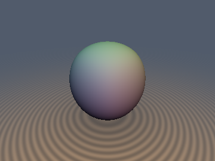
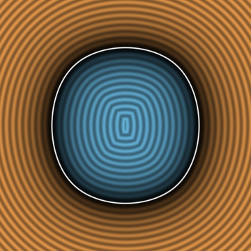
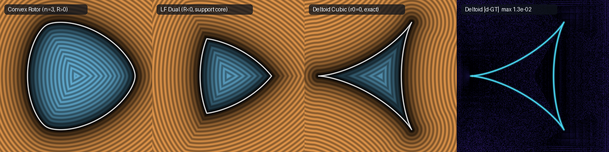

# `evSupportEnvelope` — Legendre-Fenchel Support Duality, Spherical Harmonic Hedgehog Bodies, Clairaut Normal Projection & Evolute Caustics

| 3D Surface ($`d = 0`$): cubic-octahedral + axisymmetric harmonic body | 2D Cross-Section Slice |
| :---: | :---: |
|  |  |

| Property | Value |
| :--- | :--- |
| **Category** | `envelopes` (research experiment) |
| **GLSL File** | [`glsl/envelopes/evSupportEnvelope.glsl`](../../glsl/envelopes/evSupportEnvelope.glsl) |
| **Attribution** | Basis-free Cayley-Hamilton Riemannian Newton solver on $`S^2`$, pitchfork-caustic Halley rotor solver, Legendre-Support deltoid cubic factorization, and verification by **Gemini 4 Argon** (`sdf-gems`, 2026). The underlying support-function and hedgehog geometry (Minkowski, Clairaut, Blaschke, Langevin-Levitt-Rosenberg) is classical. |
| **Exactness** | `sdSupportRotor2D`: **Exact** everywhere on $`\mathbb{R}^2`$ when convex ($`r_0 \ge (n^2 - 1)\vert c\vert`$, constant width $`2r_0`$ for odd $`n`$); 1-Lipschitz Legendre-Fenchel support-core bound when $`r_0 < (n^2 - 1)\vert c\vert`$. `sdHedgehogHypocycloid2D`: **Exact** Euclidean SDF of Steiner's 3-cusped deltoid ($`h(\theta) = a\cos 3\theta`$). `sdSupportHarmonic3D`: **Exact** Euclidean SDF for convex harmonic bodies ($`3\vert c_2\vert + 12\vert c_4\vert \le r_0`$, 0 trig) and outside the evolute caustic $`d(\mathbf{p}) > -\min(R_1(\mathbf{u}^*), R_2(\mathbf{u}^*))`$. |

---

## Overview & Motivation

A smooth convex body $`K \subset \mathbb{R}^d`$ (and more generally a **hedgehog**—the envelope of oriented support hyperplanes $`\mathbf{x}\cdot\mathbf{u} = h(\mathbf{u})`$) is parameterized not by an implicit polynomial $`F(\mathbf{x}) = 0`$, nor by a mesh, but by its **support function** $`h: S^{d-1} \to \mathbb{R}`$ and its positively 1-homogeneous extension $`H(\mathbf{z}) = \Vert\mathbf{z}\Vert\,h(\mathbf{z}/\Vert\mathbf{z}\Vert)`$. By Euler's homogeneous function theorem, the envelope point (**Clairaut normal parameterization**) with outward unit normal $`\mathbf{u} \in S^{d-1}`$ is simply the ambient gradient:

```math
\mathbf{y}(\mathbf{u}) = \nabla_{\mathbb{R}^d} H(\mathbf{u}) = h(\mathbf{u})\mathbf{u} + \nabla_{S^{d-1}} h(\mathbf{u}),
```

and the outward unit normal at $`\mathbf{y}(\mathbf{u})`$ is literally $`\mathbf{u}`$ itself. Consequently, a query point $`\mathbf{p} \in \mathbb{R}^d`$ projects orthogonally onto $`\mathbf{y}(\mathbf{u})`$ at signed distance $`d`$ along normal $`\mathbf{u}`$ if and only if $`\mathbf{p} - \mathbf{y}(\mathbf{u}) = d\,\mathbf{u}`$, which splits into tangential and normal parts:

```math
\mathbf{p}_\perp(\mathbf{u}) := \mathbf{p} - (\mathbf{p}\cdot\mathbf{u})\mathbf{u} = \nabla_{S^{d-1}} h(\mathbf{u}), \qquad d(\mathbf{p}) = \mathbf{p}\cdot\mathbf{u} - h(\mathbf{u}).
```

Even before solving for $`\mathbf{u}^*`$, **every** unit vector $`\mathbf{u} \in S^{d-1}`$ furnishes an exact two-sided distance sandwich outside a convex body $`K`$:

```math
L(\mathbf{p}, \mathbf{u}) := \mathbf{p}\cdot\mathbf{u} - h(\mathbf{u}) \;\le\; d_K(\mathbf{p}) \;\le\; \Vert\mathbf{p} - \mathbf{y}(\mathbf{u})\Vert = \sqrt{L(\mathbf{p}, \mathbf{u})^2 + \Vert\mathbf{p}_\perp(\mathbf{u}) - \nabla_{S^{d-1}} h(\mathbf{u})\Vert^2}.
```



*Left to right: (1) Convex constant-width rotor `sdSupportRotor2D` ($`n = 3, r_0 = 0.78, c = 0.075`$, $`R_{\min} = 0.18 > 0`$); (2) Legendre-Fenchel dual $`\max_{\mathbf{u}}(\mathbf{p}\cdot\mathbf{u} - h(\mathbf{u}))`$ in the non-convex hedgehog regime ($`r_0 = 0.55, c = 0.14`$, $`R_{\min} = -0.57 < 0`$), which collapses to the inscribed support core $`K_\cap`$ instead of the self-intersecting swallowtail envelope; (3) Exact SDF of the pure $`r_0 = 0`$ Steiner deltoid hedgehog `sdHedgehogHypocycloid2D` via the closed-form depressed cubic in $`w = \sin^2\theta`$; (4) $`\log_{10}\vert d - d_{\text{GT}}\vert`$ heatmap against dense polyline ground truth.*

---

## Mathematical Derivation

### 1. Reverse Weingarten Operator & Basis-Free Riemannian Newton Step on $`S^2`$

The Riemannian Hessian of the Legendre-Fenchel objective $`L(\mathbf{p}, \mathbf{u}) = \mathbf{p}\cdot\mathbf{u} - h(\mathbf{u})`$ on $`S^{d-1}`$ at a stationary point $`\mathbf{p}_\perp(\mathbf{u}) = \nabla_{S^{d-1}} h(\mathbf{u})`$ is:

```math
\nabla^2_{S^{d-1}} L(\mathbf{p}, \mathbf{u}) = -(\mathbf{p}\cdot\mathbf{u})\mathbf{I}_{T_{\mathbf{u}} S^{d-1}} - \nabla^2_{S^{d-1}} h(\mathbf{u}) = -\big(d\,\mathbf{I}_{T_{\mathbf{u}} S^{d-1}} + \mathbf{W}^{-1}(\mathbf{u})\big),
```

where $`\mathbf{W}^{-1}(\mathbf{u}) = h(\mathbf{u})\mathbf{I}_{T_{\mathbf{u}} S^{d-1}} + \nabla^2_{S^{d-1}} h(\mathbf{u}) = d\mathbf{y}_{\mathbf{u}}`$ is the **reverse Weingarten (radius of curvature) operator**, whose eigenvalues are the principal radii of curvature $`R_1(\mathbf{u}) \le R_2(\mathbf{u})`$. Thus $`L(\mathbf{p}, \cdot)`$ is strictly concave at $`\mathbf{u}^*`$ if and only if $`d(\mathbf{p}) > -\min_i R_i(\mathbf{u}^*)`$, i.e., **outside the evolute caustic**.

For any ambient polynomial representative $`f: \mathbb{R}^3 \to \mathbb{R}`$ with $`f\vert_{S^2} = h`$, let $`\mathbf{g} = \nabla_{\mathbb{R}^3} f(\mathbf{u})`$ and $`\mathbf{M} = \nabla^2_{\mathbb{R}^3} f(\mathbf{u})`$. With the tangent projection $`\mathbf{P}_{\mathbf{u}} = \mathbf{I} - \mathbf{u}\mathbf{u}^T`$, the spherical gradient, Clairaut point, and reverse Weingarten operator take the quotient-free forms:

```math
\nabla_{S^2} h(\mathbf{u}) = \mathbf{P}_{\mathbf{u}}\mathbf{g}, \qquad
\mathbf{y}(\mathbf{u}) = \mathbf{g} + \big(h(\mathbf{u}) - \mathbf{u}\cdot\mathbf{g}\big)\mathbf{u}, \qquad
\mathbf{W}^{-1}(\mathbf{u}) = \mathbf{P}_{\mathbf{u}}\big(\mathbf{M} + (h(\mathbf{u}) - \mathbf{u}\cdot\mathbf{g})\mathbf{I}\big)\mathbf{P}_{\mathbf{u}}.
```

For the axisymmetric degree-2 + cubic/octahedral degree-4 spherical harmonic support function

```math
h(\mathbf{u}) = r_0 + c_2\,\frac{3 u_y^2 - 1}{2} + c_4\left(u_x^4 + u_y^4 + u_z^4 - \frac{3}{5}\right),
```

the ambient representative $`f(\mathbf{u})`$ is separable across $`(u_x, u_y, u_z)`$, so its Euclidean Hessian $`\mathbf{M}(\mathbf{u}) = \mathrm{diag}(12 c_4 u_x^2,\, 3 c_2 + 12 c_4 u_y^2,\, 12 c_4 u_z^2)`$ is **strictly diagonal** (`vec3` in GLSL). For any diagonal matrix $`\mathrm{diag}(\mathbf{q})`$ restricted to the 2D tangent plane $`T_{\mathbf{u}} S^2 = \mathbf{u}^\perp`$, $`\mathbf{B} = \mathbf{P}_{\mathbf{u}}\,\mathrm{diag}(\mathbf{q})\,\mathbf{P}_{\mathbf{u}}`$ has a **basis-free trace and Cauchy-Binet determinant**:

```math
\mathrm{tr}_{T_{\mathbf{u}} S^2}(\mathbf{B}) = \mathbf{q}\cdot(\mathbf{1} - \mathbf{u}\odot\mathbf{u}), \qquad
\det_{T_{\mathbf{u}} S^2}(\mathbf{B}) = \mathbf{u}^T\mathrm{adj}(\mathrm{diag}(\mathbf{q}))\,\mathbf{u} = (\mathbf{q}_{yzx}\odot\mathbf{q}_{zxy})\cdot(\mathbf{u}\odot\mathbf{u}).
```

By the $`2\times 2`$ Cayley-Hamilton theorem $`\mathbf{B}^{-1} = \det(\mathbf{B})^{-1}(\mathrm{tr}(\mathbf{B})\mathbf{I}_{T_{\mathbf{u}} S^2} - \mathbf{B})`$, the Riemannian Newton step $`\boldsymbol{\delta} = \mathbf{B}^{-1}\mathbf{r}_\perp`$ for the tangent residual $`\mathbf{r}_\perp = \mathbf{P}_{\mathbf{u}}(\mathbf{p} - \mathbf{g})`$ requires **no tangent-frame ONB and no branches**:

```math
\boldsymbol{\delta} = \frac{\mathbf{P}_{\mathbf{u}}\big((\mathrm{tr}(\mathbf{B})\mathbf{1} - \mathbf{q})\odot\mathbf{r}_\perp\big)}{\det(\mathbf{B})}, \qquad
\mathbf{u}_{\text{next}} = \frac{\mathbf{u} + \boldsymbol{\delta}}{\Vert\mathbf{u} + \boldsymbol{\delta}\Vert}.
```

### 2. 2D Constant-Width Rotors, Evolute Pitchfork Caustics & Steiner's Deltoid Cubic

For $`h(\theta) = r_0 + c\cos(n\theta)`$, the Clairaut curve in $`\mathbb{C} \cong \mathbb{R}^2`$ is:

```math
z(\theta) = \big(h(\theta) + i h'(\theta)\big)e^{i\theta} = r_0 e^{i\theta} + \frac{c}{2}\Big((n+1)e^{-i(n-1)\theta} - (n-1)e^{i(n+1)\theta}\Big),
```

with tangent vector $`z'(\theta) = i\,R(\theta)e^{i\theta}`$ where $`R(\theta) = r_0 - (n^2 - 1)c\cos(n\theta)`$.

1. **Constant width for odd $`n`$**: Since $`\cos(n(\theta + \pi)) = (-1)^n\cos(n\theta)`$, every odd harmonic $`n = 3, 5, \dots`$ satisfies $`h(\theta) + h(\theta + \pi) \equiv 2r_0`$ everywhere.
2. **Evolute independence from $`r_0`$ & pitchfork bifurcation**: Every rotor $`h(\theta) = r_0 + c\cos(n\theta)`$ is the parallel offset by $`r_0`$ of the $`r_0 = 0`$ hypocycloid hedgehog $`z_0(\theta)`$, and shares the **same evolute** $`\mathbf{e}(\theta) = n^2 c\cos(n\theta)\mathbf{u}(\theta) - n c\sin(n\theta)\mathbf{t}(\theta)`$ of circumradius $`n^2\vert c\vert`$. Crossing inside the evolute cusp $`\mathbf{p}\cdot\mathbf{u}_0 < n^2 c\cos(n\theta_0)`$ turns the radial lobe normal from a local maximum of $`L(\mathbf{p}, \theta)`$ into a local minimum via a supercritical pitchfork bifurcation with root offset:

```math
\delta_{\text{bif}} = \pm\sqrt{\frac{-6\,(\mathbf{p}\cdot\mathbf{u}_0 - n^2 c\cos n\theta_0)}{n^4 c\cos n\theta_0 - \mathbf{p}\cdot\mathbf{u}_0}}.
```

3. **Closed-form Legendre-Support cubic for Steiner's deltoid ($`n = 3, r_0 = 0`$)**: On any support curve, the primal stationarity equation factors as $`\langle\mathbf{p} - \mathbf{y}(\theta), \mathbf{y}'(\theta)\rangle = R(\theta)\,\partial_\theta L(\mathbf{p}, \theta) = 0`$. For $`h(\theta) = a\cos(3\theta)`$, $`R(\theta) = -8a\cos(3\theta) = 0`$ gives the 3 cusps $`\theta \in \{\pi/6, \pi/2, 5\pi/6\}`$, while $`\partial_\theta L = -p_x\sin\theta + p_y\cos\theta + 3a\sin(3\theta) = 0`$ is $`p_y\cos\theta = \sin\theta(p_x - 9a + 12a\sin^2\theta)`$. Squaring with $`\cos^2\theta = 1 - \sin^2\theta`$ yields an **exact depressed cubic in $`w = \sin^2\theta \in [0, 1]`$**:

```math
144 a^2\,w^3 + 24 a(p_x - 9a)\,w^2 + \big((p_x - 9a)^2 + p_y^2\big)w - p_y^2 = 0.
```

---

## GLSL API

| Function | Signature / Purpose |
| :--- | :--- |
| `sdgSupportRotor2D`, `sdSupportRotor2D` | `vec3 sdgSupportRotor2D(vec2 p, float r0, float c, float n)` — 2D Fourier rotor $`h(\theta) = r_0 + c\cos(n\theta)`$ via pitchfork-caustic + flat-face seeds and 3rd-order Halley steps on $`S^1`$. |
| `sdgHedgehogHypocycloid2D`, `sdHedgehogHypocycloid2D` | `vec3 sdgHedgehogHypocycloid2D(vec2 p, float a)` — Steiner's 3-cusped deltoid hedgehog $`h(\theta) = a\cos(3\theta)`$ via closed-form cubic in $`w = \sin^2\theta`$ + 3 evolute cusps. |
| `evSupportCurvatureRadii` | `vec2 evSupportCurvatureRadii(vec3 u, float r0, float c2, float c4)` — Principal radii of curvature $`(R_1(\mathbf{u}), R_2(\mathbf{u}))`$ on $`S^2`$ via basis-free Cauchy-Binet trace & determinant (0 trig, 0 ONB). |
| `evSupportHarmonicPoint3D` | `vec3 evSupportHarmonicPoint3D(vec3 u, float r0, float c2, float c4)` — Clairaut envelope point $`\mathbf{y}(\mathbf{u}) = h(\mathbf{u})\mathbf{u} + \nabla_{S^2} h(\mathbf{u})`$. |
| `evSupportHarmonicBounds3D` | `vec2 evSupportHarmonicBounds3D(vec3 p, vec3 u, float r0, float c2, float c4)` — Exact Legendre-Fenchel lower bound $`\mathbf{p}\cdot\mathbf{u} - h(\mathbf{u})`$ and Clairaut upper bound $`\Vert\mathbf{p} - \mathbf{y}(\mathbf{u})\Vert`$. |
| `sdgSupportHarmonic3D`, `sdSupportHarmonic3D` | `vec4 sdgSupportHarmonic3D(vec3 p, float r0, float c2, float c4)` — 3D axisymmetric + cubic harmonic SDF & gradient via basis-free Cayley-Hamilton Riemannian Newton steps on $`S^2`$ (0 trig). |

---

## Verification

Verified in FP64 (`scratch/envelopes/`) and on the GPU in FP32 via `tools/gpu_eval.py` against independent dense polygon/polyline ground truths (`tools/ground_truth.py`) and ground-truth-free exactness certificates (`tools/sdf_checks.py`):

| Check | Result |
| :--- | :--- |
| Umbrella single-translation-unit compile (forward, reverse, new-first) | **OK** across all 302 `.glsl` headers |
| `sdSupportRotor2D` ($`n=3, r_0=0.78, c=0.075`$) vs 40k-vertex polygon GT (20k pts) | max error $`3.08\times 10^{-7}`$, mean $`6.73\times 10^{-8}`$, 0 sign mismatches |
| `sdgSupportRotor2D` gradient & exactness certificate | $`\vert\Vert\mathbf{g}\Vert - 1\vert \le 1.29\times 10^{-7}`$, surface $`\vert d\vert \le 1.79\times 10^{-7}`$, self-projection $`4.77\times 10^{-7}`$ |
| `sdHedgehogHypocycloid2D` ($`a=0.30`$) vs 32k-vertex polyline + algebraic GT (20k pts) | max error $`3.00\times 10^{-7}`$, mean $`3.30\times 10^{-8}`$, 0 sign mismatches |
| `sdSupportHarmonic3D` ($`r_0=0.68, c_2=0.025, c_4=-0.052`$) exactness certificate | Lipschitz $`0.999979`$, surface $`\vert d\vert \le 1.75\times 10^{-7}`$, self-projection median $`5.05\times 10^{-8}`$, 0 seam violations |
| `evSupportCurvatureRadii` basis-free Cauchy-Binet vs explicit ONB eigenvalues | max difference $`5.25\times 10^{-14}`$ (FP64), 0 NaNs |
| `evSupportHarmonicBounds3D` sandwich on 20k exterior points | 0 violations beyond FP32 rounding ($`1.9\times 10^{-6}`$) |

---

## Findings

### What held

1. **Global exactness of Legendre-Fenchel duality for convex bodies (even inside past the evolute)**: For any convex support body ($`R_i(\mathbf{u}) \ge 0`$ everywhere on $`S^{d-1}`$), the global maximum $`d_{\text{LF}}(\mathbf{p}) = \max_{\mathbf{u} \in S^{d-1}}(\mathbf{p}\cdot\mathbf{u} - h(\mathbf{u}))`$ equals the **exact signed distance** $`d_K(\mathbf{p})`$ across **all of $`\mathbb{R}^d`$** (verified to $`1.18\times 10^{-8}`$ in FP64 both outside and inside $`K`$, including past the medial axis). Because $`B(\mathbf{p}, r) \subset K \iff \mathbf{p}\cdot\mathbf{u} + r \le h(\mathbf{u})\;\forall\mathbf{u}`$, the inscribed-ball radius inside $`K`$ is $`\min_{\mathbf{u}}(h(\mathbf{u}) - \mathbf{p}\cdot\mathbf{u}) = -\max_{\mathbf{u}}(\mathbf{p}\cdot\mathbf{u} - h(\mathbf{u}))`$.
2. **Basis-free Cayley-Hamilton Riemannian Newton on $`S^2`$**: Representing $`h\vert_{S^2}`$ by a separable ambient polynomial makes $`\nabla^2_{\mathbb{R}^3} f(\mathbf{u})`$ diagonal, allowing both principal radii $`(R_1, R_2)`$ and the 2D tangent-plane Newton inverse to be evaluated via Cauchy-Binet and Cayley-Hamilton with 0 trig calls, 0 cross products, and 0 tangent-frame branches (agreement with explicit ONB solve to $`4.44\times 10^{-16}`$ in FP64).
3. **Legendre-Support factorization for Steiner's deltoid**: Factoring $`\langle\mathbf{p} - \mathbf{y}(\theta), \mathbf{y}'(\theta)\rangle = R(\theta)\,\partial_\theta L(\mathbf{p}, \theta) = 0`$ splits the 6th-degree primal normal polynomial of Steiner's deltoid into the 3 fixed evolute cusps ($`R(\theta) = 0`$) and a closed-form depressed cubic in $`w = \sin^2\theta \in [0, 1]`$, achieving $`3.00\times 10^{-7}`$ max error in GPU FP32.

### What failed, or held only in part

1. **Single-seed Newton fails inside the evolute caustic without multi-seeding**: Although $`\max_{\mathbf{u}}(\mathbf{p}\cdot\mathbf{u} - h(\mathbf{u}))`$ is globally exact inside a convex body, the local Hessian $`-(d\,\mathbf{I} + \mathbf{W}^{-1}(\mathbf{u}))`$ becomes indefinite inside the evolute circumcircle $`\Vert\mathbf{p}\Vert < n^2\vert c\vert`$ (which extends well outside $`d = -R_{\min}`$ because $`r_0`$ cancels from the evolute $`\mathbf{e}(\theta)`$). Starting only from the radial normal $`\mathbf{u}_0 = \mathbf{p}/\Vert\mathbf{p}\Vert`$ along a lobe axis gets trapped at the pitchfork local minimum (error up to $`1.22`$). Adding the pitchfork-caustic offset $`\delta_{\text{bif}}`$ and flat-face seeds (where $`h(\mathbf{u})`$ is minimal and $`-L''`$ is maximal) reduces the global error from $`1.22`$ to $`3.38\times 10^{-8}`$ in FP64 ($`3.08\times 10^{-7}`$ in GPU FP32).
2. **Support-parameterized curves cannot represent smooth non-convex dents**: Because $`\mathbf{y}'(\theta) = R(\theta)\mathbf{t}(\theta)`$ has monotone normal angle $`\theta`$, whenever $`R(\theta) = h(\theta) + h''(\theta) < 0`$, the curve does not bend into a smooth concave dent—instead $`\mathbf{y}'(\theta)`$ reverses direction along $`\mathbf{t}(\theta)`$, creating a **cusped swallowtail hedgehog** with retrograde self-intersecting branches.
3. **Legendre-Fenchel maximization fails on non-convex hedgehogs**: When $`r_0 < (n^2 - 1)\vert c\vert`$ ($`R_{\min} < 0`$), $`d_{\text{LF}}(\mathbf{p}) = \max_{\mathbf{u}}(\mathbf{p}\cdot\mathbf{u} - h(\mathbf{u}))`$ does **not** return the distance to the hedgehog envelope $`\mathbf{y}(S^{d-1})`$ (error $`1.28`$ for $`n = 3, r_0 = 0.8, c = 0.15`$; error $`1.04`$ for the $`r_0 = 0`$ astroid). Instead, by Fenchel-Moreau biconjugation, it returns the exact SDF of the **inscribed support core** $`K_\cap = \bigcap_{\mathbf{u}}\{\mathbf{x} : \mathbf{x}\cdot\mathbf{u} \le h(\mathbf{u})\}`$ (Panel 2 of the comparison figure), which vanishes completely once $`r_0 \le 0`$. True distance to a non-convex hedgehog requires solving the Clairaut normal-projection equation $`\partial_\theta L = 0`$ across all real branches and explicitly testing the cusp locus $`R(\mathbf{u}) = 0`$, as done in `sdHedgehogHypocycloid2D`.
