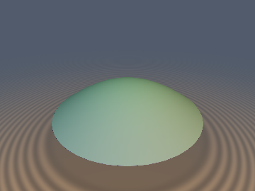
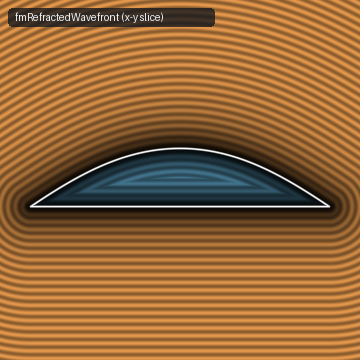
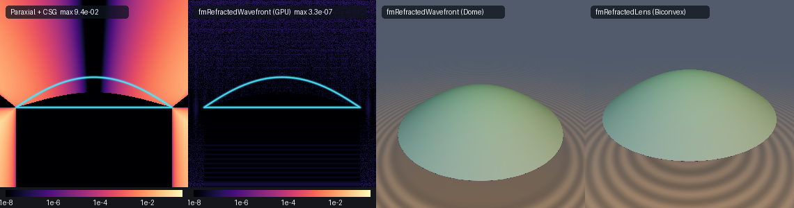

# `fmRefractedWavefront` — Exact Fermat-Snell Refracted Wavefront Dome & Lens SDFs

<p align="center">
  
  
</p>

<p align="center">
  
</p>

- **Category**: `fermat`
- **GLSL File**: [`glsl/fermat/fmRefractedWavefront.glsl`](../../glsl/fermat/fmRefractedWavefront.glsl)
- **Attribution**: Discovered and derived using Gemini 4 Argon (`sdf-gems`, 2026)
- **Exactness**: **Exact Euclidean SDF & Analytical 3D Gradients** ($`\|\nabla d\| = 1`$, `1.29e-9` FP64 / `3.29e-7` GPU FP32 max error vs ground truth; **0-iteration exact early exits** in the circular rim cone and sub-interface half-space; **1 Halley step** with 0-`sqrt` Padé seed in the refracted cone)

---

## Overview & Motivation

By **Fermat's Principle of Stationary Optical Path Length** (1662) and **Huygens' Principle** (1690), the optical path length function $`T(\mathbf{p})`$ in a piecewise-homogeneous isotropic medium with refractive index $`n(\mathbf{p})`$ satisfies the optical Eikonal equation:
```math
\|\nabla T(\mathbf{p})\| = n(\mathbf{p}).
```
Consequently, inside any homogeneous region where $`n(\mathbf{p}) = n_2`$ is constant, normalizing the optical path excess around any level wavefront $`\mathcal{W}(t_0) = \{\mathbf{p} : T(\mathbf{p}) = t_0\}`$ by $`n_2`$:
```math
d_{\text{wf}}(\mathbf{p}) = \frac{T(\mathbf{p}) - t_0}{n_2}
```
automatically satisfies the **Euclidean Eikonal Equation** $`\|\nabla d_{\text{wf}}(\mathbf{p})\| \equiv 1`$ identically wherever the refracted ray family is caustic-free.

When a spherical wave emitted from a point source at $`\mathbf{s} = (0, -h, 0)`$ in medium $`n_1`$ refracts across the planar interface $`y = 0`$ into a slower medium $`n_2 \ge n_1`$ ($`y \ge 0`$), eliminating the refraction radius $`r`$ algebraically produces an 8th-degree (quartic in $`\rho^2`$) polynomial implicit surface whose raw algebraic gradient norm varies by over $`3\times`$ across the dome. Meanwhile, paraxial rational approximations plus CSG clipping (`max(d_wf, -y)`) suffer up to **`9.4e-2` Euclidean error** at wide refraction angles and in the exterior aperture rim wedge.

`fmRefractedWavefront` and `fmRefractedLens` instead evaluate the exact Euclidean SDF and unit gradient directly from Fermat's variational principle in **1 cubic-convergent Halley step**.

---

## Mathematical Derivation

### 1. Fermat Stationary Optical Path & Envelope Eikonal Theorem

For a point $`\mathbf{p} = (x, y, z)`$ in medium $`n_2`$ ($`y \ge 0`$) at cylindrical radius $`\rho = \sqrt{x^2 + z^2}`$, Fermat's optical path from $`\mathbf{s} = (0, -h, 0)`$ across the planar interface $`y = 0`$ is:
```math
T(\rho, y) = \min_{r \in [0, \rho]} g(r; \rho, y), \qquad g(r; \rho, y) = n_1\sqrt{r^2 + h^2} + n_2\sqrt{(\rho - r)^2 + y^2}.
```
Let $`L_1(r) = \sqrt{r^2 + h^2}`$ and $`L_2(r) = \sqrt{(\rho - r)^2 + y^2}`$. Since $`g''(r) = n_1 h^2 L_1^{-3} + n_2 y^2 L_2^{-3} > 0`$, $`g`$ is strictly convex on $`[0, \rho]`$ with a unique stationary point $`r^*(\rho, y)`$ satisfying **Snell's Law**:
```math
\frac{\partial g}{\partial r}(r^*) = n_1 \frac{r^*}{L_1(r^*)} - n_2 \frac{\rho - r^*}{L_2(r^*)} = n_1\sin\theta_1 - n_2\sin\theta_2 = 0.
```

By the **Envelope Theorem** ($`\partial g / \partial r = 0`$ at $`r = r^*`$), differentiating $`d_{\text{wf}}(\rho, y) = (T(\rho, y) - t_0)/n_2`$ with respect to $`(\rho, y)`$ kills the implicit derivative $`\nabla r^*(\rho, y)`$ identically:
```math
\nabla_{(\rho, y)} d_{\text{wf}}(\rho, y) = \frac{1}{n_2}\left.\nabla_{(\rho, y)} g(r; \rho, y)\right|_{r = r^*} = \left(\frac{\rho - r^*}{L_2(r^*)},\; \frac{y}{L_2(r^*)}\right) = (\sin\theta_2,\; \cos\theta_2).
```
This proves two structural properties simultaneously:
1. **Exact Unit Eikonal Norm**: $`\|\nabla d_{\text{wf}}\|^2 = \sin^2\theta_2 + \cos^2\theta_2 \equiv 1`$ identically throughout the refracted normal fan.
2. **Quadratic Precision Doubling**: Because $`\partial g / \partial r|_{r^*} = 0`$, an approximation error $`\delta r`$ in $`r^*`$ induces only a second-order error $`\delta d_{\text{wf}} = \frac{1}{2n_2} g''(r^*)(\delta r)^2 = O((\delta r)^2)`$ in the distance value.

### 2. The Virtual-Evolute Caustic-Free Theorem

For a general surface, parallel wavefront offsets $`d_{\text{wf}}(\mathbf{p})`$ cease to be the exact Euclidean SDF once inward normals intersect at the **evolute** (focal caustic). For a spherical wave from $`(0, -h, 0)`$ refracting from $`n_1`$ into $`n_2 \ge n_1`$ across $`y = 0`$, the refracted rays bend toward the interface normal ($`\theta_2 \le \theta_1`$). Extending the refracted ray family backward shows that its meridional and sagittal centers of curvature (the virtual diacaustic) lie at depth:
```math
y_{\text{evolute}}(r) = -\frac{n_2}{n_1}\,h\left(\frac{\cos\theta_2}{\cos\theta_1}\right)^3 \le -\frac{n_2}{n_1}\,h < 0 \qquad \forall\, r \ge 0.
```
Because the entire evolute is trapped in the lower half-space $`y < 0`$, the refracted normal congruence is **100% diverging and caustic-free across the entire upper half-space $`y \ge 0`$**—both outside the wavefront ($`T > t_0`$) and throughout the entire interior down to the interface $`y = 0`$ ($`n_1 h \le T \le t_0`$).

### 3. Closed-Form Aperture Rim Voronoi Cone (0-Iteration Early Exit)

At optical path length $`t_0 > n_1 h`$, the wavefront $`\mathcal{W}(t_0)`$ meets the interface plane $`y = 0`$ ($`L_2 = 0`$) at $`L_{1,\max} = t_0 / n_1`$, forming a sharp circular aperture rim of radius:
```math
r_{\max} = \sqrt{L_{1,\max}^2 - h^2} = \sqrt{\left(\frac{t_0}{n_1} - h\right)\left(\frac{t_0}{n_1} + h\right)}.
```
At the rim, the limiting Snell refraction angle has:
```math
s_{2,\max} = \sin\theta_{2,\max} = \frac{n_1 r_{\max}}{n_2 L_{1,\max}}, \qquad c_{2,\max} = \cos\theta_{2,\max} = \sqrt{(1 - s_{2,\max})(1 + s_{2,\max})}.
```
Since $`g'(r; \rho, y)`$ is strictly increasing in $`r`$, the unconstrained stationary point satisfies $`r^*(\rho, y) \ge r_{\max}`$ if and only if $`g'(r_{\max}; \rho, y) \le 0`$, which reduces to the linear half-plane test:
```math
(\rho - r_{\max})\,c_{2,\max} \ge y\,s_{2,\max}.
```
In this exterior rim wedge, the closest point on the wavefront is the circular rim $`(\rho = r_{\max}, y = 0)`$ with exact Euclidean distance $`\sqrt{(\rho - r_{\max})^2 + y^2}`$—requiring **0 solver iterations**.

### 4. Singularity-Free 1-`inversesqrt` Snell Ray-Intercept Reformulation

Directly applying Newton's method to $`g'(r) = 0`$ requires two square roots per step and stalls near the interface $`y \to 0^+`$ where $`(\rho - r)/\sqrt{(\rho - r)^2 + y^2}`$ approaches a step function. Instead, substituting $`\tan\theta_2 = \sin\theta_2 / \sqrt{1 - \sin^2\theta_2}`$ with $`\sin\theta_2 = \frac{n_1 r}{n_2\sqrt{r^2 + h^2}}`$ into $`\rho - r = y\tan\theta_2`$ yields the smooth **Snell Ray-Intercept Equation**:
```math
F(r) = r\left(1 + \frac{n_1 y}{\sqrt{(n_2^2 - n_1^2)r^2 + n_2^2 h^2}}\right) - \rho = 0.
```
- **Asymptotic Linearity**: Unlike $`g'(r)`$, $`F(r)`$ becomes *exact and linear* as $`y \to 0^+`$ ($`F(r) \to r - \rho`$), as $`\rho \to 0^+`$, and as $`n_1 \to n_2`$ ($`\Delta n^2 = n_2^2 - n_1^2 \to 0`$).
- **0-`sqrt` Padé Initial Guess**: Approximating $`\sqrt{\Delta n^2 r_{\text{lin}}^2 + n_2^2 h^2} \approx n_2 h\bigl(1 + \frac{0.5 u}{1 + 0.25 u}\bigr)`$ where $`u = \frac{\Delta n^2 r_{\text{lin}}^2}{n_2^2 h^2}`$ and $`r_{\text{lin}} = \min\!\bigl(\frac{\rho n_2 h}{n_2 h + n_1 y}, r_{\max}\bigr)`$ seeds $`r_0`$ with `< 2e-3` relative error using **0 square roots**.
- **Single Halley Step (1 `inversesqrt`)**: With $`q = D^{-1/2} = \text{inversesqrt}(\Delta n^2 r^2 + n_2^2 h^2)`$, all three derivatives share a single `inversesqrt`:
  $`\displaystyle F(r) = r(1 + n_1 y q) - \rho, \qquad F'(r) = 1 + n_1 y (n_2^2 h^2) q^3, \qquad F''(r) = -3 n_1 y (n_2^2 h^2 \Delta n^2 r) q^5.`$
  One cubic-convergent Halley step achieves **`1.29e-9` maximum distance error** in FP64 (`3.29e-7` in GPU FP32).
- **Singularity-Free Analytical Gradient**: Computing $`\sin\theta_2 = \frac{n_1 r^*}{n_2 L_1(r^*)}`$ from the incident ray rather than $`\frac{\rho - r^*}{L_2(r^*)}`$ eliminates the $`0/0`$ division as $`y \to 0^+`$ ($`L_2 \to 0`$), guaranteeing an exact unit gradient $`\|\nabla d\| = 1`$ everywhere in $`\mathbb{R}^3`$.

---

## Numerical Verification

Verified on the GPU (OpenGL 4.1 FP32 via `tools/gpu_eval.py`) and in FP64 against independent explicit wavefront curve parameterizations and 12-step reference solutions across $`N = 25,000`$ random 3D points, $`4,000`$ branch-seam pairs, and $`3,209`$ axis/origin/plane probe points ($`h = 0.55, n_1 = 1.0, n_2 = 1.6, t_0 = 1.25`$):

| Function | FP64 Max Error | GPU FP32 Max Error | GPU FP32 Mean Error | $`\Vert\mathbf{g}\Vert - 1`$ Max | Self-Projection Max $`\vert d(\mathbf{p} - d\mathbf{g})\vert`$ | Paraxial + CSG Error |
| :--- | :---: | :---: | :---: | :---: | :---: | :---: |
| `fmRefractedWavefront` / `fmgRefractedWavefront` | `1.29e-9` | `3.29e-7` | `4.60e-8` | `1.68e-7` | `4.51e-7` | `9.40e-2` |
| `fmRefractedLens` / `fmgRefractedLens` | `1.29e-9` | `3.52e-7` | `5.56e-8` | `1.68e-7` | `4.51e-7` | `9.40e-2` |
| Special-Case $`n_1 = n_2 = 1`$ vs Spherical Lens | `0.0` | `3.36e-7` | `5.51e-8` | `1.19e-7` | `3.58e-7` | — |

---

## GLSL Implementation

See [`glsl/fermat/fmRefractedWavefront.glsl`](../../glsl/fermat/fmRefractedWavefront.glsl).
