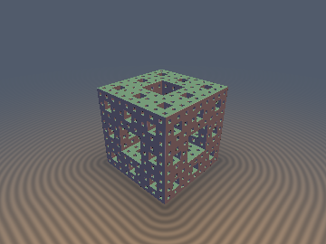
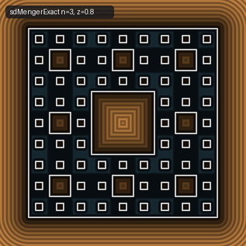
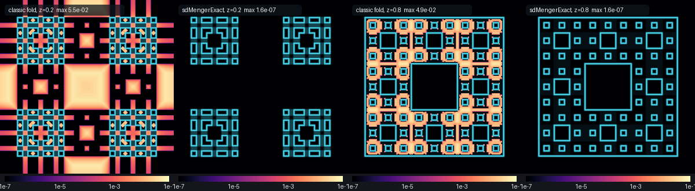

# `sdSierpinski2D`, `sdSierpinskiTetra`, `sdMengerExact`, `sdMengerGreedy` — Euclidean SDFs of Level-n Self-Similar Sets

| 3D Surface ($`f(\mathbf{p}) = 0`$, Menger level 3) | 2D Cross-Section Slice ($`z = 0.8`$) |
| :---: | :---: |
|  |  |

| Property | Value |
| :--- | :--- |
| **Author** | **Claude Fable 5.2** (`sdf-gems`, 2026). Research experiment: see [Findings](#findings) for what failed. |
| **Category** | `fractals` |
| **GLSL File** | [`glsl/fractals/sdFractalExact.glsl`](../../glsl/fractals/sdFractalExact.glsl) |
| **`sdSierpinski2D(p, n)`** | Exact (proved; GPU max error `5.5e-7` vs brute force at levels 2–6, `1.6e-6` at distance 10) |
| **`sdSierpinskiTetra(p, n)`** | Exact (proved; GPU max error `3.8e-7` vs brute force at levels 2–5, `1.4e-6` at distance 9) |
| **`sdMengerExact(p, n)`** | Exact for $`n \le 5`$ with the default beam of 16 (proved; GPU max error `3.5e-7` outside, `9.8e-8` inside, levels 1–5). Conservative bound for larger $`n`$. |
| **`sdMengerGreedy(p, n)`** | Approximate: no proof. Equal to `sdMengerExact` at all `2e7` sampled points (levels 2–6). |
| **`sdSierpinskiTetraLod`, `sdMengerExactLod`** | Conservative bound, within `eps` of the level-n distance wherever the result is positive |

---

## Overview

Shader "distance estimators" for IFS fractals are bounds or estimates, not distances. A level-$`n`$ approximant
$`A_n`$ is a finite union of similar copies of one primitive (triangle, tetrahedron, cube), so its distance is a
minimum over $`N^n`$ copies. This experiment asked how few copies have to be looked at.

The answer is better than the brief expected: using the reflection symmetry of each node, the Sierpinski sets need
**one** path (one primitive evaluation in total), and the Menger sponge needs a tree with branching factor **2**
instead of 20. A fixed array of 16 candidates makes the Menger distance exact up to level 5.



*Error against brute-force ground truth (log scale, true surface in cyan), Menger level 3. Panels 1–2: slice $`z = 0.2`$
(mostly outside the solid). Panels 3–4: slice $`z = 0.8`$ (mostly inside the solid). The classic max-of-crosses estimator
is off by up to `5.5e-2`; `sdMengerExact` stays at `1.6e-7`.*

## Mathematical Derivation

### 1. The symmetry lemma

Let $`S`$ be a closed set invariant under a finite reflection group $`W`$, and let $`C`$ be a closed chamber of $`W`$
containing $`\mathbf{p}`$. For any $`\mathbf{q} \in S`$, the image $`\mathbf{q}^* \in C`$ of $`\mathbf{q}`$ under $`W`$ satisfies
$`\Vert \mathbf{p} - \mathbf{q}^* \Vert \le \Vert \mathbf{p} - \mathbf{q} \Vert`$ (each reflection that moves $`\mathbf{q}`$ to
the side of a mirror where $`\mathbf{p}`$ is does not increase the distance). Hence

```math
\mathrm{dist}(\mathbf{p}, S) = \mathrm{dist}(\mathbf{p}, S \cap C).
```

### 2. Sierpinski triangle and tetrahedron: a single path

$`A_n = \bigcup_i \tfrac12 (A_{n-1} + \mathbf{v}_i)`$ with $`\mathbf{v}_i`$ the vertices of the root simplex. The perpendicular
bisectors of vertex pairs are mirrors of $`A_n`$. The region $`R_i`$ of points closer to $`\mathbf{v}_i`$ than to any other vertex
is a union of chambers, and $`A_n \cap R_i`$ is exactly child $`i`$ (the other children touch $`R_i`$ only in points shared
with child $`i`$). By the lemma, with $`i`$ the index of the nearest vertex,

```math
d_n(\mathbf{p}) = \tfrac12 \, d_{n-1}(2\mathbf{p} - \mathbf{v}_i), \qquad d_0 = \text{exact SDF of the simplex}.
```

The children touch only in vertices, so the signed minimum over leaves is the signed distance of the union, and the
recursion also holds inside the solid. Cost: $`n`$ nearest-vertex selections and one primitive SDF.

### 3. Menger sponge: branching factor 2

A node is a cube of half-size $`s`$ symmetric under the cube group. After folding the query point into the chamber
$`x \ge y \ge z \ge 0`$ of the node, only four of its 27 sub-cubes meet the chamber:

| Sub-cube (centre / $`\tfrac{2s}{3}`$) | Type |
| :--- | :--- |
| $`(1,1,1)`$ corner, $`(1,1,0)`$ edge | kept: recurse |
| $`(0,0,0)`$ centre, $`(1,0,0)`$ face centre | removed |

Outside the solid the distance is the minimum over the two kept children, recursively: a binary tree with $`2^n`$ leaves
instead of $`20^n`$. Inside the solid the distance to the complement is the minimum of the distance to the outside of the
root cube, the two removed children of every visited node, and the recursion into the two kept children.

Pruning uses the node's box distance $`\ell`$ as a lower bound and $`\ell + h s`$ as an upper bound, where

```math
h = \sup_{\mathbf{x} \in \text{hull}} \mathrm{dist}(\mathbf{x}, A_\infty) / s = \tfrac{\sqrt2}{3} \ \text{(cube)}, \quad
\sqrt{3/8} \ \text{(tetrahedron, } s = 1 \text{ for vertices } (\pm1,\pm1,\pm1)), \quad \tfrac14 \ \text{(triangle, circumradius 1)}.
```

Survivors are kept in an array of $`K`$ candidates sorted by lower bound. When a candidate is dropped for lack of room,
its lower bound enters the final minimum, so the result can only decrease: it stays a conservative bound. Since a level
has at most $`2^{k}`$ nodes, $`K = 16`$ cannot overflow for $`n \le 5`$.

### 4. Level of detail and the limit set

$`A_\infty \subset A_n \subset A_k`$ for $`k \le n`$, and every point of $`A_k`$ is within $`h r^k`$ of $`A_\infty`$ ($`r`$ the
contraction ratio). So wherever $`d_k > 0`$:

```math
0 \le d_n - d_k \le d_\infty - d_k \le h \, r^k .
```

This is a single term, not a geometric series. The early-out rule is: stop at the first level $`k`$ with
$`h r^k \le \varepsilon`$ (for a pixel footprint $`\varepsilon`$), i.e. `sdFractalLodLevel`.

## Verification

All numbers are from the literal GLSL on the GPU (FP32) unless marked FP64. Ground truths are independent of the
descent: `polygon_sdf` per leaf triangle, `convex_hull_sdf` per leaf tetrahedron, and for the sponge a $`3^n`$ occupancy
grid built from the base-3 digit predicate, searched with a KD-tree and a completeness certificate.

| Check | `sdSierpinski2D` | `sdSierpinskiTetra` | `sdMengerExact` |
| :--- | :---: | :---: | :---: |
| NaN/Inf at probes, $`n = 0..7`$ | 0 | 0 | 0 |
| max $`\vert d - d_{gt} \vert`$, worst level | `5.5e-7` (n 2–6); `1.6e-6` at n = 0 where $`d \approx 10`$ (60k pts per level) | `3.8e-7` (n 2–5); `1.4e-6` at n = 0 where $`d \approx 9`$ (60k pts per level) | `3.5e-7` outside, `9.8e-8` inside (n 1–5, 200k pts per level) |
| Sign mismatches | 0 | 0 | 17 of 200k at n = 5, all with $`0 < d_{gt} < 2.1 \times 10^{-6}`$ |
| Lipschitz (pairs, $`\sigma = 0.01`$) | `1.00024` (FP32), `1.000000` (FP64) | `0.999996` | `0.999995` |
| Eikonal, fraction within `1e-2` | `0.945` | `0.972` | `0.924` |
| Seam $`C^0`$ on fold planes | `2.0e-5`, 0 violations | `2.0e-5`, 0 violations | `2.1e-5`, 0 violations |
| $`\vert d \vert`$ on independent surface samples | `4.5e-8` | `3.4e-8` | `4.3e-8` |
| Self-projection (FP64 port, FD gradient), median / max | `6.8e-12` / `3.2e-4` | `3.3e-11` / `1.3e-8` | `4.1e-12` / `5.7e-4` |
| Sphere-tracing overstep pixels | n/a | 0 | 0 |

The self-projection maxima come from finite-difference gradients across medial seams: for the sponge, the residual
exceeds `1e-8` at 0.001% of points, all of them with a non-unit FD gradient; elsewhere the maximum is `5.6e-10`.
The eikonal fractions below 1 have the same cause (fractal fields have dense medial sets).

The sign mismatches are a deliberate threshold: points with outer distance below `2e-6` are treated as inside.

FP64 prototypes match the ground truths to `2e-15` at every level tested (200k points per level).

## Findings

### What held

- **A small bounded candidate set suffices.** With the symmetry reduction: 1 path for both Sierpinski sets; at most
  $`2^{k}`$ nodes at level $`k`$ for the sponge, on average 1.6, 2.1, 2.6, 3.2 live nodes at levels 1–4 (level 5, FP64).
  Mean box evaluations outside: 5.3, 9.5, 14.6, 21.0 for levels 2–5 (brute force: 400 to 3.2 million).
- **The certificate works.** Over all beam widths and levels tested, the certified result never exceeded the exact
  distance (max overshoot `0.0`).
- **Level of detail.** Measured $`d_n - d_{lod} \le`$ `0.102, 0.034, 0.011, 0.0037` (sponge) and `0.100, 0.046, 0.011, 0.0052`
  (tetrahedron) for $`\varepsilon`$ = `0.3, 0.1, 0.03, 0.01`, wherever the LOD result is positive, and never negative
  beyond `4e-7`.
- **Limit-set bound.** $`d_{n+6} - d_n`$ for the tetrahedron reaches 56–64% of $`h 2^{-n}`$ for $`n`$ = 1–6;
  $`d_5 - d_n`$ for the sponge reaches 63–66% of $`\sqrt2 / 3^{n+1}`$ for $`n`$ = 1–3.
- **Minkowski dimension** from $`\mathrm{vol}\{d < r\} \sim r^{\dim - D}`$ (pairwise slopes, finest scales last):
  tetrahedron (level 10) `1.88, 1.97, 1.99, 2.00, 1.99, 2.00` (expected 2); triangle (level 12)
  `1.46 … 1.581, 1.585` (expected 1.585); sponge (level 8) `2.679, 2.708, 2.719, 2.724` (expected 2.727, still converging).

### What failed or was weaker than hoped

- **The brief's premise that greedy descent must fail was not confirmed.** Following the single child with the smallest
  hull distance (no symmetry, 20 or 4 children per level) agreed with the exact distance at every one of 400k random
  plus 400k adversarial points per level (tetrahedron levels 2–5, sponge levels 2–4, inside and outside). The beam was
  checked to really restrict the live set, and an independently written greedy gave identical values. I found no
  failure set and no proof. `sdMengerGreedy` is therefore shipped as approximate.
- **Certifying the generic (unfolded) tree needs wide beams.** With hull-distance bounds only, up to 44 nodes per level
  stay live for the sponge (30 for the tetrahedron); the certificate confirms exactness everywhere only from $`K = 4`$
  outside and $`K = 8`$ inside at level 5. The symmetry reduction, not the beam, is what makes this cheap.
- **My first upper-bound constant for the tetrahedron was wrong** ($`1/\sqrt3`$, the inradius of the octahedral hole).
  The foot of the perpendicular lands in a hole of the child's face; the correct value is $`\sqrt{3/8}`$ (brute-force
  sup at level 4: 0.601). The wrong constant pruned every node at some points and returned infinity.
- **For the Sierpinski tetrahedron the classic fold is already exact.** The Kaleidoscopic-IFS fold (three conditional
  reflections, scale 2) ended with an exact tetrahedron matched ground truth at 100% of 200k points per level. Only the
  usual endings are wrong: `length(z)` overestimates at 100% of points (median ratio 1.19 at level 3, max above 1000),
  and subtracting the bounding sphere underestimates (median ratio 0.81) and fattens the shape.
- **Exactness barely helps sphere tracing.** Sponge level 4: 8.22 steps per pixel (exact) vs 8.26 (classic), 0 overstep
  pixels for both. The classic estimator never overestimated in `1e6` points.
- **Where the classic sponge estimator is wrong.** Outside: ratio to exact between 0.707 and 1, exact at 69–76% of
  points, max error 0.14. Inside: it drops to zero on interior cell planes (e.g. $`x = 1/3`$) where the true depth is
  up to 0.05; 15% of interior points at level 3 have less than half the true depth. This matters for offsets,
  shells and interior shading, not for hitting the surface.
- **Koch curve, Cantor dust, Vicsek: not done.**
- **GPU timing was not resolved**: 2 million evaluations take 4–16 ms including transfer for every variant, which is
  too close to the transfer cost to rank them. `sdMengerExact` was the slowest at levels 5–6 (15–16 ms vs 4–5 ms).

### Open questions

- Is greedy hull-distance descent provably exact for the sponge (and for the unfolded tetrahedron)?
- Beyond level 5 the 16-beam can overflow (live nodes reach 24 and 32 at levels 7 and 8), yet the result equalled the
  unbounded search at all 300k points per level (FP64, levels 6–8). Is that general?
- The Koch curve has a single mirror, so the lemma only halves its tree.

## Novelty & Prior Art

- Fold-and-scale estimators: Kaleidoscopic IFS (Knighty, Fractal Forums), the Syntopia "Distance Estimated 3D Fractals"
  series, and the widely copied max-of-crosses Menger shader. These are the baselines above.
- Hierarchical bounding volumes over the IFS tree for ray intersection: Hart and DeFanti, "Efficient antialiased
  rendering of 3-D linear fractals" (SIGGRAPH 1991). Branch-and-bound over the IFS tree is therefore not new.
- I found no published exact Euclidean SDF of the Menger sponge, but the search was shallow (summaries only, no primary
  sources opened, and one summary mislabelled the max-of-crosses shader as exact). Treat novelty as unconfirmed.
- Possibly new here: the 2-way folded tree with removed-cube candidates for the signed interior distance, the overflow
  certificate, and the measurements. The Sierpinski result is a proof that a known fold is exact when ended correctly.

## GLSL

See [`glsl/fractals/sdFractalExact.glsl`](../../glsl/fractals/sdFractalExact.glsl). Root shapes: triangle of circumradius 1
with a vertex at $`(0, 1)`$; tetrahedron with vertices $`(1,1,1), (1,-1,-1), (-1,1,-1), (-1,-1,1)`$; cube $`[-1, 1]^3`$.
`SDF_FRACTAL_MENGER_BEAM` (default 16) sets the candidate array size; $`2^{n-1}`$ guarantees exactness at level $`n`$.
