# 6. Analytical Gradients & Curvature Jets (`sdg` / `sdh`)

[**← Back to Main `sdf-gems` README**](../../README.md) · **GLSL Headers**: [`glsl/gradients3d/`](../../glsl/gradients3d/) (32 headers)

Functions returning `vec4(d, grad.xyz)` in 3D (or 6-float Weingarten curvature 2-jets in `sdhJet3D`) enable single-pass analytical normals, self-projection, osculating-sphere tracing, and angle-aware booleans parameterized by $`\cos\theta = \nabla a \cdot \nabla b`$.

## Contents

- **3D Primitive Analytical Gradients** (22)
- **Gradient-Propagating Booleans, Extrusions, Folds & Curvature Jets** (10)

## 3D Primitive Analytical Gradients

| Preview | Function | Summary |
| :---: | :--- | :--- |
| 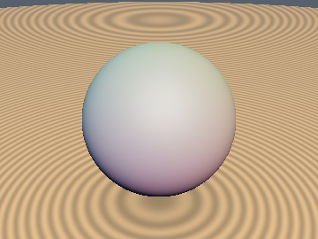&nbsp;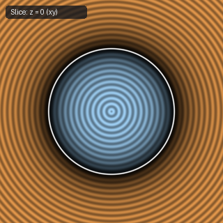 | [**`sdgSphere`**](sdgSphere.md) [`glsl`](../../glsl/gradients3d/sdgSphere.glsl) · **Exact** | Returns `vec4(d, p / length(p))` |
| 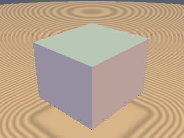&nbsp;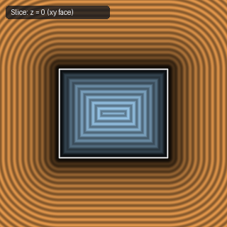 | [**`sdgBox`**](sdgBox.md) [`glsl`](../../glsl/gradients3d/sdgBox.glsl) · **Exact** | **Also**: `sdgRoundBox`. 0/1-SFU 3D box & rounded box + gradient (`0` SFUs & `0` divs in interior + all 6 exterior face prisms) |
| 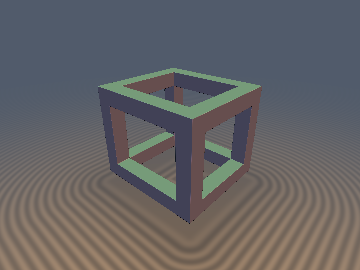 | [**`sdgBoxFrame`**](sdgBoxFrame.md) [`glsl`](../../glsl/gradients3d/sdgBoxFrame.glsl) · **Exact** | **Also**: `sdgBoxEdges`. 1-`sqrt` analytical 3D distance + unit gradient for a hollow 12-beam box frame via Weyl-chamber closest-beam reduction |
| 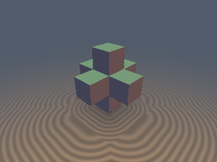&nbsp;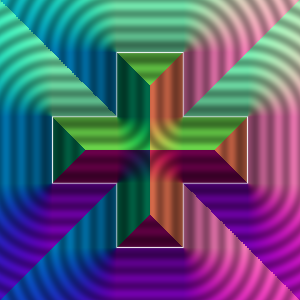 | [**`sdgCross3D`**](sdgCross3D.md) [`glsl`](../../glsl/gradients3d/sdgCross3D.glsl) · **Exact** | **Also**: `sdgInfCross3D`, `sdgJack3D`, `sdgAxisJack3D`, `sdgFaceJack3D`. 0/1-SFU 3D orthogonal & Menger cross gradients (`0` SFU on 18 faces & arms via reversible 3-swap) and 1-SFU 0-swap capsule jacks |
| 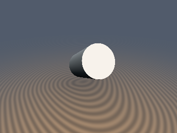&nbsp;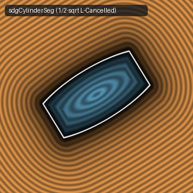 | [**`sdgCylinder`**](sdgCylinder.md) [`glsl`](../../glsl/gradients3d/sdgCylinder.glsl) · **Exact** | **Also**: `sdgCylinderSeg`. 0/1/2-`sqrt` vertical & 1/2-`sqrt` segment cylinder + gradient; fixes $`100\%`$ exterior axis `0.0 * NaN` bug in IQ's `3fcyz2` |
| 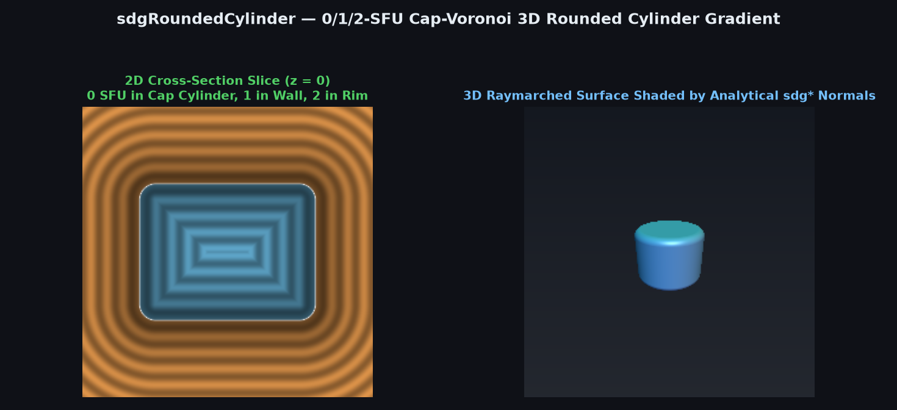 | [**`sdgRoundedCylinder`**](sdgRoundedCylinder.md) [`glsl`](../../glsl/gradients3d/sdgRoundedCylinder.glsl) · **Exact** | 0/1/2-SFU 3D rounded cylinder distance + gradient (`0` SFU in flat-cap Voronoi cylinder/paraboloid, `1` in wall, `2` in rim) |
| 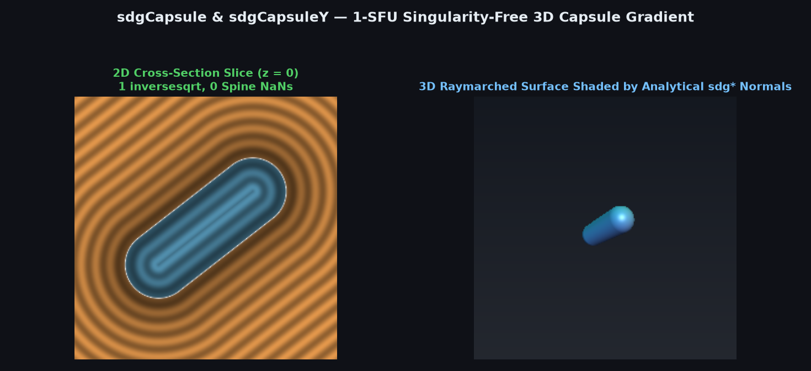 | [**`sdgCapsule`**](sdgCapsule.md) [`glsl`](../../glsl/gradients3d/sdgCapsule.glsl) · **Exact** | **Also**: `sdgCapsuleY`. 1-`inversesqrt` singularity-free 3D capsule distance + unit gradient (`0` divisions in `sdgCapsuleY`, `0` medial-spine `NaN`s) |
| 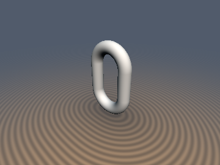&nbsp;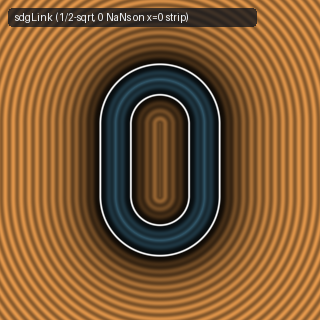 | [**`sdgLink`**](sdgLink.md) [`glsl`](../../glsl/gradients3d/sdgLink.glsl) · **Exact** | **Also**: `sdgCapsule`. 1/2-`sqrt` chain link & 1-`sqrt` capsule + 3D gradient; fixes $`100\%`$ 2D planar strip `0.0/0.0 = NaN` bug in IQ's `wc3yD7` |
| 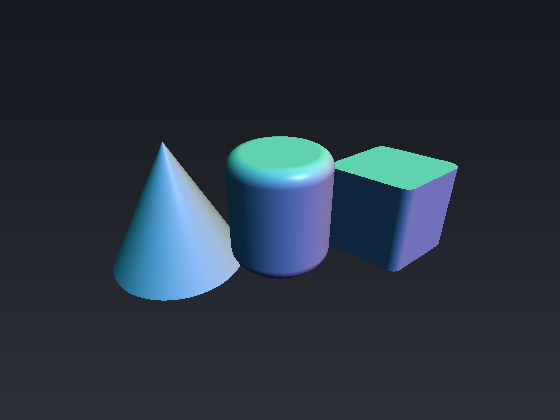&nbsp;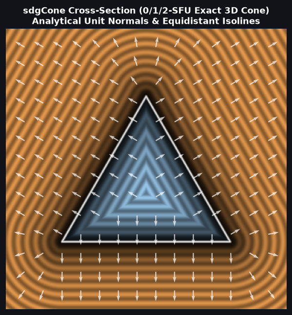 | [**`sdgCone`**](sdgCone.md) [`glsl`](../../glsl/gradients3d/sdgCone.glsl) · **Exact** | **Also**: `sdgConeBound`. 0/1/2-SFU 3D exact cone distance + unit gradient (`0` SFU in base & apex Voronoi cones, `1` SFU in mantle, `2` in rim) |
| 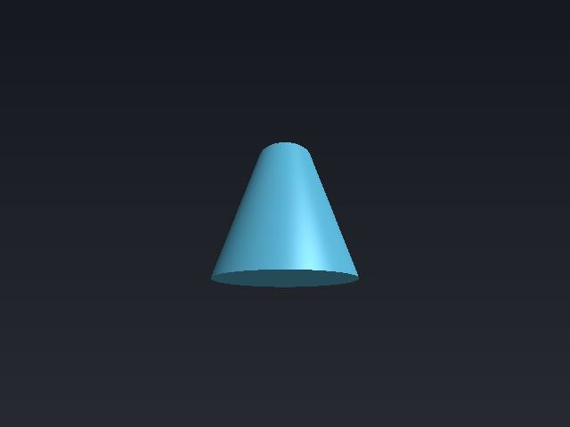&nbsp;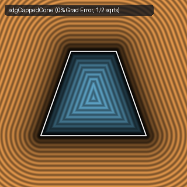 | [**`sdgCappedCone`**](sdgCappedCone.md) [`glsl`](../../glsl/gradients3d/sdgCappedCone.glsl) · **Exact** | 1/2-`sqrt` 3D capped cone + gradient; fixes $`56.91\%`$ rim gradient failure in IQ's `sdgCappedCone` (`3ctcW7`) |
| 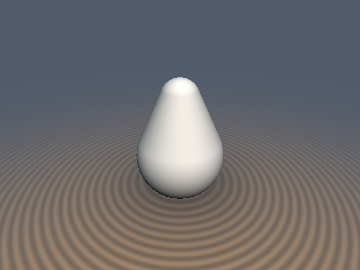&nbsp;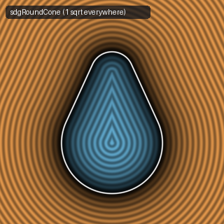 | [**`sdgRoundCone`**](sdgRoundCone.md) [`glsl`](../../glsl/gradients3d/sdgRoundCone.glsl) · **Exact** | **Also**: `sdgTorus`. 1-`sqrt` vertical & $`O(L^2)`$ segment round cone gradients (`sdgRoundConeSeg`) and 2-`sqrt` `sdgTorus` |
| 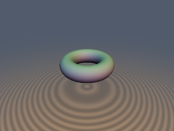&nbsp;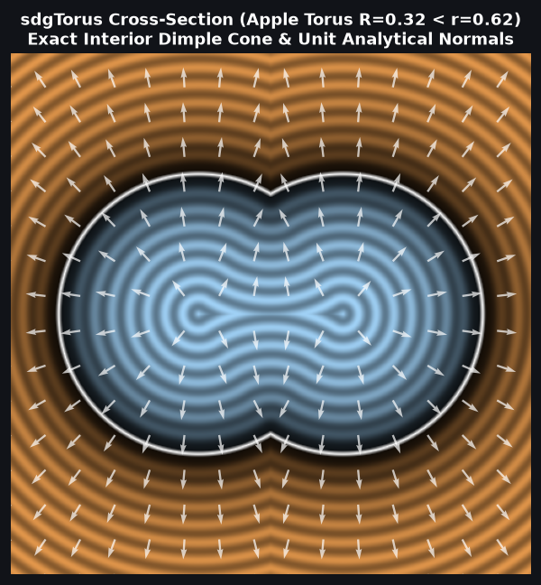 | [**`sdgTorus`**](sdgTorus.md) [`glsl`](../../glsl/gradients3d/sdgTorus.glsl) · **Exact** | **Also**: `sdTorusAllRegime`, `sdgTorusAllRegime`, `sdLemonTorus`, `sdgLemonTorus`. Singularity-free 3D ring, self-intersecting apple ($`R < r`$), and spindle-core lemon torus SDFs + gradients (eliminates internal phantom sheet) |
| 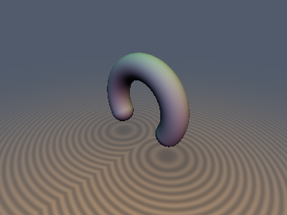 | [**`sdgCappedTorus`**](sdgCappedTorus.md) [`glsl`](../../glsl/gradients3d/sdgCappedTorus.glsl) · **Exact** | 1/2-SFU singularity-free 3D capped torus distance + gradient (`1` `inversesqrt` in $`63.2\%`$ of space; $`5\times`$ tighter spine FP32 accuracy) |
| 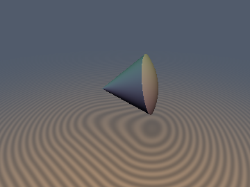&nbsp;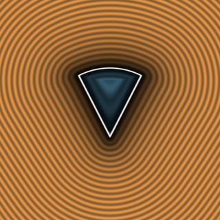 | [**`sdgSolidAngle`**](sdgSolidAngle.md) [`glsl`](../../glsl/gradients3d/sdgSolidAngle.glsl) · **Exact** | **Also**: `sdgCappedTorus`, `sdgCutSphere`. 0/1/2-SFU 3D solid angle (`1` `inversesqrt` in $`65\%\text{--}81\%`$ of space via Cap-Voronoi), capped torus, & cut/hollow sphere gradients |
| 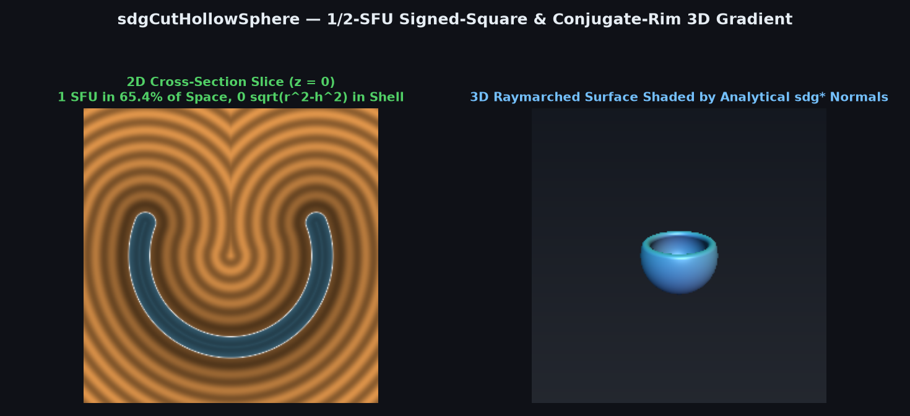 | [**`sdgCutHollowSphere`**](sdgCutHollowSphere.md) [`glsl`](../../glsl/gradients3d/sdgCutHollowSphere.glsl) · **Exact** | 1/2-SFU 3D cut hollow sphere distance + gradient (`1` `inversesqrt` in $`65.4\%`$ of space via 0-`sqrt` signed-square test + conjugate rim) |
| 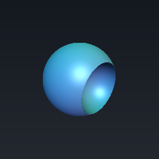&nbsp;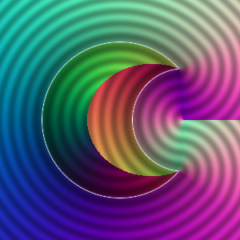 | [**`sdgDeathStar`**](sdgDeathStar.md) [`glsl`](../../glsl/gradients3d/sdgDeathStar.glsl) · **Exact** | **Also**: `sdgLens`, `sdgVesicaSegment`. 1/2-SFU sphere-subtracted-by-sphere, optical lens, and 3D revolved vesica gradients (`1` `inversesqrt` in $`88\%\text{--}91\%`$ of space + conjugate rim) |
| 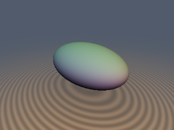 | [**`sdgEllipsoid`**](sdgEllipsoid.md) [`glsl`](../../glsl/gradients3d/sdgEllipsoid.glsl) · **Exact** | **Also**: `sdgEllipsoidExact`, `sdgSpheroid`. 0-extra-`sqrt` analytical 3D triaxial ellipsoid & spheroid gradients via Secular Co-Normal Reuse ($`\nabla d = \mathbf{u} / \Vert \mathbf{u}\Vert`$) |
| 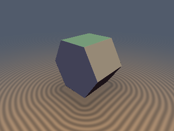&nbsp;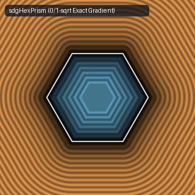 | [**`sdgHexPrism`**](sdgHexPrism.md) [`glsl`](../../glsl/gradients3d/sdgHexPrism.glsl) · **Exact** | **Also**: `sdgTriPrism`. 0/1-`sqrt` hexagonal and triangular prisms with analytical 3D gradient (`0` `sqrt`s in interior & caps, `1` in walls) |
| 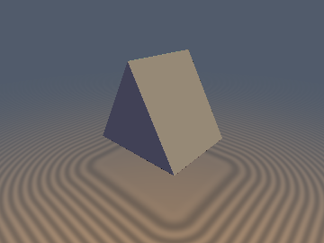 | [**`sdgTriPrism`**](sdgTriPrism.md) [`glsl`](../../glsl/gradients3d/sdgTriPrism.glsl) · **Exact** | 0/1-SFU equilateral triangular prism 3D distance + unit gradient (`0` SFU across $`51.4\%`$ of space via 2D/3D face-prism early exit) |
| 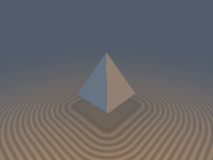&nbsp;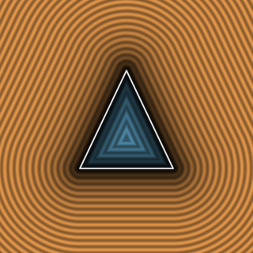 | [**`sdgPyramid`**](sdgPyramid.md) [`glsl`](../../glsl/gradients3d/sdgPyramid.glsl) · **Exact** | 0/1-per-pixel-SFU 3D square pyramid distance + gradient via Euclidean-Vector Decomposition (`0` SFU in base & slanted face, `1` `inversesqrt` at edges) |
| 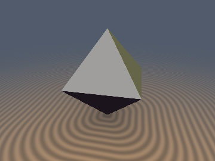&nbsp;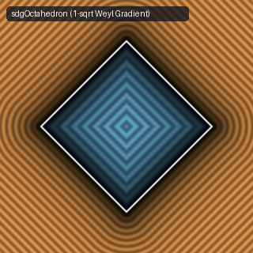 | [**`sdgOctahedron`**](sdgOctahedron.md) [`glsl`](../../glsl/gradients3d/sdgOctahedron.glsl) · **Exact** | **Also**: `sdgRhombicDodecahedron`. 1-`sqrt` branchless-formula analytical 3D distance + gradient via Orthogonal Weyl-Vector Decomposition |
| 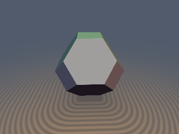 | [**`sdgArchimedeanSolid`**](sdgArchimedeanSolid.md) [`glsl`](../../glsl/gradients3d/sdgArchimedeanSolid.glsl) · **Exact** | **Also**: `sdgTruncatedOctahedron`, `sdgCuboctahedron`, `sdgRhombicDodecahedron`. 0-loop, 0-trig, 1-`sqrt` exact analytical unit gradients and Euclidean SDFs for Archimedean truncated octahedron, cuboctahedron, & Catalan rhombic dodecahedron |

## Gradient-Propagating Booleans, Extrusions, Folds & Curvature Jets

| Preview | Function | Summary |
| :---: | :--- | :--- |
| 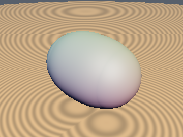&nbsp;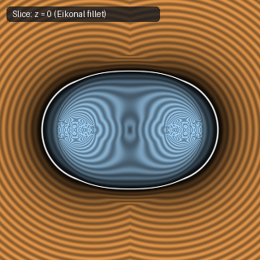 | [**`sdgSmoothUnion`**](sdgSmoothUnion.md) [`glsl`](../../glsl/gradients3d/sdgSmoothUnion.glsl) · **Exact** | Corner-local, angle-invariant rolling-ball fillet with exact Eikonal distance $`\Vert \nabla d\Vert = 1`$ ($`0\%`$ overstep) |
| 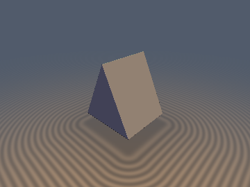&nbsp;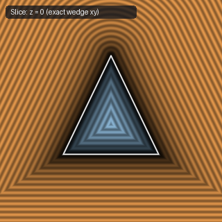 | [**`sdgWedgeIntersection`**](sdgWedgeIntersection.md) [`glsl`](../../glsl/gradients3d/sdgWedgeIntersection.glsl) · **Exact** | Exact Euclidean Gram-Schmidt wedge intersection, union, and subtraction for any angle $`\theta`$ |
| 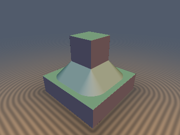&nbsp;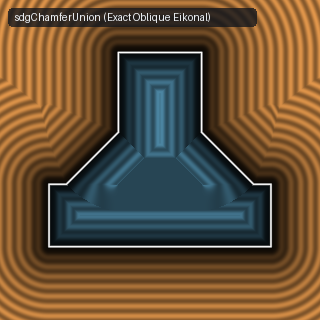 | [**`sdgChamfer`**](sdgChamfer.md) [`glsl`](../../glsl/gradients3d/sdgChamfer.glsl) · **Exact** | Angle-exact Euclidean chamfer union, intersection, and subtraction with unit 3D gradient for any angle $`\theta`$ |
| 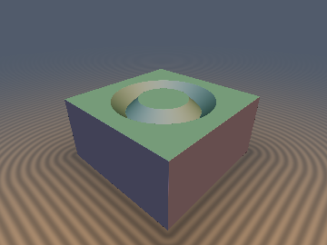&nbsp;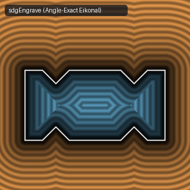 | [**`sdgEngrave`**](sdgEngrave.md) [`glsl`](../../glsl/gradients3d/sdgEngrave.glsl) · **Exact** | **Also**: `sdgTongue`, `sdgGroove`, `sdgPipe`. Angle-exact Gram-Schmidt surface-anchored V-engraving, tongue, groove, and pipe with unit 3D gradient ($`\Vert \nabla d\Vert = 1`$) |
| 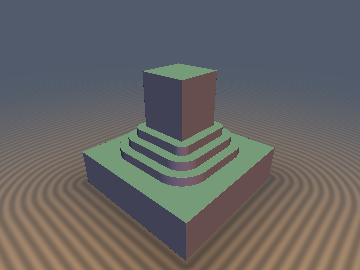&nbsp;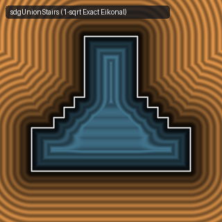 | [**`sdgStairs`**](sdgStairs.md) [`glsl`](../../glsl/gradients3d/sdgStairs.glsl) · **Exact** | 1-`sqrt` stepped stairs union, intersection, and subtraction with sign-cancelled analytical 3D unit gradient |
| 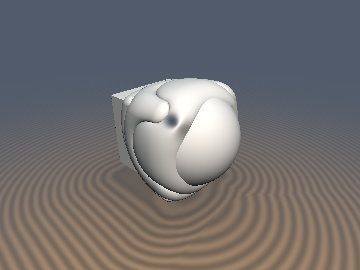&nbsp;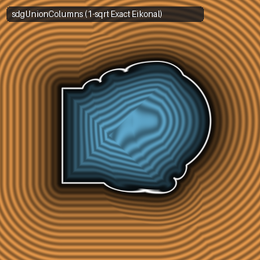 | [**`sdgColumns`**](sdgColumns.md) [`glsl`](../../glsl/gradients3d/sdgColumns.glsl) · **Exact** | 1-`sqrt` columned union, subtraction, and intersection with $`45^\circ`$ orthonormal-basis analytical 3D unit gradient |
| 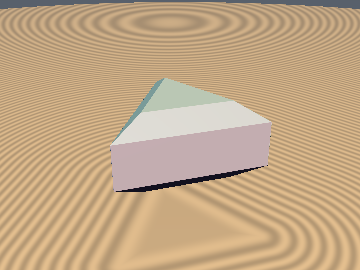&nbsp;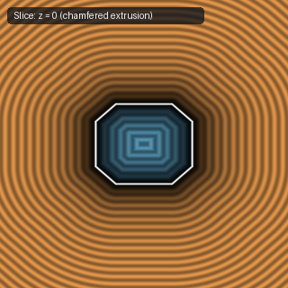 | [**`sdgExtrusion`**](sdgExtrusion.md) [`glsl`](../../glsl/gradients3d/sdgExtrusion.glsl) · **Exact** | Lifts any 2D `vec3(d, gx, gy)` into an exact 3D `vec4(d, grad.xyz)` under sharp, round, chamfer, or $`n`$-stepped ziggurat extrusion |
| &nbsp; | [**`sdgRevolution`**](sdgRevolution.md) [`glsl`](../../glsl/gradients3d/sdgRevolution.glsl) · **Exact** | Lifts any 2D `vec3(d, gx, gy)` into an exact 3D `vec4(d, grad.xyz)` under full $`360^\circ`$ or limited-angle partial revolution |
| &nbsp; | [**`sdgMirrorFold`**](sdgMirrorFold.md) [`glsl`](../../glsl/gradients3d/sdgMirrorFold.glsl) · **Exact** | **Also**: `sdgMirrorExact`, `sdgMirrorFillet`, `sdgMirrorChamfer`, `sdgMirrorEngrave`, `sdgMirrorFilletPlane`, `opMirror*`. 1-tap, 1-`sqrt` exact seam-corrected mirror-fold union, fillet, chamfer, & V-engraving from a single `sdgPrim(vec3(abs(p.x), p.y, p.z))` evaluation (eliminates $`29.3\%`$ crease underestimation & $`+41.4\%`$ miter-spike inflation) |
|  | [**`sdhJet3D`**](sdhJet3D.md) [`glsl`](../../glsl/gradients3d/sdhJet3D.glsl) · **Exact** | **Also**: `sdhSphere`, `sdhPlane`, `sdhBox`, `sdhRoundBox`, `sdhCylinder`, `sdhTorus`, `sdhSmoothUnion`, `sdhOsculatingStep`. 6-float Weingarten 2-jet propagating distance, gradient, and ambient principal curvatures $`(\kappa_1, \kappa_2)`$ with evolute-safe osculating-sphere raymarching |
