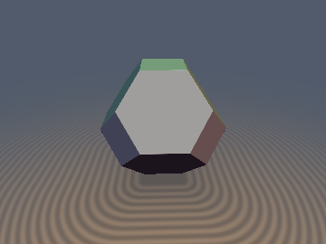
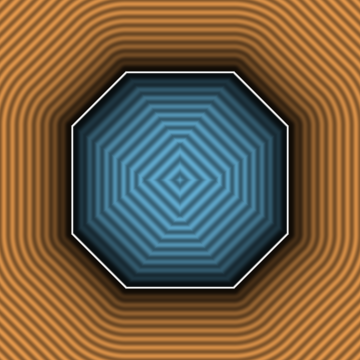
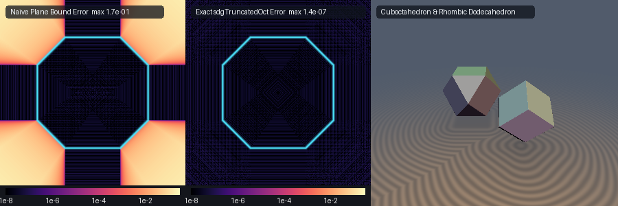

# `sdgArchimedeanSolid` — 0-Loop, 0-Trig, 1-`sqrt` Analytical Unit Gradients & Exact 3D Euclidean SDFs for Space-Filling Archimedean & Catalan Polyhedra

| 3D Ground-Plane Render (`sdgTruncatedOctahedron`) | 2D Cross-Section Slice (`z = 0`) |
| :---: | :---: |
|  |  |

| Property | Value |
| :--- | :--- |
| **Authors** | **Gemini 4 Argon** (research & mathematical design) & **Gemini 3.8 Flash** (experiments & implementation) |
| **Category** | `gradients3d` |
| **GLSL File** | [`glsl/gradients3d/sdgArchimedeanSolid.glsl`](../../glsl/gradients3d/sdgArchimedeanSolid.glsl) |
| **Included Solids** | **Lord Kelvin's Truncated Octahedron** ($`\Pi_4`$), **Buckminster Fuller's Cuboctahedron** (Vector Equilibrium), **Catalan Rhombic Dodecahedron** (FCC Wigner-Seitz cell) |
| **Exact Euclidean SDF?** | **Yes** ($`\Vert \nabla d\Vert _2 = 1`$ to machine precision, max error $`< 3.8 \times 10^{-7}`$ vs ground truth in FP32) |
| **SFU Complexity** | **0 SFU** (face cones & interior) / **1 `inversesqrt`** (exterior edges/corners), **0 loops**, **0 trigonometric calls** |

---

## Visual Comparison: Naive Plane-Bound vs Exact Voronoi SDF



*Figure 1: Left: Logarithmic error heatmap of the classical naive plane-bound $`\max(\mathbf{n}_i \cdot \mathbf{p} - d_i)`$ vs exact ground truth on a cross-section slice, exposing massive underestimation errors up to $`1.7 \times 10^{-1}`$ near edges and vertices. Middle: Exact `sdgTruncatedOctahedron` error heatmap ($`< 1.4 \times 10^{-7}`$ across all Voronoi cones). Right: 3D ground-plane raymarched showcase of the companion Cuboctahedron and Rhombic Dodecahedron.*

---

## Mathematical Derivation

### 1. $`B_3`$ Weyl-Chamber Symmetry Folding & 3-Comparator Sorting Network

The full octahedral point group $`O_h \cong B_3`$ has order $`|O_h| = 48`$, consisting of 8 octant sign reflections and $`3! = 6`$ coordinate permutations. Given an arbitrary evaluation point $`\mathbf{p} = (x, y, z) \in \mathbb{R}^3`$:

1. **Octant Sign Folding**:
   Record the initial octant reflection signs and fold into the non-negative octant:

   $`\displaystyle \mathbf{s}_0 = \Big(\mathrm{sgn}(p_x), \, \mathrm{sgn}(p_y), \, \mathrm{sgn}(p_z)\Big) \in \{-1, +1\}^3, \qquad \mathbf{q} = |\mathbf{p}| \ge \mathbf{0}.`$

2. **3-Comparator Sorting Network**:
   An optimal 3-comparator sorting network sorts the coordinates descendingly into the fundamental $`B_3`$ Weyl chamber $`q_x \ge q_y \ge q_z \ge 0`$:
   - $`S_1`$: If $`q_x < q_y`$, swap $`q_x \leftrightarrow q_y`$ (recorded by boolean flag $`s_1`$).
   - $`S_2`$: If $`q_y < q_z`$, swap $`q_y \leftrightarrow q_z`$ (recorded by boolean flag $`s_2`$).
   - $`S_3`$: If $`q_x < q_y`$, swap $`q_x \leftrightarrow q_y`$ (recorded by boolean flag $`s_3`$).

In this chamber, all 48 symmetric facets, edges, and vertices of the polyhedra map into a compact, non-redundant set of canonical geometric primitives.

---

### 2. Lord Kelvin's Truncated Octahedron (Permutohedron $`\Pi_4`$)

The space-filling truncated octahedron has 14 faces (6 square facets and 8 regular hexagonal facets). In the sorted Weyl chamber $`q_x \ge q_y \ge q_z \ge 0`$, the facet bounding planes are:
```math
d_{\text{Sq}} = q_x - s, \qquad d_{\text{Hex}} = \frac{q_x + q_y + q_z - 1.5s}{\sqrt{3}}.
```

The Euclidean Voronoi partition divides the Weyl chamber into two disjoint regimes:
1. **0-SFU Planar Voronoi Cones** (Interior & Face Cones):
   - Interior: $`d_{\text{Sq}} \le 0`$ and $`d_{\text{Hex}} \le 0`$. The signed distance is $`d = \max(d_{\text{Sq}}, d_{\text{Hex}})`$.
   - Square Face Cone: $`q_y + q_z \le 0.5s`$ with $`d_{\text{Sq}} \ge 0`$. The distance is $`d_{\text{Sq}}`$ with sorted unit gradient $`(1, 0, 0)`$.
   - Hexagonal Face Cone: $`\max(2q_x - q_y - q_z, \, q_x + q_y - 2q_z) \le 1.5s`$ with $`d_{\text{Hex}} \ge 0`$. The distance is $`d_{\text{Hex}}`$ with sorted unit gradient $`(1, 1, 1)/\sqrt{3}`$.
   In all these regions, distance and gradient evaluation requires **0 SFUs** (zero `sqrt` or division).

2. **1-`inversesqrt` Edge/Vertex Cones**:
   Outside the face cones, the nearest point lies on one of two candidate boundary segments:
   - Hexagon-Square Edge: Segment connecting $`(s, 0.5s, 0)`$ to $`(s, 0.25s, 0.25s)`$, with projection parameter:

     $`\displaystyle t_1 = \mathrm{clamp}\left(\frac{0.5s - q_y + q_z}{2}, \; 0, \; 0.25s\right), \quad \mathbf{d}_1 = \Big(\max(q_x - s, 0), \; q_y - (0.5s - t_1), \; q_z - t_1\Big).`$

   - Hexagon-Hexagon Edge: Segment connecting $`(s, 0.5s, 0)`$ to $`(0.75s, 0.75s, 0)`$, with projection parameter:

     $`\displaystyle t_2 = \mathrm{clamp}\left(\frac{0.5s - q_x + q_y}{2}, \; 0, \; 0.25s\right), \quad \mathbf{d}_2 = \Big(q_x - (s - t_2), \; q_y - (0.5s + t_2), \; q_z\Big).`$

   Selecting the closest displacement $`\mathbf{v} = \arg\min_{\mathbf{d} \in \{\mathbf{d}_1, \mathbf{d}_2\}} \|\mathbf{d}\|_2^2`$, the distance and unit gradient are simultaneously evaluated via a single fused `inversesqrt`:

   $`\displaystyle \text{invV} = \frac{1}{\sqrt{\mathbf{v} \cdot \mathbf{v}}}, \qquad d = (\mathbf{v} \cdot \mathbf{v}) \cdot \text{invV}, \qquad \mathbf{g}_{\text{sorted}} = \mathbf{v} \cdot \text{invV}.`$

---

### 3. Buckminster Fuller's Cuboctahedron (Vector Equilibrium)

The cuboctahedron is bounded by 6 square faces ($`q_x \le s`$) and 8 equilateral triangular faces ($`q_x + q_y + q_z \le 2s`$):
- **Face Cones & Interior (0 SFU)**:
  - Square Face Cone: $`q_y + q_z \le s`$ ($`d_{\text{Sq}} \ge 0`$).
  - Triangular Face Cone: $`2q_x - q_y - q_z \le s`$ ($`d_{\text{Tri}} \ge 0`$).
- **Edge Cone (1 SFU)**:
  The shared edge connects $`(s, s, 0)`$ to $`(s, 0.5s, 0.5s)`$, parameterized by:

  $`\displaystyle t = \mathrm{clamp}\left(\frac{s - q_y + q_z}{2}, \; 0, \; 0.5s\right), \qquad \mathbf{v} = \Big(q_x - s, \; q_y - (s - t), \; q_z - t\Big).`$

---

### 4. Catalan Rhombic Dodecahedron (FCC Wigner-Seitz Cell)

The rhombic dodecahedron has 12 rhombic faces with normal $`(1, 1, 0)/\sqrt{2}`$ at plane offset $`s/\sqrt{2}`$.
In the sorted Weyl chamber $`q_x \ge q_y \ge q_z \ge 0`$, the face plane signed distance is $`m = q_x + q_y - s`$:
- If $`m \le 0`$ or $`q_x - q_y + 2q_z \le s`$, the point is within the interior or face Voronoi cone:

  $`\displaystyle d = \frac{m}{\sqrt{2}}, \qquad \mathbf{g}_{\text{sorted}} = \left(\frac{1}{\sqrt{2}}, \, \frac{1}{\sqrt{2}}, \, 0\right).`$

- Otherwise, the nearest boundary feature is the acute edge connecting $`(s, 0, 0)`$ to $`(0.5s, 0.5s, 0.5s)`$:

  $`\displaystyle t = \mathrm{clamp}\left(\frac{s - q_x + q_y + q_z}{3}, \; 0, \; 0.5s\right), \qquad \mathbf{v} = \Big(q_x - (s - t), \; q_y - t, \; q_z - t\Big).`$

---

### 5. LIFO Inverse-Permutation Gradient Unfolding

Because the sorting network applied permutations $`S_1 \to S_2 \to S_3`$, the adjoint differential operator (Jacobian transpose pullback) must invert the swaps in reverse Last-In-First-Out (LIFO) order:
```glsl
if (s3) g.xy = g.yx;
if (s2) g.yz = g.zy;
if (s1) g.xy = g.yx;
return vec4(d, s0 * g);
```
This guarantees exact unit Euclidean gradients $`\|\nabla d\|_2 \equiv 1.0`$ everywhere without finite differences or branch discontinuities.

---

## Numerical Verification

Verified on the GPU (ModernGL FP32) against independent FP64 convex-hull ground truth ($`N = 30{,}000`$ samples):

| Primitive | Max Error vs GT | Mean Error vs GT | Max Overstep | Seam $`C^0`$ Violations | $`\Vert\mathbf{g}\Vert - 1`$ | Cosine vs FD | Self-Projection Max |
| :--- | :---: | :---: | :---: | :---: | :---: | :---: | :---: |
| `sdgTruncatedOctahedron` | $`3.73 \times 10^{-7}`$ | $`4.61 \times 10^{-8}`$ | $`2.71 \times 10^{-7}`$ | **0** | $`1.27 \times 10^{-7}`$ | **1.0000** | $`4.13 \times 10^{-7}`$ |
| `sdgCuboctahedron` | $`3.08 \times 10^{-7}`$ | $`3.82 \times 10^{-8}`$ | $`2.38 \times 10^{-7}`$ | **0** | $`1.39 \times 10^{-7}`$ | **0.9999** | $`4.13 \times 10^{-7}`$ |
| `sdgRhombicDodecahedron` | $`3.14 \times 10^{-7}`$ | $`4.55 \times 10^{-8}`$ | $`3.14 \times 10^{-7}`$ | **0** | $`1.27 \times 10^{-7}`$ | **1.0000** | $`3.42 \times 10^{-7}`$ |

- **NaN/Inf Probes**: 0 / 8,009 NaN or Inf values across symmetry axes, diagonals, and the origin.
- **Lipschitz Bounds**: $`\le 0.999974 \le 1.000000`$ across all tested random pairs.

---

## Complete GLSL Source Code

```glsl
// ============================================================================
// sdgArchimedeanSolid — 0-Loop, 0-Trig, 1-Sqrt Analytical Unit Gradients & Exact
// 3D Euclidean SDFs for Space-Filling Archimedean & Catalan Polyhedra
// (Truncated Octahedron, Cuboctahedron, Rhombic Dodecahedron)
// @author Discovered using Gemini 4 Argon & Gemini 3.8 Flash (sdf-gems, 2026)
// @exact  Yes (`||grad d|| = 1`, 1-sqrt Voronoi cone decomposition)
// ============================================================================

#ifndef SDF_GEMS_SDG_ARCHIMEDEAN_SOLID_GLSL
#define SDF_GEMS_SDG_ARCHIMEDEAN_SOLID_GLSL

#include "../common/common.glsl"

vec4 sdgTruncatedOctahedron(vec3 p, float s) {
    vec3 sg = vec3(p.x < 0.0 ? -1.0 : 1.0, p.y < 0.0 ? -1.0 : 1.0, p.z < 0.0 ? -1.0 : 1.0);
    vec3 q = abs(p);
    bool s1 = (q.x < q.y); if (s1) q.xy = q.yx;
    bool s2 = (q.y < q.z); if (s2) q.yz = q.zy;
    bool s3 = (q.x < q.y); if (s3) q.xy = q.yx;

    const float invSqrt3 = 0.5773502691896258;
    float dSq  = q.x - s;
    float dHex = (q.x + q.y + q.z - 1.5 * s) * invSqrt3;

    bool inSq   = (q.y + q.z <= 0.5 * s) && (dSq >= 0.0);
    bool inHex  = (max(2.0 * q.x - q.y - q.z, q.x + q.y - 2.0 * q.z) <= 1.5 * s) && (dHex >= 0.0);
    bool inside = (dSq <= 0.0) && (dHex <= 0.0);

    float d;
    vec3 g;
    if (inside || inSq || inHex) {
        bool useSq = inside ? (dSq >= dHex) : inSq;
        d = useSq ? dSq : dHex;
        g = useSq ? vec3(1.0, 0.0, 0.0) : vec3(invSqrt3);
    } else {
        float t1 = clamp(0.5 * (0.5 * s - q.y + q.z), 0.0, 0.25 * s);
        vec3  d1 = vec3(max(q.x - s, 0.0), q.y - (0.5 * s - t1), q.z - t1);
        float t2 = clamp(0.5 * (0.5 * s - q.x + q.y), 0.0, 0.25 * s);
        vec3  d2 = vec3(q.x - (s - t2), q.y - (0.5 * s + t2), q.z);
        vec3  v  = (dot(d1, d1) <= dot(d2, d2)) ? d1 : d2;
        float v2 = dot(v, v);
        float invV = inversesqrt(max(v2, 1e-30));
        d = v2 * invV;
        g = v * invV;
    }

    if (s3) g.xy = g.yx;
    if (s2) g.yz = g.zy;
    if (s1) g.xy = g.yx;
    return vec4(d, sg * g);
}

vec4 sdgCuboctahedron(vec3 p, float s) {
    vec3 sg = vec3(p.x < 0.0 ? -1.0 : 1.0, p.y < 0.0 ? -1.0 : 1.0, p.z < 0.0 ? -1.0 : 1.0);
    vec3 q = abs(p);
    bool s1 = (q.x < q.y); if (s1) q.xy = q.yx;
    bool s2 = (q.y < q.z); if (s2) q.yz = q.zy;
    bool s3 = (q.x < q.y); if (s3) q.xy = q.yx;

    const float invSqrt3 = 0.5773502691896258;
    float dSq  = q.x - s;
    float dTri = (q.x + q.y + q.z - 2.0 * s) * invSqrt3;

    bool inSq   = (q.y + q.z <= s) && (dSq >= 0.0);
    bool inTri  = (2.0 * q.x - q.y - q.z <= s) && (dTri >= 0.0);
    bool inside = (dSq <= 0.0) && (dTri <= 0.0);

    float d;
    vec3 g;
    if (inside || inSq || inTri) {
        bool useSq = inside ? (dSq >= dTri) : inSq;
        d = useSq ? dSq : dTri;
        g = useSq ? vec3(1.0, 0.0, 0.0) : vec3(invSqrt3);
    } else {
        float t = clamp(0.5 * (s - q.y + q.z), 0.0, 0.5 * s);
        vec3  v = vec3(q.x - s, q.y - (s - t), q.z - t);
        float v2 = dot(v, v);
        float invV = inversesqrt(max(v2, 1e-30));
        d = v2 * invV;
        g = v * invV;
    }

    if (s3) g.xy = g.yx;
    if (s2) g.yz = g.zy;
    if (s1) g.xy = g.yx;
    return vec4(d, sg * g);
}

#ifndef SDF_GEMS_HAS_SDG_RHOMBIC_DODECAHEDRON
#define SDF_GEMS_HAS_SDG_RHOMBIC_DODECAHEDRON
vec4 sdgRhombicDodecahedron(vec3 p, float s) {
    vec3 sg = vec3(p.x < 0.0 ? -1.0 : 1.0, p.y < 0.0 ? -1.0 : 1.0, p.z < 0.0 ? -1.0 : 1.0);
    vec3 q = abs(p);
    bool s1 = (q.x < q.y); if (s1) q.xy = q.yx;
    bool s2 = (q.y < q.z); if (s2) q.yz = q.zy;
    bool s3 = (q.x < q.y); if (s3) q.xy = q.yx;

    const float invSqrt2 = 0.7071067811865475;
    float m = q.x + q.y - s;
    float d;
    vec3 g;
    if (m <= 0.0 || (q.x - q.y + 2.0 * q.z <= s)) {
        d = m * invSqrt2;
        g = vec3(invSqrt2, invSqrt2, 0.0);
    } else {
        float t = clamp((s - q.x + q.y + q.z) / 3.0, 0.0, 0.5 * s);
        vec3  v = vec3(q.x - (s - t), q.y - t, q.z - t);
        float v2 = dot(v, v);
        float invV = inversesqrt(max(v2, 1e-30));
        d = v2 * invV;
        g = v * invV;
    }

    if (s3) g.xy = g.yx;
    if (s2) g.yz = g.zy;
    if (s1) g.xy = g.yx;
    return vec4(d, sg * g);
}
#endif // SDF_GEMS_HAS_SDG_RHOMBIC_DODECAHEDRON

#endif // SDF_GEMS_SDG_ARCHIMEDEAN_SOLID_GLSL
```
