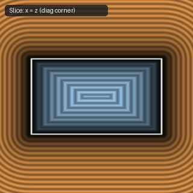

# `sdgBox` — 3D Box with Analytical Gradient

| 3D Surface ($f(p) = 0$) | Primary 2D Cross-Section | Secondary 2D Cross-Section |
| :---: | :---: | :---: |
|  |  |  |

| Property | Value |
| :--- | :--- |
| **Author / Discoverer** | **Inigo Quilez** |
| **Source** | [https://iquilezles.org/articles/distgradfunctions3d/](https://iquilezles.org/articles/distgradfunctions3d/) |
| **Category** | `gradients3d` |
| **GLSL File** | [`glsl/gradients3d/sdgBox.glsl`](../../glsl/gradients3d/sdgBox.glsl) |
| **Exact Euclidean SDF?** | Yes (`||grad d|| = 1`) |

---

## Mathematical Overview

Returns `vec4(d, grad.xyz)` for a 3D box of half-extents $b$.

---

## GLSL Implementation

```glsl
vec4 sdgBox( in vec3 p, in vec3 b )
{
    vec3 w = abs(p) - b;
    vec3 s = vec3(p.x < 0.0 ? -1.0 : 1.0,
                  p.y < 0.0 ? -1.0 : 1.0,
                  p.z < 0.0 ? -1.0 : 1.0);
    float g = max(w.x, max(w.y, w.z));
    vec3  q = max(w, 0.0);
    float l = length(q);
    return vec4( (g > 0.0) ? l : g,
                 s*((g > 0.0) ? q/l : ((w.x > w.y) ? ((w.x > w.z) ? vec3(1,0,0) : vec3(0,0,1))
                                                   : ((w.y > w.z) ? vec3(0,1,0) : vec3(0,0,1)))) );
}
```
