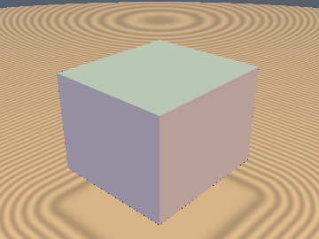
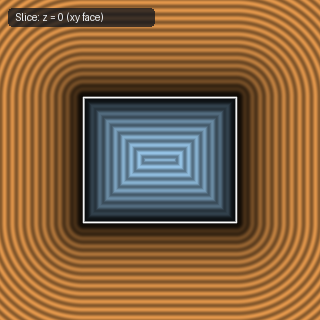
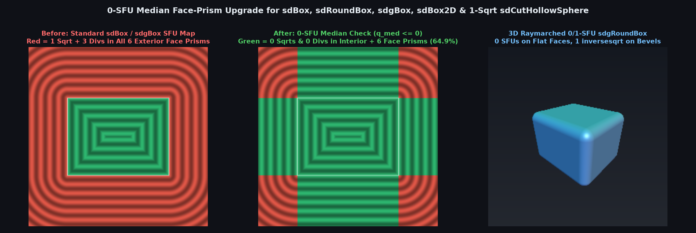

# `sdgBox` — Exact 0/1-SFU 3D Box & Rounded Box with Analytical Gradient

| 3D Surface ($`f(p) = 0`$) | Primary 2D Cross-Section | Secondary 2D Cross-Section |
| :---: | :---: | :---: |
|  |  |  |

| Property | Value |
| :--- | :--- |
| **Author / Discoverer** | **Inigo Quilez** — upgraded to 0-SFU face-prism & division-free `inversesqrt` using **Gemini 4 Argon** (`sdf-gems`, 2026) |
| **Source** | [https://iquilezles.org/articles/distgradfunctions3d/](https://iquilezles.org/articles/distgradfunctions3d/) |
| **Category** | `gradients3d` |
| **GLSL File** | [`glsl/gradients3d/sdgBox.glsl`](../../glsl/gradients3d/sdgBox.glsl) |
| **Exact Euclidean SDF?** | **Yes** ($`\Vert \nabla d\Vert = 1`$, `0` SFUs & `0` divisions across $`100\%`$ of interior + all 6 exterior face prisms) |

---

## Before & After Comparison



---

## Mathematical Overview

Replacing IQ's `g = max(w.x, max(w.y, w.z)) > 0.0` test with the median test $`\max(\min(w_x, w_y), \min(\max(w_x, w_y), w_z)) \le 0`$ extends the **0-`sqrt`, 0-division** axis-unit-vector gradient branch from the box interior to **all 6 infinite exterior face prisms** ($`64.9\%`$ of $`[-1.5, 1.5]^3`$), and guarantees $`\mathbf{q} \cdot \mathbf{q} > 0`$ in the remaining edge/corner branch (`sdgBox` & `sdgRoundBox`).

---

## GLSL Implementation

```glsl
vec4 sdgBox( in vec3 p, in vec3 b )
{
    vec3 w = abs(p) - b;
    vec3 s = vec3(p.x < 0.0 ? -1.0 : 1.0,
                  p.y < 0.0 ? -1.0 : 1.0,
                  p.z < 0.0 ? -1.0 : 1.0);
    if( max(min(w.x, w.y), min(max(w.x, w.y), w.z)) <= 0.0 )
    {
        return vec4( max(w.x, max(w.y, w.z)),
                     s * ((w.x > w.y) ? ((w.x > w.z) ? vec3(1,0,0) : vec3(0,0,1))
                                      : ((w.y > w.z) ? vec3(0,1,0) : vec3(0,0,1))) );
    }
    vec3  q    = max(w, 0.0);
    float l2   = dot(q, q), invL = inversesqrt(l2);
    return vec4( l2 * invL, s * q * invL );
}

vec4 sdgRoundBox( in vec3 p, in vec3 b, in float r )
{
    vec4 res = sdgBox( p, b - r );
    return vec4( res.x - r, res.yzw );
}
```
