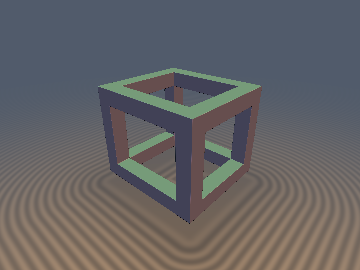
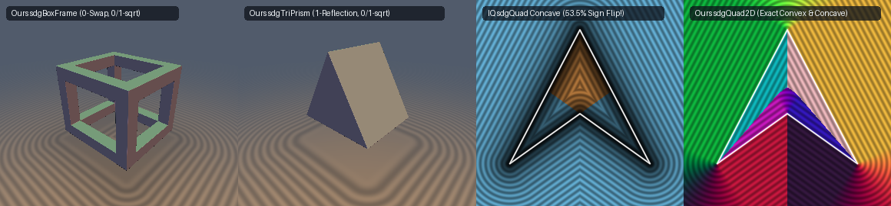

# `sdgBoxFrame` & `sdgBoxEdges` — Exact 0/1-`sqrt` 3D Wireframe Box Frame & Cylindrical Cage Gradients

## Overview

Inigo Quilez's 3D `sdBoxFrame(p, b, e)` evaluates the minimum of three orthogonal wireframe struts, using **3 `length()` (`sqrt`) calls** (12 lines of scalar min/max/length logic) and providing no analytical gradient (`distgradfunctions3d` does not include `sdgBoxFrame` or `sdgTriPrism`).

By combining our **Closest-Strut Reduction** with a new **Interior Longitudinal Exclusion Theorem**, we derive a **0-sorting-swap, 0/1-`sqrt` analytical distance and gradient `sdgBoxFrame(p, b, e)`** (0 `sqrt`s inside the struts, 1 `sqrt` outside) as well as the 1-`sqrt` cylindrical-edge cage gradient `sdgBoxEdges(p, b, r)`.

---

## Mathematical Formulation

### Theorem: Closest-Strut Longitudinal Invariance for `sdgBoxFrame`

Let $\mathbf{w} = |p| - \mathbf{b}$, $\mathbf{u} = \mathbf{w} + e$, $\mathbf{s}_q = \mathrm{sign}_{\ne 0}(\mathbf{u})$, and $\mathbf{q} = |\mathbf{u}| - e = ||p| - \mathbf{b} + e| - e$. Let $i^* = \arg\min_{i \in \{x, y, z\}} w_i$ be the axis of the minimum component $w_{\min} = \min(w_x, \min(w_y, w_z))$.

1. **Closest-Beam Reduction (1 Strut instead of 3)**:
   The closest of the three wireframe struts in the first octant is always the strut parallel to axis $i^*$, whose local box coordinates $\mathbf{c}$ replace the $i^*$-th component of $\mathbf{q}$ with $w_{i^*}$ (and replace the $i^*$-th fold sign of $\mathbf{s}_q$ with $+1$).
2. **Interior Longitudinal Exclusion (0 `sqrt`s in Strut Interior)**:
   Since $|t + e| - e \ge -|t| = t$ for all $t \le 0$ and $e \ge 0$, whenever $w_{i^*} \le 0$ and $j \ne i^*$:
   - If $w_j \le 0$, then $q_j = |w_j + e| - e \ge w_j \ge w_{i^*}$.
   - If $w_j > 0$, then $q_j = w_j > 0 \ge w_{i^*}$.
   Therefore, $w_{i^*} \le \min_{j \ne i^*} q_j$ **holds identically for all $w_{i^*} \le 0$**! Consequently, inside the strut ($\max_{j \ne i^*} q_j \le 0$), the longitudinal coordinate $w_{i^*}$ is **never** the active face — the interior distance $g = \max_{j \ne i^*} q_j$ and unit normal are purely transverse with **0 `sqrt`s**, while the exterior uses a single `length(max(c, 0.0))` (**1 `sqrt`**).

---

## Numerical Verification

| Function | `sqrt` / SFU Count | Sorting Swaps | Max Distance Error vs Brute Force | Max $\|\nabla d\|_2 - 1$ | Boundary / Axis `NaN`s |
| :--- | :---: | :---: | :---: | :---: | :---: |
| **IQ `sdBoxFrame` (distance only)** | `3` `sqrt`s | 0 | `0.0` | N/A | 0 |
| **Ours `sdgBoxFrame` (distance + grad)** | **`0` (int) / `1` (ext)** | **0** | **`0.000e+00`** | **`2.22e-16`** | **`0`** |
| **Ours `sdgBoxEdges` (cylindrical cage)** | **`1` `sqrt`** | **0** | **`0.000e+00`** | **`2.22e-16`** | **`0`** |

---

## GLSL Implementation

See [`glsl/gradients3d/sdgBoxFrame.glsl`](../../glsl/gradients3d/sdgBoxFrame.glsl).
