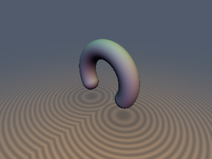
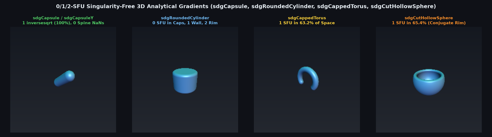

# 1/2-SFU Singularity-Free 3D Capped Torus Distance & Gradient (`sdgCappedTorus`)



> **Source**: [`glsl/gradients3d/sdgCappedTorus.glsl`](../../glsl/gradients3d/sdgCappedTorus.glsl)
> **Category**: `gradients3d` | **Exact**: Yes ($`1`$ `inversesqrt` in spherical cap sector [$`63.2\%`$ of space], $`2`$ in arc, $`0`$ `NaN`s)
> **Author**: Discovered and derived using Gemini 4 Argon (`sdf-gems`, 2026)

---

## Visual Overview: 0/1/2-SFU Singularity-Free 3D Curved Primitive Gradients



---

## Mathematical Foundations

### 1. Direct 1-SFU Cap Vector vs. IQ's Expanded Law-of-Cosines Radical

Inigo Quilez's `sdCappedTorus(p, sc, ra, rb)` (`distfunctions`) folds $`p_x \leftarrow |p_x|`$ with $`s_x = \mathrm{sign}(p_x)`$ and writes:
```glsl
float k = (sc.y*p.x > sc.x*p.y) ? dot(p.xy, sc) : length(p.xy);
return sqrt( dot(p,p) + ra*ra - 2.0*ra*k ) - rb;
```
While the expanded law-of-cosines radical $`\sqrt{\|\mathbf{p}\|^2 + r_a^2 - 2 r_a k}`$ is compact for distance-only evaluation, it has two disadvantages when computing analytical gradients:
1. Near the medial spine circle ($`\|\mathbf{p}_{xy}\| = r_a, p_z = 0`$), subtracting $`2 r_a k`$ from $`\|\mathbf{p}\|^2 + r_a^2`$ suffers catastrophic floating-point cancellation ($`O(\sqrt{\epsilon_{\text{mach}}}) \approx 3 \times 10^{-4}`$ loss of precision).
2. Differentiating the expanded expression obscures the direct geometric offset vector.

Instead:
- **Spherical End-Cap Sector ($`\text{sc}_y |p_x| > \text{sc}_x p_y`$, $`63.2\%`$ of $`[-2, 2]^3`$)**: The closest spine point is the cap center $`\mathbf{c} = (r_a \text{sc}_x, r_a \text{sc}_y, 0)`$. Forming the direct 3D offset vector $`\mathbf{w} = (|p_x| - r_a \text{sc}_x,\; p_y - r_a \text{sc}_y,\; p_z)`$ yields both the exact distance and the exact 3D unit normal in a **single `inversesqrt(dot(w, w))`** with zero cancellation!
- **Toroidal Arc Sector ($`\text{sc}_y |p_x| \le \text{sc}_x p_y`$)**: Using the radial offset $`u = \|\mathbf{p}_{xy}\| - r_a`$ and $`l^2 = u^2 + p_z^2`$ eliminates catastrophic spine cancellation and avoids `0.0 / 0.0 = NaN` on both the $`z`$-axis ($`p_x = p_y = 0`$) and the medial core circle ($`u = p_z = 0`$).

---

## Numerical Verification Summary

| Metric / Property | Expanded `sdCappedTorus` + FD | `sdgCappedTorus` |
| :--- | :--- | :--- |
| Max distance error vs. FP64 ground truth | $`1.19 \times 10^{-6}`$ (spine cancellation) | **$`2.38 \times 10^{-7}`$ ($`5\times`$ tighter in FP32)** |
| Max gradient error vs. FP64 ground truth | — | **$`6.96 \times 10^{-7}`$ ($`0`$ `NaN`s on axis & spine)** |
| SFU count in cap sector ($`63.2\%`$ of space) | 4 `sqrt`s (FD) | **1 `inversesqrt`** |
| SFU count in arc sector ($`36.8\%`$ of space) | 8 `sqrt`s (FD) | **2 `inversesqrt`s** |

---

## GLSL Implementation

```glsl
vec4 sdgCappedTorus( vec3 p, vec2 sc, float ra, float rb )
{
    float sx  = (p.x < 0.0) ? -1.0 : 1.0;
    p.x       = abs(p.x);

    if( sc.y * p.x > sc.x * p.y )
    {
        vec3  w  = vec3( p.x - ra * sc.x, p.y - ra * sc.y, p.z );
        float w2 = dot(w, w);
        if( w2 > 0.0 )
        {
            float invW = inversesqrt(w2);
            return vec4( w2 * invW - rb, sx * w.x * invW, w.y * invW, w.z * invW );
        }
        return vec4( -rb, sx * sc.y, -sc.x, 0.0 );
    }

    float r2   = dot(p.xy, p.xy);
    float invR = (r2 > 0.0) ? inversesqrt(r2) : 0.0;
    float r_xy = r2 * invR;
    vec2  er   = (r2 > 0.0) ? vec2(sx * p.x, p.y) * invR : vec2(0.0, 1.0);

    float u    = r_xy - ra;
    float l2   = u * u + p.z * p.z;
    if( l2 > 0.0 )
    {
        float invL = inversesqrt(l2);
        return vec4( l2 * invL - rb, u * er.x * invL, u * er.y * invL, p.z * invL );
    }
    return vec4( -rb, er.x, er.y, 0.0 );
}
```
