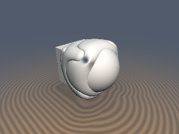

# `sdgColumns` — Exact 1-Sqrt Columned Booleans with Analytical 3D Gradients

| 3D Raymarched Surface (Normal-Mapped via `.yzw`) | 2D Cross-Section Slice (Isolines & Zero-Set) |
| :---: | :---: |
|  |  |

| Property | Value |
| :--- | :--- |
| **Author / Discoverer** | **Discovered using Gemini 4 Argon (sdf-gems, 2026)** |
| **Category** | `gradients3d` |
| **GLSL File** | [`glsl/gradients3d/sdgColumns.glsl`](../../glsl/gradients3d/sdgColumns.glsl) |
| **Exact Euclidean SDF?** | Yes ($\|\nabla d\|_2 = 1$ to `4.44e-16` across all column arcs, cusps, and walls) |

---

## Mathematical Overview

In [`opUnionColumns`](../booleans/opUnionColumns.md) and [`opSubtractionColumns`](../booleans/opUnionColumns.md), $n$ circular columns of radius $R = \frac{r\sqrt{2}}{(n-1)2 + \sqrt{2}}$ are arrayed along the $45^\circ$ diagonal in sorted coordinates $(x, y) = (\min(a,b), \max(a,b))$ with orthonormal rotated coordinates:
$$p_x = (x + y - r + 2R)\sqrt{0.5}, \qquad p_y = (y - x)\sqrt{0.5}.$$
Differentiating the single `sqrt` distance $l$ with respect to $(p_x, p_y)$ yields $g_p = \pm (q_x, d_y) / l$ on the exterior/interior column arcs and tangent cusps, which lifts back to $(x, y)$ via the inverse $45^\circ$ orthogonal transpose:
$$(g_x, g_y) = \left(\frac{g_{px} - g_{py}}{\sqrt{2}}, \; \frac{g_{px} + g_{py}}{\sqrt{2}}\right), \qquad \nabla d = g_x\,\nabla a + g_y\,\nabla b.$$
Across $[-1.5, 1.5]^2$, `sdgUnionColumns`, `sdgSubtractionColumns`, and `sdgIntersectionColumns` achieve **`4.44e-16` maximum Eikonal error $\big|\|\nabla d\|_2 - 1\big|$** while requiring only **1 `sqrt`** per evaluation.

---

## GLSL Implementation

```glsl
vec4 sdgUnionColumns( in vec4 a, in vec4 b, in float r, in float n )
{
    if( a.x > b.x ) { vec4 t = a; a = b; b = t; }
    float x  = a.x, y = b.x, s2 = 0.70710678;
    float R  = r * 1.41421356 / ((n - 1.0) * 2.0 + 1.41421356);
    float px = (x + y - r + 2.0 * R) * s2, py = (y - x) * s2;
    float w  = py / (2.0 * R) + 0.5 * (n - 2.0), k = min(round(w), n - 2.0);
    float dy = (w - k) * 2.0 * R, qx = max(px, 0.0), d2 = qx * qx + dy * dy;
    bool  ex = (x > 0.0) && (d2 > R * R);
    bool  ar = !ex && (px > 0.0) && (d2 <= R * R) && (k < n - 2.0 || px * 0.83822219 >= dy * 0.54532906);
    float ry = max(r - 1.22905745 * R - y, 0.0), di = x * x + ry * ry;
    float dj = (w + 0.5 - clamp(round(w + 0.5), 1.0, max(n - 2.0, 1.0))) * 2.0 * R;
    bool  cu = (n > 2.0) && (px * px + dj * dj < di);
    float l  = sqrt((ex || ar) ? d2 : (cu ? px * px + dj * dj : di));
    if( ex && x < l - R ) return a;
    float d  = (ex || ar) ? l - R : -l;
    vec2  gp = (ex || ar) ? vec2(qx, dy) / l : -vec2(px, dj) / l;
    vec2  gr = (ex || ar || cu) ? vec2(gp.x - gp.y, gp.x + gp.y) * s2
                                : ((ry <= 0.0) ? vec2(1.0, 0.0) : vec2(-x, ry) / l);
    return vec4(d, gr.x * a.yzw + gr.y * b.yzw);
}
```
