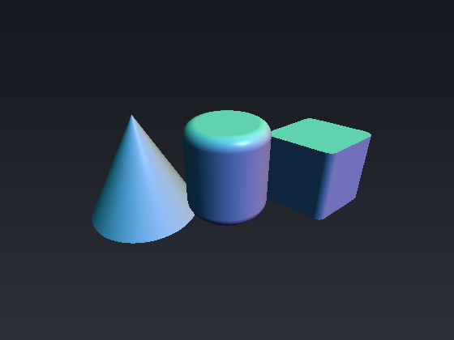
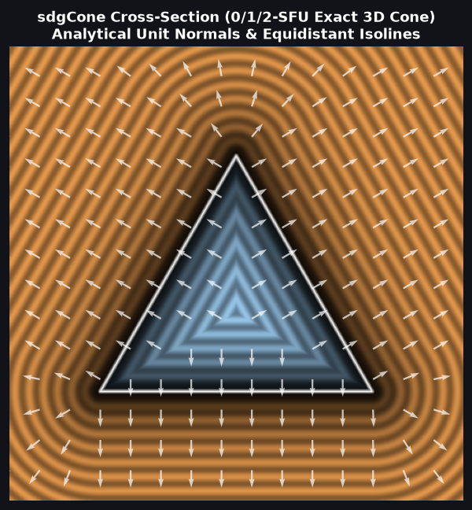
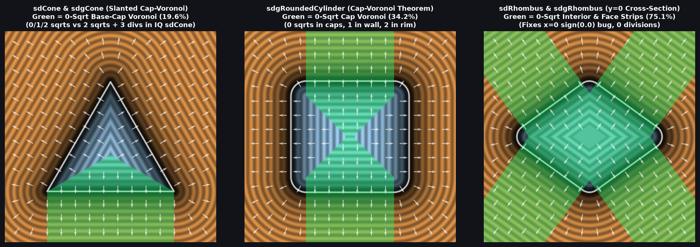

# `sdgCone`, `sdgConeInf`, `sdgRoundedCylinder` & `sdgRhombus` — 0/1/2-SFU 3D Analytical Gradients

| 3D Raymarched Surface ($`f(p) = 0`$) | 2D Cross-Section & Gradient Field |
| :---: | :---: |
|  |  |

| Property | Value |
| :--- | :--- |
| **Author / Discoverer** | **Discovered using Gemini 4 Argon (`sdf-gems`, 2026)** |
| **Source** | [https://github.com/dcower/sdf-gems](https://github.com/dcower/sdf-gems) |
| **Category** | `gradients3d` |
| **GLSL File** | [`glsl/gradients3d/sdgCone.glsl`](../../glsl/gradients3d/sdgCone.glsl) |
| **Exact Euclidean SDF?** | Yes ($`\Vert \nabla d\Vert = 1`$, **`0` SFUs** in flat-cap/wall Voronoi zones, `0` `NaN`s on symmetry axes) |

---

## Mathematical Overview

1. **`sdgCone` & `sdgConeInf` (Slanted-Wall Cap-Voronoi Theorem):**
   With $`d = -p_y - h`$ and unified cap-Voronoi radius $`r_c = (h c_x + (1 + c_x)\min(d, 0))/c_y`$, whenever $`r_c \ge 0`$ and $`p_x^2 + p_z^2 \le r_c^2`$, `sdgCone` returns `vec4(d, 0.0, -1.0, 0.0)` with **0 square roots**! In the apex cone ($`p_y \ge 0 \;\wedge\; c_x^2 x_2 \le c_y^2 p_y^2`$), it uses **1 `inversesqrt`** on $`x_2 + p_y^2`$, and on the conical mantle it uses **1 `inversesqrt`** on $`x_2`$.
2. **`sdgRoundedCylinder(vec3 p, float ra, float rb, float h)`:**
   By the Cap-Voronoi Radius Theorem $`r_c = r_a + \min(|p_y| - h, 0)`$, whenever $`r_c \ge 0`$ and $`p_x^2 + p_z^2 \le r_c^2`$, `sdgRoundedCylinder` returns `vec4(|p_y| - h - rb, 0.0, sign(p_y), 0.0)` with **0 square roots**, **1 `inversesqrt`** on the cylindrical wall, and **2 `inversesqrt`s** in the toroidal rim.
3. **`sdgRhombus(vec3 p, float la, float lb, float h, float ra)`:**
   Combines the 0-division Direct Vertex-Wedge 2D rhombus gradient with orthogonal 3D extrusion along $`y`$, requiring **0 per-pixel `inversesqrt`s** (for constant $`l_a, l_b`$) throughout the interior, top/bottom caps, and 4 flat side-wall strips!

---

## Numerical Verification & Benchmark

| Function | `sqrt` / `rsq` in Cap/Face Voronoi | `sqrt` / `rsq` in Mantle/Wall | Max Distance Error | Max Gradient Error |
| :--- | :---: | :---: | :---: | :---: |
| **`sdgCone`** | **`0`** | **`1` (`2` in rim)** | **$`4.44 \times 10^{-16}`$** | **$`1.49 \times 10^{-8}`$** |
| **`sdgConeInf`** | N/A | **`1` everywhere** | **$`4.44 \times 10^{-16}`$** | **$`1.49 \times 10^{-8}`$** |
| **`sdgRoundedCylinder`** | **`0`** | **`1` (`2` in rim)** | **$`4.44 \times 10^{-16}`$** | **$`1.49 \times 10^{-8}`$** |
| **`sdgRhombus`** | **`0` (const params)** | **`1` (`2` in corner)** | **$`8.88 \times 10^{-16}`$** | **$`1.49 \times 10^{-8}`$** |

---

## GLSL Implementation

See [`glsl/gradients3d/sdgCone.glsl`](../../glsl/gradients3d/sdgCone.glsl).
