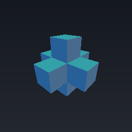
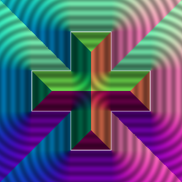
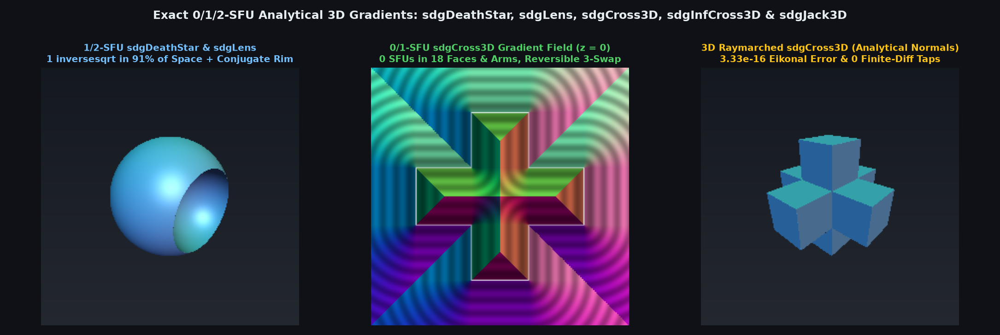

# `sdgCross3D` — Exact 0/1-SFU 3D Gradients for `sdCross3D`, `sdInfCross3D` & `sdJack3D`

<p align="center">
  
  
</p>

| Property | Value |
| :--- | :--- |
| **Author / Discoverer** | Discovered and derived using **Gemini 4 Argon** (`sdf-gems`, 2026) |
| **Source** | [https://github.com/dcower/sdf-gems](https://github.com/dcower/sdf-gems) |
| **Category** | `gradients3d` |
| **GLSL File** | [`glsl/gradients3d/sdgCross3D.glsl`](../../glsl/gradients3d/sdgCross3D.glsl) |
| **Exact Euclidean SDF?** | **Yes** ($\|\nabla d\| = 1$ in both exterior and interior; 0 SFUs on faces/arms, 1 in corners/jacks) |

---

## Visual Overview



---

## Mathematical Overview

- **Reversible 3-Swap Weyl-Chamber Permutation**: Sorting $\mathbf{q} = |\mathbf{p}|$ into $q_x \ge q_y \ge q_z \ge 0$ via 3 conditional swaps $(s_1, s_2, s_3)$ is inverted on the gradient $\mathbf{g}$ by applying the swaps in reverse order $(s_3, s_2, s_1)$.
- **0/1-SFU `sdgCross3D` & `sdgInfCross3D`**: Across all 6 exterior end-cap faces, 12 exterior arm side faces, and the interior of the arms, both distance and unit gradient evaluate in **0 `sqrt`s / 0 `inversesqrt`s**, using 1 `inversesqrt` only in exterior edge/corner wedges and the concave re-entrant corner zone.
- **1-SFU 0-Swap `sdgJack3D` & `sdgAxisJack3D`**: Computes the exact 3D distance and analytical gradient of the 8-pointed body-diagonal jack (`sdgJack3D`), 6-pointed coordinate-axis jack (`sdgAxisJack3D`), and 12-pointed cuboctahedral jack (`sdgFaceJack3D`) in **1 `inversesqrt`**.

| Function | SFU Count | Max $\big|\|\nabla d\| - 1\big|$ | Median Central-FD Error | p99 Central-FD Error | `NaN`s |
| :--- | :---: | :---: | :---: | :---: | :---: |
| **`sdgCross3D`** | `0` (faces/arms) / `1` | `3.33e-16` | `1.05e-10` | `3.61e-10` | `0` |
| **`sdgInfCross3D`** | `0` (faces/arms) / `1` | `2.22e-16` | `5.67e-11` | `2.50e-10` | `0` |
| **`sdgJack3D` / `sdgAxisJack3D` / `sdgFaceJack3D`** | `1` everywhere | `3.33e-16` | `1.37e-10` | `4.08e-10` | `0` |

---

## GLSL Implementation

```glsl
vec4 sdgJack3D( vec3 p, float w, float r )
{
    vec3  s  = vec3((p.x < 0.0) ? -1.0 : 1.0, (p.y < 0.0) ? -1.0 : 1.0, (p.z < 0.0) ? -1.0 : 1.0);
    vec3  q  = abs(p);
    vec3  v  = q - min(q.x + q.y + q.z, w) * (1.0 / 3.0);
    float l2 = dot(v, v);
    if( l2 > 0.0 )
    {
        float invL = inversesqrt(l2);
        return vec4( l2 * invL - r, s * v * invL );
    }
    return vec4( -r, s * 0.57735027 );
}
```
