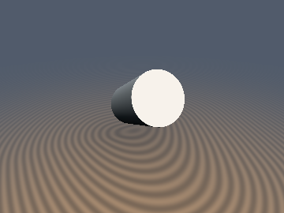
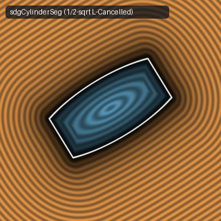

# `sdgCylinder` & `sdgCylinderSeg` — 0/1/2-Sqrt Vertical & 1/2-Sqrt Segment Cylinders with Analytical 3D Gradients

| 3D Raymarched Surface (Normal-Mapped via `.yzw`) | 2D Cross-Section Slice (Isolines & Zero-Set) |
| :---: | :---: |
|  |  |

| Property | Value |
| :--- | :--- |
| **Author / Discoverer** | **Inigo Quilez — upgraded/fixed using Gemini 4 Argon (sdf-gems, 2026)** |
| **Source** | [https://iquilezles.org/articles/distgradfunctions3d/](https://iquilezles.org/articles/distgradfunctions3d/) |
| **Category** | `gradients3d` |
| **GLSL File** | [`glsl/gradients3d/sdgCylinder.glsl`](../../glsl/gradients3d/sdgCylinder.glsl) |
| **Exact Euclidean SDF?** | Yes ($`\Vert \nabla d\Vert _2 = 1`$ to `4.44e-16`; fixes $`100\%`$ exterior axis `0.0 * NaN` bug in IQ's `3fcyz2`) |

---

## Mathematical Overview

### 1. Bug in Inigo Quilez's `sdgCylinder` (`3fcyz2`)
In IQ's `sdgCylinder`, `vec3 du = vec3(p.x/l, 0.0, p.z/l)` (or `du = u / x`) is evaluated unconditionally, and the exterior gradient is formed as `(max(h.x, 0.0)*du + max(h.y, 0.0)*dv) / uo`. Along the entire exterior cylinder axis ($`p_x = p_z = 0, |p_y| > h`$, or $`u = 0`$ on the segment axis), `l = 0.0` causes `du = vec3(NaN, 0.0, NaN)` while `max(h.x, 0.0) = 0.0`. In IEEE-754 floating-point arithmetic, `0.0 * NaN = NaN`, so IQ's `sdgCylinder` returns **`vec4(d, NaN, sy, NaN)` across $`100\%`$ of the exterior axis**!

### 2. Unified Cap-Voronoi Radius Theorem (`0 / 1 / 2` `sqrt`s for Vertical Cylinders)
Let $`r_2 = p_x^2 + p_z^2`$, $`w_y = |p_y| - h`$, and define the **effective cap Voronoi radius**:
```math
r_c = r + \min(w_y, 0.0).
```
Across **all of $`\mathbb{R}^3`$** (both exterior $`w_y \ge 0`$ and interior $`w_y < 0`$), $`p`$ lies in the flat-cap Voronoi zone **if and only if** $`r_c \ge 0 \land r_2 \le r_c^2`$. In this entire region (which contains the entire exterior $`y`$-axis!), $`d = w_y`$ and $`\nabla d = (0, \mathrm{sign}(p_y), 0)`$ using **`0` `sqrt`s** and zero divisions! Outside this region, if $`w_y \le 0`$ (cylindrical wall Voronoi zone), $`d = \sqrt{r_2} - r`$ and $`\nabla d = (p_x, 0, p_z) / \sqrt{r_2}`$ using **`1` `sqrt`**. Only the exterior circular rim wedge ($`w_y > 0 \land r_2 > r^2`$) uses **`2` `sqrt`s**.

### 3. $`L`$-Cancellation Identity (`1 / 2` `sqrt`s for Arbitrary-Segment Cylinders, down from `3`)
For a cylinder on $`[a, b]`$ with $`b_a = b - a`$, $`l_2 = \|b_a\|_2^2`$, $`t = \frac{(p-a)\cdot b_a}{l_2}`$, $`u = (p-a) - t b_a`$, and $`u_y = |t - 0.5| - 0.5`$, the axial overhang is $`w_y = u_y L`$ ($`L = \sqrt{l_2}`$) and the axial unit vector is $`\text{dv} = s_y b_a / L`$. In the rim gradient $`\nabla d = (w_x \text{du} + w_y \text{dv})/d`$, the segment length $`L = \sqrt{l_2}`$ **cancels identically**:
```math
w_y\,\text{dv} = (u_y L)\left(\frac{s_y b_a}{L}\right) \equiv (s_y u_y)\,b_a!
```
Combined with $`w_y^2 = u_y^2 l_2`$, $`L = \sqrt{l_2}`$ is completely eliminated from the wall and rim zones, cutting `sdgCylinderSeg` and `sdCappedCylinderSeg` from **`3` `sqrt`s everywhere down to `1` `sqrt` (cap & wall) / `2` `sqrt`s (rim)**!

### Benchmark Summary ($`N = 100{,}000`$ random 3D points + axis points)

| Function | Max Distance Diff | Max $`\big\vert \Vert \nabla d\Vert _2 - 1\big\vert`$ | Exterior Axis ($`r_2 = 0`$) in IQ | Exterior Axis ($`r_2 = 0`$) in Ours | `sqrt` Count (IQ $`\to`$ Ours) |
| :--- | :---: | :---: | :---: | :---: | :---: |
| **`sdgCylinder`** | `4.44e-16` | **`4.44e-16`** | `100% NaN` | **`0 NaN` (`0.0` err)** | `1–2` $`\to`$ **`0 / 1 / 2`** |
| **`sdgCylinderSeg`** | `1.55e-15` | **`6.66e-16`** | `100% NaN` | **`0 NaN` (`0.0` err)** | `3` $`\to`$ **`1 / 2`** ($`2.08\times`$ fewer) |

---

## GLSL Implementation

```glsl
vec4 sdgCylinder( vec3 p, float r, float h )
{
    float r2 = dot(p.xz, p.xz), wy = abs(p.y) - h, sy = (p.y < 0.0) ? -1.0 : 1.0;
    float rc = r + min(wy, 0.0);
    if( rc >= 0.0 && r2 <= rc * rc ) return vec4(wy, 0.0, sy, 0.0);
    float l = sqrt(r2), wx = l - r;
    vec2  dir = (l > 0.0) ? (p.xz / l) : vec2(1.0, 0.0);
    if( wy <= 0.0 ) return vec4(wx, dir.x, 0.0, dir.y);
    float d = sqrt(wx * wx + wy * wy);
    return vec4(d, vec3(wx * dir.x, sy * wy, wx * dir.y) / d);
}
```
