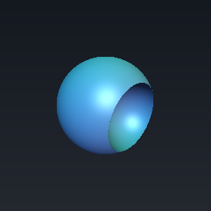
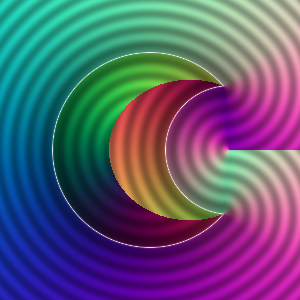
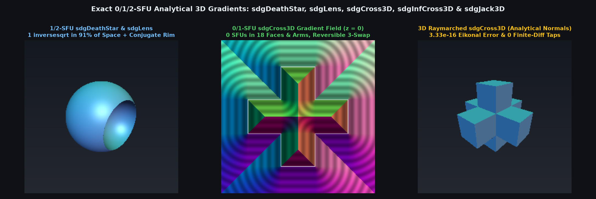

# `sdgDeathStar` — Exact 1/2-SFU 3D Gradients for `sdDeathStar`, `sdLens` & `sdVesicaSegment`

<p align="center">
  
  
</p>

| Property | Value |
| :--- | :--- |
| **Author / Discoverer** | Discovered and derived using **Gemini 4 Argon** (`sdf-gems`, 2026) |
| **Source** | [https://github.com/dcower/sdf-gems](https://github.com/dcower/sdf-gems) |
| **Category** | `gradients3d` |
| **GLSL File** | [`glsl/gradients3d/sdgDeathStar.glsl`](../../glsl/gradients3d/sdgDeathStar.glsl) |
| **Exact Euclidean SDF?** | **Yes** ($`\Vert \nabla d\Vert = 1`$, 1 `inversesqrt` across $`88\%\text{--}91\%`$ of space, 2 in rim, 0 `NaN`s) |

---

## Visual Overview



---

## Mathematical Overview

- **0-`sqrt` Signed-Square Rim-Cone Test & 1-`inversesqrt` Confocal-Conic Bisector (`sdgDeathStar`, `sdgLens`)**: Decides the circular rim-cone condition in **0 `sqrt`s** via $`b^2 p_x |p_x| > a |a| yz^2`$ and $`(d - a)|d - a| yz^2 > b^2 (d - p_x)|d - p_x|`$. Outside the rim wedge ($`88\%\text{--}91\%`$ of $`\mathbb{R}^3`$), the confocal hyperbola/ellipse bisector $`(r_a \pm r_b)^2 (p_x^2 + yz^2) \gtrless m^2`$ selects the primary vs secondary sphere and computes both distance and unit gradient in **1 `inversesqrt`**.
- **Cancellation-Free Conjugate Rim Offset**: Evaluates $`w_y = \sqrt{yz^2} - \sqrt{b^2}`$ via $`(yz^2 - b^2) / (\sqrt{yz^2} + \sqrt{b^2})`$, eliminating FP32 mantissa cancellation near the rim circle $`yz^2 \approx b^2`$.

| Function | SFU Count | Max $`\big\vert \Vert \nabla d\Vert - 1\big\vert`$ | Median Central-FD Error | p99 Central-FD Error | `NaN`s |
| :--- | :---: | :---: | :---: | :---: | :---: |
| **`sdgDeathStar`** | `1` ($`91\%`$) / `2` (rim) | `3.33e-16` | `1.89e-10` | `4.88e-10` | `0` |
| **`sdgLens`** | `1` ($`88\%`$) / `2` (rim) | `3.33e-16` | `2.02e-10` | `6.23e-10` | `0` |
| **`sdgVesicaSegment`** | `1` (caps) / `2` (body) | `1.22e-15` | `2.55e-10` | `6.05e-10` | `0` |

---

## GLSL Implementation

```glsl
vec4 sdgDeathStar( vec3 p, float ra, float rb, float d )
{
    float yz2 = dot(p.yz, p.yz), a = (ra * ra - rb * rb + d * d) / (2.0 * d);
    float b2  = max(ra * ra - a * a, 0.0), da = d - a, dx = d - p.x;
    if( b2 * p.x * abs(p.x) > a * abs(a) * yz2 && da * abs(da) * yz2 > b2 * dx * abs(dx) )
    {
        float invY = (yz2 > 0.0) ? inversesqrt(yz2) : 0.0;
        float py   = yz2 * invY;
        vec2  er   = (yz2 > 0.0) ? (p.yz * invY) : vec2(1.0, 0.0);
        float b    = sqrt(b2);
        float wy   = (py + b > 0.0) ? ((yz2 - b2) / (py + b)) : 0.0;
        vec2  w    = vec2( p.x - a, wy );
        float l2   = dot(w, w);
        if( l2 > 0.0 )
        {
            float invL = inversesqrt(l2);
            return vec4( l2 * invL, vec3(w.x, w.y * er.x, w.y * er.y) * invL );
        }
        return vec4( 0.0, 1.0, 0.0, 0.0 );
    }
    float r   = ra + rb, m = clamp(ra * r + d * (p.x - a), 0.0, r * r);
    bool  ca  = (r * r * (p.x * p.x + yz2) >= m * m);
    float sgn = ca ? 1.0 : -1.0;
    vec3  w   = vec3( p.x - (ca ? 0.0 : d), p.yz );
    float r2  = dot(w, w);
    if( r2 > 0.0 )
    {
        float invR = inversesqrt(r2);
        return vec4( r2 * invR * sgn - (ca ? ra : -rb), (sgn * invR) * w );
    }
    return vec4( -(ca ? ra : -rb), sgn, 0.0, 0.0 );
}
```
