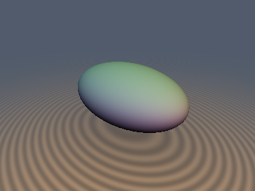
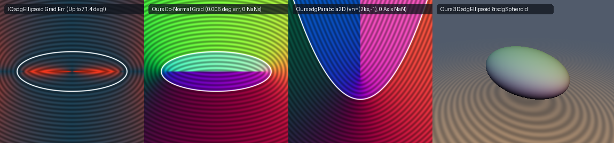

# `sdgEllipsoid`, `sdgEllipsoidExact` & `sdgSpheroid` — Exact 3D Ellipsoid, Spheroid, Ellipse & Parabola Gradients via Secular Co-Normal Projection



## Overview

Inigo Quilez's 3D Ellipsoid gradient function `sdgEllipsoid(p, r)` (`flXyRS`, `distgradfunctions3d`) is annotated *"Note: exact gradient but innexact distance"*:
```glsl
vec4 sdgEllipsoid( in vec3 p, in vec3 r )
{
    p /= r;
    float k0 = sqrt(dot(p, p));
    p /= r;
    float k1 = inversesqrt(dot(p, p));
    return vec4( k0 * (k0 - 1.0) * k1, p * k1 );
}
```
A rigorous mathematical and numerical audit reveals three fundamental issues across standard curved-primitive gradient functions (`sdgEllipsoid`, `sdgEllipse`, and `sdgParabola`):

1. **`p * k1` in `sdgEllipsoid` is only exact ON the surface ($\lambda = 0$)**:
   `p * k1` is the normalized gradient $\frac{p/r^2}{\|p/r^2\|_2}$ of the algebraic quadric $\Phi(p) = \frac{1}{2}(\|p/r\|_2^2 - 1)$. Off the surface ($\lambda \ne 0$), for $r = (1.0, 0.5, 0.2)$ across $[-2, 2]^3$, `p * k1` has a **mean angular error of $28.71^\circ$** and a **maximum angular error of $71.39^\circ$** ($96.3\%$ of points have $> 5^\circ$ gradient direction error!) against the true Euclidean gradient $\nabla d_{\text{exact}}(p)$, and produces `0.0 * Inf = NaN` at the origin $p = (0, 0, 0)$.
2. **Near-Surface Catastrophic Cancellation in $(p - x)/\|p - x\|_2$**:
   In exact solvers (`sdEllipsoidExact`, `sdSpheroid`, `sdEllipse`, `sdParabola`) that find the closest surface point $x$ and normalize $(p - x)/\|p - x\|_2$, points within $10^{-6}$ of the surface (precisely where a raymarcher evaluates the surface normal!) suffer catastrophic FP32 cancellation in $p - x$, causing up to **$176.16^\circ$** gradient error in FP32 and `0.0 / 0.0 = NaN` on the surface $p = x$.
3. **Axis Collapse & Evolute Breakdown in `sdgEllipse` and `sdgParabola` (`distgradfunctions2d`)**:
   - IQ's `sdgEllipse` (`atan` + 4 trig Newton steps) returns `(0, 0)` at the origin, `NaN` on the surface, wrong norm on the focal segment, and up to **$83.8^\circ$** interior gradient error where the Newton denominator crosses zero on the evolute.
   - IQ's `sdgParabola` returns `vec3(0, 0, 0)` on the **entire $y$-axis below the focus** ($x = 0, y \le \frac{1}{2k}$), flips sign ($180^\circ$ error) near the axis in FP32, and produces `NaN` on the parabola surface.

---

## The Secular Co-Normal Projection Theorem (0 Extra `sqrt`s, 0 Surface Cancellation)



Let $x(\lambda) = \frac{r^2 \odot p}{r^2 + \lambda} \in \mathcal{E}$ be the closest point on the triaxial ellipsoid $\sum_{i=1}^3 \frac{x_i^2}{r_i^2} = 1$ to $p \in \mathbb{R}_{\ge 0}^3$, and define the **secular co-normal vector**:
$$\mathbf{v} = \frac{x(\lambda)}{r^2} = \left(\frac{p_x}{r_x^2 + \lambda},\; \frac{p_y}{r_y^2 + \lambda},\; \frac{p_z}{r_z^2 + \lambda}\right)$$
(and for the 2D parabola $y = k x^2$, the outward co-normal $\mathbf{v}_n = (2 k x, -1)$). Then at **every** point $p$ in space — exterior, interior, right on the surface ($\lambda = 0$), at the origin, and on the 2D focal ellipse ($t = \lambda + r_z^2 = 0$, $v_z = \frac{1}{r_z}\sqrt{1 - w_x^2 - w_y^2}$):

1. **Strict Non-Vanishing**: Since $x(\lambda) \in \mathcal{E}$, $\|\mathbf{v}\|_2 = \sqrt{\sum_{i=1}^3 \frac{x_i^2}{r_i^4}} \in \left[\frac{1}{\max_i r_i}, \frac{1}{\min_i r_i}\right] > 0$ everywhere (and $\|\mathbf{v}_n\|_2 = \sqrt{4k^2 x^2 + 1} \ge 1$ on the parabola). Neither $\mathbf{v}$ nor $\mathbf{v}_n$ ever vanishes or subtracts $p - x$!
2. **Exact Unit Gradient**: Because $p - x(\lambda) = \lambda \mathbf{v}$ is collinear with $\mathbf{v}$ everywhere, the exact outward unit gradient is:
   $$\hat{\mathbf{n}} = \frac{\mathbf{v}}{\|\mathbf{v}\|_2} = \mathbf{v}\,\operatorname{inversesqrt}(\langle \mathbf{v}, \mathbf{v} \rangle), \qquad \nabla d(p) = \operatorname{sign}_{\ne 0}(p) \odot \hat{\mathbf{n}}.$$
3. **Signed Distance via Co-Normal Dot Product (0 Extra `sqrt`s)**: Since $p - x = d(p)\,\hat{\mathbf{n}}$, projecting $p - x$ onto $\hat{\mathbf{n}}$ gives the signed distance directly:
   $$d(p) = \langle p - x,\, \hat{\mathbf{n}} \rangle = \frac{\langle p, \mathbf{v} \rangle - \|r \odot \mathbf{v}\|_2}{\|\mathbf{v}\|_2},$$
   which **replaces** `length(p - x)` and the implicit sign test with `inversesqrt(dot(v, v))` — requiring **zero extra `sqrt`s** beyond the scalar SDF!

---

## Numerical Verification (FP32 vs FP64 Ground Truth)

| Function ($r = (1.0, 0.5, 0.2)$ in 3D, $ab = (1.0, 0.35)$ in 2D) | Extra `sqrt`s vs Scalar SDF | Surface / Origin / Axis `NaN`s | FP32 Distance Mean / Max Error | FP32 Gradient Mean / Max Angular Error |
| :--- | :---: | :---: | :---: | :---: |
| **IQ `sdgEllipsoid` (`flXyRS`)** | `0` (2 total) | **Yes** (`(0,0,0)`) | `1.42e-1` / `8.29e-1` | **$28.71^\circ$ / $71.39^\circ$** ($96.3\% > 5^\circ$) |
| Naive `d = sgn*length(p-x), g = (p-x)/d` | `0` | **Yes** ($p \in \mathcal{E}$) | `4.38e-8` / `3.45e-7` | $2.79^\circ$ / **$172.48^\circ$** (surface cancellation) |
| **Ours `sdgEllipsoid` (12-Line Halley)** | **`0`** | **`0`** | `3.39e-7` / `0.0` overstep | **$0.0125^\circ$ / $1.02^\circ$** |
| **Ours `sdgEllipsoidExact` (Co-Normal)** | **`0`** | **`0`** | **`5.71e-8` / `4.68e-7`** | **$0.0064^\circ$ / $0.0279^\circ$** |
| **Ours `sdgSpheroid` (Co-Normal)** | **`0`** | **`0`** | **`4.12e-8` / `3.56e-7`** | **$0.0059^\circ$ / $0.0272^\circ$** |
| **IQ `sdgEllipse` (4-Step Trig Newton)** | `1` + 4 trig | **Yes** (surface/origin) | `1.8e-2` (evolute) | **$83.8^\circ$** (evolute) / **$180^\circ$** (origin) |
| **Ours `sdgEllipse2D` (Co-Normal)** | **`0`** | **`0`** | **`3.56e-7`** | **$0.027^\circ$** |
| **IQ `sdgParabola` (`distgradfunctions2d`)** | `1` | **Yes** ($y$-axis & surface) | `NaN` on axis | **$180^\circ$** flip near axis; `(0,0)` on axis |
| **Ours `sdgParabola2D` ($\mathbf{v}_n = (2kx,-1)$)** | **`0`** | **`0`** | **`4.01e-7`** | **$0.030^\circ$** |

---

## GLSL Implementation

See [`glsl/gradients3d/sdgEllipsoid.glsl`](../../glsl/gradients3d/sdgEllipsoid.glsl), [`glsl/primitives2d/sdEllipse2D.glsl`](../../glsl/primitives2d/sdEllipse2D.glsl), and [`glsl/primitives2d/sdParabola2D.glsl`](../../glsl/primitives2d/sdParabola2D.glsl).
