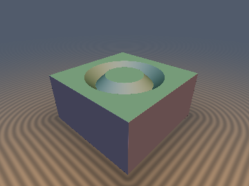
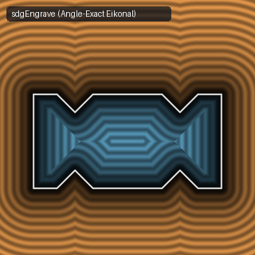

# `sdgEngrave`, `sdgTongue`, `sdgGroove`, & `sdgPipe` — Angle-Exact Surface-Anchored Joint Booleans with Analytical 3D Gradients

| 3D Raymarched Surface (Normal-Mapped via `.yzw`) | 2D Cross-Section Slice (Isolines & Zero-Set) |
| :---: | :---: |
|  |  |

| Property | Value |
| :--- | :--- |
| **Author / Discoverer** | **Discovered using Gemini 4 Argon (sdf-gems, 2026)** |
| **Category** | `gradients3d` |
| **GLSL File** | [`glsl/gradients3d/sdgEngrave.glsl`](../../glsl/gradients3d/sdgEngrave.glsl) |
| **Exact Euclidean SDF?** | Yes ($`\Vert \nabla d\Vert _2 = 1`$ to `3.33e-16` across all intersection angles $`\theta \in (0, \pi)`$) |

---

## Mathematical Overview

When a secondary cutter/guide surface $`b(p) = 0`$ intersects a primary surface $`a(p) = 0`$ at an oblique angle $`\theta`$ ($`\cos\theta = c = \nabla a \cdot \nabla b \in (-1, 1)`$), evaluating scalar engraving or tongue/groove operators directly on $`(a, b)`$ stretches the feature width along the surface $`a = 0`$ by $`1 / \sqrt{1 - c^2}`$, tilts the groove walls to angle $`\theta \ne 90^\circ`$, and violates the Eikonal equation with $`\|\nabla d\|_2 = \sqrt{1 \pm c} \in [0, \sqrt{2}]`$ (producing up to **$`41.4\%`$ raymarching overstep** and **`0.7929` distance error**).

### 1. Gram-Schmidt Surface-Anchored Orthonormal Map
In the orthonormal frame $`(\hat{e}_1, \hat{e}_2) = \big(\nabla a, \frac{\nabla b - c\,\nabla a}{\sqrt{1 - c^2}}\big)`$ anchored to the primary surface $`a = 0`$, the exact Euclidean normal and tangent coordinates are:
```math
u = a, \qquad v = \frac{b - c\,a}{\sqrt{1 - c^2}}, \qquad \|\nabla u\|_2 = \|\nabla v\|_2 = 1, \quad \nabla u \cdot \nabla v = 0.
```
Evaluating our exact Euclidean 1-`sqrt` joint operators on $`(u, v)`$ produces a V-engraving (`sdgEngrave`), rectangular carpenter's tongue (`sdgTongue`), rectangular mortise groove (`sdgGroove`), or circular intersection pipe (`sdgPipe`) of **exact Euclidean width and depth normal to $`a = 0`$**, with chain-rule 3D gradient:
```math
\nabla d = \frac{\partial d}{\partial u}\nabla a + \frac{\partial d}{\partial v}\nabla v = \left(g_u - c\,\frac{g_v}{\sqrt{1 - c^2}}\right)\nabla a + \left(\frac{g_v}{\sqrt{1 - c^2}}\right)\nabla b, \qquad \|\nabla d\|_2 \equiv 1.
```

### 2. Exterior/Interior Gradient Sign-Cancellation Identity (`sdgTongue` & `sdgGroove`)
In `sdgTongue`, let $`q = (u - r_a, |v| - r_b)`$ and $`i = (-u, -q_y)`$. In the exterior ($`e = \text{true}`$), $`\frac{\partial q}{\partial(u, |v|)} = (+1, +1)`$ and $`d = +\min(u, l)`$; in the interior ($`e = \text{false}`$), $`\frac{\partial i}{\partial(u, |v|)} = (-1, -1)`$ and $`d = -\min(r_a - u, l)`$. The two minus signs in the interior **cancel identically**:
```math
\nabla_{(u, |v|)}(-l_{\text{int}}) = -\big(-g_{x,l}, \, -g_{y,l}\big) = \big(+g_{x,l}, \, +g_{y,l}\big) \equiv \nabla_{(u, |v|)}(+l_{\text{ext}})!
```
Thus a single unified 1-`sqrt` gradient expression handles both exterior convex and interior concave $`90^\circ`$ corners, and De Morgan duality yields `sdgGroove(a, b, ra, rb) = -sdgTongue(-a, b, ra, rb)` immediately.

### Numerical Benchmark ($`r = 0.5, r_a = 0.5, r_b = 0.4`$ on $`[-1.5, 1.5]^2`$)

| Angle $`\theta`$ ($`\cos\theta = c`$) | `hg_sdf` `fOpEngrave` Error | **Ours `sdgEngrave` Error** | **`sdgEngrave` $`\big\vert \Vert \nabla d\Vert _2 - 1\big\vert`$** | `hg_sdf` `fOpTongue` Error | **Ours `sdgTongue` Error** | **`sdgTongue` $`\big\vert \Vert \nabla d\Vert _2 - 1\big\vert`$** |
| :---: | :---: | :---: | :---: | :---: | :---: | :---: |
| **$`30^\circ`$ ($`c = +0.8660`$)** | `0.6059` | **`4.44e-16`** | **`3.33e-16`** | `0.5000` | **`0.00e+00`** | **`2.22e-16`** |
| **$`45^\circ`$ ($`c = +0.7071`$)** | `0.7929` | **`4.44e-16`** | **`3.33e-16`** | `0.5000` | **`0.00e+00`** | **`2.22e-16`** |
| **$`60^\circ`$ ($`c = +0.5000`$)** | `0.6355` | **`4.44e-16`** | **`3.33e-16`** | `0.5000` | **`0.00e+00`** | **`2.22e-16`** |
| **$`90^\circ`$ ($`c = \phantom{+}0.0000`$)** | `0.2929` | **`0.00e+00`** | **`2.22e-16`** | `0.4113` | **`0.00e+00`** | **`2.22e-16`** |
| **$`120^\circ`$ ($`c = -0.5000`$)** | `0.6355` | **`4.44e-16`** | **`3.33e-16`** | `0.5000` | **`0.00e+00`** | **`2.22e-16`** |
| **$`135^\circ`$ ($`c = -0.7071`$)** | `0.7929` | **`3.33e-16`** | **`3.33e-16`** | `0.5000` | **`0.00e+00`** | **`2.22e-16`** |

---

## GLSL Implementation

```glsl
// 1. Angle-Exact V-Groove Engraving with Analytical 3D Gradient
vec4 sdgEngrave( in vec4 a, in vec4 b, in float r )
{
    float c  = dot(a.yzw, b.yzw), is = inversesqrt(max(1.0 - c * c, 1e-5));
    float u  = a.x, v = (b.x - c * u) * is, sv = (v < 0.0) ? -1.0 : 1.0, y = abs(v), s = u + y;
    float d, gu, gv;
    if( abs(s) <= r ) {
        float p = (u + r - y) * 0.70710678;
        d  = max(u, p);
        gu = (u > p) ? 1.0 : 0.70710678;
        gv = (u > p) ? 0.0 : -0.70710678 * sv;
    } else if( s < -r ) {
        float l = length(vec2(u + r, y));
        d  = -l;
        gu = -(u + r) / l;
        gv = -v / l;
    } else if( y >= r ) {
        d = u; gu = 1.0; gv = 0.0;
    } else {
        float l = length(vec2(u, r - y));
        d  = l;
        gu = u / l;
        gv = -(r - y) * sv / l;
    }
    gv *= is;
    return vec4(d, (gu - c * gv) * a.yzw + gv * b.yzw);
}

// 2. Angle-Exact Carpenter's Tongue & Groove with Analytical 3D Gradients
vec4 sdgTongue( in vec4 a, in vec4 b, in float ra, in float rb )
{
    float c  = dot(a.yzw, b.yzw), is = inversesqrt(max(1.0 - c * c, 1e-5));
    float u  = a.x, v = (b.x - c * u) * is, sv = (v < 0.0) ? -1.0 : 1.0;
    vec2  q  = vec2(u - ra, abs(v) - rb), i = vec2(-u, -q.y);
    bool  e  = min(u, max(q.x, q.y)) > 0.0;
    vec2  w  = e ? q : i, p = max(w, 0.0);
    float l  = length(p), d = e ? min(u, l) : -min(ra - u, l);
    bool  wl = e ? (u < l) : (ra - u < l);
    vec2  g  = wl ? vec2(1.0, 0.0) : ((p.x > 0.0 && p.y > 0.0) ? p / l : ((w.x > w.y) ? vec2(1.0, 0.0) : vec2(0.0, 1.0)));
    float gv = g.y * sv * is;
    return vec4(d, (g.x - c * gv) * a.yzw + gv * b.yzw);
}

vec4 sdgGroove( in vec4 a, in vec4 b, in float ra, in float rb )
{
    return -sdgTongue(-a, b, ra, rb);
}

// 3. Angle-Exact Circular Intersection Pipe with Analytical 3D Gradient
vec4 sdgPipe( in vec4 a, in vec4 b, in float r )
{
    float c  = dot(a.yzw, b.yzw), s2 = max(1.0 - c * c, 1e-5);
    float h  = b.x - c * a.x, l = sqrt(a.x * a.x + h * h / s2);
    return vec4(l - r, ((a.x - c * h / s2) * a.yzw + (h / s2) * b.yzw) / max(l, 1e-12));
}
```
