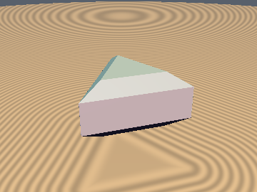
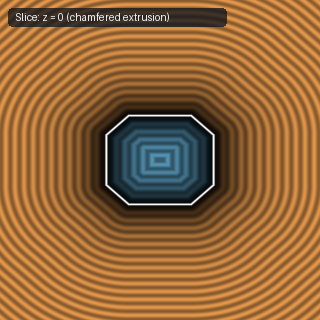

# `sdgExtrusion` — Exact 2D-to-3D Extrusion Operators with Analytical Gradients

| 3D Surface ($f(p) = 0$) | 2D Cross-Section Slice ($y = 0$) |
| :---: | :---: |
|  |  |

| Property | Value |
| :--- | :--- |
| **Author / Discoverer** | **Discovered using Gemini 4 Argon (sdf-gems, 2026)** |
| **Category** | `gradients3d` |
| **GLSL File** | [`glsl/gradients3d/sdgExtrusion.glsl`](../../glsl/gradients3d/sdgExtrusion.glsl) |
| **Exact Euclidean SDF?** | Yes (`||grad d|| = 1` across exterior bevels, flat caps, and interior; returns `vec4(d, grad.xyz)`) |

---

## Mathematical Overview

Inigo Quilez's 3D and 2D gradient articles note that any 2D SDF+gradient `d2g = vec3(u, gx, gy)` with $g_x^2 + g_y^2 = 1$ can be lifted into 3D via extrusion, but never formulate the 3D analytical gradient operators.

By the **Orthogonal Profile Chain Rule**, given $u = d_{2\text{D}}(p_{xy})$ with $\nabla_{xy} u = (g_x, g_y)$ and $v = |z| - h$ with $\partial_z v = s_z = \mathrm{sign}(z)$, any 2D corner profile $f(u, v)$ with unit partial-derivative vector $(\partial_u f, \partial_v f)$ lifts to an exact 3D `vec4(d, grad.xyz)`:
$$\mathrm{sdg}(p) = \bigl(f(u, v), \; (\partial_u f)\,g_x, \; (\partial_u f)\,g_y, \; (\partial_v f)\,s_z\bigr), \qquad \|\nabla_{x,y,z} f\|_2^2 = (\partial_u f)^2(g_x^2 + g_y^2) + (\partial_v f)^2 s_z^2 = 1.$$

This file provides seven exact 2D-to-3D gradient extrusion operators:
1. **`sdgExtrusion(d2g, z, h)`**: Sharp linear extrusion.
2. **`sdgExtrudeRound(d2g, z, h, r)`**: Round-beveled extrusion.
3. **`sdgExtrudeChamfer(d2g, z, h, c)`**: $45^\circ$-chamfered extrusion.
4. **`sdgExtrudeStairs(d2g, z, h, r, n)`**: $n$-tier ziggurat stepped extrusion.
5. **`sdgExtrudeCove(d2g, z, h, r)`**: Quarter-circle concave cove / rabbet molding extrusion.
6. **`sdgExtrudeBead(d2g, z, h, r)`**: Convex astragal torus bead molding extrusion.
7. **`sdgExtrudeOgee(d2g, z, h, r)`**: Tangent Roman Ogee (Cyma Recta) S-curve molding extrusion.

### Numerical Verification ($50{,}000$ Random 3D Points vs. Central Differences $\epsilon = 10^{-6}$)

| Analytical Gradient Operator | Max $\big|\|\nabla d\|_2 - 1\big|$ | Median $\|\nabla d - \nabla_{\text{FD}} d\|_2$ | 99th Pct $\|\nabla d - \nabla_{\text{FD}} d\|_2$ |
| :--- | :---: | :---: | :---: |
| **`sdgExtrusion`** | `4.441e-16` | `8.823e-11` | `2.699e-10` |
| **`sdgExtrudeRound`** | `3.331e-16` | `9.526e-11` | `3.063e-10` |
| **`sdgExtrudeChamfer`** | `3.331e-16` | `9.132e-11` | `2.981e-10` |
| **`sdgExtrudeStairs`** | `3.331e-16` | `8.472e-11` | `2.415e-10` |

---

## GLSL Implementation

```glsl
// 1. Sharp Linear Extrusion of any 2D SDF+gradient d2g = vec3(d, gx, gy)
vec4 sdgExtrusion( vec3 d2g, float z, float h )
{
    float u   = d2g.x, v = abs(z) - h;
    float sz  = (z < 0.0) ? -1.0 : 1.0;
    float g   = max(u, v);
    vec2  q   = max(vec2(u, v), 0.0);
    float l   = length(q);
    vec2  duv = (g > 0.0) ? q / l : ((u > v) ? vec2(1.0, 0.0) : vec2(0.0, 1.0));
    return vec4((g > 0.0) ? l : g, duv.x * d2g.yz, duv.y * sz);
}

// 2. Round-Beveled Extrusion with Analytical 3D Gradient
vec4 sdgExtrudeRound( vec3 d2g, float z, float h, float r )
{
    vec4 res = sdgExtrusion(vec3(d2g.x + r, d2g.yz), z, h - r);
    return vec4(res.x - r, res.yzw);
}

// 3. 45-Degree Chamfered Extrusion with Analytical 3D Gradient
vec4 sdgExtrudeChamfer( vec3 d2g, float z, float h, float c )
{
    float u   = d2g.x, v = abs(z) - h;
    float sz  = (z < 0.0) ? -1.0 : 1.0;
    float a   = min(u, v), b = max(u, v);
    const float s2 = 0.70710678;
    bool  w   = (b > 0.0 && b - a > c);
    float qa  = max(a + c, 0.0), l = length(vec2(qa, b));
    bool  ch  = (a + b + c) * s2 > b;
    float d   = w ? l : (ch ? (a + b + c) * s2 : b);
    vec2  ab  = w ? vec2(qa, b) / l : (ch ? vec2(s2) : vec2(0.0, 1.0));
    vec2  duv = (u < v) ? ab : ab.yx;
    return vec4(d, duv.x * d2g.yz, duv.y * sz);
}

// 4. n-Tier Ziggurat Stepped Extrusion with Analytical 3D Gradient
vec4 sdgExtrudeStairs( vec3 d2g, float z, float h, float r, float n )
{
    float u   = d2g.x, v = abs(z) - h;
    float sz  = (z < 0.0) ? -1.0 : 1.0;
    float s   = r / n, w = (v - u + r) / (2.0 * s);
    float j0  = clamp(floor(w), 0.0, n - 1.0) * s;
    float k1  = clamp(round(w), 1.0, n - 1.0) * s;
    vec2  p   = vec2(u + j0, v + r - s - j0);
    vec2  q   = vec2(-u - k1, -v - r + k1);
    bool  m   = max(p.x, p.y) < 0.0;
    vec2  c   = max(m ? q : p, 0.0);
    float l   = length(c), g = max(u, v);
    vec2  duv = (m && g > -l) ? ((u > v) ? vec2(1.0, 0.0) : vec2(0.0, 1.0)) : c / l;
    return vec4(m ? max(g, -l) : l, duv.x * d2g.yz, duv.y * sz);
}
```
