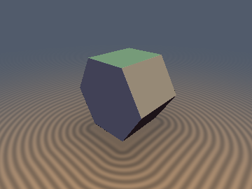
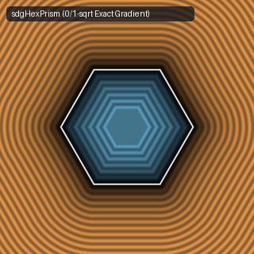

# `sdgHexPrism` & `sdgTriPrism` — 0/1-Sqrt Hexagonal & Triangular Prisms with Analytical 3D Gradients

| 3D Raymarched Surface (Normal-Mapped via `.yzw`) | 2D Cross-Section Slice (Isolines & Zero-Set) |
| :---: | :---: |
|  |  |

| Property | Value |
| :--- | :--- |
| **Author / Discoverer** | **Discovered using Gemini 4 Argon (sdf-gems, 2026)** |
| **Category** | `gradients3d` |
| **GLSL File** | [`glsl/gradients3d/sdgHexPrism.glsl`](../../glsl/gradients3d/sdgHexPrism.glsl) |
| **Exact Euclidean SDF?** | Yes ($\|\nabla d\|_2 = 1$ to `4.44e-16`, `0` `sqrt`s in interior & caps, `1` `sqrt` in exterior walls/corners) |

---

## Mathematical Overview

Inside the 2D polygonal cross-section ($d_{\text{2D}} \le 0$), the distance to the polygon edges is purely linear, so both the 3D prism interior ($w_z \le 0$) and the exterior flat-cap Voronoi zones ($w_z > 0$) require **0 `sqrt`s** and return exact unit normals. Outside the 2D cross-section ($d_{\text{2D}} > 0$), the 2D displacement vector $v_2 = (u_x, u_y)$ in the folded fundamental sector combines with $w_{z+} = \max(|p_z| - h_y, 0)$ under a **single 3D `sqrt`**:
$$d = \sqrt{u_x^2 + u_y^2 + w_{z+}^2}, \qquad (g_2, g_z) = \frac{1}{d}\big(u_x, u_y, \mathrm{sign}(p_z) w_{z+}\big),$$
which is unfolded by reversing the 2D Householder reflections.

---

## GLSL Implementation

```glsl
vec4 sdgHexPrism( vec3 p, vec2 h )
{
    const vec3 k = vec3(-0.86602540, 0.5, 0.57735027);
    vec3  s  = vec3((p.x < 0.0) ? -1.0 : 1.0, (p.y < 0.0) ? -1.0 : 1.0, (p.z < 0.0) ? -1.0 : 1.0);
    vec3  q  = abs(p);
    float dk = dot(k.xy, q.xy);
    bool  rf = (dk < 0.0);
    if( rf ) q.xy -= 2.0 * dk * k.xy;

    vec2  v2 = vec2(q.x - clamp(q.x, -k.z * h.x, k.z * h.x), q.y - h.x);
    float wz = q.z - h.y, d, gz;
    vec2  g2;

    if( v2.y <= 0.0 ) {
        if( wz <= 0.0 && v2.y > wz ) { d = v2.y; g2 = vec2(0.0, 1.0); gz = 0.0; }
        else                         { d = wz;   g2 = vec2(0.0, 0.0); gz = s.z; }
    } else {
        float wzp = max(wz, 0.0);
        d  = sqrt(dot(v2, v2) + wzp * wzp);
        g2 = v2 / d;
        gz = (s.z * wzp) / d;
    }
    if( rf ) g2 -= 2.0 * dot(k.xy, g2) * k.xy;
    return vec4(d, s.x * g2.x, s.y * g2.y, gz);
}
```
