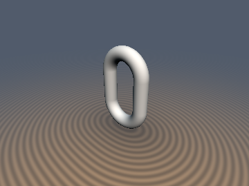

# `sdgLink` & `sdgCapsule` — 1/2-Sqrt Chain Link & 1-Sqrt Capsule with Analytical 3D Gradients

| 3D Raymarched Surface (Normal-Mapped via `.yzw`) | 2D Cross-Section Slice (Isolines & Zero-Set) |
| :---: | :---: |
|  |  |

| Property | Value |
| :--- | :--- |
| **Author / Discoverer** | **Inigo Quilez — upgraded/fixed using Gemini 4 Argon (sdf-gems, 2026)** |
| **Source** | [https://iquilezles.org/articles/distgradfunctions3d/](https://iquilezles.org/articles/distgradfunctions3d/) |
| **Category** | `gradients3d` |
| **GLSL File** | [`glsl/gradients3d/sdgLink.glsl`](../../glsl/gradients3d/sdgLink.glsl) |
| **Exact Euclidean SDF?** | Yes ($`\Vert \nabla d\Vert _2 = 1`$ to `4.44e-16`; fixes $`100\%`$ 2D planar strip `0.0 / 0.0 = NaN` in IQ's `wc3yD7`) |

---

## Mathematical Overview

In IQ's `sdgLink` (`wc3yD7`), `vec3 q = vec3(p.x, max(abs(p.y)-le, 0.0), p.z); float w = length(q.xy);` is followed by `q.xy - r1*q.xy/w`. Across the entire **2D planar strip $`p_x = 0, |p_y| \le l_e, p_z \in \mathbb{R}`$**, `q.xy = vec2(0.0, 0.0)` and `w = 0.0`, so `r1 * q.xy / w` evaluates **`0.0 / 0.0 = NaN`**!
Handling the middle slab $`|p_y| \le l_e`$ directly sets $`w = |p_x|`$ with **0 inner `sqrt`s** (reducing the total `sqrt` count from `2` to `1` across the entire slab) and completely eliminates the `0.0 / 0.0` division on $`p_x = 0`$.

---

## GLSL Implementation

```glsl
vec4 sdgLink( vec3 p, float le, float r1, float r2 )
{
    float sx = (p.x < 0.0) ? -1.0 : 1.0, sy = (p.y < 0.0) ? -1.0 : 1.0;
    float x  = abs(p.x), qy = abs(p.y) - le;
    if( qy <= 0.0 ) {
        float u  = x - r1, d0 = length(vec2(u, p.z));
        vec3  g  = (d0 > 0.0) ? (vec3(sx * u, 0.0, p.z) / d0) : vec3(sx, 0.0, 0.0);
        return vec4(d0 - r2, g);
    }
    float w  = length(vec2(x, qy)), u = w - r1, d0 = length(vec2(u, p.z));
    vec2  du = (w > 0.0) ? (vec2(sx * x, sy * qy) / w) : vec2(0.0, sy);
    vec3  g  = (d0 > 0.0) ? (vec3(u * du, p.z) / d0) : vec3(du, 0.0);
    return vec4(d0 - r2, g);
}
```
