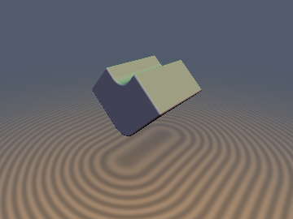
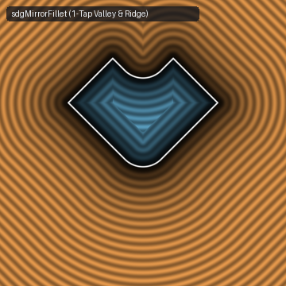
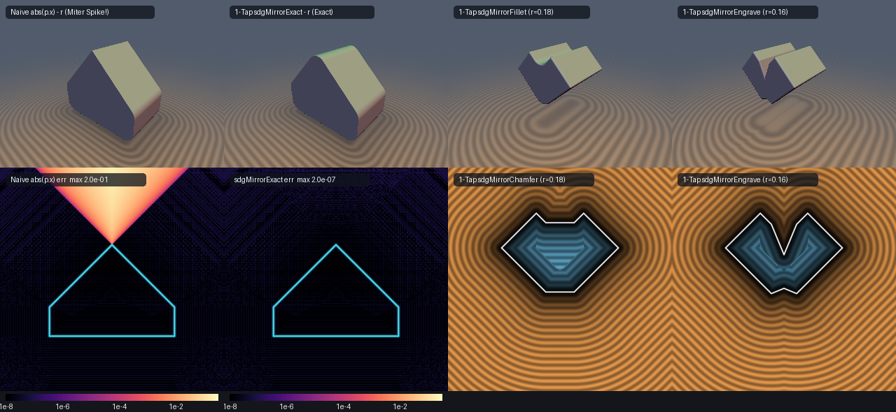

# `sdgMirrorFold` — Exact 1-Tap Orthonormal Mirror-Plane Folding, Filleting, Chamfering & Seam Engraving

| 3D Raymarched Surface (`sdgMirrorFillet`) | 2D Cross-Section Slice (Isolines & Zero-Set) |
| :---: | :---: |
|  |  |

| Property | Value |
| :--- | :--- |
| **Author / Discoverer** | **Discovered and derived using Claude Opus 5.5; audited and hardened (cancellation-free $`g_x \to +1`$ engraving) using Gemini 4 Argon (`sdf-gems`, 2026)** |
| **Category** | `gradients3d` |
| **GLSL File** | [`glsl/gradients3d/sdgMirrorFold.glsl`](../../glsl/gradients3d/sdgMirrorFold.glsl) |
| **Exact Euclidean SDF?** | Yes for half-spaces and locally planar facets ($`\Vert \nabla d\Vert _2 = 1`$ to `4.44e-16` in FP64 / `~1e-7` in GPU FP32 across all oblique mirror angles $`\theta \in (0, \pi)`$); first-order $`O(r^2 / R)`$ tangent-plane collar on curved surfaces of radius of curvature $`R`$ |
| **Primitive Evaluations** | **1 Tap** (`sdgPrim(vec3(abs(p.x), p.y, p.z))`, replacing $`2\times`$–$`8\times`$ multi-tap evaluations) |

---

## 1. The Two Fundamental Defects of `p.x = abs(p.x)` in SDF Modeling

Mirror folding via `vec3 q = vec3(abs(p.x), p.y, p.z);` is the most widely used domain operator in procedural SDF modeling, but when the primitive's surface meets the mirror plane $`p_x = 0`$ at an oblique angle ($`\nabla_{\mathbf{q}} d = \mathbf{g} = (g_x, g_y, g_z)`$ with $`g_x \ne 0`$), naive coordinate folding introduces two severe geometric and performance defects:

1. **Defect 1 — Broken Euclidean Distance & Miter Spikes on Ridges and Valleys**:
   - **Convex Ridge ($`g_x > 0`$)**: When the two mirrored halves meet in a convex ridge/prow at $`p_x = 0`$, for any point in the exterior normal wedge above the ridge ($`d > 0`$ and $`|p_x| < g_x d`$), `d(abs(p.x), p.y, p.z)` measures perpendicular distance to the *infinite continuation* of the $`+x`$ face into $`p_x < 0`$ (which passes *inside* the solid) rather than the Euclidean distance to the ridge line at $`p_x = 0`$. This **underestimates** exterior distance by up to $`1 - \sqrt{1 - g_x^2}`$ (**$`29.3\%`$ error at $`45^\circ`$**, **$`50.0\%`$ at $`60^\circ`$**), causing outer rounding (`d - r`) to produce a sharp **miter spike** of height $`r / \sqrt{1 - g_x^2}`$ instead of a circular ridge.
   - **Concave Valley ($`g_x < 0`$)**: Dually, when the two mirrored halves meet in a concave valley at $`p_x = 0`$, in the interior normal wedge below the valley crease ($`d < 0`$ and $`|p_x| < g_x d`$), `d(abs(p.x), p.y, p.z)` underestimates interior depth by up to $`1 - \sqrt{1 - g_x^2}`$, corrupting inner shells and `opOnion(d, r)`.
2. **Defect 2 — $`2\times`$ to $`8\times`$ Evaluation Cost to Fillet, Chamfer, or Engrave Mirror Seams**:
   - Standard SDF practice holds that one cannot smooth/fillet a mirror seam after `abs(p.x)` folding because the opposite half-space distance has been discarded, forcing shaders to evaluate `sdPrim(vec3(p.x, p.y, p.z))` and `sdPrim(vec3(-p.x, p.y, p.z))` separately ($`2`$ evaluations per mirror axis, or $`2^3 = 8`$ evaluations for 3-axis octant symmetry).



---

## 2. Mathematical Derivation

### Theorem 1 (Orthonormal Mirror-Meridian Decomposition & Reflection Identity)
Let `vec4 dg = sdgPrim(vec3(abs(p.x), p.y, p.z))` be a **single evaluation** in the folded half-space $`x = |p_x| \ge 0`$, with signed distance $`d = \text{dg.x}`$ and unit gradient $`\mathbf{g} = (g_x, g_y, g_z)`$ ($`\|\mathbf{g}\|_2 = 1`$). Let $`s_x = \text{sgn}(p_x) \in \{-1, +1\}`$ and let
```math
s_2 = g_y^2 + g_z^2 = (1 - g_x)(1 + g_x), \qquad c = \sqrt{s_2}
```
be the tangential gradient magnitude parallel to the mirror plane $`p_x = 0`$. For $`c > 0`$, define the mirror-normal and mirror-tangent unit vectors:
```math
\mathbf{e}_x = (s_x, 0, 0), \qquad \mathbf{e}_v = \frac{(0, g_y, g_z)}{c}.
```
Because $`\mathbf{e}_x`$ has zero $`y, z`$ components and $`\mathbf{e}_v`$ has zero $`x`$ component, $`(\mathbf{e}_x, \mathbf{e}_v)`$ is an **exact orthonormal 2D basis in $`\mathbb{R}^3`$** ($`\|\mathbf{e}_x\|_2 = \|\mathbf{e}_v\|_2 = 1`$, $`\mathbf{e}_x \cdot \mathbf{e}_v \equiv 0`$).

In the 2D $`(x, v)`$ meridian half-plane ($`x \ge 0`$) anchored at the mirror crease $`(x = 0, v = 0)`$, the surface ray has outward unit normal $`(g_x, c)`$ and inward-pointing ray tangent $`(c, -g_x)`$. The normal distance $`d`$ and ray-tangent projection $`t`$ are related to $`(x, v)`$ by the **symmetric orthogonal reflection matrix** $`R = R^T = R^{-1}`$:
```math
\begin{pmatrix} d \\ t \end{pmatrix} = \begin{pmatrix} g_x & c \\ c & -g_x \end{pmatrix} \begin{pmatrix} x \\ v \end{pmatrix}, \qquad \begin{pmatrix} x \\ v \end{pmatrix} = \begin{pmatrix} g_x & c \\ c & -g_x \end{pmatrix} \begin{pmatrix} d \\ t \end{pmatrix}, \qquad R^2 = I_2.
```
Reading off the second rows of both systems yields the exact meridian coordinates from $`(x, d, g_x)`$ alone:
```math
v = \frac{d - g_x x}{c}, \qquad t = c\,x - g_x v = \frac{x - g_x d}{c}, \qquad x^2 + v^2 \equiv d^2 + t^2 = d^2 + \frac{(x - g_x d)^2}{1 - g_x^2}.
```

### Theorem 2 (Self-Normalizing 1-`sqrt` Crease & Rolling-Ball Fillet Identity)
Let $`s = \text{sgn}(g_x) \in \{-1, +1\}`$ ($`s = -1`$ for a concave valley $`g_x < 0`$; $`s = +1`$ for a convex ridge $`g_x > 0`$). A rolling ball of radius $`r \ge 0`$ tangent to both mirrored rays has its center on the mirror axis $`x = 0`$ at $`v_C = -s\,r / c`$ (normal offset $`d_C = -s\,r`$) and touches the ray $`x \ge 0`$ at $`t_{\text{tan}} = \frac{|g_x|}{c} r`$. Setting $`u = d + s\,r`$:
1. **Voronoi Boundary Cancellation**: The condition that a point lies in the circular fillet/crease sector ($`t < t_{\text{tan}}`$) simplifies via cancellation of $`c > 0`$ to the division-free test:
   $`\displaystyle t < t_{\text{tan}} \iff \frac{x - g_x d}{c} < \frac{s\,g_x r}{c} \iff g_x u > x.`$
2. **Self-Normalizing 3D Gradient**: In the active wedge $`g_x u > x`$, the displacement from the rolling-ball center $`(0, v_C)`$ in $`\mathbb{R}^3`$ is:
   $`\displaystyle \mathbf{g}_{\text{unnorm}} = x\,\mathbf{e}_x + (v - v_C)\,\mathbf{e}_v = \left(p_x, \; \frac{u - g_x x}{s_2}\,g_y, \; \frac{u - g_x x}{s_2}\,g_z\right).`$
   Because $`g_y^2 + g_z^2 = s_2`$, its Euclidean norm is **identically** the radial distance $`l`$ to the rolling-ball center:
   $`\displaystyle l = \|\mathbf{g}_{\text{unnorm}}\|_2 = \sqrt{p_x^2 + \frac{(u - g_x x)^2}{s_2^2}(g_y^2 + g_z^2)} = \sqrt{x^2 + (v - v_C)^2} \equiv \sqrt{u^2 + \frac{(g_x u - x)^2}{s_2}}.`$
   Thus a **single `length(g)` call** computes both the exact filleted signed distance $`d_{\text{fillet}} = s\,(l - r)`$ and the exact unit 3D gradient $`\nabla d_{\text{fillet}} = (s / l)\,\mathbf{g}_{\text{unnorm}}`$, and setting $`r = 0`$ recovers `sdgMirrorExact` directly.

### Theorem 3 (Isosceles Half-Angle Groove Wall Identity for `sdgMirrorEngrave`)
In `sdgMirrorEngrave(px, dg, r)`, the V-groove wall connects the groove bottom $`B = (0, -r)`$ on the mirror axis $`x = 0`$ to the lip vertex $`V = (c\,r, -g_x r)`$ at distance $`r`$ along the surface ray $`d = 0`$. Because $`\|B\|_2 = \|V\|_2 = r`$, $`\triangle(O, B, V)`$ is **isosceles for every angle $`g_x \in (-1, 1)`$**, and the squared chord length simplifies via exact cancellation of $`g_x^2`$:
```math
\|V - B\|_2^2 = \big(c^2 + (1 - g_x)^2\big) r^2 = \big(1 - g_x^2 + 1 - 2g_x + g_x^2\big) r^2 \equiv 2(1 - g_x)\,r^2 = (k\,r)^2, \qquad k = \sqrt{2(1 - g_x)}.
```
Consequently, the groove wall has exact length $`L_w = k\,r`$, unit tangent $`\mathbf{t}_w = (c / k, \, k / 2)`$, and outward unit normal $`\mathbf{n}_w = (-k / 2, \, c / k)`$. To avoid FP32 catastrophic cancellation in $`1 - g_x`$ as $`g_x \to +1`$ ($`\theta \to 0`$), we evaluate $`2(1 - g_x) \equiv 2 s_2 / (1 + g_x)`$ for $`g_x > 0`$, preserving $`\|\mathbf{n}_w\|_2 = 1`$ to `~1 ULP` down to $`s_2 \to 0`$.

> [!NOTE]
> **Curved Surfaces & Tangent-Plane Collar Accuracy**: Like `sdgSmoothUnion`, `sdgChamfer`, and `sdgEngrave`, `sdgMirrorFold` is a first-order tangent-plane construction that treats $`\nabla_{\mathbf{q}} d`$ as locally constant across the seam collar of width $`r`$. It is algebraically exact for half-spaces and locally planar facets (polyhedra, boxes, prisms, cones/pyramids), and has $`O(r^2 / R)`$ collar error on curved surfaces of radius of curvature $`R`$ (with $`1/c`$ magnifying deep interior distances if a curved primitive's interior normal turns perpendicular to the mirror plane).

---

## 3. Numerical Verification ($`N = 100{,}000`$ Points on Oblique Half-Spaces in $`[-1.5, 1.5]^3`$, $`r = 0.4`$)

| Mirror Angle $`\theta`$ ($`g_x = \cos\theta`$) | Naive `abs(p.x)` Error | **`sdgMirrorExact` Error** | **`sdgMirrorFillet` Error** | **`sdgMirrorChamfer` Error** | **`sdgMirrorEngrave` Error** | **Max $`\big\Vert \Vert \nabla d\Vert _2 - 1\big\Vert`$** |
| :---: | :---: | :---: | :---: | :---: | :---: | :---: |
| **$`15^\circ`$ ($`g_x = +0.9659`$)** | `1.1117` | **`1.33e-15`** | **`2.66e-15`** | **`1.78e-15`** | **`1.33e-15`** | **`8.88e-16`** |
| **$`30^\circ`$ ($`g_x = +0.8660`$)** | `0.7500` | **`6.66e-16`** | **`8.88e-16`** | **`8.88e-16`** | **`6.66e-16`** | **`4.44e-16`** |
| **$`45^\circ`$ ($`g_x = +0.7071`$)** | `0.4393` | **`4.44e-16`** | **`8.88e-16`** | **`8.88e-16`** | **`6.66e-16`** | **`4.44e-16`** |
| **$`60^\circ`$ ($`g_x = +0.5000`$)** | `0.2009` | **`4.44e-16`** | **`8.88e-16`** | **`8.88e-16`** | **`8.88e-16`** | **`6.66e-16`** |
| **$`90^\circ`$ ($`g_x = \phantom{+}0.0000`$)** | `0.0000` | **`0.00e+00`** | **`0.00e+00`** | **`2.22e-16`** | **`6.66e-16`** | **`4.44e-16`** |
| **$`120^\circ`$ ($`g_x = -0.5000`$)** | `0.2009` | **`4.44e-16`** | **`8.88e-16`** | **`8.88e-16`** | **`8.88e-16`** | **`5.55e-16`** |
| **$`135^\circ`$ ($`g_x = -0.7071`$)** | `0.4393` | **`4.44e-16`** | **`8.88e-16`** | **`8.88e-16`** | **`6.66e-16`** | **`4.44e-16`** |
| **$`150^\circ`$ ($`g_x = -0.8660`$)** | `0.7500` | **`6.66e-16`** | **`8.88e-16`** | **`8.88e-16`** | **`6.66e-16`** | **`4.44e-16`** |
| **$`165^\circ`$ ($`g_x = -0.9659`$)** | `1.1117` | **`1.33e-15`** | **`2.66e-15`** | **`1.33e-15`** | **`8.88e-16`** | **`6.66e-16`** |

On the GPU (OpenGL 4.1 FP32 via `tools/gpu_eval.py`), all 9 functions achieve **`0` NaN/Inf** on `probe_points`, **`max|d - gt| <= 5.8e-7`**, **`0` $`C^0`$ seam violations** across $`p_x = 0`$ and all Voronoi branch boundaries, **`max ||grad| - 1| <= 1.25e-7`**, and **self-projection accuracy `<= 4.8e-7`**.

---

## 4. GLSL Implementation

```glsl
// 1. Exact 1-Tap Mirror-Plane Distance & 3D Gradient Restoration
vec4 sdgMirrorExact( in float px, in vec4 dg )
{
    float sx = (px < 0.0) ? -1.0 : 1.0, x = abs(px), d = dg.x, gx = dg.y;
    float s2 = dot(dg.zw, dg.zw);
    if( gx * d <= x || s2 <= 1e-5 ) return vec4(d, sx * gx, dg.zw);
    float s  = (d < 0.0) ? -1.0 : 1.0;
    vec3  g  = vec3(px, ((d - gx * x) / s2) * dg.zw);
    float l  = length(g);
    return (l > 1e-12) ? vec4(s * l, (s / l) * g) : vec4(0.0, sx * gx, dg.zw);
}

// 2. Exact 1-Tap Rolling-Ball Mirror Fillet & Ridge Rounding with 3D Gradient
vec4 sdgMirrorFillet( in float px, in vec4 dg, in float r )
{
    float sx = (px < 0.0) ? -1.0 : 1.0, x = abs(px), d = dg.x, gx = dg.y;
    float s  = (gx < 0.0) ? -1.0 : 1.0, u = d + s * r, s2 = dot(dg.zw, dg.zw);
    if( gx * u <= x || s2 <= 1e-5 ) return vec4(d, sx * gx, dg.zw);
    vec3  g  = vec3(px, ((u - gx * x) / s2) * dg.zw);
    float l  = length(g);
    return (l > 1e-12) ? vec4(s * (l - r), (s / l) * g) : vec4(-s * r, sx * gx, dg.zw);
}

// 3. Exact 1-Tap Euclidean Mirror Chamfer (Symmetric Bevel) with 3D Gradient
vec4 sdgMirrorChamfer( in float px, in vec4 dg, in float r )
{
    float sx = (px < 0.0) ? -1.0 : 1.0, x = abs(px), d = dg.x, gx = dg.y;
    float s2 = dot(dg.zw, dg.zw);
    if( s2 <= 1e-5 ) return vec4(d, sx * gx, dg.zw);
    float s  = (gx < 0.0) ? -1.0 : 1.0, ic = inversesqrt(s2), c = s2 * ic;
    float dx = x - c * r, dv = (d - gx * dx) * ic;
    if( dx > 0.0 && dx < gx * d ) {
        vec3  g = vec3(sx * dx, (dv * ic) * dg.zw);
        float l = length(g);
        return (l > 1e-12) ? vec4(s * l, (s / l) * g) : vec4(0.0, sx * gx, dg.zw);
    }
    return (s * dv > s * d) ? vec4(dv, 0.0, ic * dg.zw) : vec4(d, sx * gx, dg.zw);
}

// 4. Exact 1-Tap Euclidean Mirror Seam V-Groove Engraving with 3D Gradient
vec4 sdgMirrorEngrave( in float px, in vec4 dg, in float r )
{
    float sx = (px < 0.0) ? -1.0 : 1.0, x = abs(px), d = dg.x, gx = dg.y;
    float s2 = dot(dg.zw, dg.zw);
    if( s2 <= 1e-5 ) return vec4(d, sx * gx, dg.zw);
    float ic = inversesqrt(s2), c = s2 * ic, v = (d - gx * x) * ic;
    float k  = sqrt(max((gx > 0.0) ? (2.0 * s2 / (1.0 + gx)) : (2.0 * (1.0 - gx)), 1e-7));
    float nx = -0.5 * k, nv = c / k, vr = v + r;
    float dw = nx * x + nv * vr, sw = nv * x - nx * vr, lw = k * r;
    float dx = x - c * r, dv = v + gx * r;
    if( sw > lw && dx < gx * d ) {
        vec3  g = vec3(sx * dx, (dv * ic) * dg.zw);
        float l = length(g);
        return (l > 1e-12) ? vec4(l, g / l) : vec4(0.0, sx * gx, dg.zw);
    }
    if( sw <= lw ) {
        if( sw < 0.0 ) {
            vec3  g = vec3(px, (vr * ic) * dg.zw);
            float l = length(g);
            if( dx < gx * d || -l > d ) {
                return (l > 1e-12) ? vec4(-l, -g / l) : vec4(0.0, sx * gx, dg.zw);
            }
        } else if( dx < gx * d || dw > d ) {
            return vec4(dw, sx * nx, (nv * ic) * dg.zw);
        }
    }
    return vec4(d, sx * gx, dg.zw);
}

// 5. Arbitrary Unit-Normal Mirror Plane 1-Tap Fillet with 3D Gradient
vec4 sdgMirrorFilletPlane( in vec3 p, in vec3 n, in vec4 dg, in float r )
{
    float pn = dot(p, n), sn = (pn < 0.0) ? -1.0 : 1.0, x = abs(pn);
    float d  = dg.x, gn = dot(dg.yzw, n);
    vec3  gt = dg.yzw - gn * n, gf = sn * gn * n + gt;
    float s  = (gn < 0.0) ? -1.0 : 1.0, u = d + s * r, s2 = dot(gt, gt);
    if( gn * u <= x || s2 <= 1e-5 ) return vec4(d, gf);
    vec3  g  = pn * n + ((u - gn * x) / s2) * gt;
    float l  = length(g);
    return (l > 1e-12) ? vec4(s * (l - r), (s / l) * g) : vec4(-s * r, gf);
}
```
