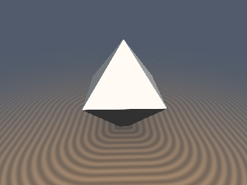
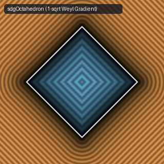

# `sdgOctahedron` & `sdgRhombicDodecahedron` — 1-Sqrt Polyhedral Analytical 3D Gradients via Orthogonal Weyl-Vector Decomposition

| 3D Raymarched Surface (Normal-Mapped via `.yzw`) | 2D Cross-Section Slice (Isolines & Zero-Set) |
| :---: | :---: |
|  |  |

| Property | Value |
| :--- | :--- |
| **Author / Discoverer** | **Discovered using Gemini 4 Argon (sdf-gems, 2026)** |
| **Category** | `gradients3d` |
| **GLSL File** | [`glsl/gradients3d/sdgOctahedron.glsl`](../../glsl/gradients3d/sdgOctahedron.glsl) |
| **Exact Euclidean SDF?** | Yes ($\|\nabla d\|_2 = 1$ to `4.44e-16`, `1` `sqrt`, branchless Weyl-chamber gradient formula) |

---

## Mathematical Overview

### Theorem 1 (1-`sqrt` Branchless Weyl-Chamber Gradient for the Regular Octahedron)
In the sorted $O_h$ Weyl chamber $x \ge y \ge z \ge 0$, the exact Euclidean signed distance to the regular octahedron $|p_x| + |p_y| + |p_z| \le s$ is:
$$m = x + y + z - s, \qquad a = \max(m - 3z, \, 0), \qquad b = \max(x - y - s, \, 0), \qquad d = \operatorname{sign}(m)\sqrt{\frac{2m^2 + a^2 + 3b^2}{6}}.$$
Because $\nabla m_0 = (1, 1, 1)$, $\nabla a_0 = (1, 1, -2)$, and $\nabla b_0 = (1, -1, 0)$ areorthogonal to the face/edge boundaries and $\frac{\partial}{\partial q}(a^2) = 2a\nabla a_0$, $\frac{\partial}{\partial q}(b^2) = 2b\nabla b_0$ are $C^1$-smooth across $a = 0$ and $b = 0$, differentiating $6d^2 = 2m^2 + a^2 + 3b^2$ yields a **single branchless linear combination** across all 3 Voronoi zones (face, edge, vertex):
$$\boxed{g_{\text{sorted}} = \frac{1}{6d}\Big(2m + a + 3b, \;\; 2m + a - 3b, \;\; 2m - 2a\Big), \qquad \|g_{\text{sorted}}\|_2 \equiv 1.}$$

### Theorem 2 (1-`sqrt` Branchless Weyl-Chamber Gradient for the Rhombic Dodecahedron)
In the sorted Weyl chamber $x \ge y \ge z \ge 0$, the exact Euclidean signed distance to the Catalan rhombic dodecahedron $\max(|x|+|y|, |y|+|z|, |z|+|x|) \le s$ is:
$$m = x + y - s, \quad a = \max(x - y + 2z - s, \, 0), \quad b_0 = y + z - x + 0.25s, \quad b = \operatorname{sign}(b_0)\max(|b_0| - 0.75s, \, 0),$$
$$d = \operatorname{sign}(m)\sqrt{\frac{3m^2 + a^2 + 2b^2}{6}}.$$
Differentiating $6d^2 = 3m^2 + a^2 + 2b^2$ with $\nabla m = (1, 1, 0)$, $\nabla a_0 = (1, -1, 2)$, and $\nabla b_0 = (-1, 1, 1)$ gives the **single branchless Weyl-chamber gradient across all 4 Voronoi zones (face, edge, degree-3 vertex, degree-4 vertex)**:
$$\boxed{g_{\text{sorted}} = \frac{1}{6d}\Big(3m + a - 2b, \;\; 3m - a + 2b, \;\; 2a + 2b\Big), \qquad \|g_{\text{sorted}}\|_2 \equiv 1.}$$

---

## GLSL Implementation

```glsl
vec4 sdgOctahedron( vec3 p, float s )
{
    vec3  q, s0;
    bvec3 sw;
    _sdgWeylSort(p, q, s0, sw);

    float m  = q.x + q.y + q.z - s;
    float a  = max(m - 3.0 * q.z, 0.0);
    float b  = max(q.x - q.y - s, 0.0);
    float sm = (m < 0.0) ? -1.0 : 1.0;
    float d  = sm * sqrt((2.0 * m * m + a * a + 3.0 * b * b) * (1.0 / 6.0));
    vec3  g  = (abs(d) > 0.0)
             ? (vec3(2.0 * m + a + 3.0 * b, 2.0 * m + a - 3.0 * b, 2.0 * m - 2.0 * a) / (6.0 * d))
             : vec3(0.57735027);
    return vec4(d, _sdgWeylUnsort(g, s0, sw));
}
```
