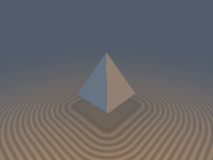
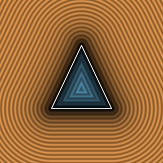

# `sdgPyramid` — 0/1-Per-Pixel-SFU 3D Square Pyramid Distance & Analytical Gradient

| 3D Raymarched Surface (Normal-Mapped via `.yzw`) | 2D Cross-Section Slice (Isolines & Zero-Set) |
| :---: | :---: |
|  |  |

| Property | Value |
| :--- | :--- |
| **Author / Discoverer** | **Discovered and derived using Gemini 4 Argon (sdf-gems, 2026)** |
| **Category** | `gradients3d` |
| **GLSL File** | [`glsl/gradients3d/sdgPyramid.glsl`](../../glsl/gradients3d/sdgPyramid.glsl) |
| **Exact Euclidean SDF?** | Yes ($`\Vert \nabla d\Vert _2 = 1`$ to `3.33e-16`; `0` SFU ops in base zone, `0` per-pixel SFU ops in slanted-face zone, `1` `inversesqrt` in edge/vertex zone; fixes IQ's interior base-face bug) |

---

## Mathematical Overview

### 1. The Euclidean-Vector Decomposition Identity

In Inigo Quilez's scalar `sdPyramid(vec3 p, float h)`, after folding $`\mathbf{u} = |p_{xz}|`$, sorting $`u_x \ge u_y`$, and shifting $`\mathbf{u} \gets \mathbf{u} - \frac{1}{2}`$, the function computes two scalar quadratic forms $`(a + q_z^2)/m_2`$ and $`(b + q_z^2)/m_2`$, where $`m_2 = h^2 + \frac{1}{4}`$, $`q_y = h p_y - \frac{1}{2} u_x`$, and $`q_z = h u_x + \frac{1}{2} p_y`$.

Expanding the Euclidean norms reveals that these two algebraic quantities are **identically equal** to the squared lengths of the explicit 3D Euclidean difference vectors from $`p`$ to the base edge $`E_A`$ and the slanted hip edge $`E_B`$:

```math
\frac{a + q_z^2}{m_2} \equiv \|\mathbf{v}_A\|_2^2, \qquad \mathbf{v}_A = \big(u_x,\; p_y,\; \max(u_y, 0)\big),
```

```math
\frac{b + q_z^2}{m_2} \equiv \|\mathbf{v}_B\|_2^2, \qquad \mathbf{v}_B = \big(u_x + \tfrac{1}{2}t,\; p_y - h t,\; u_y + \tfrac{1}{2}t\big), \quad t = \mathrm{clamp}\!\left(\frac{q_y - \frac{1}{2}u_y}{m_2 + \frac{1}{4}}, 0, 1\right).
```

### 2. Three-Zone 0/1-SFU Decomposition

1. **Zone 1 (Base Face — `0` SFU ops):** Either outside below the base square ($`p_y \le 0 \land u_x \le 0`$) or inside closer to the base $`y = 0`$ than the slanted face ($`q_z \le 0 \land p_y > 0 \land m_2 p_y^2 \le q_z^2`$), returning $`d = -p_y`$ and $`\nabla d = (0, -1, 0)`$ (also fixing IQ's missing interior base-face Voronoi region).
2. **Zone 2 (Slanted Triangular Face — `0` per-pixel SFU ops):** Inside closer to the slanted face ($`q_z \le 0 \land p_y > 0`$) or in the exterior slanted-face normal prism ($`q_y > 0 \land -u_y m_2 - \frac{1}{2} q_y > 0`$), returning $`d = q_z / \sqrt{m_2}`$ and folded normal $`(h, \frac{1}{2}, 0) / \sqrt{m_2}`$.
3. **Zone 3 (Base Edge vs. Hip Edge — `1` `inversesqrt`):** Selects $`\mathbf{v} = (\|\mathbf{v}_A\|_2^2 < \|\mathbf{v}_B\|_2^2) \mathbin{?} \mathbf{v}_A : \mathbf{v}_B`$ and normalizes with a single `inversesqrt`.

---

## Numerical Verification

| Function | SFU Ops in Base Zone | Per-Pixel SFU Ops in Slanted-Face Zone | SFU Ops in Edge/Vertex Zone | Eikonal Error $`\lvert\Vert \nabla d\Vert _2 - 1\rvert`$ | Max Gradient Error vs FD |
| :--- | :---: | :---: | :---: | :---: | :---: |
| **`sdgPyramid` (Ours)** | **`0`** | **`0`** (`invM` constant) | **`1` (`inversesqrt`)** | **`3.33e-16`** | **`1.15e-09`** |
