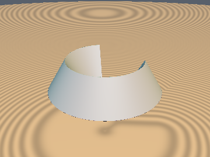
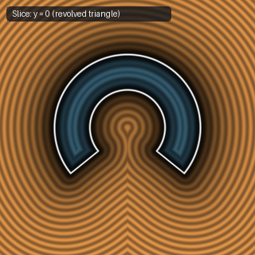

# `sdgRevolution` — Exact Full & Limited-Angle 3D Revolution with Gradients

| 3D Surface ($f(p) = 0$) | 2D Cross-Section Slice ($y = 0$) |
| :---: | :---: |
|  |  |

| Property | Value |
| :--- | :--- |
| **Author / Discoverer** | **Discovered using Gemini 4 Argon (sdf-gems, 2026)** |
| **Category** | `gradients3d` |
| **GLSL File** | [`glsl/gradients3d/sdgRevolution.glsl`](../../glsl/gradients3d/sdgRevolution.glsl) |
| **Exact Euclidean SDF?** | Yes (`||grad d|| = 1` across $\mathbb{R}^3$; returns `vec4(d, grad.xyz)`) |

---

## Mathematical Overview

Lifts any 2D SDF+gradient `d2g = vec3(d, gx, gy)` into an exact 3D `vec4(d, gx, gy, gz)` under full $360^\circ$ revolution (`sdgRevolutionFinalize`) or limited-angle partial revolution (`sdgRevolutionLimFinalize`, paired with [`opRevolutionLim`](../deform/opRevolutionLim.md)):
- **Inside the angular sector ($w \le 0$)**: The radial coordinate $l = \|p_{xz}\|_2$ has gradient $\nabla l = (p_x / l, 0, p_z / l) \perp \hat{y}$, so the mantle gradient is $(g_x p_x / l, g_y, g_x p_z / l)$ (or the flat end-cap normal $g_w = (\operatorname{sign}(p_x)\cos\theta, 0, -\sin\theta)$ when the interior end-cap is active).
- **Outside the angular sector ($w > 0$)**: The in-plane cap tangent $(\operatorname{sign}(p_x)\sin\theta, 0, \cos\theta)$, the vertical axis $(0, 1, 0)$, and the outward cap normal $g_w = (\operatorname{sign}(p_x)\cos\theta, 0, -\sin\theta)$ form a **3D orthonormal triad**, so the exterior cap-rim gradient is $(d_{2\text{D}}\,g_u + w\,g_w) / \sqrt{d_{2\text{D}}^2 + w^2}$ with exact unit norm $\|\nabla d\|_2 = 1$ (`3.33e-16` max Eikonal deviation).

---

## GLSL Implementation

```glsl
// Full 360-degree revolution gradient finalize for d2g = sdgShape2D(vec2(length(p.xz) - o, p.y))
vec4 sdgRevolutionFinalize( vec3 p, vec3 d2g )
{
    float l = length(p.xz);
    return vec4(d2g.x, d2g.y * p.x / l, d2g.z, d2g.y * p.z / l);
}

// Limited-angle partial revolution gradient finalize for q = opRevolutionLim(p, o, sc) and d2g = sdgShape2D(q.xy)
vec4 sdgRevolutionLimFinalize( vec3 p, vec2 sc, vec3 d2g )
{
    float sx = (p.x < 0.0) ? -1.0 : 1.0;
    vec2  q  = vec2(abs(p.x), p.z);
    float u  = q.x * sc.x + q.y * sc.y;
    float w  = q.x * sc.y - q.y * sc.x;
    float l  = length(q);
    vec3  gw = vec3(sx * sc.y, 0.0, -sc.x);
    if( w > 0.0 ) {
        if( d2g.x <= 0.0 ) return vec4(w, gw);
        float d  = length(vec2(d2g.x, w));
        vec3  gu = vec3(sx * d2g.y * sc.x, d2g.z, d2g.y * sc.y);
        return vec4(d, (d2g.x * gu + w * gw) / d);
    }
    if( d2g.x < 0.0 && u > 0.0 && w > d2g.x ) return vec4(w, gw);
    return vec4(d2g.x, sx * d2g.y * q.x / l, d2g.z, d2g.y * q.y / l);
}
```
