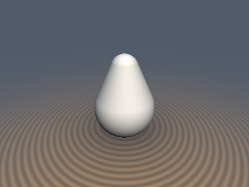
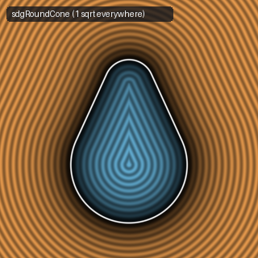

# `sdgRoundCone` & `sdgRoundConeSeg` — 1-`sqrt` Round Cone Analytical Gradients

| 3D Raymarched Surface | 2D Cross-Section Slice |
| :---: | :---: |
|  |  |

- **GLSL Implementation**: [`sdgRoundCone.glsl`](../../glsl/gradients3d/sdgRoundCone.glsl)
- **Category**: `gradients3d`
- **Status**: **Exact 1-`sqrt` Euclidean SDF + Unit 3D Gradient** (Discovered using **Gemini 4 Argon**, `sdf-gems`, 2026)

---

## 1. Overview & Mathematical Derivations

1. **1-`sqrt` Vertical `sdgRoundCone(vec3 p, float r1, float r2, float h)`**:
   Let $b = (r_1 - r_2)/h$, $a_2 = 1 - b^2$, and $x_2 = p_x^2 + p_z^2$.
   - Using the signed-square tangent-cone boundaries $a_2 y |y| < b|b| x_2$ (bottom sphere) and $a_2 (y - h)|y - h| > b|b| x_2$ (top sphere), we classify the spherical caps **before** taking any square root.
   - In the conical mantle, setting $w = \sqrt{a_2 x_2} = \sqrt{1 - b^2}\|p_{xz}\|_2$ yields both the radial distance term $w$ and the horizontal gradient $\frac{a_2 p_{xz}}{w} = \sqrt{1 - b^2}\frac{p_{xz}}{\|p_{xz}\|_2}$ without ever computing $a = \sqrt{1 - b^2}$. Thus `sdgRoundCone` uses **only `1` `sqrt` everywhere in $\mathbb{R}^3$**.
2. **1-`sqrt` $O(L^2)$ Scale-Safe `sdgRoundConeSeg`**:
   Replaces IQ's $O(L^8)$ discriminator `sign(z)*a2*z2 > sign(rr)*rr*rr*x2` (which overflows FP16 for $\|b - a\|_2 \ge 4$) and catastrophic-cancellation `sqrt(il2*(x2+z2))` with normalized projection $y = \mathrm{dot}(p_a, b_a)/L^2$ and orthogonal residual $u = p_a - y b_a$, using **only `1` `sqrt` everywhere in $\mathbb{R}^3$**.

*(For `sdgTorus`, see [`sdgTorus.md`](sdgTorus.md) and [`glsl/gradients3d/sdgTorus.glsl`](../../glsl/gradients3d/sdgTorus.glsl).)*

---

## 2. Numerical Verification ($50{,}000$ Random 3D Points)

| Function | `sqrt` Calls | Max $\big|\|\nabla d\|_2 - 1\big|$ | Median $\|\nabla d - \nabla_{\text{FD}} d\|_2$ | FP16 Overflow at $L = 10$ |
| :--- | :---: | :---: | :---: | :---: |
| **1-`sqrt` `sdgRoundCone`** | **`1` everywhere** | `3.331e-16` | `1.204e-10` | `0.0%` |
| **1-`sqrt` `sdgRoundConeSeg`** | **`1` everywhere** | `1.110e-15` | `1.345e-10` | **`0.0%` (vs. `100%` in IQ)** |

---

## 3. GLSL Implementation

```glsl
vec4 sdgRoundCone(vec3 p, float r1, float r2, float h) {
    float b  = (r1 - r2) / h, a2 = 1.0 - b * b;
    float x2 = dot(p.xz, p.xz), y = p.y, z = y - h, s = b * abs(b) * x2;
    if (a2 * y * abs(y) < s) { float w = sqrt(x2 + y * y); return vec4(w - r1, p / max(w, 1e-12)); }
    if (a2 * z * abs(z) > s) { float w = sqrt(x2 + z * z); return vec4(w - r2, vec3(p.x, z, p.z) / max(w, 1e-12)); }
    float w = max(sqrt(a2 * x2), 1e-12);
    return vec4(w + b * y - r1, a2 * p.x / w, b, a2 * p.z / w);
}
```
