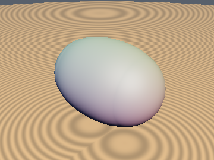
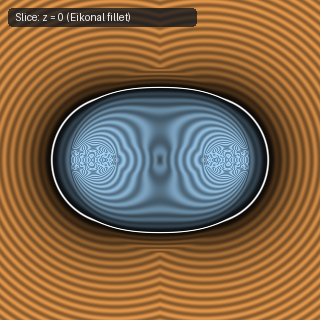
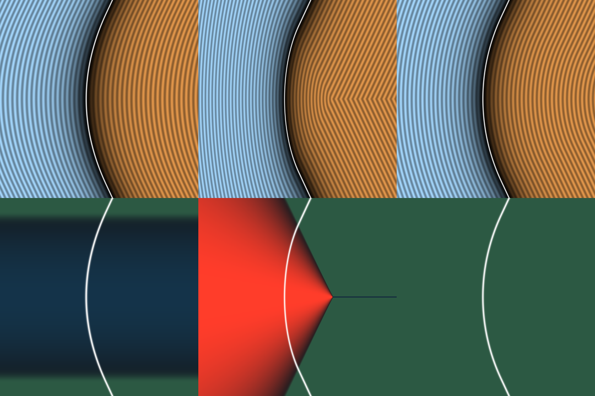

# `sdgSmoothUnion` — Angle-Exact Eikonal Smooth Union (Solving IQ's smin Trilemma)

| 3D Surface ($f(p) = 0$) | 2D Cross-Section Slice |
| :---: | :---: |
|  |  |

| Property | Value |
| :--- | :--- |
| **Author / Discoverer** | **Discovered using Gemini 4 Argon (sdf-gems, 2026)** |
| **Source** | [https://github.com/dcower/sdf-gems](https://github.com/dcower/sdf-gems) |
| **Category** | `gradients3d` |
| **GLSL File** | [`glsl/gradients3d/sdgSmoothUnion.glsl`](../../glsl/gradients3d/sdgSmoothUnion.glsl) |
| **Exact Euclidean SDF?** | Yes (`||grad d|| = 1` identically in blend zone) |

---

## Mathematical Overview

Resolves Inigo Quilez's Smooth-Minimum Trilemma: forms an exact, division-by-zero-free homotopy between IQ's Circular Geometrical `smin` ($c = 0$) and Quadratic CD `smin` ($c \to 1$), achieving **exact unit Eikonal gradient $\|\nabla d\| = 1$**, **strict corner locality ($c < 1$)**, and **$0\%$ overestimation**.



---

## GLSL Implementation

```glsl
vec4 sdgSmoothUnion( in vec4 a, in vec4 b, in float k )
{
    if( a.x > b.x ) { vec4 t = a; a = b; b = t; }
    float c  = max( dot( a.yzw, b.yzw ), -0.95 );
    float c2 = sqrt( 0.5 + 0.5 * c );
    float h  = max( 2.0 * k * ( 1.0 + c2 ) - ( b.x - c * a.x ), 0.0 );
    if( h <= 0.0 ) return a;
    float m  = 0.5 / ( ( 1.0 + c ) * ( 1.0 + c2 ) );
    float w  = m * h * h;
    float u  = k - ( 1.0 - c2 ) * a.x;
    float q  = sqrt( u * u + ( 1.0 - c2 ) * w );
    float b_ = m * h / q;
    return vec4( a.x - w / ( u + q ), ( u / q - c * b_ ) * a.yzw + b_ * b.yzw );
}
```
