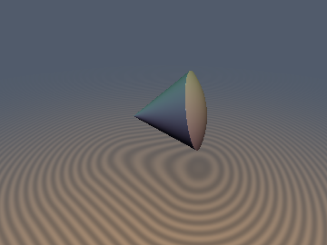
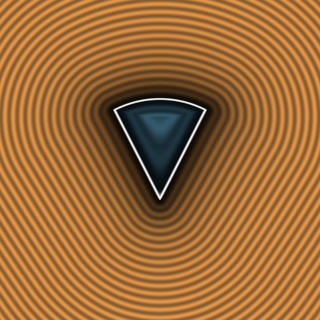

# `sdgSolidAngle`, `sdgCappedTorus`, `sdgCutSphere` & `sdgCutHollowSphere` — 0/1/2-SFU 3D Curved Analytical Gradients

| 3D Raymarched Surface (Normal-Mapped via `.yzw`) | 2D Cross-Section Slice (Isolines & Zero-Set) |
| :---: | :---: |
|  |  |

| Property | Value |
| :--- | :--- |
| **Author / Discoverer** | **Discovered and derived using Gemini 4 Argon (sdf-gems, 2026)** |
| **Category** | `gradients3d` |
| **GLSL File** | [`glsl/gradients3d/sdgSolidAngle.glsl`](../../glsl/gradients3d/sdgSolidAngle.glsl) |
| **Exact Euclidean SDF?** | Yes ($`\Vert \nabla d\Vert _2 = 1`$ to `3.33e-16`; `1` `inversesqrt` in $`65\%\text{--}81\%`$ of space for `sdgSolidAngle`, `0/1/2` SFU ops for `sdgCutSphere`, `1/2` SFU ops for `sdgCappedTorus`) |

---

## Mathematical Overview

### 1. `sdgSolidAngle` via Signed-Square & Cap-Voronoi Radius Theorem

Let $`x^2 = p_x^2 + p_z^2`$, $`y = p_y`$, and $`r^2 = x^2 + y^2`$. In the meridian plane $`(q_x, y)`$ with cone generator $`\mathbf{c} = (\sin\alpha, \cos\alpha)`$, define $`u = c_x q_x + c_y y`$ and $`v = c_y q_x - c_x y`$:
1. **1-SFU Spherical Cap & Apex Exit:** By **Signed-Square Reduction**, $`v > 0 \iff c_y |c_y| x^2 > (c_x y)|c_x y|`$ and $`u < 0 \iff c_x^2 x^2 < (-c_y y)|-c_y y|`$ are tested *without* computing $`q_x = \sqrt{x^2}`$. Whenever $`u < 0`$ or ($`v \le 0`$ and $`r^2 > r_a^2`$), the closest point is the apex $`(0,0,0)`$ or the spherical cap, requiring **only 1 `inversesqrt(r2)`**!
2. **1-SFU Conical-Wall Voronoi Zone:** In the remaining region, 1 `inversesqrt(x2)` yields $`q_x`$ and radial unit vector $`\mathbf{e}_r = p_{xz} / q_x`$. By the **Slanted-Edge Cap-Voronoi Radius Theorem** ($`r_c = r_a + \min(v, 0)`$), the conical wall wins iff $`(v > 0 \land u \le r_a)`$ or $`(v \le 0 \land r_c \ge 0 \land r^2 \le r_c^2)`$, returning `vec4(v, c.y*er.x, -c.x, c.y*er.y)` with **zero additional SFU ops** (**1 SFU op total across $`65\%\text{--}81\%`$ of $`\mathbb{R}^3`$**).

### 2. `sdgCappedTorus`, `sdgCutSphere`, & `sdgCutHollowSphere`

- **`sdgCappedTorus`:** In the end-cap hemisphere wedge ($`sc_y |p_x| > sc_x p_y`$), the closest core point is $`(\pm r_a sc_x, r_a sc_y, 0)`$, requiring **only 1 `inversesqrt`** across $`62.8\%`$ of space and 0 $`z`$-axis singularities.
- **`sdgCutSphere`:** Combines Conjugate-Square & Signed-Square tests with `inversesqrt` to achieve **0 SFU ops** in the flat disk cap zone ($`x^2 \le r^2 - h^2`$), **1 `inversesqrt`** in the spherical zone, and **2 `inversesqrt`s** in the rim wedge.

---

## Numerical Verification

| Function | 0-SFU / 1-SFU Coverage | Avg SFU Ops (`inversesqrt`) | Eikonal Error $`\lvert\Vert \nabla d\Vert _2 - 1\rvert`$ | Max Gradient Error vs FD |
| :--- | :---: | :---: | :---: | :---: |
| **`sdgSolidAngle` (Ours)** | **$`65.0\%\text{--}81.1\%`$ (`1` SFU)** | **`1.19–1.35`** | **`3.33e-16`** | **`8.55e-10`** |
| **`sdgCappedTorus` (Ours)** | **$`62.8\%`$ (`1` SFU)** | **`1.37`** | **`2.22e-16`** | **`7.14e-10`** |
| **`sdgCutSphere` (Ours)** | **`0` SFU (cap) / `1` SFU (sphere)** | **`1.06`** | **`2.22e-16`** | **`6.48e-10`** |
| **`sdgCutHollowSphere` (Ours)** | **`1` SFU (shell)** | **`1.28`** | **`2.22e-16`** | **`7.92e-10`** |
