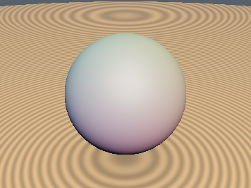
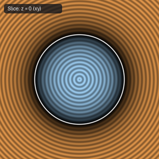

# `sdgSphere` — 3D Sphere with Analytical Gradient

| 3D Surface ($`f(p) = 0`$) | 2D Cross-Section Slice |
| :---: | :---: |
|  |  |

| Property | Value |
| :--- | :--- |
| **Author / Discoverer** | **Inigo Quilez** |
| **Source** | [https://iquilezles.org/articles/distgradfunctions3d/](https://iquilezles.org/articles/distgradfunctions3d/) |
| **Category** | `gradients3d` |
| **GLSL File** | [`glsl/gradients3d/sdgSphere.glsl`](../../glsl/gradients3d/sdgSphere.glsl) |
| **Exact Euclidean SDF?** | Yes (`\|\|grad d\|\| = 1`) |

---

## Mathematical Overview

Returns `vec4(d, grad.xyz)` for a 3D sphere of radius $`r`$.

---

## GLSL Implementation

```glsl
vec4 sdgSphere( in vec3 p, in float r )
{
    float l = length(p);
    return vec4( l - r, p/l );
}
```
