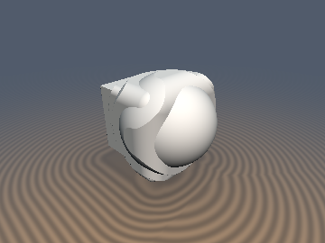
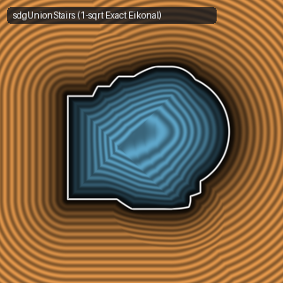

# `sdgStairs` & `sdgColumns` — Exact 1-Sqrt Stepped Stairs & Columned Booleans with Analytical 3D Gradients

| 3D Raymarched Surface (Normal-Mapped via `.yzw`) | 2D Cross-Section Slice (Isolines & Zero-Set) |
| :---: | :---: |
|  |  |

| Property | Value |
| :--- | :--- |
| **Author / Discoverer** | **Discovered using Gemini 4 Argon (sdf-gems, 2026)** |
| **Category** | `gradients3d` |
| **GLSL Files** | [`glsl/gradients3d/sdgStairs.glsl`](../../glsl/gradients3d/sdgStairs.glsl), [`glsl/gradients3d/sdgColumns.glsl`](../../glsl/gradients3d/sdgColumns.glsl) |
| **Exact Euclidean SDF?** | Yes ($\|\nabla d\|_2 = 1$ to `2.22e-16` for `sdgStairs` and `4.44e-16` for `sdgColumns`) |

---

## Mathematical Overview

Architectural stepped stairs (`opUnionStairs`, `opIntersectionStairs`, `opSubtractionStairs`) and circular columns (`opUnionColumns`, `opSubtractionColumns`, `opIntersectionColumns`) introduce $n$ discrete convex noses, concave corners, or tangent cusps along the intersection seam of two 3D primitives. Computing their surface normals via 4-tap or 6-tap finite differences requires 4 to 6 full scene evaluations and suffers from finite-difference rounding across the sharp concave step/cusp creases.

### 1. Unified Sign-Cancelled Gradient for `sdgUnionStairs`
In [`opUnionStairs`](../booleans/opUnionStairs.md), the closest convex step nose $O_{k_1}$ has local offset $q = (a - k_1, b - r + k_1)$ with Jacobian $\frac{\partial q}{\partial(a,b)} = (+1, +1)$ and exterior distance $d = \min(\min(a,b), +l)$, whereas the closest concave step corner $I_{j_0}$ has local offset $i = (j_0 - a, r - s - j_0 - b)$ with Jacobian $\frac{\partial i}{\partial(a,b)} = (-1, -1)$ and interior distance $d = -(l + \min(\max(i_x, i_y), 0))$.
Because $(-1) \cdot (-1) = +1$, the two minus signs in the interior **cancel identically**, reducing the exact 2D gradient weights $(g_x, g_y)$ across all $n - 1$ convex noses, $n$ concave corners, and all step risers and treads to **2 lines of GLSL** with **`2.22e-16` Eikonal error**.
By De Morgan duality:
- `sdgIntersectionStairs(a, b, r, n) = -sdgUnionStairs(-a, -b, r, n)`
- `sdgSubtractionStairs(a, b, r, n) = -sdgUnionStairs(a, -b, r, n)`

### 2. $45^\circ$ Orthonormal-Basis Gradient Lift for `sdgUnionColumns` & `sdgSubtractionColumns`
In [`opUnionColumns`](../booleans/opUnionColumns.md), the column centers lie along the $45^\circ$ diagonal in $(x, y) = (\min(a,b), \max(a,b))$ with orthonormal rotated coordinates $(p_x, p_y) = \big(\frac{x + y - r + 2R}{\sqrt{2}}, \frac{y - x}{\sqrt{2}}\big)$. Differentiating the single `sqrt` distance $l$ with respect to $(p_x, p_y)$ yields $g_p = \pm (q_x, d_y) / l$, which lifts back to $(x, y)$ via the inverse $45^\circ$ orthogonal transpose:
$$(g_x, g_y) = \left(\frac{g_{px} - g_{py}}{\sqrt{2}}, \; \frac{g_{px} + g_{py}}{\sqrt{2}}\right), \qquad \|\nabla d\|_2 = 1 \text{ to } 4.44 \times 10^{-16}.$$

---

## GLSL Implementation

```glsl
// 1. Exact 1-Sqrt Stepped Stairs Booleans with Analytical 3D Gradients
vec4 sdgUnionStairs( in vec4 a, in vec4 b, in float r, in float n )
{
    float s  = r / n, w = (a.x - b.x + r) / (2.0 * s);
    float k1 = clamp(round(w), 1.0, n - 1.0) * s;
    float j0 = clamp(floor(w), 0.0, n - 1.0) * s;
    vec2  q  = vec2(a.x - k1, b.x - r + k1), i = vec2(j0 - a.x, r - s - j0 - b.x);
    bool  e  = min(min(a.x, b.x), max(q.x, q.y)) > 0.0;
    vec2  v  = e ? q : i, c = max(v, 0.0);
    float l  = length(c), d = e ? min(min(a.x, b.x), l) : -(l + min(max(i.x, i.y), 0.0));
    vec2  g  = (e && min(a.x, b.x) < l) ? ((a.x < b.x) ? vec2(1.0, 0.0) : vec2(0.0, 1.0))
             : ((c.x > 0.0 && c.y > 0.0) ? c / l : ((v.x > v.y) ? vec2(1.0, 0.0) : vec2(0.0, 1.0)));
    return vec4(d, g.x * a.yzw + g.y * b.yzw);
}

vec4 sdgIntersectionStairs( in vec4 a, in vec4 b, in float r, in float n ) { return -sdgUnionStairs(-a, -b, r, n); }
vec4 sdgSubtractionStairs( in vec4 a, in vec4 b, in float r, in float n )  { return -sdgUnionStairs(a, -b, r, n); }
```
