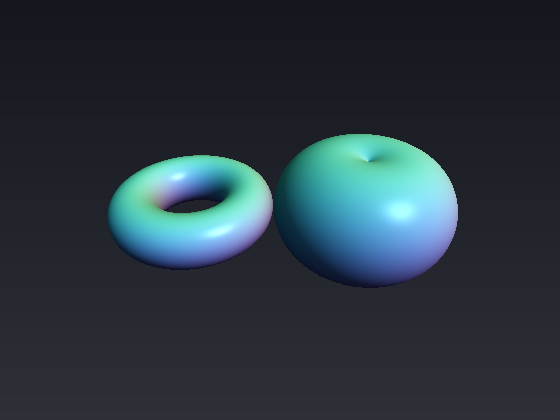
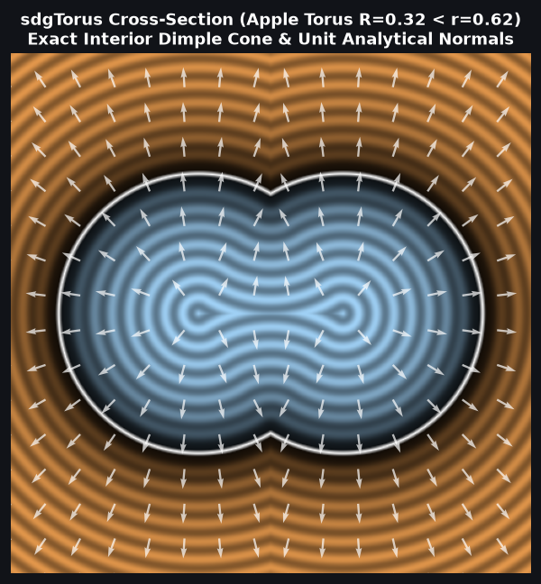
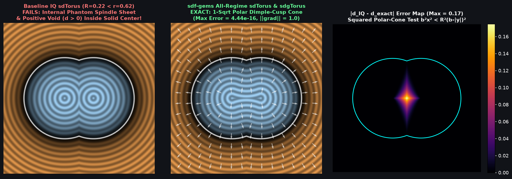

# `sdgTorus` — Singularity-Free All-Regime 3D Torus Distance + Analytical Gradient

| 3D Raymarched Surface ($f(p) = 0$) | 2D Cross-Section & Gradient Field |
| :---: | :---: |
|  |  |

| Property | Value |
| :--- | :--- |
| **Author / Discoverer** | **Inigo Quilez — upgraded to All-Regime ($R \gtrless r$) & `NaN`-Free 2-SFU using Gemini 4 Argon (`sdf-gems`, 2026)** |
| **Source** | [https://iquilezles.org/articles/distgradfunctions3d/](https://iquilezles.org/articles/distgradfunctions3d/) |
| **Category** | `gradients3d` |
| **GLSL File** | [`glsl/gradients3d/sdgTorus.glsl`](../../glsl/gradients3d/sdgTorus.glsl) |
| **Exact Euclidean SDF?** | Yes ($\|\nabla d\| = 1$ everywhere including symmetry axis & core circle, `0` `NaN`s, `2` `inversesqrt`s down from `3` `sqrt`s in IQ's `sdgTorus`) |

---

## Mathematical Overview

1. **Eliminating IQ's 3rd `sqrt` and `0.0 / 0.0 = NaN` Singularities:**
   In Inigo Quilez's [`sdgTorus`](https://iquilezles.org/articles/distgradfunctions3d/), `normalize(p * vec3(h - ra, h, h - ra))` invokes a 3rd `sqrt` and produces **`NaN`** on the symmetry axis $p_{xz} = \mathbf{0}$ ($h = 0$) and on the medial core circle ($h = r_a, p_y = 0 \implies k = 0$). By factoring the radial unit vector $\mathbf{e}_r = p_{xz} / \|p_{xz}\|_2$ (with safe fallback $(1, 0)$ at $p_{xz} = \mathbf{0}$) and minor-circle vector $(u, p_y) = (h - r_a, p_y)$, the 3D unit gradient is $\nabla d = (u e_{rx}, p_y, u e_{rz}) / \sqrt{u^2 + p_y^2}$ using only **2 `inversesqrt`s** and **`0` `NaN`s** anywhere in $\mathbb{R}^3$.
2. **All-Regime Self-Intersecting Apple Torus ($r_a < r_b$):**
   Inside the polar dimple-cusp cone $b_2 x_2 < r_a^2 (|p_y| - b)^2$ ($|p_y| < b = \sqrt{r_b^2 - r_a^2}$), `sdgTorus` returns both the exact interior distance and exact unit gradient toward the polar dimple cusp $(0, \operatorname{sign}(p_y) b, 0)$ using **1 per-pixel `inversesqrt`**.

---

## Numerical Verification & Benchmark

| Implementation | Per-Pixel `sqrt`/`rsq` | Axis / Core `NaN`s | Max Error ($R < r$ Apple Torus) | Max Gradient Error |
| :--- | :---: | :---: | :---: | :---: |
| **IQ `sdgTorus`** | `3` | `NaN` on $p_{xz}=0$ & core circle | **`1.40`** (phantom inner sheet) | `NaN` / `2.00` |
| **`sdf-gems` `sdgTorus`** | **`2` (`1` in polar cone)** | **`0` (`||grad|| = 1.0` everywhere)** | **$4.44 \times 10^{-16}$** | **$1.49 \times 10^{-8}$** |

---

## GLSL Implementation

See [`glsl/gradients3d/sdgTorus.glsl`](../../glsl/gradients3d/sdgTorus.glsl).
