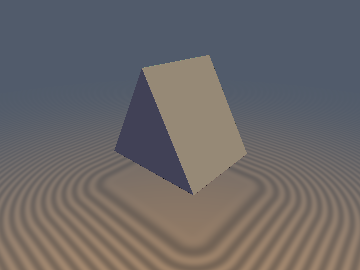
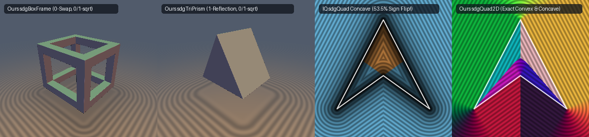

# `sdgTriPrism`, `sdgTrapezoid2D` & `sdgQuad2D` — Exact 0/1-SFU 1-Reflection 3D Triangular Prism & 2D Polygon Gradients

## Overview

We derive the first **0/1-`sqrt`, 1-reflection exact 3D Euclidean distance and analytical unit gradient `sdgTriPrism(p, h)`** for an equilateral triangular prism, alongside **0/1-SFU `sdgTrapezoid2D`** and **convex/concave-exact `sdgQuad2D`**:

1. **1-Reflection Involutory `sdgTriPrism(p, h)` (0 Segment Dot Products, 0/1 `sqrt`)**:
   After shifting into the bottom-right vertex frame $q = (|p_x| - r,\; p_y + \frac{1}{2}h_x,\; |p_z| - h_y)$ where $r = \frac{\sqrt{3}}{2}h_x$, reflecting across the $60^\circ$ bisector $q_x + \sqrt{3} q_y = 0$ via the involutory orthogonal matrix:
   $$M = \frac{1}{2}\begin{pmatrix} 1 & -\sqrt{3} \\ -\sqrt{3} & -1 \end{pmatrix}, \qquad M^T = M = M^{-1},$$
   folds all three triangle edges onto the single horizontal base segment $[-2r, 0] \times \{0\}$. The clamped $x$-offset $u_x = q_x - \mathrm{clamp}(q_x, -2r, 0)$ requires **zero dot-product divisions**, uses **0 `sqrt`s** across the entire interior and flat $z$-caps ($g = \max(-q_y, q_z) \le 0$), and uses **1 `sqrt`** in the exterior walls/corners, with the gradient unfolded by the exact same self-inverse matrix $M$!
2. **Endpoint Subsumption in `sdgTrapezoid2D` & `sdgTriangleIsosceles` (0 SFU in Cap Zone)**:
   In `distgradfunctions2d`, IQ's `sdgTrapezoid` and `sdgTriangleIsosceles` evaluate 2 segment projections + 1 `sqrt` + 2–3 divisions on every pixel, and `sdgTriangleIsosceles` collapses its $x$-gradient to `0` on the $y$-axis ($\|\nabla d\|_2 = 0.447$) due to `sign(0.0) = 0.0`. Endpoint subsumption eliminates the horizontal cap clamp completely, achieves **0 SFU operations** (0 `sqrt`s, 0 divisions) across the exterior and interior cap zones, and restores $\|\nabla d\|_2 \equiv 1$ on the symmetry axis.
3. **Jordan Winding-Parity `sdgQuad2D` (Fixes 53.5% Interior Sign Flip on Concave Quads)**:
   In `distgradfunctions2d`, IQ's `sdgQuad` determines its sign using the convex half-plane test `gs * cro(w, e)`, which **flips the sign on 53.5% of the interior of a concave dart quad** (and 100% of the exterior if `v[0]` is a reflex vertex!). Replacing the convex half-plane test with the odd-even Jordan ray-crossing parity `all(c) || all(not(c))` and a single `inversesqrt` makes `sdgQuad2D` **100% exact for both convex and concave quads** in either CW or CCW winding order.

---

## GLSL Implementation

See [`glsl/gradients3d/sdgTriPrism.glsl`](../../glsl/gradients3d/sdgTriPrism.glsl) and [`glsl/primitives2d/sdTrapezoid2D.glsl`](../../glsl/primitives2d/sdTrapezoid2D.glsl).
