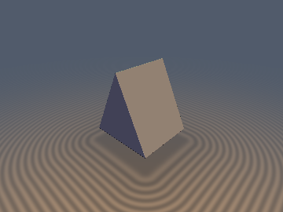
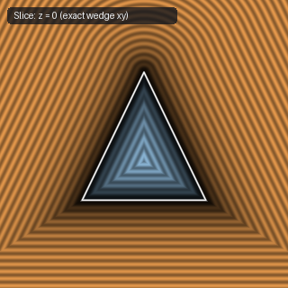
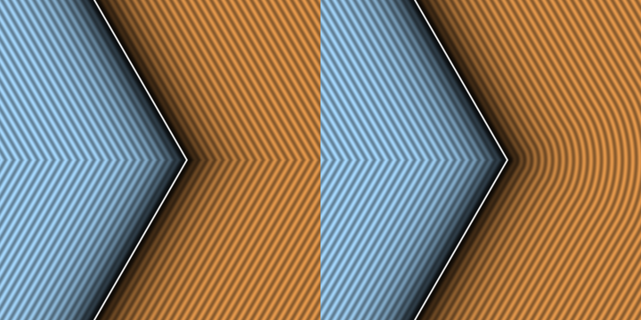

# `sdgWedgeIntersection` — Exact Euclidean Gram-Schmidt Wedge Booleans

| 3D Surface ($`f(p) = 0`$) | 2D Cross-Section Slice |
| :---: | :---: |
|  |  |

| Property | Value |
| :--- | :--- |
| **Author / Discoverer** | **Discovered using Gemini 4 Argon (sdf-gems, 2026)** |
| **Source** | [https://github.com/dcower/sdf-gems](https://github.com/dcower/sdf-gems) |
| **Category** | `gradients3d` |
| **GLSL File** | [`glsl/gradients3d/sdgWedgeIntersection.glsl`](../../glsl/gradients3d/sdgWedgeIntersection.glsl) |
| **Exact Euclidean SDF?** | Yes (`\|\|grad d\|\| = 1`) |

---

## Mathematical Overview

Plain `max(a, b)` underestimates the exterior corner distance of two surfaces meeting at acute angle $`\theta`$ by $`1/\sin(\theta/2)`$ (up to $`10\times`$ error). Using $`c = \nabla a \cdot \nabla b = \cos\theta`$, `sdgWedgeIntersection` tests whether $`p`$ lies in the dual normal cone $`\min(a,b) > c\max(a,b)`$ and returns the exact Gram-Schmidt Euclidean corner distance and unit gradient.



---

## GLSL Implementation

```glsl
vec4 sdgWedgeIntersection( in vec4 a, in vec4 b )
{
    if( a.x < b.x ) { vec4 t = a; a = b; b = t; }
    float c = dot( a.yzw, b.yzw );
    float h = b.x - c * a.x;
    if( h <= 0.0 ) return a;
    float s2 = max( 1.0 - c * c, 1e-5 );
    float d  = sqrt( a.x * a.x + h * h / s2 );
    return vec4( d, ( a.x * a.yzw + ( h / s2 ) * ( b.yzw - c * a.yzw ) ) / d );
}
```
