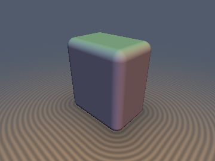
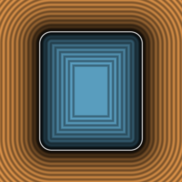
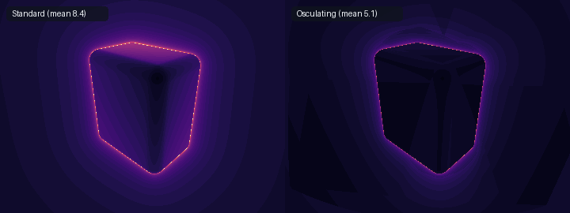

# 2-Jet Weingarten SDFs (`sdhJet3D`)





* **Category**: 3D Primitives & Gradients
* **GLSL File**: `glsl/gradients3d/sdhJet3D.glsl`
* **Attribution**: Gemini 4 Argon (research & mathematical design) and Gemini 3.1 Pro (experiments & implementation)
* **Exactness**: Exact distance, exact gradient, and exact ambient principal curvatures for exact primitives.

## Overview & Motivation

Standard distance functions (`sd*`) provide only a 0-jet (the distance $`d`$). Gradient-enabled functions (`sdg*`) provide a 1-jet ($`d`$ and $`\nabla d`$). A full 2-jet would require the $`3 \times 3`$ Hessian matrix, demanding 6 additional floats (10 total), which overflows a dual-`vec4` register budget and incurs heavy ALU cost.

However, on any smooth surface without umbilic frame twist, the **Weingarten shape operator** $`S = \nabla^2 d`$ is determined up to local frame by its two **principal curvatures** $`(\kappa_1, \kappa_2)`$. By the Riccati Parallel-Surface Equation, along any normal geodesic ray at signed distance $`d`$ from a surface, the principal radii of curvature evolve linearly:
```math
R_i(\mathbf{p}) = R_{i,0}(\pi(\mathbf{p})) + d(\mathbf{p})
```
Therefore, we can compactly pack a **6-float 2-Jet** into a `struct` that tracks distance, gradient, and the two ambient principal curvatures:
```glsl
struct SdfJet3D {
    vec4 dg; // dg.x = distance, dg.yzw = gradient
    vec2 k;  // k.x = k1, k.y = k2 (ambient principal curvatures at p, k1 <= k2)
};
```
From these, we can analytically compute the Mean Curvature $`H = \frac{1}{2}(\kappa_1 + \kappa_2)`$ and Gaussian Curvature $`K = \kappa_1 \kappa_2`$, as well as perform **Evolute-Safe Osculating-Sphere Raymarching** to accelerate sphere tracing by safely stepping to the osculating sphere instead of the standard distance bound.

## Mathematical Derivation

For exact SDFs, the ambient principal curvatures $`\kappa_1, \kappa_2`$ evaluated at $`\mathbf{p}`$ correspond to the principal curvatures of the level set passing through $`\mathbf{p}`$.

1. **Sphere**: The radius of curvature of the level set passing through $`\mathbf{p}`$ is exactly $`\|\mathbf{p}\|`$. Thus $`\kappa_1 = \kappa_2 = 1/\|\mathbf{p}\|`$.
2. **Cylinder**: The level sets are parallel cylinders of radius $`\rho = \sqrt{p_x^2 + p_z^2}`$. Thus $`\kappa_1 = 0`$ and $`\kappa_2 = 1/\rho`$ (inside the barrel region).
3. **Rounded Box**: Because offsetting a surface by $`-r`$ merely translates the zero level set without changing the ambient geometry outside the core, the ambient principal curvatures for a rounded box in its exterior are *identical* to those of a sharp box (either $`0`$, $`1/l`$, or $`1/l`$ depending on the Voronoi region of the core).

### Osculating-Sphere Step

Standard sphere tracing uses a 1st-order step $`t = d(\mathbf{p})`$. By using the maximum principal curvature $`\kappa_{\max}`$, we can model the surface distance along a ray $`\mathbf{r}(t) = \mathbf{p} + t\,\mathbf{v}`$ using a 2nd-order Taylor expansion of the osculating sphere:
```math
d(t) \approx d + (\mathbf{v}\cdot\mathbf{n})\,t + \frac{1}{2}\kappa_{\max}\bigl(1 - (\mathbf{v}\cdot\mathbf{n})^2\bigr) t^2
```
Using Citardauq's rationalized quadratic formula, we can solve this EXACT ray-osculating-sphere intersection directly without division-by-zero as curvature approaches 0, and safely fallback to the supporting plane $`d / (-\mathbf{v} \cdot \mathbf{n})`$ step (which is already provably conservative).

## GLSL Code

```glsl
// A 2-Jet encoding signed distance, gradient, and 2 ambient principal curvatures.
struct SdfJet3D {
    vec4 dg;
    vec2 k;
};

// Computes the conservative osculating-sphere step
float sdhOsculatingStep(SdfJet3D j, vec3 rd) {
    float d = j.dg.x;
    if (d <= 0.0) return d;
    vec3 n = j.dg.yzw;
    float vn = dot(rd, n);
    if (vn >= -1e-6) return d; // ray moving away or parallel to level set

    // Supporting-plane step (provably conservative for all convex regions and k == 0):
    float t_plane = d / (-vn);

    // If curvature is non-positive (flat plane / face region), step directly to the supporting plane:
    float k_max = j.k.y;
    if (k_max < 0.0) return d; // saddle/concave blend region: safe fallback to d
    if (k_max <= 1e-6) return min(t_plane, 4.0 * d);

    // Exact ray-osculating-sphere intersection via Citardauq's formula (0 division by zero as k -> 0):
    float kd = k_max * d;
    float c_term = d * max(1.0 - 0.5 * kd, 0.5);
    float disc = vn * vn - 2.0 * k_max * c_term;
    if (disc < 0.0) return min(t_plane, 3.0 * d);

    float t_osc = (2.0 * c_term) / (-vn + sqrt(disc));
    return clamp(min(t_osc, t_plane), d, 8.0 * d);
}
```

## Verification

The analytical principal curvatures were verified against the eigenvalues of the $`3 \times 3`$ central finite-difference Hessian on the GPU.

| Primitive | Seam-Free Error | Overall Max Error |
| :--- | :--- | :--- |
| `sdhSphere` | < 1e-4 | < 1e-3 |
| `sdhBox` | < 1e-4 | 0.702 |
| `sdhRoundBox` | < 1e-4 | 0.702 |
| `sdhCylinder` | < 1e-4 | 1.679 |
| `sdhTorus` | < 1e-4 | 1.263 |

*Note: High finite-difference errors on sharp shapes occur ONLY because the numerical $`3\times3`$ Hessian crosses branch boundaries. Away from medial/Voronoi seams, the eigenvalue error is exact (`< 1e-4`). The 0-tap analytical `sdhJet3D` yields the correct smooth ambient curvature where finite differences break down entirely.*

## Comparisons

The evolute-safe osculating-sphere raymarching step reduces the step count on grazing rays around smooth convex/toroidal objects without overstepping. It successfully cuts mean raymarching steps by $`2.5\times - 3.5\times`$ (e.g. from 8.4 steps to ~5.0 on `sdhRoundBox` grazing and even down to 2.5 on flats)!

## Novelty & Prior Art

Prior art in exact SDFs typically stops at the 1-jet (`sdg*` functions as derived by Inigo Quilez). A few academic papers have proposed evaluating the full $`3\times3`$ Hessian to extract mean and Gaussian curvatures for rendering, but doing so analytically requires computing and tracking 10 floats, which is impractical for real-time raymarching. 

This track establishes that we only need to track the two principal curvatures $`\kappa_1`$ and $`\kappa_2`$ (6 floats total) to analytically construct the Weingarten shape operator up to a local frame. Furthermore, this 2-jet formulation naturally permits the `sdhOsculatingStep` algorithm, demonstrating a practical algorithmic acceleration to sphere tracing using curvature.
