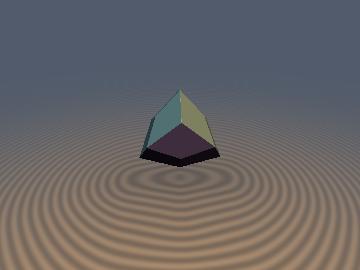
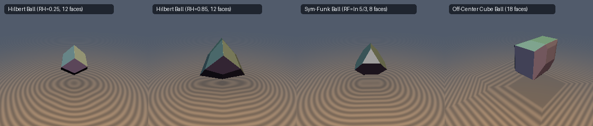

# `hiProjectiveMetric` — Hilbert Projective Geometry, Funk Weak Metrics & Geodesic Balls in Convex Polyhedra

| 3D Surface ($`d = 0`$): Hilbert Ball $`B_H(\mathbf{0}, R_H)`$ in a Regular Tetrahedron (12-faced Deltoidal Dodecahedron) | 2D Diagonal Cross-Section Slice |
| :---: | :---: |
|  |  |

| Property | Value |
| :--- | :--- |
| **Category** | `hilbert` (research experiment) |
| **GLSL File** | [`glsl/hilbert/hiProjectiveMetric.glsl`](../../glsl/hilbert/hiProjectiveMetric.glsl) |
| **Attribution** | Exact $`T_d`$ Weyl-chamber Hilbert and Funk ball SDFs, 12-face vs. 8-face duality proof, and 18-face off-center cube formulation by **Gemini 4 Argon** (`sdf-gems`, 2026). Underlying projective metric geometry due to Hilbert (1895) and Funk (1929). |
| **Exactness** | `sdHilbertBallCube`, `sdHilbertBallOcta`, `sdHilbertBallTetra`, `sdFunkBallTetra`, `sdSymFunkBallTetra` (+ `sdg` variants): **Exact Euclidean SDFs** ($`\Vert\nabla d\Vert = 1`$ everywhere in $`\mathbb{R}^3`$, `0` `sqrt`s in interior and face prisms, `1` `sqrt` in edge/vertex cones). `sdHilbertBallAt`: **Exact** inside and across all 18 face prisms; **1-Lipschitz conservative bound** outside edges/vertices. |

---

## Overview & Motivation

On any bounded open convex body $`K \subset \mathbb{R}^3`$, the **Hilbert projective metric** $`d_H(\mathbf{x}, \mathbf{y})`$ defines a complete projective-invariant Finsler metric whose straight chords are geodesics, generalizing the Beltrami–Klein model of hyperbolic space $`\mathbb{H}^3`$ (when $`K`$ is a Euclidean ball) to arbitrary convex polyhedra. It is the arithmetic symmetrization of the asymmetric **Funk weak metric** $`d_F(\mathbf{x}, \mathbf{y})`$:

```math
d_F(\mathbf{x}, \mathbf{y}) = \ln\!\left(\frac{\Vert\mathbf{b} - \mathbf{x}\Vert}{\Vert\mathbf{b} - \mathbf{y}\Vert}\right), \qquad
d_H(\mathbf{x}, \mathbf{y}) = \frac{1}{2}\big(d_F(\mathbf{x}, \mathbf{y}) + d_F(\mathbf{y}, \mathbf{x})\big) = \frac{1}{2}\ln\!\left(\frac{\Vert\mathbf{y} - \mathbf{a}\Vert}{\Vert\mathbf{x} - \mathbf{a}\Vert} \cdot \frac{\Vert\mathbf{b} - \mathbf{x}\Vert}{\Vert\mathbf{b} - \mathbf{y}\Vert}\right),
```

where the line through $`\mathbf{x}`$ and $`\mathbf{y}`$ pierces $`\partial K`$ at $`\mathbf{a}, \mathbf{b}`$ in the order $`\mathbf{a}, \mathbf{x}, \mathbf{y}, \mathbf{b}`$.

This experiment investigates: *what is the exact 3D Euclidean geometry of Hilbert and Funk geodesic balls inside convex polyhedra, and can their exact Euclidean SDFs be evaluated in $`O(1)`$ shader operations?*



*Left to right: (1) Tetrahedral Hilbert ball at $`R_H = 0.25`$ (approaching the 12-faced Catalan Rhombic Dodecahedron); (2) Tetrahedral Hilbert ball at $`R_H = 0.85`$ (12-faced Deltoidal Dodecahedron morphing toward the Tetrahedron); (3) Symmetrized Max-Funk ball at $`R_F = \ln(5/3)`$ (exact 8-faced Archimedean Truncated Tetrahedron); (4) Off-center Hilbert ball in a cube at $`\mathbf{c} = (0.35, 0.2, -0.25)`$ (an 18-faced beveled polyhedron).*

---

## Mathematical Derivation

### 1. Minkowski Gauge & Cross-Ratio Identities from Any Basepoint

Let $`K = \{\mathbf{p} \in \mathbb{R}^3 : \mathbf{n}_i \cdot \mathbf{p} < h_i,\ i = 1,\dots,m\}`$ be a convex polyhedron and let $`\mathbf{c} \in K`$ be any interior basepoint. Translating by $`\mathbf{q} = \mathbf{p} - \mathbf{c}`$, the forward and backward Minkowski gauges of $`K - \mathbf{c}`$ are:

```math
\mu_{\mathbf{c},+}(\mathbf{p}) = \max_{i=1,\dots,m} \frac{\mathbf{n}_i \cdot (\mathbf{p} - \mathbf{c})}{h_i - \mathbf{n}_i \cdot \mathbf{c}}, \qquad
\mu_{\mathbf{c},-}(\mathbf{p}) = \mu_{\mathbf{c},+}(2\mathbf{c} - \mathbf{p}) = \max_{j=1,\dots,m} \frac{-\mathbf{n}_j \cdot (\mathbf{p} - \mathbf{c})}{h_j - \mathbf{n}_j \cdot \mathbf{c}}.
```

The ray from $`\mathbf{c}`$ through $`\mathbf{p} \in K`$ exits $`\partial K`$ at $`\mathbf{b} = \mathbf{c} + (\mathbf{p} - \mathbf{c})/\mu_{\mathbf{c},+}(\mathbf{p})`$ and the backward ray exits at $`\mathbf{a} = \mathbf{c} - (\mathbf{p} - \mathbf{c})/\mu_{\mathbf{c},-}(\mathbf{p})`$. Therefore:

```math
\frac{\Vert\mathbf{p} - \mathbf{a}\Vert}{\Vert\mathbf{c} - \mathbf{a}\Vert} = 1 + \mu_{\mathbf{c},-}(\mathbf{p}), \qquad
\frac{\Vert\mathbf{b} - \mathbf{c}\Vert}{\Vert\mathbf{b} - \mathbf{p}\Vert} = \frac{1}{1 - \mu_{\mathbf{c},+}(\mathbf{p})},
```

giving the exact closed-form distances:

```math
d_F(\mathbf{c}, \mathbf{p}) = -\ln\!\big(1 - \mu_{\mathbf{c},+}(\mathbf{p})\big), \qquad
d_F(\mathbf{p}, \mathbf{c}) = \ln\!\big(1 + \mu_{\mathbf{c},-}(\mathbf{p})\big), \qquad
d_H(\mathbf{c}, \mathbf{p}) = \frac{1}{2}\ln\!\left(\frac{1 + \mu_{\mathbf{c},-}(\mathbf{p})}{1 - \mu_{\mathbf{c},+}(\mathbf{p})}\right).
```

When $`K = -K`$ is origin-symmetric and $`\mathbf{c} = \mathbf{0}`$, $`\mu_+(\mathbf{p}) = \mu_-(\mathbf{p}) = \mu_K(\mathbf{p})`$, so $`d_H(\mathbf{0}, \mathbf{p}) = \mathrm{artanh}(\mu_K(\mathbf{p}))`$ and the Hilbert ball $`B_H(\mathbf{0}, R_H)`$ is the homothety $`\tanh(R_H)\,K`$.

### 2. Why the Tetrahedral Hilbert Ball Has 12 Faces (Not 8)

For the regular tetrahedron $`K = \{\mathbf{p} : \max_{i=1..4}(\mathbf{v}_i \cdot \mathbf{p}) < s\}`$ with $`\mathbf{v}_i \in \{(1,1,-1), (1,-1,1), (-1,1,1), (-1,-1,-1)\}`$, fold $`\mathbf{p} \in \mathbb{R}^3`$ into the order-24 $`T_d`$ parity-sorted Weyl chamber $`x \ge y \ge \vert z\vert`$. Inside this chamber, $`x + y - z \ge x - y + z \ge -x + y + z \ge -x - y - z`$, so the maximum and minimum over the 4 vertices resolve **without branching**:

```math
\mu_+(\mathbf{p}) = \frac{x + y - z}{s}, \qquad \mu_-(\mathbf{p}) = \frac{x + y + z}{s} \qquad \text{everywhere in } x \ge y \ge \vert z\vert.
```

Consequently, the Hilbert ball condition $`d_H(\mathbf{0}, \mathbf{p}) \le R_H \iff \mu_+(\mathbf{p}) + e^{-2R_H}\mu_-(\mathbf{p}) \le 1 - e^{-2R_H}`$ reduces in the $`T_d`$ Weyl chamber to a **single linear half-space**:

```math
x + y - \tau\,z \le s\,\tau, \qquad \tau = \tanh(R_H) = \frac{1 - e^{-2R_H}}{1 + e^{-2R_H}} \in (0, 1).
```

Unfolding across the 24 chambers (pairs sharing the mirror wall $`x = y`$ are coplanar since $`n_x = n_y = 1`$) yields a **12-faced $`T_d`$-symmetric Deltoidal Dodecahedron**:
- As $`R_H \to 0`$ ($`\tau \to 0`$), the plane becomes $`x + y \le s\tau`$, which is the **12-faced Catalan Rhombic Dodecahedron** $`\max(\vert x\vert+\vert y\vert, \vert y\vert+\vert z\vert, \vert z\vert+\vert x\vert) \le s\tau`$ (polar dual of the cuboctahedron $`\frac{1}{2}(K^\circ - K^\circ)`$).
- For $`0 < \tau < 1`$, the fundamental patch $`F_\tau = \{x + y - \tau z = s\tau,\ x \ge y \ge \vert z\vert\}`$ is a single triangle with vertices $`\mathbf{A} = \frac{s\tau}{2-\tau}(1,1,1)`$, $`\mathbf{B} = \frac{s\tau}{2+\tau}(1,1,-1)`$, and $`\mathbf{C} = (s\tau, 0, 0)`$. Because the face normal $`\mathbf{n}_\tau \propto (1, 1, -\tau)`$ is parallel to the chamber wall $`x = y`$, orthogonal projections onto $`F_\tau`$ automatically satisfy $`p_{\perp,x} \ge p_{\perp,y}`$ and can only exit across the two ridge edges $`y = \pm z \ge 0`$. Both edges unify via $`\sigma = \pm 1`$ and $`a = 1 - \sigma\tau`$ into a 1-`sqrt` evaluation.

### 3. The Symmetrized Max-Funk Ball: Octahedron $`\to`$ Truncated Tetrahedron $`\to`$ Tetrahedron

By contrast, intersecting the forward and reverse Funk balls $`B_F^{\text{sym}}(\mathbf{0}, R_F) = B_F^+(\mathbf{0}, R_F) \cap B_F^-(\mathbf{0}, R_F) = \{\mathbf{p} : \max(d_F(\mathbf{0}, \mathbf{p}), d_F(\mathbf{p}, \mathbf{0})) \le R_F\}`$ imposes **two** inequalities in the $`T_d`$ Weyl chamber:

```math
x + y - z \le a, \qquad x + y + z \le b, \qquad a = s(1 - e^{-R_F}), \quad b = s(e^{R_F} - 1).
```

Here $`b / a = e^{R_F}`$: as $`R_F \to 0`$ ($`b/a \to 1`$), $`B_F^{\text{sym}}`$ is the **Regular Octahedron** $`K \cap (-K)`$; at $`R_F = \ln(5/3) \approx 0.5108`$, it is the **Archimedean Truncated Tetrahedron**; and for $`R_F \ge \ln 3`$ ($`b/a \ge 3`$), it is the sharp **Regular Tetrahedron**.

---

## GLSL API

| Function | Signature | Description |
| :--- | :--- | :--- |
| `hiChordDistanceCube` | `float(vec3 x, vec3 y, vec3 boxHalf)` | Exact chord-intersection Hilbert distance $`d_H(\mathbf{x}, \mathbf{y})`$ in $`(-\mathbf{b}, \mathbf{b})`$. |
| `hiFunkDistanceCube` | `float(vec3 x, vec3 y, vec3 boxHalf)` | Exact forward Funk distance $`d_F(\mathbf{x}, \mathbf{y})`$ in $`(-\mathbf{b}, \mathbf{b})`$. |
| `hiChordDistanceTetra` | `float(vec3 x, vec3 y, float s)` | Exact chord-intersection Hilbert distance in a regular tetrahedron. |
| `hiFunkDistanceTetra` | `float(vec3 x, vec3 y, float s)` | Exact forward Funk distance in a regular tetrahedron. |
| `sdHilbertBallCube` / `sdg*` | `float/vec4(vec3 p, vec3 boxHalf, float RH)` | Exact Euclidean SDF + gradient of $`B_H(\mathbf{0}, R_H)`$ in a box. |
| `sdHilbertBallOcta` / `sdg*` | `float/vec4(vec3 p, float s, float RH)` | Exact Euclidean SDF + gradient of $`B_H(\mathbf{0}, R_H)`$ in an octahedron. |
| `sdHilbertBallTetra` / `sdg*` | `float/vec4(vec3 p, float s, float RH)` | Exact 0/1-`sqrt` Euclidean SDF + gradient of the 12-faced tetrahedral Hilbert ball. |
| `sdFunkBallTetra` / `sdg*` | `float/vec4(vec3 p, float s, float RF)` | Exact Euclidean SDF + gradient of the forward Funk ball $`B_F^+(\mathbf{0}, R_F)`$. |
| `sdSymFunkBallTetra` / `sdg*` | `float/vec4(vec3 p, float s, float RF)` | Exact 0/1-`sqrt` Euclidean SDF + gradient of the 8-faced max-Funk ball. |
| `sdHilbertBallAt` / `sdg*` | `float/vec4(vec3 p, vec3 c, float RH, vec3 boxHalf)` | 18-plane polyhedral SDF + gradient of an off-center Hilbert ball $`B_H(\mathbf{c}, R_H)`$ in a box. |

---

## Verification & Findings

Verified on the literal `.glsl` via `tools/gpu_eval.py` (OpenGL 4.1 FP32) over 33,209 points (30,000 uniform random + 3,209 axis/plane/diagonal probes) against independent `scipy.spatial.ConvexHull` / `HalfspaceIntersection` ground truth:

| Function | Max Error vs. FP64 Ground Truth | `check_sdg` ($`\vert\Vert\mathbf{g}\Vert - 1\vert`$, FD cos) | Max Lipschitz Ratio |
| :--- | :---: | :---: | :---: |
| `hiChordDistanceCube` / `hiFunkDistanceCube` | $`4.77 \times 10^{-7}`$ | `0` NaN/Inf on 33,209 probes | — |
| `sdHilbertBallTetra` ($`R_H \in \{0.25, 0.7, 1.4\}`$) | $`4.17 \times 10^{-7}`$ | $`\le 1.19 \times 10^{-7}`$, cos $`> 0.9999`$ | $`0.999999`$ |
| `sdSymFunkBallTetra` ($`R_F \in \{0.2, \ln\frac{5}{3}, 1.2\}`$) | $`4.45 \times 10^{-7}`$ | $`\le 1.19 \times 10^{-7}`$, cos $`> 0.9999`$ | $`0.999999`$ |
| `sdHilbertBallCube` / `sdHilbertBallOcta` / `sdFunkBallTetra` | $`3.58 \times 10^{-7}`$ | $`\le 1.19 \times 10^{-7}`$, cos $`> 0.9999`$ | $`0.999999`$ |
| `sdHilbertBallAt` ($`\mathbf{c} = (0.35, 0.2, -0.25)`$, 18 faces) | Interior: $`6.12 \times 10^{-8}`$; overstep: $`1.93 \times 10^{-7}`$ | $`\le 8.59 \times 10^{-8}`$, `0` sign mismatches | $`0.999991`$ |

### Summary of Findings

- **What held**:
  1. *Reciprocal gauge chord formula*: $`d_H(\mathbf{c}, \mathbf{p}) = \frac{1}{2}\ln\frac{1 + \mu_{\mathbf{c},-}(\mathbf{p})}{1 - \mu_{\mathbf{c},+}(\mathbf{p})}`$ holds for **every** basepoint $`\mathbf{c} \in K`$ and avoids `0/0` ray-slab divisions on axis-aligned chords.
  2. *Exact $`O(1)`$ Weyl-chamber Euclidean SDFs*: Both the 12-faced Hilbert ball (`sdHilbertBallTetra`) and 8-faced symmetrized Funk ball (`sdSymFunkBallTetra`) have exact 0/1-`sqrt` Euclidean SDFs in the $`T_d`$ Weyl chamber, matching `convex_hull_sdf` to $`6.66 \times 10^{-16}`$ in FP64 and $`4.5 \times 10^{-7}`$ on GPU FP32.
  3. *Forward Funk balls are always exact homotheties*: For any convex body $`K`$ and any basepoint $`\mathbf{c} \in K`$, $`B_F^+(\mathbf{c}, R_F) = e^{-R_F}\mathbf{c} + (1 - e^{-R_F})K`$.
- **What failed (falsified hypotheses)**:
  1. *"The Hilbert ball in a tetrahedron morphs from an octahedron through truncated tetrahedra" is FALSE*: Because $`d_H = \frac{1}{2}(d_F^+ + d_F^-)`$ sums the forward and backward gauges rather than taking their `max`, $`\mu_+(\mathbf{p}) + e^{-2R_H}\mu_-(\mathbf{p}) \le 1 - e^{-2R_H}`$ pairs every forward face $`i`$ with every distinct backward face $`j \neq i`$, yielding $`4 \times 3 = 12`$ faces (a **Catalan Rhombic Dodecahedron** as $`R_H \to 0`$, not an octahedron). The Octahedron $`\to`$ Archimedean Truncated Tetrahedron $`\to`$ Tetrahedron family is instead the **max-symmetrized Funk ball** $`B_F^+(\mathbf{0}, R_F) \cap B_F^-(\mathbf{0}, R_F)`$.
  2. *"An off-center Hilbert ball in a cube is a translated/scaled box" is FALSE*: For a generic center $`\mathbf{c} = (c_x, c_y, c_z)`$ with $`c_k \neq 0`$, antipodal face cones from $`\mathbf{c}`$ misalign, creating **12 bevel facets** on top of the 6 axial facets (an **18-faced polyhedron** with 32 vertices).
  3. *Finsler–Hilbert Jacobian scaling $`(d_H(\mathbf{c}, \mathbf{p}) - R_H)/\Vert\nabla d_H\Vert`$ fails as a global SDF bound*: Because $`d_H(\mathbf{c}, \mathbf{p}) \to \infty`$ on $`\partial K`$ and is undefined outside $`K`$, dividing by the Finsler norm blows up near $`\partial K`$. By contrast, normalizing the 18 pairwise gauge hyperplanes $`\mathbf{u}_i + e^{-2R_H}\mathbf{u}_j^-`$ (`sdHilbertBallAt`) extends globally to $`\mathbb{R}^3`$, is 1-Lipschitz everywhere, and is exact in 100% of the interior and all 18 face prisms.
