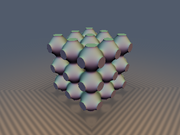
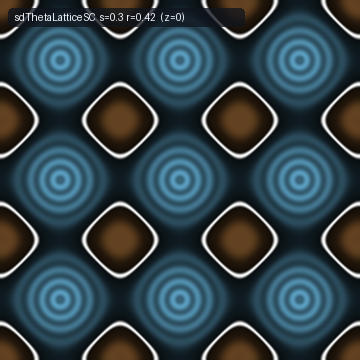
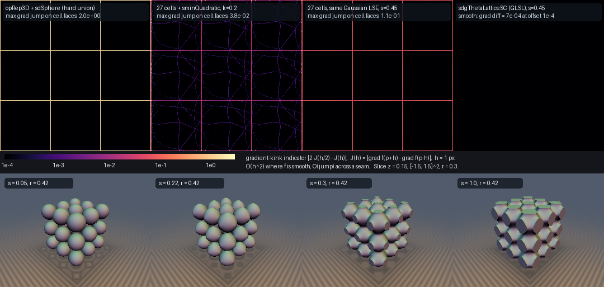

# `sdThetaLatticeSC`, `sdgThetaLatticeSC`, `sdThetaLatticeBCC`, `sdThetaLatticeFCC`, `thetaLatticeSoftSq1D` & `thetaLattice1D` — Poisson-Summed (Jacobi Theta) Smooth Union of an Entire Lattice

| 3D Surface ($`f(\mathbf{p}) = 0`$, 3×3×3 block, $`s = 0.3`$, $`r = 0.42`$) | 2D Cross-Section Slice ($`z = 0`$) |
| :---: | :---: |
|  |  |

| Property | Value |
| :--- | :--- |
| **Author / Discoverer** | **Claude Fable 5.2** (`sdf-gems`, 2026). Research experiment: see [Findings](#findings) for what held and what did not. |
| **Category** | `latticesum` |
| **GLSL File** | [`glsl/latticesum/sdThetaLattice.glsl`](../../glsl/latticesum/sdThetaLattice.glsl) |
| **Exact Euclidean SDF?** | **No.** Conservative bound. Simple cubic: globally 1-Lipschitz (proof below, which relies on one classical elliptic-function identity; the lemma was also checked at 400 digits), `0` overstep pixels. BCC / FCC: 1-Lipschitz **measured only** (no proof). First-order exact only at the lattice points; $`\Vert\nabla f\Vert`$ on the surface is typically `0.35`–`1.0`. |

---

## Overview & Motivation

Domain repetition evaluates one cell. A smooth union of a repeated shape therefore needs the neighbours, and the usual
fix (fold a smooth-min over the 27 nearest cells) is exact only while the blend is short-ranged: once the blend radius
approaches the cell size, the 28th-nearest cell matters and the field gets a gradient seam on every cell face.

For a Gaussian kernel the sum over **all** lattice points is available in closed form and is separable:

```math
S(\mathbf{x}) = \sum_{\mathbf{n} \in \mathbb{Z}^3} e^{-\Vert\mathbf{x} - \mathbf{n}\Vert^2 / (2 s^2)} = \vartheta(x)\,\vartheta(y)\,\vartheta(z),
\qquad \vartheta(u) = \sum_{n \in \mathbb{Z}} e^{-(u - n)^2 / (2 s^2)} .
```

$`\vartheta`$ is a Jacobi theta-3 function. It has two series that converge fast in complementary regimes (Poisson
summation / Jacobi's imaginary transformation):

```math
\vartheta(u) = \sum_{n} e^{-(u-n)^2/(2s^2)} = s\sqrt{2\pi}\,\Big[1 + 2\sum_{k \ge 1} q^{k^2}\cos(2\pi k u)\Big], \qquad q = e^{-2\pi^2 s^2}.
```

This file turns that into a raymarchable field: a seamless ($`C^\infty`$ away from the lattice points) smooth union of
all spheres of a simple cubic, BCC or FCC lattice, with one softness parameter $`s`$ that morphs the surface from
separate spheres ($`s \to 0`$) through necks to a triply periodic network ($`s \gtrsim 0.5`$).



*Top: gradient-kink indicator on the slice $`z = 0.15`$ (black = smooth). The hard union and both 27-cell blends have
a gradient jump on every cell face; the polynomial smooth-min additionally shows its curvature discontinuities and a
value jump; the theta lattice has none. Bottom: the $`s`$-morph at fixed $`r = 0.42`$, rendered from the literal GLSL.*

---

## Mathematical Derivation

### 1. The Raw Soft Squared Distance Is Not Usable (Research Question 2)

The log-sum-exp smooth minimum of $`\Vert\mathbf{x} - \mathbf{n}\Vert^2`$ over all lattice points is
$`D_2(\mathbf{x}) = -2 s^2 \log S(\mathbf{x})`$. It goes **negative** as soon as the images overlap ($`S > 1`$), so
$`\sqrt{D_2} - r`$ fails. Measured (FP64, 60k points):

| $`s`$ | range of $`D_2`$ | fraction of space where $`\sqrt{D_2}`$ is NaN |
| :--- | :--- | :--- |
| `0.25` | `[+0.0001, +0.4900]` | `0%` |
| `0.3` | `[-0.0039, +0.3757]` | `0.1%` |
| `0.4` | `[-0.0807, +0.0827]` | `50.9%` |
| `0.5` | `[-0.3601, -0.3170]` | `100%` |

Subtracting the minimum fixes the sign but not the scale: $`D_2 - D_{2,\min}`$ shrinks like $`q = e^{-2\pi^2 s^2}`$
($`10^{-9}`$ at $`s = 1`$), so a fixed radius $`r`$ would stop meaning anything. The normalisation that works for
every $`s`$ is to re-zero **and** divide by the curvature at the lattice point:

```math
E(\mathbf{x}) = -2 s^2 \log\frac{S(\mathbf{x})}{S(\mathbf{0})} \;\ge\; 0, \qquad
L(s)^2 = \tfrac12\,\partial_{xx} E(\mathbf{0}) = -s^2\,\partial_{xx}\log S\,(\mathbf{0}), \qquad
\boxed{f(\mathbf{x}) = \frac{\sqrt{E(\mathbf{x})}}{L(s)} - r}
```

$`S`$ is maximal at the lattice points (all Fourier coefficients are positive), so $`E \ge 0`$ with equality exactly
there, and $`\sqrt{E}/L = \Vert\mathbf{x} - \mathbf{n}\Vert + O(\Vert\mathbf{x}-\mathbf{n}\Vert^3)`$: for every $`s`$
the field is a unit-slope cone at each lattice point, so a small $`r`$ always means "sphere of radius $`r`$".
For the simple cubic lattice $`L`$ is closed-form in either series:

```math
L(s)^2 = 1 - \frac{\mathrm{Var}_0[n]}{s^2} = 1 - \frac{2 e_1}{s^2 (1 + 2 e_1)} + \dots
       = \frac{8\pi^2 s^2 \sum_k k^2 q^{k^2}}{1 + 2\sum_k q^{k^2}}, \qquad e_1 = e^{-1/(2 s^2)} .
```

and $`E / L^2`$ is a **sum of three 1D terms** $`h_2(u) = -2 s^2 \log\big(\vartheta(u)/\vartheta(0)\big) / L^2`$
(`thetaLatticeSoftSq1D`).

### 2. Theorem: Global 1-Lipschitz Bound for the Simple Cubic Field (Research Question 3)

**Claim.** For every $`s > 0`$ and every dimension, $`\Vert\nabla \sqrt{E}\Vert \le L(s)`$, with equality only in the
limit at the lattice points. Hence $`f`$ is 1-Lipschitz and $`\vert f\vert`$ never exceeds the distance to the surface.

**Proof.** Let $`e(u) = -2 s^2 \log(\vartheta(u)/\vartheta(0))`$, so $`E = e(x) + e(y) + e(z)`$.
1. *1D curvature is maximal at the lattice point.* $`e'' = -2 s^2 (\log\vartheta)''`$, and the classical identity
   $`(\log\vartheta_3)''(z) = c - \wp(z + \tfrac12 + \tfrac{\tau}{2})`$ makes $`e''`$ a real elliptic function whose
   derivative vanishes on the real axis only at the half-periods $`u \in \{0, \tfrac12\}`$. So $`e''`$ is monotone on
   $`[0, \tfrac12]`$. Because $`e'(0) = e'(\tfrac12) = 0`$ (symmetry) its integral over $`[0, \tfrac12]`$ is zero, and
   because $`e`$ has its minimum at $`0`$, $`e''`$ decreases from $`e''(0) = 2 L^2 > 0`$ to a negative value. Therefore
   $`e''(u) \le 2 L^2`$, and $`e'`$ (concave, zero at both ends) is $`\ge 0`$ on $`[0, \tfrac12]`$.
2. *1D bound.* Let $`\varphi = L^2 e - (e'/2)^2`$. Then $`\varphi(0) = 0`$ and
   $`\varphi' = e'\,(L^2 - e''/2) \ge 0`$ on $`[0, \tfrac12]`$, so $`(e')^2 \le 4 L^2 e`$ everywhere (by symmetry and periodicity).
3. *Any dimension (mediant inequality).*
   $`\displaystyle \Vert\nabla\sqrt{E}\Vert^2 = \frac{\sum_i e'(x_i)^2}{4\sum_i e(x_i)} \le \frac{\sum_i 4 L^2 e(x_i)}{4 \sum_i e(x_i)} = L^2 . \qquad\blacksquare`$

The same argument holds with a different softness per axis (each axis is normalised by its own $`L(s_i)`$), which is
the `vec3 s` overload.

Step 1 leans on a textbook identity that was not re-derived here; it was instead checked numerically at 400 digits
(see Verification). A corollary: since $`f + r`$ is 1-Lipschitz and vanishes at the lattice points,
$`f \le \Vert\mathbf{x} - \mathrm{round}(\mathbf{x})\Vert - r`$ for every $`s`$: the smooth union always contains the
hard union, and $`f`$ is also a conservative bound for the hard sphere lattice.

### 3. Two Series, Written in Soft-Squared-Distance Form (Research Question 1)

Evaluating $`\vartheta`$ itself and taking a logarithm fails in FP32 on both ends: for small $`s`$ it underflows
between lattice points ($`\vartheta(\tfrac12) \approx e^{-1/(8 s^2)}`$, `1e-136` at $`s = 0.02`$), and for large $`s`$
the ratio $`\vartheta(u)/\vartheta(0)`$ is $`1 - O(q)`$ and cancels. Both series are therefore rearranged to produce
$`h_2`$ directly, with $`u`$ reduced to $`[-\tfrac12, \tfrac12]`$:

- **Image regime** ($`s < 0.22`$, images $`n \in \{-1, 0, 1\}`$). With
  $`E_\pm = e^{(\pm 2u - 1)/(4 s^2)}`$ (both exponents $`\le 0`$) and $`e_1 = E_+ E_-`$:
  $`\displaystyle e(u) = u^2 - 2 s^2 \log\!\Big(1 + \frac{(E_+ - E_-)^2}{1 + 2 e_1}\Big), \qquad e'(u) = 2\Big(u - \frac{E_+^2 - E_-^2}{1 + E_+^2 + E_-^2}\Big).`$
  The second term of $`e'`$ is the Gibbs-weighted mean lattice point $`\mathbb{E}[n]`$. As $`s \to 0`$ this is $`u^2`$ exactly.
- **Fourier regime** ($`s \ge 0.22`$, $`k \le 4`$), using $`1 - \cos(2\pi k u) = 2\sin^2(\pi k u)`$ and dividing the common factor $`s^2 q`$ out of $`e`$ and $`L^2`$ analytically:
  $`\displaystyle h_2(u) = \frac{\sum_k q^{k^2 - 1}\sin^2(\pi k u)}{\pi^2 \sum_k k^2 q^{k^2-1}}\cdot\frac{-\log(1 - \delta)}{\delta}, \qquad \delta = \frac{4\sum_k q^{k^2}\sin^2(\pi k u)}{1 + 2\sum_k q^{k^2}} .`$
  All terms are non-negative, nothing underflows, and $`q \to 0`$ gives $`\sin^2(\pi u)/\pi^2`$. One `sin` + one `cos` give all four harmonics by angle-multiplication.

The crossover $`s = 0.22`$ balances the neglected image ($`\sim e^{-1/s^2} = 10^{-9}`$) against the neglected
harmonic ($`q^{25} \approx 10^{-10}`$).

### 4. Limits (Research Question 6)

```math
s \to 0:\; f \to \Vert\mathbf{x} - \mathrm{round}(\mathbf{x})\Vert - r, \qquad\qquad
s \to \infty:\; f \to \frac{1}{\pi}\sqrt{\sin^2(\pi x) + \sin^2(\pi y) + \sin^2(\pi z)} - r .
```

The large-$`s`$ limit is **not** "nothing": thanks to the normalisation it is a fixed field whose level sets are
exactly the Schwarz-P nodal family $`\cos 2\pi x + \cos 2\pi y + \cos 2\pi z = 3 - 2\pi^2 r^2`$. The nodal P surface
itself ($`= 0`$) is $`r = \sqrt{3/2}/\pi \approx 0.3898`$. Necks through the cell faces exist when $`r`$ exceeds the
face-centre value of $`\sqrt{E}/L`$, which falls from $`0.5`$ ($`s \to 0`$) to $`1/\pi`$; the surface is empty for
$`r`$ above the cell-corner value (from $`\sqrt3/2`$ to $`\sqrt3/\pi`$).

### 5. BCC and FCC as Cosets (Research Question 7)

BCC $`= \mathbb{Z}^3 + \{(0,0,0), (\tfrac12,\tfrac12,\tfrac12)\}`$ and FCC $`= \mathbb{Z}^3 + \{(0,0,0), (0,\tfrac12,\tfrac12), (\tfrac12,0,\tfrac12), (\tfrac12,\tfrac12,0)\}`$,
so $`S`$ is a sum of 2 or 4 theta products. Splitting $`\vartheta(u) = C_e + C_o`$, $`\vartheta(u - \tfrac12) = C_e - C_o`$ into even and odd harmonics gives

```math
S_{\mathrm{BCC}} = 2\,\big(C_e C_e C_e + C_e C_o C_o + C_o C_e C_o + C_o C_o C_e\big), \qquad
S_{\mathrm{FCC}} = 4\,\big(C_e C_e C_e + C_o C_o C_o\big),
```

(one factor per axis), which is evaluated as a cancellation-free difference from its value at the lattice point. The
image regime uses a log-sum-exp over the cosets of sums of the 1D $`e(u)`$. $`L^2`$ is again closed-form from
$`\vartheta''(0)`$ and $`\vartheta''(\tfrac12)`$. Large-$`s`$ limits (first reciprocal-lattice shell):

```math
f_{\mathrm{BCC}} \to \frac{1}{2\pi}\sqrt{3 - c_x c_y - c_y c_z - c_z c_x} - r, \qquad
f_{\mathrm{FCC}} \to \frac{1}{\pi}\sqrt{\frac{1 - c_x c_y c_z}{2}} - r, \qquad c_i = \cos 2\pi x_i .
```

So BCC tends to the level sets of $`c_x c_y + c_y c_z + c_z c_x`$ (the leading term of the usual I-WP nodal
approximation) and FCC to the level sets of $`c_x c_y c_z`$ (the first FCC mode). These are *not* minimal surfaces,
and no comparison against true I-WP / F-RD was made.

---

## GLSL

```glsl
#include "glsl/latticesum/sdThetaLattice.glsl"

// lattice period c, softness s (in lattice units), sphere radius r (in lattice units)
float d = c * sdThetaLatticeSC(p / c, s, r);              // simple cubic
vec4 dg = sdgThetaLatticeSC(p / c, s, r);                 // dg.x * c = distance bound, normalize(dg.yzw) = normal
float b = c * sdThetaLatticeBCC(p / c, s, r);             // body-centred cubic (conventional cell c)
float g = c * sdThetaLatticeFCC(p / c, s, r);             // face-centred cubic (conventional cell c)
float a = c * sdThetaLatticeSC(p / c, vec3(0.1, 0.3, 0.3), r);   // softness per axis
float blk = max(d, sdBox(p, vec3(1.5 * c)));              // a finite block
```

`sdgThetaLatticeSC` returns the **true** gradient of the bound ($`\Vert\nabla f\Vert \le 1`$, not unit length).

---

## Verification

All "GLSL" numbers are from the literal file on the GPU (FP32) via `tools/gpu_eval.py`. References are built from the
definition only: direct image sums in FP64 (log-sum-exp), an explicit 3D lattice sum (BCC/FCC, 1458–2916 points), and
a multiprecision (`mpmath`, 40–700 digits) evaluation for large $`s`$ where FP64 itself cancels.

| Check | Result |
| :--- | :--- |
| Single-translation-unit compile | forward / reverse / new-first: OK (290 files at the last run) |
| NaN / Inf | `0` over 9 values of $`s \in \{0, 10^{-5}, \dots, 10^{3}\}`$ × 5 expressions × 6424 probes |
| `thetaLatticeSoftSq1D` vs reference, $`s \in [0.02, 5]`$, 20001 points | max abs error of $`h_2`$: `2.0e-7`; of $`\sqrt{h_2}`$: `2.6e-7`; of $`h_2'`$: `1.2e-6` for $`s \ge 0.2`$, growing to `2.0e-5` ($`s = 0.05`$) and `1.2e-4` ($`s = 0.02`$) |
| `sdThetaLatticeSC` vs reference, 24k points (uniform + near-surface + near lattice points), 15 values of $`s \in [0.02, 5]`$ | max abs error `3.6e-7` (worst at $`s = 0.5`$) |
| per-axis softness overload vs reference | max abs error `1.8e-7` |
| `sdgThetaLatticeSC` gradient vs FP64 analytic gradient (itself within `3.2e-8` of FP64 central differences for $`s \ge 0.1`$) | max abs error `2.5e-6` for $`s \ge 0.15`$; `5.5e-6` ($`s=0.1`$), `1.8e-5` ($`s=0.05`$), `9.4e-5` ($`s=0.02`$) |
| 1D Lipschitz lemma, 400 digits, 17 values of $`s \in [0.03, 2]`$ × 400 values of $`u`$ | $`\sup (h'/L)^2 = 1 - 6.3\cdot10^{-239}`$; $`e' \ge 0`$ and $`e''`$ decreasing on $`[0,\tfrac12]`$: no violation |
| Lipschitz, GLSL, 200k random pairs ($`\sigma = 0.05`$ and $`0.005`$), 11 values of $`s`$ | SC max `0.999999`; per-axis softness max `0.999897`. FP64 analytic $`\sup\Vert\nabla f\Vert`$ over 110k points: $`\le 1 + 10^{-9}`$ (reference rounding) |
| Raymarch (`raymarch_stats`, 3×3×3 block in a box), 6 $`(s, r)`$ pairs | SC: `11.0`–`11.4` steps/px, p95 `22`–`24`, **`0` overstep px** |
| Seam $`C^0`$ (`seam_pair_test`) on cell faces, 20k–80k points | `0` violations (SC, BCC, FCC) |
| Series crossover: $`\vert f(s = 0.22^-) - f(s = 0.22^+)\vert`$, 20k points | SC `3.9e-7`, BCC `4.7e-7`, FCC `3.1e-7` |
| $`s \to 0`$: $`\max\vert f - \text{exact sphere lattice}\vert`$ within `0.3` of a lattice point | `1.5e-7` for $`s \le 0.1`$; `1.0e-5` ($`s = 0.15`$); `8.5e-4` ($`s = 0.2`$). Over all space (cell corners): `2.5e-5` ($`s=0.005`$), `5.2e-4` ($`0.02`$), `4.0e-3` ($`0.05`$), `2.1e-2` ($`0.1`$) |
| $`f \le`$ exact sphere-lattice SDF (corollary) | holds on 60k points for every tested $`s`$ |
| $`s \to \infty`$: $`\max\vert f - f_\infty\vert`$ | `9.3e-2` ($`s=0.3`$), `2.4e-2` ($`0.4`$), `4.0e-3` ($`0.5`$), `4.5e-4` ($`0.6`$), `1.9e-6` ($`0.8`$), `1.3e-7` ($`\ge 1`$) |
| Distance from the level set $`r = \sqrt{3/2}/\pi`$ to the nodal P surface (40k nodal points, FP64 Newton projection) | `1.3e-1` ($`s=0.3`$), `3.2e-2` ($`0.4`$), `5.7e-3` ($`0.5`$), `6.5e-4` ($`0.6`$), `5.0e-5` ($`0.7`$), `2e-9` ($`1.0`$) |
| BCC / FCC vs explicit 3D lattice sum, 20k uniform points, 8 values of $`s \le 0.3`$ | max abs error `2.8e-7` (BCC), `9.8e-7` (FCC) |
| BCC / FCC vs multiprecision (300 uniform points), $`s \in \{0.22, 0.3, 0.5, 0.8, 1.5, 3\}`$ | max abs error `1.4e-7` |
| BCC / FCC **near lattice points** (distance `1e-5`…`0.1`) | Fourier regime ($`s \ge 0.22`$): `1.7e-7`. Image regime, $`0.15 \le s < 0.22`$: up to **`5.5e-5`** within `1e-3` of a lattice point, `8e-6` at `1e-3`…`3e-3`, below `1e-6` beyond `1e-2` |
| BCC / FCC Lipschitz (measured, **not proven**) | FP64 analytic gradients + local search, 9 values of $`s \in [0.05, 0.45]`$: $`\sup\Vert\nabla\sqrt{E}\Vert/L \le 1.00000000`$. GLSL pairs, 12 values of $`s \in [0.02, 3]`$: see Findings. Raymarch: `0` overstep px in 8 scenes, `10.2`–`14.1` steps/px |
| BCC / FCC large-$`s`$ limits, $`\max\vert f - f_\infty\vert`$ | BCC: `3.0e-2` ($`s=0.3`$), `2.1e-3` ($`0.4`$), `6.0e-5` ($`0.5`$), `1.3e-7` ($`\ge 0.8`$). FCC: `1.8e-2`, `6.5e-3`, `1.1e-3`, `1.4e-7` ($`\ge 1`$) |

**Tightness of the bound** ($`\Vert\nabla f\Vert`$ on the surface, 60k surface points, GLSL `sdg`):

| $`s`$, $`r`$ | min | 5% | median | 95% |
| :--- | :--- | :--- | :--- | :--- |
| `0.05`, `0.3` (separate spheres) | `1.000` | `1.000` | `1.000` | `1.000` |
| `0.15`, `0.4` | `0.972` | `0.983` | `0.999` | `1.000` |
| `0.25`, `0.4` (necks) | `0.303` | `0.482` | `0.874` | `0.951` |
| `0.3`, `0.4` | `0.354` | `0.367` | `0.734` | `0.867` |
| `1.0`, `0.39` (nodal P) | `0.408` | `0.426` | `0.523` | `0.684` |
| `1.0`, `0.45` (about to pinch off at the edge centres) | `0.026` | `0.157` | `0.461` | `0.561` |

The bound is loose by up to ~3× on the network surfaces and arbitrarily loose near the topology changes (where the
surface passes through a critical point of $`E`$). The obvious first-order fix $`f / \Vert\nabla f\Vert`$ is **not** a
bound: in the same six scenes it oversteps on `391`–`5440` of ~`8000`–`15000` hit pixels while saving only ~10% of the
steps (`10.0`–`10.9` vs `11.0`–`11.4` steps/px).

### Seams vs. Domain Repetition + Smooth-Min (Research Question 5)

20000 points on the cell face $`x = \tfrac12`$, $`r = 0.3`$; one-sided differences at offsets `1e-5` and `1e-6`
(a real jump does not depend on the offset; a smooth field scales with it). Baselines are FP64 NumPy ports.

| Field | value jump | gradient jump |
| :--- | :--- | :--- |
| hard union: `opRep3D` + `sdSphere` | none | `2.0` |
| 27 cells, `sminQuadratic` fold, $`k = 0.05`$ | none | none |
| 27 cells, `sminQuadratic` fold, $`k = 0.1`$ | `1.8e-4` | `3.7e-3` |
| 27 cells, `sminQuadratic` fold, $`k = 0.2`$ | `8.4e-3` | `3.8e-2` |
| 27 cells, exponential smooth-min, $`k = 0.05`$ | none | none (below resolution) |
| 27 cells, exponential smooth-min, $`k = 0.1`$ | none | `3.3e-4` |
| 27 cells, exponential smooth-min, $`k = 0.2`$ | none | `1.8e-2` |
| 27 cells, the same Gaussian log-sum-exp truncated, $`s \le 0.25`$ | none | none (below resolution) |
| 27 cells, the same Gaussian log-sum-exp truncated, $`s = 0.35`$ / `0.45` / `0.5` | none | `1.7e-3` / `1.1e-1` / `5.3e-1` |
| **theta lattice**, $`s = 0.15 \dots 0.5`$ (FP64 reference and literal GLSL) | none (GLSL: 0–1 FP32 ulp) | none: difference $`\propto`$ offset |

The fold of a non-associative polynomial smooth-min also has a **value** jump on the faces, because the fold order is
tied to the cell index. The improvement is real but only for large blends: for $`k \le 0.05`$ or $`s \le 0.25`$ the
27-cell neighbourhood is already seamless to measurement precision.

### Cost

Static operation counts per evaluation (parameters that depend on $`s`$ only are recomputed per call unless the
compiler folds a constant $`s`$):

| Field | transcendental / SFU operations |
| :--- | :--- |
| `sdThetaLatticeSC`, image regime | 6 `exp` + ≤3 `log` + 1 `sqrt` + 9 divisions, plus $`s`$-only: 6 `exp` + 6 divisions |
| `sdThetaLatticeSC`, Fourier regime | 3 `sin` + 3 `cos` + ≤3 `log` + 1 `sqrt` + ≤12 divisions, plus $`s`$-only: 3 `exp` |
| `sdThetaLatticeBCC` / `FCC`, image regime | 12 `exp` + ≤6 `log` (1D terms) + 2–4 `exp` + 1 `log` + 1 `sqrt`, plus $`s`$-only terms |
| `sdThetaLatticeBCC` / `FCC`, Fourier regime | 3 `sin` + 3 `cos` + ≤1 `log` + 1 `sqrt` + 1 `exp` ($`s`$-only) |
| 27-cell smooth-min fold | 27 `sqrt` + 26 smooth-min evaluations |

Measured GPU timings are reported in Findings together with their caveats.

---

## Findings

**What held**

1. *Two-series evaluation (Q1).* In the log-domain form the field is accurate to `2e-7`–`4e-7` absolute for every
   $`s`$ from `0.02` to `5` with 3 images or 4 harmonics; no NaN/Inf from $`s = 0`$ to $`s = 1000`$.
2. *Normalisation (Q2).* $`\sqrt{E}/L - r`$ is well defined for all $`s`$, keeps $`r`$ meaningful, and has a finite
   large-$`s`$ limit.
3. *Lipschitz bound (Q3), simple cubic.* $`L(s)`$ is the exact global Lipschitz constant of $`\sqrt{E}`$, in closed
   form, in any dimension and with per-axis softness. `0` overstep pixels.
4. *Analytic gradient (Q4)* from $`\vartheta'/\vartheta`$ (the Gibbs mean lattice point): `2e-6` for $`s \ge 0.15`$.
5. *Seamlessness (Q5).* No value or gradient jump at cell faces for any $`s`$.
6. *Limits (Q6).* $`s \to 0`$ recovers the exact sphere lattice near the spheres; $`s \to \infty`$ gives the Schwarz-P
   nodal family exactly, reached to `6.5e-4` at $`s = 0.6`$ and to FP32 precision at $`s \ge 1`$.
7. *Cosets (Q7).* BCC and FCC work as 2 and 4 theta products and match explicit 3D lattice sums.
8. *Per-axis softness (Q8, partly).* Free by separability and covered by the same proof.

**What failed or only partly held**

1. *"~1e-7 relative accuracy of $`\vartheta`$ for every $`s`$" is false in FP32 for the plain value.*
   `thetaLattice1D` reaches `≤ 7.3e-7` relative only for $`s \ge 0.2`$; it degrades to `1.0e-6` ($`s = 0.15`$),
   `2.7e-6` ($`0.1`$), `1.2e-5` ($`0.05`$) because the exponent argument is large, and it underflows to zero on about
   half of the cell at $`s = 0.02`$. Its derivative is accurate to `≤ 8.1e-7` absolute for $`s \ge 0.15`$ (`5.4e-6` at $`s = 0.02`$); for $`s \ge 2`$ it is smaller than the FP64 reference could resolve (`< 1e-15`) and was not checked.
   The log-domain `thetaLatticeSoftSq1D` exists for this reason.
2. *$`\sqrt{D_2} - r`$ is unusable* (NaN on half of space at $`s = 0.4`$), and subtracting the minimum alone is not enough.
3. *The bound is not tight.* $`\Vert\nabla f\Vert`$ on fused surfaces is typically `0.35`–`0.9` and tends to `0` at
   topology changes. The first-order normalisation $`f/\Vert\nabla f\Vert`$ oversteps badly and is not offered.
4. *"Seams of the 27-cell approach" are a large-blend problem only.* For short blends the 27-cell fold is already
   seamless; the theta lattice buys nothing there except cost.
5. *BCC / FCC Lipschitz constant is not proven.* The separable argument does not apply. The bound was only measured.
   In FP32 the random-pair test reaches `1.000000` (FCC, $`s = 0.02`$), i.e. it is at the limit, not strictly inside.
6. *BCC / FCC lose accuracy next to lattice points in the image regime:* up to `5.5e-5` within `1e-3` of a lattice
   point for $`0.15 \le s < 0.22`$ (a `log` of a ratio near 1). The first version of the shader was worse (`9e-5` near
   the lattice points of the non-origin cosets in the Fourier regime too) until the point was first moved into the
   Voronoi cell of the origin coset.
7. *Not attempted:* the Yukawa / $`e^{-k\Vert x\Vert}`$ kernel via Ewald splitting, an analytic gradient for
   BCC / FCC, and a comparison of the BCC / FCC limits with true minimal surfaces.
8. *The field is a cone at each lattice point* (like a true distance), so it is $`C^\infty`$ only away from them.

**Cost measurement: caveats**

GPU timing was attempted with five harness variants. The first four were rejected: a one-evaluation-per-vertex
transform-feedback benchmark was dominated by data transfer and produced negative costs; two looped variants were not
repeatable (an $`s`$-independent expression varied by 70% between runs); and a fourth failed its own pre-set
proportionality gate because a fixed per-vertex cost dominates. The fifth estimates the per-evaluation cost from the
slope in the loop count at fixed vertex count. Its numbers are reported in the table below **only for rows that passed
its gates**, are from one machine, and should be read as rough:

| Field | ns / evaluation, 250k vertices | ns / evaluation, 1M vertices | gates |
| :--- | :--- | :--- | :--- |
| `sdThetaLatticeSC`, $`s = 0.1`$ (images) | `0.031` (repeat: `0.029`) | `0.027` (repeat: `0.028`) | passed |
| `sdThetaLatticeSC`, $`s = 0.3`$ (Fourier) | `0.046` | `0.043` | passed |
| `sdgThetaLatticeSC`, $`s = 0.3`$ | `0.056` | `0.062` | passed |
| `sdThetaLatticeBCC`, $`s = 0.3`$ | `0.048` | `0.066` | passed (27% apart) |
| `sdThetaLatticeFCC`, $`s = 0.1`$ / $`0.3`$ | `0.089` / `0.063` | `0.089` / `0.047` | passed; the $`s = 0.1`$ checksum did not scale as expected |
| 27 cells, `sminQuadratic` fold | `0.095` | `0.095` | passed |
| 27 cells, exponential smooth-min | `0.085` | `0.075` | passed |
| `sdThetaLatticeBCC`, $`s = 0.1`$ | (`0.123`) | (`0.069`) | **failed** (slopes disagree): not usable |
| hard union, 1 sphere | (`0.010`) | (`0.005`) | **failed** (too cheap to resolve): not usable |

On this evidence the simple cubic field costs roughly 0.3–0.6× a 27-cell fold, and the BCC / FCC fields
are in the same range as a 27-cell simple-cubic fold (a 27-cell fold of BCC or FCC would evaluate 2× or 4× as many
spheres; that was not timed). The spread between the two columns (up to 27%) is the honest error bar; no claim finer
than "about 2×" is supported.

**Open questions**

- A proof (or counterexample) that $`\sup\Vert\nabla\sqrt{E}\Vert`$ is attained at the lattice points for BCC / FCC, or for general lattices.
- A tighter certified bound on fused surfaces (e.g. a second-order or Hessian-bounded step) that stays conservative.
- Other kernels with closed-form lattice sums (Ewald-split Yukawa), and non-cubic lattices (hexagonal: theta products in a skewed basis).
- Non-spherical repeated shapes: the construction relies on the kernel being a Gaussian of the distance to a point.

---

## Novelty & Prior Art

Several web searches were made (Jacobi theta metaballs, Poisson summation / Ewald in graphics, seamless smooth-min
domain repetition, periodic nodal surfaces, `length(sin(p))`-style estimators). The search tool returned topic
summaries rather than a specific shader or paper that does this, so the following is a statement of what is known to
be classical, not a claim that no such shader exists.

**Classical, not new:**
- Jacobi theta functions, the imaginary transformation (Poisson summation) and its use to switch between a real-space
  and a reciprocal-space series (the idea behind Ewald summation, 1921).
- Gaussian "blobby" implicit surfaces (Blinn, 1982) and log-sum-exp smooth minima; smooth-min and domain repetition
  as popularised by Inigo Quilez's articles, including the advice to evaluate neighbouring cells.
- Periodic nodal surfaces as leading Fourier terms of triply periodic surfaces (von Schnering & Nesper), including
  $`\cos x + \cos y + \cos z`$ for Schwarz P.
- Trigonometric periodic distance estimators of the `length(sin(p))` kind are demoscene folklore; the large-$`s`$
  limit here is a normalised member of that family.
- $`(\log\vartheta_3)''`$ as a shifted Weierstrass $`\wp`$ function.

**Believed new here (to the extent the searches can tell):**
- The normalised field $`\sqrt{-2 s^2\log(S/S(\mathbf 0))}/L(s) - r`$ with a closed-form **global** Lipschitz constant
  for every softness, proved for the simple cubic lattice via the 1D curvature lemma and the mediant inequality.
- The underflow-free / cancellation-free two-series evaluation of the 1D soft squared distance $`h_2`$ and its
  derivative in FP32, and the even/odd-harmonic coset identities used for BCC and FCC.
- The quantified comparison against truncated 27-cell blends.

---

## Reproducing the Numbers

Scratch scripts (outside the repository), run from the repository root:

```bash
S=<scratch>/latticesum
uv run python $S/proto1.py                      # FP64 lemmas before any GLSL
uv run --with mpmath python $S/v2_numbers.py    # accuracy, NaN, gradient, Lipschitz pairs, BCC/FCC vs references
uv run python $S/v3_seams.py                    # seam table, seam_pair_test, crossover continuity
uv run python $S/v3d_cost.py                    # gated GPU timing (v3b / v3c are the rejected variants)
uv run python $S/v4_limits.py                   # D2 sign, limits, nodal-P distance, tightness, raymarch_stats
uv run --with mpmath python $S/v5_lemma.py      # 400-digit 1D lemma, BCC/FCC gradient sup
uv run --with mpmath python $S/v6_coset_near.py # BCC/FCC near lattice points
uv run python $S/render.py 0.3 0.42 all         # the three images
```
