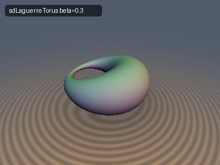
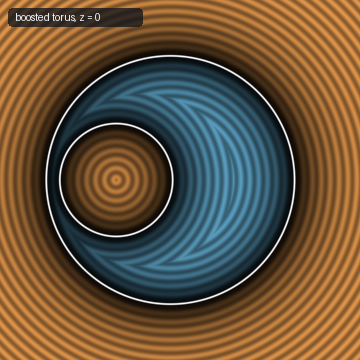
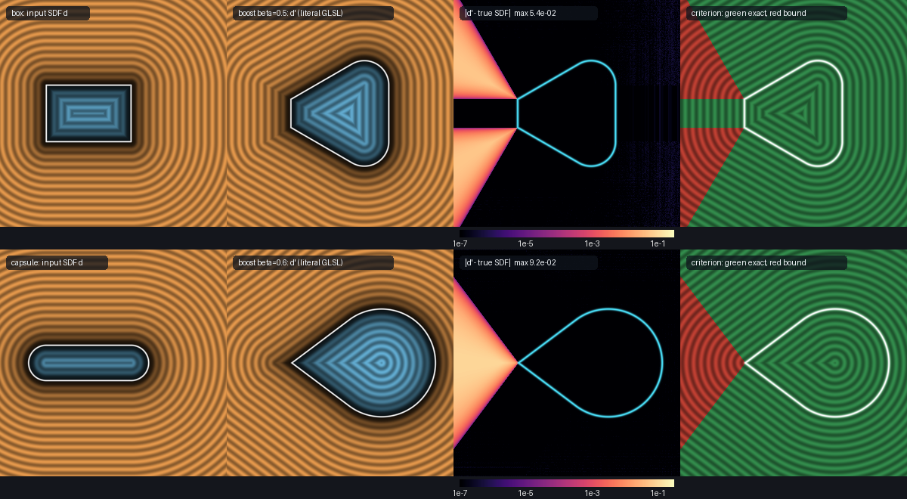

# `opLaguerreBoost` — Lorentz Boost of the Eikonal Graph (a Laguerre Transformation of an SDF)

| 3D Surface ($`d' = 0`$): torus boosted into a ring Dupin cyclide | 2D Cross-Section Slice |
| :---: | :---: |
|  |  |

| Property | Value |
| :--- | :--- |
| **Category** | `liesphere` (research experiment) |
| **GLSL File** | [`glsl/liesphere/opLaguerreBoost.glsl`](../../glsl/liesphere/opLaguerreBoost.glsl) |
| **Attribution** | Operator, closed forms, exactness criterion and verification by **Claude Fable 5.2** (`sdf-gems`, 2026). The underlying geometry (Laguerre transformations, cyclographic map, medial axis transform in Minkowski space) is classical; see *Novelty & Prior Art*. |
| **Exactness** | Operator output: **always 1-Lipschitz, unit gradient a.e., correct zero set and sign** (a conservative bound); **exact** only where the generator criterion below holds. `sdLaguerreSphere`, `sdLaguerrePlane`: Exact. `sdLaguerreCapsule`: Exact iff $`r \ge \vert\beta\vert h`$, else conservative bound. `sdLaguerreTorus`: Exact iff $`r \ge \vert\beta\vert R`$ (8-tap solve, verified for $`\vert\beta\vert \le 0.95`$), else conservative bound. `sdLaguerreBox`: conservative bound (exact inside, and everywhere after rounding by $`k \ge \gamma\vert\beta\vert b_x`$). |

---

## Overview & Motivation

For an exact SDF $`d`$, the graph $`G = \{(\mathbf{x}, t) : t = d(\mathbf{x})\}`$ in Minkowski space $`\mathbb{R}^{3,1}`$ (signature $`+++-`$) is a
null hypersurface: $`\Vert\nabla d\Vert = 1`$ says its normal $`(\nabla d, 1)`$ is a null vector, and its generators are the lifted normal lines
$`(\mathbf{y} + s\mathbf{n}, s)`$. A point $`(\mathbf{x}, t)`$ is the oriented sphere with centre $`\mathbf{x}`$ and signed radius $`t`$ (the cyclographic
model of Laguerre geometry). Lorentz transformations preserve null cones, so they map oriented spheres to oriented spheres and oriented
planes to oriented planes while preserving oriented contact: they are the **Laguerre transformations**.

This experiment asks: *if we boost the graph of an SDF, do we get the graph of another exact SDF, and can it be evaluated in a shader?*

Short answer (details in **Findings**): the boosted graph is always the graph of a 1-Lipschitz function with unit gradient almost everywhere,
which can be evaluated with a 1D root find that converges in 3 to 8 taps. It is the exact SDF of its zero set **only where the boosted
medial spheres keep non-negative radii**; elsewhere it is a strict underestimate. Several of the original claims were false as stated.



*Rows: box ($`\beta = 0.5`$) and capsule ($`\beta = 0.6 > r/h`$). Columns: input SDF; boosted field from the literal GLSL; $`\log_{10}`$ error
against the true SDF of the boosted zero set (independent polyline ground truth); the generator criterion (green: predicted exact, red:
predicted bound only). The error region and the red region coincide.*

## Mathematical Derivation

Boost along the unit axis $`\mathbf{e}`$ with velocity $`\beta \in (-1, 1)`$, $`\gamma = 1/\sqrt{1 - \beta^2}`$, $`x_\parallel = \mathbf{x}\cdot\mathbf{e}`$:

```math
x'_\parallel = \gamma\,(x_\parallel - \beta t), \qquad \mathbf{x}'_\perp = \mathbf{x}_\perp, \qquad t' = \gamma\,(t - \beta x_\parallel).
```

### Evaluation

To evaluate $`d'(\mathbf{x}')`$, find the pre-image coordinate $`s = x_\parallel`$ with $`t = d`$:

```math
s = u + \beta\, d(\mathbf{x}'_\perp + s\,\mathbf{e}), \qquad u = x'_\parallel / \gamma, \qquad
d'(\mathbf{x}') = \gamma\,(d - \beta s) = \frac{d}{\gamma} - \gamma\beta u .
```

Because $`d`$ is 1-Lipschitz, the right-hand side is a contraction with factor $`\vert\beta\vert`$: the root exists and is unique for **any**
1-Lipschitz input. $`F(s) = s - u - \beta d(s)`$ is strictly increasing with slope in $`[1 - \vert\beta\vert,\, 1 + \vert\beta\vert]`$, so every tap brackets
the root between $`s - F/(1 - \vert\beta\vert)`$ and $`s - F/(1 + \vert\beta\vert)`$, and the value error of an unconverged tap is at most
$`\vert F\vert \sqrt{(1 + \vert\beta\vert)/(1 - \vert\beta\vert)}`$ (the Doppler factor).

### 1-Lipschitz (always)

Two points of the graph of a 1-Lipschitz function are never timelike separated ($`\vert\Delta t\vert \le \Vert\Delta\mathbf{x}\Vert`$). Boosts preserve
the interval, so the same holds for the image, which is a graph over all of $`\mathbb{R}^3`$ by the contraction argument. Hence $`d'`$ is
1-Lipschitz for every 1-Lipschitz input and every $`\vert\beta\vert < 1`$, with no condition on the shape.

### Gradient: relativistic aberration

Differentiating the fixed-point equation gives, with $`\mathbf{n} = \nabla d`$ at the pre-image and $`n_\parallel = \mathbf{n}\cdot\mathbf{e}`$:

```math
n'_\parallel = \frac{n_\parallel - \beta}{1 - \beta n_\parallel}, \qquad
\mathbf{n}'_\perp = \frac{\mathbf{n}_\perp}{\gamma\,(1 - \beta n_\parallel)}, \qquad \Vert\mathbf{n}'\Vert = \Vert\mathbf{n}\Vert .
```

This is the aberration formula for a light ray, and it gives the analytic gradient (`sdg`) of the boosted field for free.

### The zero set, without a root find

$`d'(\mathbf{x}') = 0`$ iff $`d(\mathbf{x}) = \beta x_\parallel`$ with $`x_\parallel = \gamma x'_\parallel`$. So the boosted surface is the level set
$`\{d(\mathbf{x}) = \beta x_\parallel\}`$ compressed by $`1/\gamma`$ along $`\mathbf{e}`$, with the root-free implicit function

```math
g(\mathbf{x}') = d(\gamma x'_\parallel \mathbf{e} + \mathbf{x}'_\perp) - \beta\gamma\, x'_\parallel .
```

$`g`$ is not a distance, but it defines the surface independently of the solver, and all ground truths below are built from it.

### Boosted medial axis transform and the exactness criterion

Every SDF is the lower envelope of its medial cones: $`d(\mathbf{x}) = \min_{\mathbf{m}} \Vert\mathbf{x} - \mathbf{m}\Vert - \rho(\mathbf{m})`$ over the interior
medial spheres (for a convex shape; in general wherever the interior medial axis is the relevant one). A boost preserves "below the graph",
so it commutes with $`\min`$, and each sphere maps to a sphere:

```math
\mathbf{m}' = \mathbf{m} + \big((\gamma - 1)\, m_\parallel + \gamma\beta\rho\big)\,\mathbf{e}, \qquad \rho' = \gamma\,(\rho + \beta\, m_\parallel).
```

The boosted field is the lower envelope of the boosted spheres, **including those whose radius became negative**. A negative-radius sphere
contributes $`\Vert\mathbf{x}' - \mathbf{m}'\Vert + \vert\rho'\vert`$, which is positive but can undercut the true distance to the union of the positive
ones. Equivalent local statement (the *generator criterion*): with the pre-image point $`\mathbf{x}`$, $`d = d(\mathbf{x})`$, $`\mathbf{n} = \nabla d(\mathbf{x})`$,
foot point $`\mathbf{y} = \mathbf{x} - d\,\mathbf{n}`$, the generator through the graph point crosses $`t' = 0`$ at parameter

```math
s_0 = \frac{\beta\, y_\parallel}{1 - \beta\, n_\parallel}, \qquad
d'(\mathbf{x}') \text{ is the exact distance} \iff d(\mathbf{y} + s_0 \mathbf{n}) = s_0 ,
```

i.e. the normal line is still a generator of the input SDF (has not ended on the medial axis) where it meets the new zero level.
The "if" direction is a proof (the image of that point lies on the zero set at distance $`\vert d'\vert`$, and $`d'`$ is 1-Lipschitz); the "only if"
direction is supported by measurement only. `opLaguerreBoostProbe` returns $`(\mathbf{y} + s_0\mathbf{n},\, s_0)`$, so the criterion costs one
extra tap at run time.

Consequences:

- **Convex input**: the boosted interior is always exact (outward generators never end). The whole field is exact iff
  $`\rho(\mathbf{m}) + \beta\, m_\parallel \ge 0`$ for every interior medial point, including boundary vertices and edges where $`\rho = 0`$.
- **Sharp features always break exterior exactness** on the side where $`\beta\, y_\parallel < 0`$. Rounding fixes it:
  the boost of $`d - k_0`$ is exact as soon as $`k_0 + \beta\, y_\parallel \ge 0`$ on the sharp features.

### Closed-form instances

| Input | Boosted result | Parameters |
| :--- | :--- | :--- |
| Sphere $`(\mathbf{c}, r)`$ | Sphere | $`\mathbf{c}' = \mathbf{c} + ((\gamma - 1) c_\parallel + \gamma\beta r)\mathbf{e}`$, $`r' = \gamma (r + \beta c_\parallel)`$; if $`r' < 0`$ the zero set is empty |
| Plane $`\mathbf{n}\cdot\mathbf{x} = h`$ | Plane | aberrated normal, $`h' = h / (\gamma (1 - \beta n_\parallel))`$ |
| Capsule on the boost axis, half-length $`h`$, radius $`r`$ | Round cone, half-angle $`\arcsin\beta`$ | centres $`\gamma(\beta r \mp h)`$, radii $`\gamma(r \mp \beta h)`$ |
| Torus $`(R, r)`$, boost along a diameter | Dupin cyclide | focal ellipse semi-axes $`\gamma R,\ R`$ (eccentricity exactly $`\vert\beta\vert`$), sphere radii $`\gamma (r + \beta R\cos\theta)`$, shifted by $`\gamma\beta r`$ |
| Torus, boost along its axis | Torus | tube radius $`\gamma r`$, shifted by $`\gamma\beta r`$ (derived, not tested) |
| Box, boost along $`x`$ | Mixed body (not a polyhedron) | see `sdLaguerreBox`: planes on the $`-\beta`$ side; spheres, cylinders and cones of radius $`\gamma\beta\, y_\parallel`$ on the $`+\beta`$ side |

For the box, along a line parallel to the boost axis the box SDF is constant, then linear or hyperbolic in $`s`$, so the fixed-point equation
is linear or quadratic and `sdLaguerreBox` needs no iteration.

### Composition (the Poincaré group acts on SDFs)

Offsets are time translations, so they do not commute with boosts; conjugating gives (all verified to $`7\times10^{-15}`$ in FP64):

```math
\mathcal{B}_\beta[d - k](\mathbf{x}') = \mathcal{B}_\beta[d](\mathbf{x}' - \gamma\beta k\,\mathbf{e}) - \gamma k, \qquad
\mathcal{B}_\beta[d(\cdot - a\mathbf{e})](\mathbf{x}') = \mathcal{B}_\beta[d](\mathbf{x}' - \gamma a\,\mathbf{e}) - \gamma\beta a,
```

```math
\mathcal{B}_{\beta_1} \circ \mathcal{B}_{\beta_2} = \mathcal{B}_{(\beta_1 + \beta_2)/(1 + \beta_1\beta_2)}, \qquad \mathcal{B}_{-\beta} \circ \mathcal{B}_{\beta} = \mathrm{id}.
```

So boosting a shape that is not centred on the origin is the same as boosting the centred shape and then offsetting it. The family
`sdLaguerreBox(p, b, beta) - k` covers every boost of every rounded or translated box; for $`k \ge \gamma\vert\beta\vert b_x`$ it is an exact SDF
of a convex body bounded by planes, cylinders, cones and spheres (a "rounded frustum" whose rounding radius varies linearly along the axis).

## GLSL

GLSL has no function pointers, so the operator is expressed as helpers around the taps of the inner SDF:

```glsl
vec3  perp;
float u = opLaguerreBoostInit(p, e, beta, perp), s = u;
vec2  br = vec2(-1e30, 1e30);
for (int i = 0; i < 4; i++) {
    vec4 dg = sdgInner(opLaguerreBoostPoint(s, perp, e));
    s = opLaguerreBoostStepSafe(s, u, beta, e, dg, br);     // or opLaguerreBoostStep(s, u, beta, e, dg) for convex inputs
}
vec4 r = sdgLaguerreBoostFinalize(s, u, beta, e, sdgInner(opLaguerreBoostPoint(s, perp, e)));   // (d', grad d')
```

| Function | Purpose |
| :--- | :--- |
| `opLaguerreBoostInit`, `opLaguerreBoostPoint` | set up $`u`$, $`\mathbf{x}_\perp`$; sample position for the current $`s`$ |
| `opLaguerreBoostStep(u, beta, d)` | fixed-point step (distance only) |
| `opLaguerreBoostStep(s, u, beta, e, dg)` | Newton step (needs the gradient); safe for convex inputs or $`\vert\beta\vert < 1/3`$ |
| `opLaguerreBoostStepSafe(..., br)` | bracketed Newton step for non-convex inputs |
| `opLaguerreBoostFinalize`, `sdgLaguerreBoostFinalize` | value; value + aberrated gradient (includes one free Newton correction) |
| `opLaguerreBoostProbe` | sample point and target value of the run-time exactness criterion |
| `sdLaguerreSphere`, `sdgLaguerrePlane`, `sdgLaguerreCapsule`, `sdgLaguerreBox`, `sdgLaguerreTorus` | instances (closed form except the torus) |

## Verification

FP64 prototype first, then the literal GLSL on the GPU (FP32, `tools/gpu_eval.py`). Ground truths are built from the root-free implicit
function $`g`$ (2D: contour traced, projected onto $`g = 0`$ and subdivided to 60k–350k vertices, then `polyline_distance`; 3D:
`implicit_boundary_cloud` + `cloud_sdf`, accurate to about $`10^{-3}`$ only) and from existing repo primitives.

### Solver (claim 1), FP64, 200k points in $`[-2.5, 2.5]^3`$, taps until the error stays below $`10^{-6}`$

| Input | $`\beta`$ | Fixed point | Plain Newton | Bracketed Newton |
| :--- | :---: | :---: | :---: | :---: |
| sphere / box / capsule (convex) | 0.2 | 9–10 | 3 | 3 |
| | 0.5 | 21–22 | 4 | 4 |
| | 0.8 | 63–68 | 5 | 5 |
| | 0.95 | 189–219 | 5–6 | 5–6 |
| torus (non-convex) | 0.5 | 21 | 4 | 4 |
| | 0.8 | 64 | **diverges** (error 13 after 60 taps) | 6 |
| | 0.95 | 212 | **diverges** (error 170) | 7 |
| | 0.99 | — | — | 8 |

Taps include the final one. Fixed-point counts use `opLaguerreBoostFinalize`; Newton counts use `sdgLaguerreBoostFinalize`. The measured
fixed-point contraction rate equals $`\vert\beta\vert`$ (0.200, 0.500, 0.800, 0.950).
On the GPU (oblique axis, box input, plain Newton): max error $`8.7\times10^{-7}`$ with 3 taps at $`\beta = 0.3`$, $`1.9\times10^{-6}`$ with 4 taps at
$`\beta = 0.6`$, $`6.1\times10^{-6}`$ with 5 taps at $`\beta = 0.9`$ (FP32 floor grows with $`\gamma`$).

### Literal GLSL on the GPU (60k random points + 3.2k probe points)

| Check | Result |
| :--- | :--- |
| NaN / Inf at probes and degenerate parameters ($`\beta = 0, \pm 0.99`$; zero radii, zero box) | 0 / 252,836 in each of 11 configurations |
| `sdLaguerreSphere` vs FP64 analytic (incl. negative radius, oblique axis) | max error $`1.0\times10^{-6}`$ |
| `sdgLaguerrePlane` vs FP64 operator (oblique axis) | max error $`7.5\times10^{-7}`$, $`\vert\Vert g\Vert - 1\vert \le 9.3\times10^{-8}`$ |
| `sdLaguerreCapsule` vs GPU `sdRoundCone` (repo), $`\beta = \pm 0.3, 0.7`$ | max difference $`6.0\times10^{-7}`$ |
| `sdLaguerreCapsule` vs FP64 operator, $`\beta \in \{\pm 0.3, 0.375, 0.6, 0.7, 0.9\}`$ | max error $`9.3\times10^{-7}`$ |
| `sdLaguerreBox` vs FP64 operator (bisection), $`\beta \in \{0.2, \pm 0.5, 0.8, 0.95\}`$ | max error $`1.7\times10^{-6}`$ |
| `sdLaguerreTorus` vs FP64 operator, $`\beta \in \{0.2, \pm 0.3, 0.5, 0.8, 0.95\}`$ | max error $`3.0\times10^{-6}`$ |
| `sdLaguerreTorus` vs GPU `sdDupinCyclideExact` (repo), $`\beta \in \{0.2, \pm 0.3\}`$ (ring) | max difference $`1.2\times10^{-6}`$ |
| Lipschitz constant on random pairs (box, torus; all $`\beta`$ above) | max 0.999998 |
| `sdg`: value match, $`\vert\Vert g\Vert - 1\vert`$, cosine vs finite differences | 0; $`\le 2.3\times10^{-6}`$; $`> 0.999`$ on 100% of smooth points |
| Exactness certificate, ring cyclide ($`\beta = 0.2, \pm 0.3`$) | Lipschitz 0.999996; $`\vert d\vert \le 3.9\times10^{-7}`$ on independent surface samples; self-projection $`1.6\times10^{-6}`$ |
| Exactness certificate, `sdLaguerreBox - k`, $`k = \gamma\beta b_x`$ ($`\beta = 0.3, 0.6`$) | Lipschitz 0.99987; $`\vert d\vert \le 5.6\times10^{-7}`$ on surface samples; self-projection $`9.8\times10^{-7}`$ |
| `sdLaguerreBox` ($`k = 0`$) vs 3D cloud ground truth | no sign mismatch; overstep $`\le 5.2\times10^{-5}`$ (cloud noise); interior 100% within $`10^{-3}`$; exterior 63% ($`\beta = 0.3`$) and 75% ($`\beta = 0.6`$); max underestimate 0.112 and 0.135 |
| `opLaguerreBoostProbe` mask vs FP64 criterion (box, $`\beta = 0.3, \pm 0.6`$) | 100% agreement on 60k points |

### Exactness region (claim 5), FP64, 2D, 90,601 grid points in $`[-2.5, 2.5]^2`$ per case, tolerance $`2\times10^{-5}`$

| Input | $`\beta`$ | Exterior exact | Interior exact | Max underestimate |
| :--- | :---: | :---: | :---: | :---: |
| box $`0.8 \times 0.5`$, centred | 0.2 / 0.6 / 0.9 | 70.3% / 74.3% / 84.0% | 100% | 0.048 / 0.071 / 0.043 |
| same box centred at $`x = +1`$ | 0.2 / 0.375 / 0.6 / 0.9 | 100% | 100% | 0 |
| same box centred at $`x = -1`$ | 0.2 / 0.375 / 0.6 | 35.2% / 29.0% / 13.1% | 100% | 0.107 / 0.150 / 0.310 |
| same box centred at $`x = -1`$ | 0.9 | zero set is **empty** ($`\min d' = 0.305`$) | | |
| stadium $`h = 0.8,\ r = 0.3`$ on the axis | 0.2 / 0.375 | 100% | 100% | 0 |
| | 0.6 / 0.9 | 73.3% / 83.5% | 100% | 0.150 / 0.107 |
| annulus $`R = 0.8,\ w = 0.25`$ | 0.2 | 100% | 100% | 0 |
| | 0.375 / 0.6 / 0.9 | 84.7% / 72.0% / 68.6% | 100% | 0.415 / 0.545 / 0.333 |
| disk | 0.2 – 0.9 | 100% | 100% | 0 |

Over all 34 cases: max overstep $`\vert d'\vert - \vert d_{\text{true}}\vert = 4.6\times10^{-8}`$ (ground-truth noise), 0 sign mismatches. The generator
criterion and the measured exact region disagree on at most 514 of 90,601 points per case, and **every** disagreement lies within 2 grid cells
of the border between the two regions (0 farther away).

## Findings

**What held**

1. *Convergence.* The fixed point converges at rate exactly $`\vert\beta\vert`$. Newton needs 3–6 taps for convex inputs at any tested $`\beta \le 0.95`$.
2. *1-Lipschitz, always.* Proven above; measured max ratio $`\le 0.9999999`$ over $`9\times10^{6}`$ pairs (5 shapes, 3 velocities, 3 pair scales),
   and finite-difference gradient norm within $`10^{-4}`$ of 1 on 100% of sampled points.
3. *Aberrated gradient.* Matches finite differences to cosine $`1 - 10^{-9}`$ in FP64 with $`\vert\Vert\mathbf{n}'\Vert - 1\vert \le 4\times10^{-15}`$.
4. *Sphere, plane, capsule, torus.* Sphere $`\to`$ sphere and plane $`\to`$ plane exactly; capsule on the axis $`\to`$ the repo's `sdRoundCone`
   to $`6\times10^{-7}`$; torus $`\to`$ the repo's `sdDupinCyclideExact` to $`1.2\times10^{-6}`$, with the cyclide's focal eccentricity equal to $`\vert\beta\vert`$.
5. *Generator criterion.* Matches the measured exact region up to grid resolution in all 34 cases, and is cheap to evaluate (one tap).
6. *Composition laws* with offsets, translations and other boosts, to $`7\times10^{-15}`$.
7. *Zero set and sign* are always those of the root-free implicit function $`g`$ (0 sign mismatches anywhere).

**What failed, or held only in part**

1. *"The boost of an exact SDF is an exact SDF" is false in general.* It is a conservative bound. Exactness fails outside the shape wherever
   a boosted medial sphere has negative radius: 30% of the sampled exterior for a centred box at $`\beta = 0.2`$, up to 87% for a box lying
   entirely on the $`-\beta`$ side. The underestimate reached 0.55 (annulus, $`\beta = 0.6`$). No overestimate was ever observed.
2. *"Box $`\to`$ frustum-like convex polyhedron" is false.* The $`-\beta`$ side has tilted planes and sharp edges; the $`+\beta`$ side is rounded
   by spheres, cylinders and cones of radius $`\gamma\beta\, y_\parallel`$. A true polyhedron appears only when the box lies entirely in
   $`\beta x_\parallel \le 0`$, and then the exterior field is a bound, not exact. `tools/ground_truth.convex_hull_sdf` was therefore not applicable.
3. *"The zero set is the Laguerre image" is only partly true.* It is the *trimmed* image: contact elements whose generator is dead at
   $`t' = 0`$ (30% for a centred box at $`\beta = 0.2`$, 34% for the stadium at $`\beta = 0.6`$) map to points strictly outside the zero set
   ($`d' > 0`$, up to 0.93 for the box at $`x = -1`$, $`\beta = 0.6`$), exactly as an inward offset gives a trimmed offset surface.
4. *Plain Newton is not safe.* It diverged on the torus for $`\vert\beta\vert \ge 0.8`$ (the bound $`2\vert\beta\vert/(1 - \vert\beta\vert) < 1`$ guarantees
   convergence only for $`\vert\beta\vert < 1/3`$, or for convex inputs). The first safeguard tried (fall back to the fixed-point step) needed 11 to more
   than 40 taps at $`\beta \ge 0.95`$; falling back to the bracket midpoint needs 7–9.
5. *The zero set can vanish.* A sphere with $`r + \beta c_\parallel < 0`$, or the box at $`x = -1`$ with $`\beta = 0.9`$, boosts to a field that is
   positive everywhere.
6. *Stretch: Minkowski inversion $`X' = X/\langle X, X\rangle`$* (FP64, 2D only, no GLSL). Solving $`\lambda^2\Vert\mathbf{x}'\Vert^2 - d(\lambda\mathbf{x}')^2 = \lambda`$
   for $`\lambda > 0`$ and returning $`d/\lambda`$ reproduced the true SDF of the Möbius-inverted disk, box and annulus to $`4\times10^{-11}`$, with
   exactly one positive root whenever one existed. But a positive root exists only where $`\vert d'(\mathbf{x}')\vert < \Vert\mathbf{x}'\Vert`$
   (46–59% of the sampled window; masks agree on 99.95%). Elsewhere the nearest empty ball contains the inversion centre, its pre-image is the
   *outside* of a sphere, and the answer depends on the farthest-point function of the input, which an SDF does not contain. So the root find is
   well-posed but covers only part of space; the existing `sdSphereInvertMetric` bound (mean tightness 0.60–0.66 over the window, 0.77–0.78 on the
   well-posed part) is still needed for the rest.

**Not tested**

- Infinite and capped cylinders (the axial case follows from the capsule argument; no numbers were measured).
- Torus boosted along its own axis (derived only).
- The generator criterion on the GPU for inputs other than a box; 3D ground truth better than $`10^{-3}`$ for the box.
- Whether the interior stays exact for non-convex inputs in general (it did for the annulus; the proof covers convex inputs only).

**Open questions**

- Is the "only if" half of the generator criterion a theorem? It was never contradicted, but only the "if" half is proven here.
- Can the bound be repaired cheaply where it fails, for example by taking the max with the distance to the trimmed creases?
- A closed form for the torus (the fixed-point equation is a quartic in $`s`$) would remove the 8 taps.
- Combining the boost with the inversion would give the full Lie sphere group; the inversion's missing half needs a farthest-point field.

## Novelty & Prior Art

Searched: Laguerre geometry in CAGD, cyclographic map, PN surfaces, medial axis transform in Minkowski space, Dupin cyclides in Lie sphere
geometry, and Shadertoy / SDF literature for a Lorentz boost of a distance field. The search tool returned summaries rather than primary
sources, so the attributions below are to well-known bodies of work, not to checked page references.

**Known (not claimed here):**

- Laguerre transformations as Lorentz transformations of the cyclographic model; oriented spheres as points of $`\mathbb{R}^{3,1}`$ (classical: Laguerre, Blaschke; in CAGD, the Laguerre-geometry and PN-surface literature).
- The medial axis transform as a curve or surface in Minkowski space, with domain reconstruction as an envelope of cones (the Minkowski Pythagorean-hodograph literature).
- Dupin cyclides as Laguerre images of tori and cones; canal surfaces as cyclographic images of curves.
- Relativistic aberration; round cones and Dupin cyclides as SDF primitives (both already in this repo).
- Shader-side "relativistic" SDF demos found by the search apply a spatial Lorentz contraction to the sample point and rescale the distance; that is an affine squash of space, not a transformation of the eikonal graph.

**Not found in the search (believed new, with that caveat):**

- The boost as a *pointwise SDF operator* evaluated by a contraction in one scalar, with tap counts, a bracketed Newton step, and the aberration formula used as an analytic `sdg`.
- The measured statement of what it returns: always 1-Lipschitz with the trimmed Laguerre image as zero set, exact iff the generator is alive at $`t' = 0`$, together with a one-tap run-time probe for that condition.
- The closed-form boosted box field and the exact "rounded frustum" family `sdLaguerreBox - k`.
- The identification of the positive-root domain $`\vert d'\vert < \Vert\mathbf{x}'\Vert`$ for the Minkowski-inversion root find.

## Reproduction

Scratch scripts (run from the repo root with `uv run python <script>`), in the parent agent's `scratch/liesphere/` directory:
`exp1.py` and `exp1b.py`, `exp1c.py` (solver, claims 1–4 in FP64), `exp2.py` (exactness maps), `exp3.py` (composition), `exp5.py` (trimmed
Laguerre image), `exp7.py` (Minkowski inversion), `gpu_test.py` and `gpu_probe.py` (literal GLSL), `render.py` (images).
