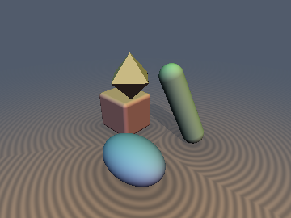
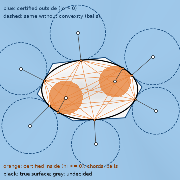
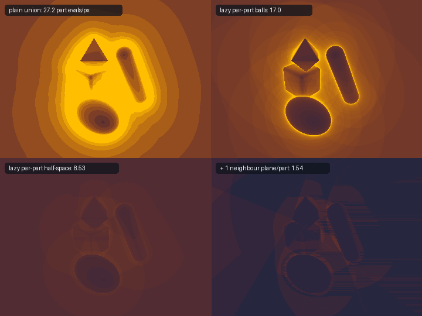

# `lcBounds` — Certified Two-Sided SDF Bounds From Cached Samples (`lcLower`, `lcUpperClosest`, `lcLowerConvex`, `lcRayStepConvex`, `lcRaySpanConvex`, `lcRaySkip`, ...)

| 3D scene marched with the certified convex step | Certified interval from 8 samples (slice) |
| :---: | :---: |
|  |  |

| Property | Value |
| :--- | :--- |
| **Attribution** | **Claude Fable 5.2** (`sdf-gems`, 2026). Research experiment; the individual inequalities are classical (see Novelty & Prior Art). |
| **Category** | `lipschitzcache` |
| **GLSL File** | [`glsl/lipschitzcache/lcBounds.glsl`](../../glsl/lipschitzcache/lcBounds.glsl) |
| **Exact Euclidean SDF?** | No. Every function returns a **conservative bound** (certificate), not a distance. |
| `lcLower`, `lcUpper` | Conservative bound for any 1-Lipschitz `d` (`lcUpper` needs a true distance, not a lower bound). |
| `lcClosestPoint`, `lcUpperClosest`, `lcInterval` | Conservative bound for **exact** SDFs with a correct unit gradient. Fails for bound SDFs and for inside samples near the medial axis. |
| `lcLowerConvex`, `lcUpperConvexHull`, `lcIntervalConvex` | Conservative bound for exact SDFs of **convex** bodies only. Fails on non-convex bodies (measured, below). |
| `lcRayStepConvex`, `lcRaySpanConvex` | Conservative (no overstep) for exact SDFs of convex bodies, samples with `d > 0`. Fails on non-convex bodies. |
| `lcRaySkip` | Conservative for samples of any 1-Lipschitz lower bound, any shape, **if the result is clamped to `tmax`** (FP32, below). |
| `lcExample*` | Demo scene (4 convex repo primitives) and three marchers used for the benchmark. |

---

## Idea

One evaluation of an exact SDF with gradient at $`\mathbf{x}_i`$ returns $`d_i`$ and the unit normal $`\mathbf{n}_i`$, hence also the
closest surface point $`\mathbf{c}_i = \mathbf{x}_i - d_i \mathbf{n}_i`$. A sphere tracer throws all of this away after each step. This file
keeps $`K`$ samples and turns them into certified bounds $`\mathrm{lo}(\mathbf{x}) \le d(\mathbf{x}) \le \mathrm{hi}(\mathbf{x})`$ that cost
no SDF evaluation, and asks how much marching work they save.



*Part evaluations per pixel (same colour scale, saturating at 40) for the 4-part convex scene, 360x270. Top: plain sphere tracing of the union (27.2),
lazy per-part Lipschitz balls (17.0). Bottom: lazy per-part half-space jump (8.53), and the same seeded with one cached plane per part from the left
neighbour pixel (1.54). The first three panels are the literal GLSL marchers; the fourth is a numpy prototype that uses the literal GLSL as SDF oracle.*

## Derivation

**1. Values only (McShane, Whitney).** For any 1-Lipschitz $`d`$:

```math
\max_i \left( d_i - \|\mathbf{x} - \mathbf{x}_i\| \right) \;\le\; d(\mathbf{x}) \;\le\; \min_i \left( d_i + \|\mathbf{x} - \mathbf{x}_i\| \right).
```

The left side is the union of the usual empty balls. The right side needs $`d_i`$ to be the true distance.

**2. Closest points.** If $`\mathbf{c}_i`$ lies on the surface, then $`|d(\mathbf{x})| \le \min_i \|\mathbf{x} - \mathbf{c}_i\|`$ for every
$`\mathbf{x}`$. This is never worse than the Whitney upper bound for outside queries, because
$`\|\mathbf{x} - \mathbf{c}_i\| \le \|\mathbf{x} - \mathbf{x}_i\| + d_i`$.

**3. Convex bodies.** The signed distance of a convex body is a convex function, so its gradient inequality holds everywhere:

```math
d(\mathbf{x}) \;\ge\; d_i + \mathbf{n}_i \cdot (\mathbf{x} - \mathbf{x}_i) \;=\; \mathbf{n}_i \cdot (\mathbf{x} - \mathbf{c}_i).
```

Each sample is a supporting half-space. In addition every chord $`\mathbf{c}_i \mathbf{c}_j`$ lies inside the body, so
$`d(\mathbf{x}) \le \mathrm{dist}(\mathbf{x}, \mathbf{c}_i \mathbf{c}_j)`$. This is an upper bound only: a chord is not on the surface, so
$`-\mathrm{dist}(\mathbf{x}, \mathbf{c}_i\mathbf{c}_j)`$ is **not** a lower bound (the inherited code assumed it was; see Findings).

**4. Rays.** Along $`\mathbf{x}(t) = \mathbf{o} + t\,\mathbf{r}`$ the function $`g(t) = d(\mathbf{x}(t))`$ is convex, and the half-space of the sample at
$`t_i`$ gives

```math
t_{\mathrm{hit}} \;\ge\; t_i + \frac{d_i}{-\mathbf{n}_i \cdot \mathbf{r}} \quad (\mathbf{n}_i \cdot \mathbf{r} < 0), \qquad \text{no hit at all if } \mathbf{n}_i \cdot \mathbf{r} \ge 0 .
```

This is the ray-plane intersection and also the Newton step of $`g`$; Newton from the positive side of a convex function cannot pass its first
root. The step is always $`\ge d_i`$. Because the planes do not depend on the ray, planes cached by *other* rays clip this ray too
(`lcRaySpanConvex`): the ray can only hit between the latest plane entry and the earliest plane exit, and an empty span is a miss with zero evaluations.

**5. Unions.** Convexity is lost under union, but $`d = \min_j d_j`$, so a per-part bound stays valid as
$`\min_j \mathrm{lo}_j`$. The demo marcher keeps one certified entry parameter per part and evaluates only the part with the smallest one
("lazy" evaluation); with `convex = false` the same loop uses plain Lipschitz balls and works for any parts.

## GLSL

```glsl
#include "glsl/lipschitzcache/lcBounds.glsl"   // LC_K (default 8) is the cache capacity

// certified marching of ONE convex body with exact SDF + gradient sdgBody(p) -> vec4(d, n):
float t = tmin;
for (int i = 0; i < 64 && t < tmax; i++) {
    vec4 dg = sdgBody(ro + t * rd);
    if (dg.x < eps) break;                       // hit
    t += lcRayStepConvex(dg.x, dg.yzw, rd);      // >= dg.x; LC_INF certifies a miss
}

// planes cached from other rays / pixels (c[i] = lcClosestPoint(x_i, dg_i), nrm[i] = dg_i.yzw, d_i > 0):
vec2 span = lcRaySpanConvex(ro, rd, c, nrm, n);  // span.x > span.y: certified miss, else start at max(tmin, span.x)

// point queries
vec2 lohi  = lcInterval(x, s, c, n);             // any exact SDF,  s[i] = vec4(x_i, d_i)
vec2 lohiC = lcIntervalConvex(x, s, c, nrm, n);  // convex bodies only
```

`lcExampleMarchConvex / Lazy / Plain(ro, rd, tmin, tmax, eps)` return `vec4(t, hit part or -1, part evaluations, 0)`.

## Verification

All rows were reproduced in this session on the GPU (FP32, literal GLSL through `tools/gpu_eval.py`) unless marked. "Violation" is the largest
amount by which a bound lies on the wrong side of the true distance. Ground truth: the repo scalar `sd*` functions (a code path independent of
the `sdg*` functions that produce the samples), themselves checked against FP64 formulas written from the definition for box, round box, capsule,
octahedron and torus (max difference $`3.5 \times 10^{-7}`$). For the ellipsoid, link and box frame the scalar repo SDF is the only reference.

**Point bounds**, 120,000 (8-sample set, query) pairs per primitive, samples and queries inside and outside:

| Bound | 5 convex primitives (box, round box, capsule, exact ellipsoid, octahedron) | 3 non-convex (torus, link, box frame) |
| :--- | :--- | :--- |
| `lcLower` / `lcUpper` | 0 / 0 | 0 / 0 |
| `lcUpperClosest` | $`\le 3.1 \times 10^{-7}`$ | $`\le 3.6 \times 10^{-7}`$ torus, link; $`3.6 \times 10^{-7}`$ box frame with inside and outside samples (was **0.027** before the `sdgBoxFrame` fix, see Findings) |
| `lcLowerConvex` | $`\le 5.7 \times 10^{-7}`$; capsule $`1.0 \times 10^{-5}`$ (inside samples near the axis) | **fails: 1.2, 1.3, 1.4** on 28.6%, 27.6%, 49.3% of pairs |
| `lcUpperConvexHull` | $`\le 3.8 \times 10^{-7}`$ | **fails: 0.36, 0.19, 0.44** on 4.4%, 3.5%, 9.4% of pairs |
| `lcInterval` (lo, hi) | $`\le 3.6 \times 10^{-7}`$ | $`\le 0`$ (torus, link) |
| `lcIntervalConvex` (lo, hi), after the fix | $`\le 7.2 \times 10^{-7}`$ | **fails: lo 1.2 (7 to 18%), hi 0.18 to 0.37** (torus, link) |
| `lcRaySpanConvex`, 8 random planes | 0 violations; certifies 26 to 46% of rays as misses (true misses 38 to 66%) | **fails: 0.06 to 0.20** on 17.7 to 29.4% of rays |
| `lcRaySkip` | 0 violations, mean skip 0.15 to 0.35 | 0 violations, mean skip 0.12 to 0.32 |

Non-exact inputs: for `max(sphere, sphere)` (a lower bound, not a distance) `lcLower` and `lcLowerConvex` still hold ($`3.0 \times 10^{-7}`$) while
`lcUpper` is violated by 0.10 and `lcUpperClosest` by 0.31 (8.8% of pairs). For the repo's non-exact `sdgEllipsoid`, `lcUpper` is violated by 1.2
and `lcUpperClosest` by 0.011.

Tightness with $`K = 8`$ outside samples on the 5 convex primitives, median interval width $`\mathrm{hi} - \max(\mathrm{lo}, 0)`$. Queries within 0.4
of a sample: values only 0.28 to 0.32; plus closest points 0.16 to 0.18; convex 0.009 to 0.016. Queries uniform in $`[-1.5, 1.5]^3`$: 1.18 to 1.22;
0.94 to 0.99; 0.25 to 0.34. Share of outside queries certified outside ($`\mathrm{lo} > 0`$): convex 97.7 to 98.2% (near) and 89.5 to 95.8% (uniform);
values only 80 to 84% and 27 to 43%.

**Single rays**, one primitive, 360x270, `eps = 1e-3`, `tmax = 6` (numpy control flow, literal `sdg*` GLSL as oracle):

| Primitive | Plain steps/px | Over-relaxation 1.2 / 1.6 | Convex step | Smallest `d` seen along the convex march |
| :--- | ---: | ---: | ---: | ---: |
| `sdBox` | 7.67 | 7.25 / 9.06 | **3.00** | $`-3.0 \times 10^{-8}`$ |
| `sdRoundBox` | 7.43 | 7.09 / 8.73 | **2.93** | $`-3.7 \times 10^{-8}`$ |
| `sdCapsule` | 6.52 | 6.10 / 6.98 | **2.53** | $`-1.5 \times 10^{-8}`$ |
| `sdEllipsoidExact` | 6.73 | 6.38 / 7.29 | **2.57** | $`-6.5 \times 10^{-8}`$ |
| `sdOctahedron` | 6.56 | 6.09 / 6.78 | **2.23** | $`-5.2 \times 10^{-8}`$ |
| `sdTorus` (not convex) | 7.48 | 7.12 / 8.61 | 2.68, **2316 wrong pixels** | $`-0.19`$ |
| `sdLink` (not convex) | 6.54 | 6.11 / 6.84 | 3.08, **1729 wrong pixels** | $`-0.12`$ |
| `sdBoxFrame` (not convex) | 8.15 | 7.67 / 9.58 | 3.04, **3127 wrong pixels** | $`-0.057`$ |

On the convex bodies 7 to 22 of 97,200 pixels differ from plain sphere tracing. They are silhouette pixels where plain tracing reports a hit
because a grazing ray enters the `eps` shell; against a reference traced with `eps = 1e-5` the convex step has fewer wrong pixels than plain
tracing on all five (12 to 37 versus 33 to 58). The over-relaxation columns are a simplified re-implementation of enhanced sphere tracing, not a
tuned one.

**Scene** (union of round box, exact ellipsoid, capsule, octahedron; 360x270; reference = plain tracing with `eps = 1e-5`; false misses were 0 for every row):

| Method | Part evaluations / pixel | Notes |
| :--- | ---: | :--- |
| `lcExampleMarchPlain` (literal GLSL) | 27.18 | 4 parts per step |
| `lcExampleMarchLazy` (literal GLSL) | 17.05 | per-part Lipschitz balls; valid for any parts |
| `lcExampleMarchConvex` (literal GLSL) | **8.53** | per-part half-space jump; smallest `d` seen $`-5.6 \times 10^{-8}`$ |
| + cached planes from neighbour pixels, 1 / 2 / 4 neighbours | 1.54 / 0.49 / 0.26 | prototype; 45% / 74% / 81% of pixels need zero evaluations; hit pixels 1.54 / 1.09 / 1.05 |
| + 4 neighbours, 2 planes per part each | 0.17 | prototype; no gain from 4 planes each (0.17) |
| Neighbour **balls** (`lcRaySkip`), keep first 8 / 64 per pixel | 7.05 / 6.58 (of 27.2 to 30.7) | prototype; works on the non-convex scene too: 5.60 / 5.04 versus 24.75 |

The two GLSL marchers agree with their numpy prototypes on the evaluation count of every pixel. The "prototype" rows run the control flow in
numpy (FP64) with the literal GLSL parts as oracle, traverse pixels in a wavefront order so that neighbours are already traced, and do not count
the cost of testing the cached planes or balls. They are an upper limit on the saving, not a shader benchmark.

Single-translation-unit compile: `forward / reverse / new-first: OK (297 files)`.

## Findings

**Held**

- McShane and Whitney bounds: 0 violations on every exact primitive, convex or not.
- Closest-point upper bound: $`\le 3.6 \times 10^{-7}`$ with samples taken outside, on all 8 exact primitives.
- Supporting half-space bound, chord bound, ray span and the convex ray step: no violation above $`7.2 \times 10^{-7}`$ on the 5 convex primitives with
  outside samples, and 2.6 to 2.9 times fewer steps than plain sphere tracing per primitive (3.2 times fewer part evaluations in the scene).
- Per-part bounds for a union of convex parts: valid (0 false misses), which is what makes the convex bound usable in a scene.
- Planes cached from neighbouring pixels remove most remaining evaluations in the prototype (down to 0.17 to 1.54 per pixel).
- The half-space lower bound survived one non-exact input, `max(sphere, sphere)`. Not tested more widely.

**Failed, or true only with a restriction**

- The convex bounds are wrong on non-convex bodies, as expected: point bound off by up to 1.4 on 28 to 49% of pairs; the ray step produces 1.8 to
  3.2% wrong pixels and walks up to 0.19 inside the surface. Nothing in the code detects non-convexity.
- **Inside samples are unsafe near the medial axis.** The certificates need $`\mathbf{c}_i`$ on the surface, and
  $`\mathbf{c}_i = \mathbf{x}_i - d_i\mathbf{n}_i`$ inherits the error of the normal times $`|d_i|`$. For `sdgCapsule` samples within $`10^{-6}`$ of the
  axis give $`\mathbf{c}_i`$ up to 0.249 off the surface and a half-space bound wrong by up to 1.1; at axis distance $`10^{-5}`$ to $`10^{-4}`$ the
  error is $`3.8 \times 10^{-5}`$; beyond $`10^{-2}`$ it is $`2 \times 10^{-6}`$. This is the source of the $`1.0 \times 10^{-5}`$ capsule entry.
  Outside a convex body there is no medial axis, so outside samples are unaffected.
- **`sdgBoxFrame` interior gradients (since fixed)**: at the time of this experiment 2.4% of interior samples gave a "closest point" 0.046 to 0.059
  away from the surface, which broke `lcUpperClosest` (0.027); with outside samples the violation was $`3.0 \times 10^{-7}`$. The cause was in the
  primitive, not the bound: inside the 8 corner cubes the old interior formula of `sdBoxFrame` / `sdgBoxFrame` treated inner strut planes as surface.
  Both functions were corrected afterwards (see [`sdgBoxFrame`](../gradients3d/sdgBoxFrame.md)); the implied closest point now lies on the surface
  (self-projection $`1.5 \times 10^{-7}`$). Re-measured after the fix on the same 120k pairs: the `lcUpperClosest` violation on the box frame fell from 0.027 to $`3.6 \times 10^{-7}`$.
- Closest-point and Whitney bounds fail for non-exact (bound) SDFs: up to 0.31 and 1.2.
- **Bug found and fixed in the inherited code**: `lcIntervalConvex` used $`-\mathrm{lcUpperConvexHull}`$ as a lower bound. Measured before the fix:
  violated by 0.22 to 0.34 on 0.5 to 1.3% of pairs on all 5 convex primitives. The earlier test compared this function only with its own prototype.
- **FP32 limit of far balls**: with `lcRaySkip` seeding, unclamped skips chained from pixel to pixel ($`14 \to 25 \to 48 \to \dots \to 10^9`$) and
  cached balls of radius $`\sim 10^9`$, whose FP32 distance carries an absolute error of about 64 units. Every hit pixel was then skipped (11,214
  false misses). Clamping the skip to `tmax` restores 0 false misses. A ball is only as empty as the absolute rounding error of its radius.
- Along the ray that produced them, the cached balls never beat the last one (gain exactly 0 on all 8 primitives): history only pays across rays or
  with the gradient.

**Open**

- Is `lcInterval` the tightest interval obtainable from $`(\mathbf{x}_i, d_i, \mathbf{n}_i)`$? An earlier comment claimed so; it was not tested and was removed.
- Real GPU cost. Neighbour seeding as tested needs an ordering between pixels; a shader would need a low-resolution prepass or the previous frame,
  and the plane tests are not free. No timing was measured.
- A cheap, certified test for "this part is convex" or a weaker curvature-based version of the half-space step for non-convex parts.
- Whether the half-space bound holds for other 1-Lipschitz lower bounds of convex bodies beyond the single case tested.

## Novelty & Prior Art

Prior art below is **from memory, not checked** against the sources; one web search in this session returned only generic descriptions and no
specific reference.

- The value bounds are the McShane (1934) and Whitney (1934) Lipschitz extensions. The empty ball is the basis of sphere tracing (Hart, 1996).
- The gradient inequality of a convex function is textbook convex analysis. Advancing a ray to a supporting plane of a convex body is, as far as I
  recall, how conservative advancement and GJK-based ray casting of convex shapes work (van den Bergen, around 2004), there with support mappings
  rather than an SDF gradient. Newton iteration for ray/implicit-surface intersection is classical.
- Over-relaxed sphere tracing (Keinert et al., 2014) and segment tracing with local Lipschitz bounds (Galin et al., 2020) accelerate marching without
  convexity. Low-resolution depth prepasses ("cone marching") are the common way to seed rays from neighbours.

What may be new is small: packaging these certificates for SDF samples with gradients as GLSL, the per-part lazy marcher with a half-space jump, the
measurements of how much each certificate saves, and the two failure modes (inside samples near the medial axis; FP32 error of far balls). I do not
claim any of the inequalities.

## Not done

- No GPU timing; no fragment-shader implementation of neighbour seeding (prototype only).
- No independent FP64 ground truth for the ellipsoid, link and box frame.
- No temporal (previous-frame) cache, no moving bodies, no shadow or secondary rays in the benchmark.
- `LC_K` is a compile-time constant; arrays of other sizes were not tested.

## Reproduce

Scripts live outside the repository in the experiment's scratch directory `scratch/lipschitzcache/`; run from the repo root with `uv run python <script>`:
`q1_validity.py` (point bounds, rays, tightness), `q1f_interval.py` (combined intervals), `q1d_capsule.py` and `q1b_anomalies.py` (inside-sample
anomalies), `q2_single_ray.py` (single rays), `q3_scene.py` (scene and seeding, about 6 minutes), `figs.py` (the three images, `uv run --with matplotlib`).
