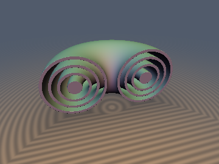
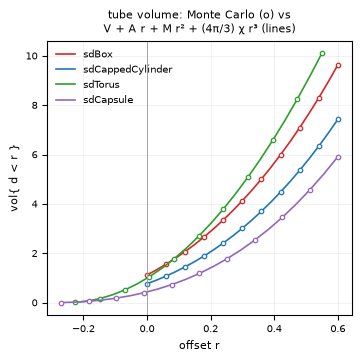
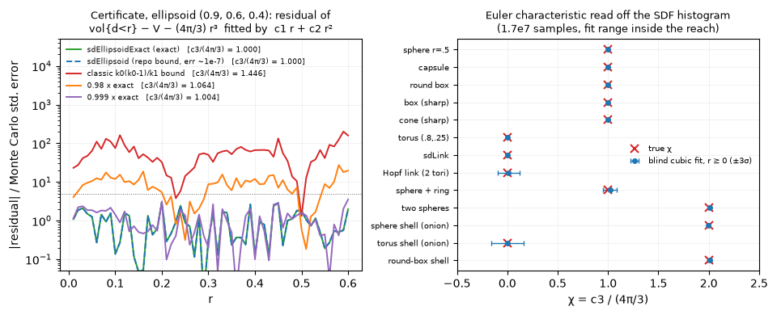

# `msSteinerTube` — Intrinsic Volumes of SDF Primitives, Steiner / Weyl Tube Polynomials & Closed-Form Glow Integrals

Functions: `msSphere`, `msBox`, `msRoundBox`, `msCapsule`, `msCylinder`, `msRoundedCylinder`, `msCappedCone`, `msCone`, `msTorus`, `msTubeCurve`, `msLink`, `msPrism`, `msHexPrism`, `msSpheroid`, `msOffset`, `msOnion`, `msUnionDisjoint`, `msTubeVolume`, `msTubeArea`, `msGlowExp`, `msGlowGauss`, `msGlowInvSq`, `msGlowPow`, `msGlowTent`, `msMeanWidth`, `msMeanProjectedArea`, `msMeanChord`.

| Tube family (offset shells of `sdTorus`, cut open) | Measured vs closed-form tube volume |
| :---: | :---: |
|  |  |

| Property | Value |
| :--- | :--- |
| **Author** | **Claude Fable 5.2** (`sdf-gems`, 2026). The mathematics is classical (Steiner 1840, Weyl 1939, Federer 1959, Cauchy, Crofton); see Novelty & Prior Art. |
| **Category** | `measure` (research experiment: integral geometry of exact SDFs) |
| **GLSL File** | [`glsl/measure/msSteinerTube.glsl`](../../glsl/measure/msSteinerTube.glsl) |
| **Exactness** | These are not distance functions. The primitive measures $`(V, A, M, \chi)`$ are closed forms, **verified** against Monte Carlo histograms of the literal repo SDFs to the Monte Carlo accuracy (standard error 4e-5 to 9e-5 of the volume; largest observed deviation 4e-4 for $`r \ge 0`$). The tube polynomial is an **identity only inside the reach** of the body; outside it is an **approximation of either sign, not a bound**. |

---

## Overview

For a solid $`K`$ with **exact** signed distance $`d`$, the volume of the offset body is a cubic polynomial in the offset:

```math
\mathrm{vol}\{d < r\} = V + A\,r + M\,r^2 + \tfrac{4\pi}{3}\,\chi\,r^3,
\qquad
\mathrm{area}\{d = r\} = A + 2M\,r + 4\pi\chi\,r^2 .
```

$`V`$ is the volume, $`A`$ the surface area, $`M = \int H\,dA`$ the integrated mean curvature ($`H = (k_1+k_2)/2`$; a sharp convex edge of length $`L`$ and exterior dihedral angle $`\theta`$ contributes $`\theta L/2`$), and $`\chi`$ the Euler characteristic of the solid. This is the Steiner formula for convex $`K`$ (all $`r \ge 0`$) and the Weyl tube formula for smooth $`K`$ ($`\vert r\vert`$ below the reach).

Every constructor returns `vec4(V, A, M, chi)` with the same parameters as the matching `sd*` primitive. By the co-area formula ($`\vert\nabla d\vert = 1`$), any radial kernel then integrates in closed form:

```math
\int_{\{d>0\}} g(d(\mathbf{x}))\,d\mathbf{x} = \int_0^\infty g(r)\,\bigl(A + 2Mr + 4\pi\chi r^2\bigr)\,dr .
```

## Closed forms

| Function | $`V`$ | $`A`$ | $`M`$ | $`\chi`$ |
| :--- | :--- | :--- | :--- | :---: |
| `msSphere(s)` | $`\tfrac43\pi s^3`$ | $`4\pi s^2`$ | $`4\pi s`$ | 1 |
| `msBox(b)` (half extents) | $`8 b_x b_y b_z`$ | $`8(b_xb_y+b_yb_z+b_zb_x)`$ | $`2\pi(b_x+b_y+b_z)`$ | 1 |
| `msCapsule(len, r)` | $`\pi r^2(\ell + \tfrac43 r)`$ | $`2\pi r(\ell+2r)`$ | $`\pi(\ell+4r)`$ | 1 |
| `msCylinder(h, r)` (half height) | $`2\pi r^2 h`$ | $`2\pi r(2h+r)`$ | $`\pi(2h) + \pi^2 r`$ | 1 |
| `msCappedCone(h, r1, r2)` | $`\tfrac{2\pi h}{3}(r_1^2+r_1r_2+r_2^2)`$ | $`\pi(r_1^2+r_2^2+(r_1+r_2)s)`$ | $`\pi\bigl(2h + \tfrac{\pi}{2}(r_1+r_2) + \alpha(r_1-r_2)\bigr)`$ | 1 |
| `msTorus(t)` | $`2\pi^2 R a^2`$ | $`4\pi^2 R a`$ | $`2\pi^2 R`$ | 0 |
| `msTubeCurve(len, a)` (any closed curve) | $`\pi a^2 \ell`$ | $`2\pi a \ell`$ | $`\pi \ell`$ | 0 |
| `msPrism(f, per, hgt)` (any convex base) | $`f\,H`$ | $`2f + pH`$ | $`\pi(H + p/2)`$ | 1 |
| `msSpheroid(ab)` | $`\tfrac43\pi a^2c`$ | classical $`\arcsin`$ / $`\mathrm{artanh}`$ form | $`2\pi\bigl(c + a^2\,\mathrm{asinh}(k/a)/k\bigr)`$, $`k^2 = c^2-a^2`$ (prolate; $`\arcsin`$ for oblate) | 1 |

with $`s = \sqrt{4h^2+(r_1-r_2)^2}`$ and $`\alpha = \mathrm{atan}\bigl((r_1-r_2)/2h\bigr)`$. Derived helpers: `msRoundBox`, `msRoundedCylinder` (offsets), `msCone` (capped cone with $`r_2=0`$), `msLink` (tube around the stadium curve of length $`2\pi r_1 + 4\,l_e`$), `msHexPrism`.

Notes on the derivations:
- **Cone wall**: $`H = \cos\beta/(2\rho)`$ at radius $`\rho`$, so $`\int H\,dA = \pi\cdot\text{height}`$ regardless of the radii; the two rims have exterior angles $`\pi/2 \pm \alpha`$. The brief's checks hold: box $`M = \pi(L_1+L_2+L_3)`$ and cylinder $`M = \pi h_{\mathrm{full}} + \pi^2 R`$.
- **Prism**: the vertical edges have total exterior angle $`2\pi`$ whatever the polygon, giving $`\pi H`$; each rim gives $`(\pi/4)\,p`$.
- **Operators**: `msOffset(m, r)` is the Taylor shift of the polynomial, $`(V,A,M,\chi) \mapsto (P(r),\,P'(r),\,P''(r)/2,\,\chi)`$. `msOnion(m, t)` (shell $`\vert d\vert < t`$) is $`(V_+ - V_-,\ A_+ + A_-,\ M_+ - M_-,\ 2\chi)`$. `msUnionDisjoint` adds.
- **Glow kernels** (exterior integral $`I`$):

| Function | $`g(d)`$ | $`I`$ |
| :--- | :--- | :--- |
| `msGlowExp(m, σ)` | $`e^{-d/\sigma}`$ | $`A\sigma + 2M\sigma^2 + 8\pi\chi\sigma^3`$ |
| `msGlowGauss(m, σ)` | $`e^{-d^2/2\sigma^2}`$ | $`\sqrt{\pi/2}\,A\sigma + 2M\sigma^2 + \sqrt{\pi/2}\,4\pi\chi\sigma^3`$ |
| `msGlowInvSq(m, σ)` | $`(1+d^2/\sigma^2)^{-2}`$ | $`\tfrac{\pi}{4}A\sigma + M\sigma^2 + \pi^2\chi\sigma^3`$ |
| `msGlowPow(m, σ, n)`, $`n>3`$ | $`(1+d/\sigma)^{-n}`$ | $`\dfrac{A\sigma}{n-1} + \dfrac{2M\sigma^2}{(n-1)(n-2)} + \dfrac{8\pi\chi\sigma^3}{(n-1)(n-2)(n-3)}`$ |
| `msGlowTent(m, R)` | $`\max(1-d/R,\,0)`$ | $`\tfrac12 AR + \tfrac13 MR^2 + \tfrac{\pi}{3}\chi R^3`$ |

A plain Lorentzian $`1/(1+d^2)`$ diverges in 3D, hence the squared one.
- **Convex corollaries**: `msMeanWidth` $`= M/2\pi`$ (additive under Minkowski sums), `msMeanProjectedArea` $`= A/4`$ (Cauchy), `msMeanChord` $`= 4V/A`$.

## GLSL (excerpt)

```glsl
vec4 msOffset( vec4 m, float r )     // measures of { d < r }
{
    float k = 12.566370614359172 * m.w;
    return vec4(m.x + r * (m.y + r * (m.z + r * k / 3.0)), m.y + r * (2.0 * m.z + r * k), m.z + r * k, m.w);
}
vec4 msCylinder( float h, float r )  // sdCappedCylinder(p, h, r)
{
    const float PI = 3.141592653589793;
    return vec4(2.0 * PI * r * r * h, 2.0 * PI * r * (2.0 * h + r), PI * (2.0 * h + PI * r), 1.0);
}
float msGlowExp( vec4 m, float sigma )   // integral of exp(-d / sigma) over the exterior
{
    return sigma * (m.y + sigma * (2.0 * m.z + sigma * 25.132741228718345 * m.w));
}
```

## Verification

Method: the **literal** repo SDFs (`glsl/primitives3d/*.glsl`) and the literal `ms*` functions are evaluated on the GPU (FP32) through `tools/gpu_eval.py`. Volumes use a stratified (jittered-grid) Monte Carlo, 8 independent replicates of $`128^3`$ points ($`1.68\cdot 10^7`$ samples; $`160^3`$ where stated). Standard errors (SE) are the spread of the 8 replicates, so a z-score follows a Student $`t_7`$ law (heavier tails than a Gaussian: isolated $`\vert z\vert \approx 4`$ among hundreds of values is expected).

### 0. Closed forms
All 13 parameter sets of the table below: literal GLSL vs an independent FP64 reference (profile quadrature for volume/area; $`M = 2\pi\cdot`$ mean width from a brute-force support function for the cones and spheroids): max relative error $`2.7\cdot10^{-7}`$ (FP32 rounding), including spheroids at and next to the sphere limit (series branch). A first version of the spheroid series had a wrong coefficient ($`2.5\cdot10^{-4}`$ error near the sphere); this test caught it.

### 1. Tube volume vs closed form (21 offsets per shape)

| SDF | $`r`$ range | max rel. error where vol > 5% of V (all offsets) | max $`\vert z\vert`$ | rms $`z`$ | median SE / vol |
| :--- | :---: | :---: | :---: | :---: | :---: |
| `sdSphere` | −0.63 … 0.6 | 5.4e-4 (1.5e-3) | 3.1 | 1.28 | 7.4e-5 |
| `sdBox` | 0 … 0.6 | 1.1e-4 | 2.9 | 1.30 | 3.8e-5 |
| `sdRoundBox` | −0.135 … 0.6 | 1.9e-4 | 1.9 | 1.08 | 4.9e-5 |
| `sdCapsule` | −0.27 … 0.6 | 2.6e-3 (7.8e-3) | 3.7 | 1.38 | 7.8e-5 |
| `sdCappedCylinder` | 0 … 0.6 | 2.7e-4 | 3.5 | 1.52 | 5.5e-5 |
| `sdRoundedCylinder` | −0.09 … 0.6 | 2.6e-4 | 2.2 | 1.02 | 4.2e-5 |
| `sdTorus` | −0.225 … 0.55 | 1.3e-3 (8.1e-3) | 3.6 | 1.32 | 7.2e-5 |
| `sdCappedCone` | 0 … 0.6 | 1.7e-4 | 3.8 | 1.47 | 5.6e-5 |
| `sdCone` | 0 … 0.6 | 3.1e-4 | 2.3 | 1.02 | 6.3e-5 |
| `sdLink` | −0.108 … 0.28 | 5.5e-4 (2.4e-3) | 4.5 | 1.48 | 7.9e-5 |
| `sdHexPrism` | 0 … 0.6 | 1.5e-4 | 3.6 | 1.17 | 4.2e-5 |
| `sdSpheroid` (oblate / prolate) | −0.17 … 0.6 | 3.9e-4 / 2.6e-4 | 2.6 / 2.4 | 1.18 / 1.10 | 5.1e-5 / 8.8e-5 |

The rms z of 1.0–1.5 is what $`t_7`$ gives (1.18) plus a mild underestimate of the SE; no shape shows a systematic deviation. The relative error grows where the eroded volume is small (2.6e-3 for the capsule at 5% of its volume, 8e-3 at the innermost samples of capsule and torus) while the z-scores stay in range, so those are noise over a small denominator, not a measured accuracy of 1e-4 there. For $`r \ge 0`$ every shape is within 4e-4.

### 2. Euler characteristic from a blind cubic fit ("topology from an SDF histogram")
A 4-parameter cubic is fitted to the measured $`\mathrm{vol}\{d<r\}`$ **without** any closed form, and $`\chi = c_3/(4\pi/3)`$. Error bars are the spread of per-replicate fits.

| Body (exact SDF) | true $`\chi`$ | fit on $`[0, R]`$ | fit on $`[-R_{in}, R]`$ | $`R_{in}`$, $`R`$ |
| :--- | :---: | :---: | :---: | :---: |
| sphere | 1 | 1.001 ± 0.003 | 1.000 ± 0.0004 | 0.45, 0.475 |
| capsule | 1 | 1.000 ± 0.001 | 1.000 ± 0.0004 | 0.27, 0.475 |
| round box | 1 | 1.000 ± 0.002 | 0.999 ± 0.001 | 0.135, 0.475 |
| box, cone (sharp) | 1 | 0.999 ± 0.002, 1.000 ± 0.002 | n/a (inner reach 0) | 0, 0.475 |
| torus | 0 | 0.000 ± 0.002 | 0.000 ± 0.001 | 0.225, 0.475 |
| `sdLink` | 0 | 0.000 ± 0.004 | 0.000 ± 0.001 | 0.108, 0.266 |
| Hopf link (`min` of two `sdTorus`) | 0 | 0.013 ± 0.036 | −0.009 ± 0.012 | 0.09, 0.19 |
| sphere + ring (`min`) | 1 | 1.019 ± 0.023 | 0.999 ± 0.003 | 0.135, 0.237 |
| two spheres (`min`) | 2 | 2.007 ± 0.004 | 2.000 ± 0.0004 | 0.27, 0.261 |
| sphere shell (`abs(d) - t`) | 2 | 1.997 ± 0.002 | 2.000 ± 0.002 | 0.09, 0.475 |
| torus shell | 0 | 0.002 ± 0.054 | 0.004 ± 0.022 | 0.045, 0.19 |
| round-box shell | 2 | 2.007 ± 0.007 | 2.000 ± 0.008 | 0.045, 0.237 |

All 13 agree with the true value within 2 SE. **Robustness, honestly**: it works only if (a) the SDF is exact, (b) the fit range lies inside the reach, and (c) the range is a sizeable fraction of the body. For the sphere of radius 0.5: $`R=0.05`$ gives $`-10.4 \pm 4.1`$, $`R=0.1`$ gives $`1.12\pm0.49`$, $`R=0.2`$ gives $`1.07\pm0.04`$, $`R=0.4`$ gives $`0.995\pm0.004`$. Beyond the reach the answer is confidently wrong: the torus (reach 0.55) gives $`0.126\pm0.001`$ for $`R=0.7`$ and $`0.521\pm0.001`$ for $`R=0.9`$. Bodies with re-entrant edges have reach 0 and fail outright (`sdBoxFrame`, next section). Thin or tightly linked bodies leave too little range. A marching-cubes Euler count is cheaper and unconditional; this read-out is a curiosity and a consistency check, not a topology algorithm.

### 3. Reach: where the cubic stops being valid ($`160^3 \times 8`$ samples)

| Body | true outer reach | first persistent 5-SE departure | onset fit $`r_0`$ | error of the cubic at the end of the scan |
| :--- | :---: | :---: | :---: | :---: |
| `sdTorus(0.8, 0.25)` | 0.55 (hole closes) | 0.600 | 0.543 | MC − cubic = **+1.7%** at $`r=0.9`$ |
| `sdLink(0.3, 0.4, 0.12)` | 0.28 | 0.283 | 0.280 | −1.7% at $`r=0.6`$ |
| Hopf link | 0.20 (half gap) | 0.203 | 0.196 | **−26.6%** at $`r=0.5`$ |
| two spheres | 0.275 (half gap) | 0.286 | 0.269 | −5.3% at $`r=0.5`$ |

Inside the reach the residuals are noise (rms z 1.1–1.2). The departure point matches the reach to 0.003–0.011 except for the torus, where the defect starts softly (fitted exponent 2.7: the missing volume is the "lemon" of the spindle torus) and the threshold test lags by 0.05; a power-law onset fit recovers 0.543. The sign differs: overlapping tubes make the cubic too large, a closing hole makes it too small. **The polynomial is therefore not a one-sided bound outside the reach.**

Inward: for the torus the cubic holds down to $`r=-a`$ (max abs deviation 5.8e-5) and then predicts $`2\pi^2R(a+r)^2 > 0`$ where the true volume is 0 (measured −0.0395 vs predicted −0.0395 at $`r=-0.30`$).

**Sharp convex edges: the inward polynomial is wrong from $`r=0^-`$.** For `sdBox` the inner parallel body is the box $`\prod 2(b_i + r)`$ (MC agreement 3.9e-5); a blind fit gives $`c_2 = 12.801`$ ($`= 8\sum b_i = 12.8`$, not $`M = 10.053`$) and $`c_3 = 8.00`$ (not $`4\pi/3`$). The Steiner polynomial is off by +0.024 at $`r=-0.1`$ and +0.144 at $`r=-0.3`$ (V = 1.12). So `msOffset` with $`r<0`$ and `msOnion` are valid only for bodies whose surface is $`C^{1,1}`$ on the eroded side (sphere, capsule, torus, round box down to its rounding radius).

**Re-entrant edges: reach 0 outward.** `sdBoxFrame(0.6, 0.05)` is a genus-5 handlebody ($`\chi=-4`$). A blind cubic on $`[0, 0.3]`$ gives $`c_2 = 37.186 \pm 0.014`$ and $`c_3/(4\pi/3) = -5.52 \pm 0.01`$. The tube volume is still locally polynomial, but a concave right-angle edge contributes $`-L\,r^2`$ instead of the additive (Hadwiger) $`-\tfrac{\pi}{4}L\,r^2`$: the prediction $`\tfrac{\pi}{4}L_{convex} - L_{concave} = 37.184`$ matches, the additive $`M = 37.699`$ does not, and the cubic coefficient is geometric, not topological.

### 4. Exactness certificate without ground truth (convex bodies)
For a convex body, an exact SDF must give $`\mathrm{vol}\{d<r\} = V + A r + M r^2 + \tfrac{4\pi}{3}r^3`$ for all $`r\ge0`$. $`V`$ (the $`r=0`$ sample) and $`A`$ (Cauchy–Crofton hit counting, 3e5 random lines × 512 steps) need only the **sign** of $`d`$. Statistics: (i) z-score of the blind $`c_3`$ against $`4\pi/3`$; (ii) max residual/SE of the fit with $`c_0 = V`$, $`c_3 = 4\pi/3`$ fixed; (iii) fitted $`c_1`$ vs the sign-only area. Fit range $`[0, 0.6]`$; the last column is the true error against the exact SDF, used only to state the power.

| Candidate | $`c_3/(4\pi/3)`$ | z | max res/SE | $`c_1`$ vs sign-only $`A`$ (z) | true mean / max error |
| :--- | :---: | :---: | :---: | :---: | :---: |
| `sdEllipsoidExact` (0.9, 0.6, 0.4) | 1.0004 ± 0.0013 | +0.3 | 3.0 | +0.8 | 0 |
| `sdEllipsoid` (repo bound) | 1.0004 ± 0.0013 | +0.3 | 3.0 | +0.8 | 4e-8 / 3e-7 |
| classic bound $`k_0(k_0-1)/k_1`$ | 1.446 ± 0.002 | +303 | 201 | −17 | 1.7e-2 / 9.1e-2 |
| $`(\vert \mathbf{p}/\mathbf{r}\vert - 1)\min r`$ | −6.05 | −5367 | 2532 | +257 | 9.3e-2 / 0.33 |
| 0.98 × exact | 1.064 ± 0.001 | +64 | 27 | +6.4 | 7e-3 / 1.2e-2 |
| 0.999 × exact | 1.0037 ± 0.0009 | +4.3 | 3.5 | +1.0 | 3.6e-4 / 6e-4 |
| `sdLens` (exact) | 1.0000 ± 0.0009 | 0.0 | 3.2 | +1.5 | 0 |
| `opIntersection(sdSphere, sdSphere)` | 0.988 ± 0.001 | −11.3 | 16 | +1.6 | 5e-3 / 6.7e-2 |
| `sdCappedCylinder` (exact) | 1.0002 ± 0.0012 | +0.1 | 4.4 | +0.9 | 0 |
| `opIntersection(cylinder, slab)` | 1.5005 ± 0.0012 | +416 | 261 | −30 | 1.6e-2 / 0.18 |



- The certificate **separates every exact SDF from every coarse bound** tested, including `max()` intersections whose gradient is unit almost everywhere (an eikonal test passes those).
- **It cannot see the repo's `sdEllipsoid` bound**: its error (mean 4e-8, max 3e-7 in the tube) is four orders of magnitude below the resolution, and its statistics are identical to the exact function's. The requested "bound fails the certificate" claim is **false for this pair**; it holds for the classic bounds.
- **Detection power** at $`1.7\cdot10^7`$ samples: the classic ellipsoid bound on near-spheres is detected ($`z(c_3) = +7.6`$) at a true mean error of 2.8e-4 (max 1.4e-3; body size 0.6) and missed at 4.7e-5 ($`z=-0.6`$); a uniform scale $`k\,d`$ gives $`z=+4.3`$ at $`k=0.999`$ and $`+12.8`$ at $`k=0.997`$, nothing at $`0.9997`$. So the threshold is a mean distance error of roughly $`3\cdot10^{-4}`$ to $`5\cdot10^{-4}`$ of the body size. Exact controls show max res/SE up to 5.1 and $`\vert z(c_3)\vert`$ up to 2.7, so I would only call a failure above about 6–8; these thresholds were chosen after seeing the data.
- The sign-only area is the weak link (0.2% SE; a 64-step version was biased by −0.6% on the cylinder because lines grazing the rim are missed, fixed by 512 steps). It only detects bounds whose surface gradient is not 1.
- A pointwise comparison with an exact SDF, when one exists, is far more sensitive ($`10^{-6}`$). The certificate is useful only when no ground truth is available, and only for convex bodies (or inside a known reach).
- By-product: Cauchy's formula checked with sign-only data: cylinder mean shadow $`1.1642 \pm 0.0022`$ vs `msMeanProjectedArea` $`= 1.1663`$.

### 5. Glow integrals vs Monte Carlo over all of $`\mathbb{R}^3`$
Radially compactified stratified sampling ($`\rho = u/(1-u)`$, so the heavy-tailed kernels need no truncation), kernels $`\sigma = 0.2`$ (exp), $`0.3`$ (Gauss, InvSq), $`0.5,\ n=5`$ (Pow), $`R = 0.5`$ (Tent).

| Body | relative error, 5 kernels | $`\vert z\vert`$ |
| :--- | :---: | :---: |
| box, cylinder, cone, spheroid, capsule (convex), $`8\times160^3`$ | $`\le 1.6\cdot10^{-4}`$ | $`\le 3.7`$ |
| same, follow-up with 40 replicates ($`8.4\cdot10^7`$ samples) | $`\le 5.9\cdot10^{-5}`$ | $`\le 1.6`$ |
| torus, Tent $`R=0.5 <`$ reach | −6e-5 (other seeds: +1.9e-4, +1e-5) | 1.2 (2.9, 0.1) |
| torus, exp / Gauss / InvSq / Pow | **+0.7% / +0.3% / +2.2% / +2.3%** | 88–412 |
| `sdLink`, all five (Tent $`R=0.5 >`$ reach 0.28) | **+0.7% / −0.7% / +3.6% / +4.2% / −1.2%** | 156–856 |

The 8-replicate run had box and capsule consistently 2–3.7 SE low (all five kernels share samples, so they move together); the 40-replicate follow-up with a new seed shows no offset, so I read it as a fluctuation. For the torus with the exponential kernel the error vanishes with $`\sigma/\text{reach}`$: within noise for $`\sigma \le 0.10`$ (ratio 0.18), +0.7% at 0.36, +6.7% at 0.73.

### 6. Stretch: Minkowski dimension from the tube exponent
No exact Menger-sponge SDF exists in the repo (the usual `max`-of-crosses fold is a bound), so I used product Cantor sets, whose exact distance is separable: a per-axis fold followed by the literal `sdBox` (checked against a brute-force nearest-of-512-boxes reference: max error 2.3e-7). Level 9, $`\mathrm{vol}\{d<r\} \sim r^{3-D}`$, log-log fit:

| Set | true $`D`$ | fit $`r\in[3^{-5},3^{-1}]`$ | $`[3^{-7},3^{-3}]`$ | $`[3^{-8},3^{-5}]`$ |
| :--- | :---: | :---: | :---: | :---: |
| Cantor dust $`C^3`$ | 1.8928 | 1.8942 | 1.8912 ± 0.0016 | 1.892 ± 0.008 |
| Cantor bars $`C^2\times I`$ | 2.2619 | 2.2177 | 2.2566 ± 0.0011 | 2.260 ± 0.003 |
| Cantor plates $`C\times I^2`$ | 2.6309 | 2.5349 | 2.6190 ± 0.0003 | 2.6291 ± 0.0006 |

It converges to the true dimension, but slowly: at $`r \sim 3^{-1}`$ the lower-order (edge/end) terms bias $`D`$ by up to 0.1, the local slope oscillates log-periodically (1.72–2.02 for the dust; these sets are not Minkowski measurable), and the statistical error bars understate the range dependence. Fit windows must span whole periods of 3. The Menger sponge was not attempted.

## Findings

**Held**
- All closed forms $`(V,A,M,\chi)`$ for 13 primitive configurations, including the brief's two checks, within Monte Carlo error (SE 4e-5 to 9e-5, largest deviation 4e-4 for $`r\ge0`$) and to $`3\cdot10^{-7}`$ against the FP64 reference.
- The tube polynomial inside the reach, for convex and smooth non-convex bodies, outward and (smooth bodies) inward.
- $`\chi`$ read-out for 13 bodies (1, 0, 2) to ±0.002–0.05; disjoint-union additivity; the shell rule $`\chi \to 2\chi`$.
- The reach is where the cubic fails (to 0.003–0.011, softer for the torus).
- Glow integrals for convex bodies, and the tent kernel for a non-convex body when $`R <`$ reach.
- The certificate separates exact SDFs from coarse bounds (classic ellipsoid, `max` intersections, Lipschitz scaling ≥ 0.1–0.3%).
- Minkowski dimension of product Cantor sets at small $`r`$.

**Failed / only partly true**
- "Valid for $`r > -`$inradius-ish": false for any body with a sharp convex edge (box, cylinder, cone, prisms). Inner reach is 0 and the inward volume follows a different polynomial.
- The certificate does **not** detect the repo's `sdEllipsoid` bound (error ~1e-7). Power threshold is ~3e-4 of the body size.
- Outside the reach the polynomial is not a bound; errors of +1.7% and −27% were measured. Infinite-support glow kernels on non-convex bodies are off by 0.3–4% at $`\sigma \approx`$ reach/2.
- $`\chi`$ read-out fails for re-entrant edges (`sdBoxFrame`: −5.52 vs −4), for fit ranges below ~40% of the body size, and silently beyond the reach.
- Dimension estimates at $`r \gtrsim 3^{-3}`$ are biased by up to 0.1.

**Open questions**
- Closed form of the box-frame cubic coefficient. Outer corners give $`+1`$ and I estimate $`-1/(2\pi)`$ per window corner (not verified separately), which would leave about $`-0.34`$ per inner vertex.
- A general inward formula for polytopes and edged bodies (the box case is trivial; cylinder and cone are not polynomial-compatible with $`M`$).
- Triaxial ellipsoid $`A`$ and $`M`$ need elliptic integrals (not included); `msTubeCurve` assumes the tube radius is below the curve's reach, which was not tested on the repo's knots.
- An exact Menger sponge SDF, to do the requested $`\log 20/\log 3`$ test.
- Whether the certificate can be sharpened with quasi-Monte Carlo or by histogramming $`\vert\nabla d\vert`$ jointly.

## Novelty & Prior Art

Textbook: the Steiner formula (Steiner, 1840), Weyl's tube formula (1939), reach and curvature measures (Federer, 1959), Hadwiger's theorem, Cauchy's projection formula, Crofton's formula, and the closed forms of $`V`$, $`A`$, mean width of the standard solids. Estimating Minkowski functionals / intrinsic volumes by fitting a polynomial to parallel-body volumes from a distance transform is established in image analysis and stochastic geometry (e.g. the Klenk–Schmidt–Spodarev line of work on polyconvex sets; Mecke's morphological measures), and curvature measures from offsets of point clouds were studied by Chazal, Cohen-Steiner and Mérigot ("Boundary measures for geometric inference"). Tube volumes for fractal dimension are the Minkowski–Bouligand "sausage" method, and the log-periodic behaviour of Cantor sets is covered by the fractal tube formulas of Lapidus and co-authors. Distance histograms as shape descriptors go back to shape distributions (Osada et al.). These references are cited from the search summaries and from memory; I did not open the papers.

What I believe is new **for an SDF shader library** (my searches found no shader/SDF library offering it, which is absence of evidence only): the packaging of $`(V,A,M,\chi)`$ per primitive with the `sd*` parameter conventions and an offset/shell/union algebra; the closed-form glow integrals as GLSL one-liners; the measured statement of where they fail; and the use of the cubic as a ground-truth-free exactness check with a quantified detection threshold. None of this is new mathematics.

## Reproduce

Scripts (run from the repo root with `uv run python <script>`), in the experiment scratch directory `scratch/measure/`:
`test1_tube.py` (tests 0–1), `test23_chi_reach.py` (2–3), `test4_certificate.py` (4), `test56_glow_dim.py` (5–6), `test5b_bias.py` (glow follow-up), `make_images.py` (figures).
