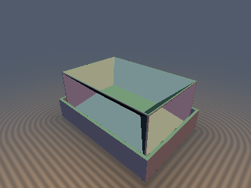
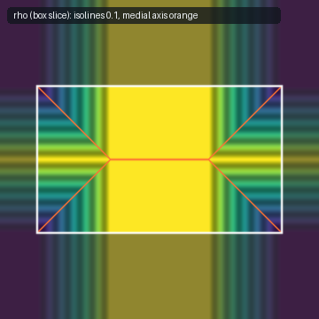
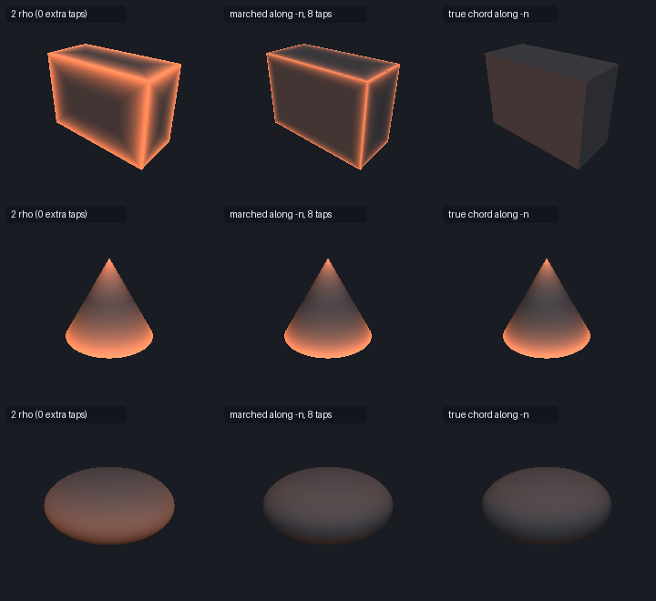

# `mdSphere`, `mdBox`, `mdRoundBox`, `mdCapsule`, `mdCylinder`, `mdTorus`, `mdTorusExterior`, `mdSpheroid`, `mdCone`, `mdEllipsoidFoot` — Closed-Form Medial Radius Paired with the SDF

| 3D: box shell (lid removed) with its medial axis $`\{\rho + d = 0\}`$ | Slice: $`\rho`$ of a box cross-section |
| :---: | :---: |
|  |  |

| Property | Value |
| :--- | :--- |
| **Author / Discoverer** | **Claude Fable 5.2** (`sdf-gems`, 2026). Research experiment: see [Findings](#findings) for what did and did not hold. |
| **Category** | `medial` |
| **GLSL File** | [`glsl/medial/mdMedialRadius.glsl`](../../glsl/medial/mdMedialRadius.glsl) |
| **Exactness of `d`** | Exact (matches the repo's `sd*` primitives to `<= 3.6e-7` on the GPU). |
| **Exactness of `rho`** | Closed form; matches an independent FP64 normal-march ground truth to `<= 2.1e-7` (sphere, box, round box, capsule, cylinder, torus, cone) and to `<= 8e-7` / `1.8e-5` worst case (prolate / oblate spheroid, triaxial ellipsoid; the worst cases sit at the focal rim where the *ground truth* is ill-conditioned, see below). |
| **`mdSkeleton`** | **Not** a lower distance bound. It is an upper bound of the distance to the medial axis; a measured per-primitive factor turns it into a lower bound. |

---

## Overview & Motivation

An exact SDF $`d`$ tells you how far the surface is. It does not tell you how far the *other side* is. The classical object that does is the
medial axis transform: the set $`M`$ of centres of maximal inscribed balls, together with their radii.

This file pairs each primitive's SDF with a second closed-form field, the **medial radius** $`\rho`$:

> For a point $`\mathbf p`$ with foot point $`\mathbf x`$ (its nearest surface point) and unit normal $`\mathbf n = \nabla d`$, $`\rho(\mathbf p)`$ is the
> distance from $`\mathbf x`$ along $`-\mathbf n`$ to the first point of the (closed) medial axis. Equivalently it is the radius of the largest ball
> inside the body that touches the surface at $`\mathbf x`$.

```math
\rho(\mathbf p) = \sup\{\, s \ge 0 : d(\mathbf x - s\,\mathbf n) = -s \,\}.
```

Every `md*` function returns `vec2(d, rho)`. By construction:

- $`\rho`$ is constant along each normal line (inside and outside), so it is a function of the foot point only;
- $`\rho \ge -d`$ inside, with equality exactly on the medial axis, so $`\rho + d`$ is the distance from $`\mathbf p`$ to its medial point *along its normal line*, and the medial point is $`\mathbf m = \mathbf p - (\rho + d)\,\nabla d`$;
- $`\rho = 0`$ when the foot point is a sharp convex edge or vertex;
- $`\min_{\partial K} \rho`$ is the inner reach of the body.

## Mathematical Derivation

Each formula follows from the same recipe: move the foot point inward by $`s`$ and find the first $`s`$ at which a second surface point is equally close.

**Box**, half-extents $`\mathbf b`$. Let $`g_k = b_k - |p_k|`$ be the distances to the three pairs of face planes and $`i = \arg\min_k g_k`$ the nearest face. Moving inward from that face, the distance to it is $`s`$, the distances $`g_j, g_k`$ to the other two do not change, and the opposite face is at $`2 b_i - s`$. Hence

```math
\rho = \max\bigl(\min(g_j,\; g_k,\; b_i),\; 0\bigr), \qquad i = \arg\min_k g_k,\ \{j,k\} = \{1,2,3\}\setminus\{i\}.
```

The clamp makes the same expression valid outside: if the foot is on an edge or vertex, two of the $`g`$ are negative and $`\rho = 0`$. No `sqrt` or division is needed for $`\rho`$.

**Round box.** An outward offset by $`r`$ does not move the medial axis of a convex body, so $`(d, \rho) \mapsto (d - r,\ \rho + r)`$ applied to the core box.

**Capped cylinder** (half-height $`h`$, radius $`r`$). With $`u = r - \|\mathbf p_{xz}\|`$, $`v = h - |p_y|`$: $`\rho = \min(v, r)`$ if the side is nearer ($`u \le v`$), else $`\rho = \min(u, h)`$, clamped at $`0`$. The medial axis is two $`45^\circ`$ cones from the rims joined by an axis segment ($`h > r`$) or a disk ($`h < r`$).

**Sphere, capsule, ring torus.** $`\rho`$ is the constant radius (centre, segment, core circle).

**Ring torus, exterior** ($`R > r`$). The exterior medial axis is the $`y`$ axis. With $`w = \|\mathbf p_{xz}\|`$ and $`\ell = \|(w - R,\, p_y)\|`$, the outward normal line meets the axis only if $`w < R`$:

```math
\rho_{\mathrm{ext}} = \frac{R\,\ell}{R - w} - r \quad (w < R), \qquad \rho_{\mathrm{ext}} = \infty \quad (w \ge R), \qquad \min \rho_{\mathrm{ext}} = R - r .
```

**Cone** (apex at the origin, half-angle $`\alpha`$, height $`h`$). With slant coordinate $`\ell = w \sin\alpha - p_y \cos\alpha`$ of the foot on the mantle:

```math
\rho_{\mathrm{mantle}} = \min\Bigl(\ell \tan\alpha,\ \frac{h - \ell\cos\alpha}{1 + \sin\alpha}\Bigr), \qquad
\rho_{\mathrm{base}} = \frac{h \sin\alpha - w \cos\alpha}{1 + \sin\alpha},
```

both clamped at $`0`$. The first term is the hit with the axis, the others the hit with the base/mantle bisector cone.

**Spheroid and ellipsoid.** For semi-axes $`a_1, a_2, a_3`$ with shortest $`c`$, the inward normal line from a surface point $`\mathbf x`$ is $`\mathbf x - \lambda\,(x_1/a_1^2,\, x_2/a_2^2,\, x_3/a_3^2)`$. It reaches the symmetry plane orthogonal to the shortest axis at $`\lambda = c^2`$, where it meets the mirror-image normal line. Therefore

```math
\rho(\mathbf x) = c^2 \left\| \Bigl( \tfrac{x_1}{a_1^2},\ \tfrac{x_2}{a_2^2},\ \tfrac{x_3}{a_3^2} \Bigr) \right\| ,
\qquad \min \rho = \frac{c^2}{a_{\max}} .
```

For a spheroid with semi-axes $`m \le M`$ and foot point $`(m\cos t,\ M \sin t)`$ in the meridian plane this is $`\rho = \tfrac{m}{M}\sqrt{m^2 \sin^2 t + M^2 \cos^2 t}`$, the same expression for the oblate case (focal disk) and the prolate case (focal segment). `mdSpheroid` gets the foot point from the same closed-form quartic solve as `sdSpheroid`. For the triaxial ellipsoid the foot point has no closed form, so the file provides `mdEllipsoidFoot(x, r)` (takes the foot) and `mdEllipsoidFromSdg(dg, p, r)` (takes a distance + gradient such as `sdgEllipsoidExact`). That the plane $`\lambda = c^2`$ is the *first* medial hit was checked numerically, not proven here.

## GLSL

```glsl
// rho of a box: 0 SFU
vec2 mdBox( vec3 p, vec3 b )
{
    vec3  q = abs(p) - b;
    float m = max(q.x, max(q.y, q.z));
    float d = (max(min(q.x, q.y), min(max(q.x, q.y), q.z)) <= 0.0) ? m : length(max(q, 0.0));
    vec3  o = (q.x >= m) ? vec3(b.x, -q.y, -q.z)
            : (q.y >= m) ? vec3(-q.x, b.y, -q.z)
            :              vec3(-q.x, -q.y, b.z);
    return vec2(d, max(min(o.x, min(o.y, o.z)), 0.0));
}

vec2  mdOffset( vec2 m, float t )        { return vec2(m.x - t, max(m.y + t, 0.0)); }
bool  mdOffsetIsExact( vec2 m, float e ) { return m.x <= -e || m.y >= e; }   // is d + e the exact SDF of {d <= -e} here?
float mdThickness( vec2 m )              { return 2.0 * m.y; }               // inscribed-ball diameter
float mdSkeleton( vec2 m )               { return m.x + m.y; }               // along-normal distance to the medial axis
```

See the [source](../../glsl/medial/mdMedialRadius.glsl) for the other primitives.

## Verification

All `rho` values below come from the literal GLSL on the GPU (FP32). Ground truths are FP64 and are built from shape definitions that do not use the `md*` formulas (the ellipsoid/spheroid distance is a bisection on the secular equation, independent of the repo's quartic).

**Ground truth 1 (normal march).** $`g(s) = d(\mathbf p - s\mathbf n) - d(\mathbf p) + s`$ is non-negative and non-decreasing; bisect for the last $`s`$ with $`g(s) \le 10^{-9}`$. Point sets: uniform in the bounding cube (inside and outside), near-surface, near sharp edges ($`\rho < 0.03`$), and interior points pushed to within $`10^{-2}..10^{-4}`$ of their own medial point. "Dropped" points are those whose finite-difference normal was not unit to $`10^{-6}`$.

| Shape | N (dropped) | max \|d − `sd*`\| GPU | max \|ρ − GT1\| | p99 | ρ along normal line (max change) | \|ρ + d\| at medial point | min ρ on surface / reach |
| :--- | ---: | ---: | ---: | ---: | ---: | ---: | ---: |
| sphere | 26000 (0) | 0 | 2.4e-8 | 2.4e-8 | 0 | 6.0e-8 | 0.90000 / 0.9 |
| box | 27662 (0) | 0 | 2.8e-8 | 2.8e-8 | 0 | 3.0e-8 | 0.00000 / 0 |
| round box | 25937 (0) | 0 | 5.8e-8 | 4.3e-8 | 0 | 1.2e-7 | 0.15000 / 0.15 |
| capsule | 25998 (2) | 0 | 1.2e-8 | 6.7e-9 | 0 | 1.5e-7 | 0.35000 / 0.35 |
| cylinder (h 0.4, r 0.8) | 27470 (0) | 2.4e-7 | 7.0e-8 | 4.3e-8 | 0 | 9.7e-8 | 0.00000 / 0 |
| cylinder (h 0.9, r 0.5) | 27083 (1) | 2.4e-7 | 4.1e-8 | 2.5e-8 | 0 | 6.0e-8 | 0.00000 / 0 |
| torus (0.8, 0.3) | 25997 (0) | 2.4e-7 | 1.5e-8 | 1.2e-8 | 0 | 1.2e-7 | 0.30000 / 0.3 |
| spheroid oblate (1, 0.5) | 25708 (260) | 0 | **1.8e-5** | 4.4e-7 | 6.3e-7 | 6.3e-7 | 0.25000 / 0.25 |
| spheroid prolate (0.5, 1) | 25438 (561) | 0 | 7.8e-7 | 7.0e-8 | 4.5e-7 | 3.3e-7 | 0.25006 / 0.25 |
| cone (30°, h 1.2) | 27677 (1) | 1.2e-7 | 2.0e-7 | 1.4e-7 | 1.2e-7 | 2.4e-7 | 0.00000 / 0 |
| ellipsoid (1, 0.7, 0.45) via `sdgEllipsoidExact` | 25719 (255) | 2.4e-7 | **1.8e-5** | 6.1e-7 | 3.3e-7 | 1.5e-7 | 0.20252 / 0.2025 |
| torus exterior (0.8, 0.3) | 4252 finite | n/a | 3.7e-6 (relative) | 1.0e-6 | n/a | n/a | 0.500000 / 0.5 |

The `1.8e-5` outliers are a limit of ground truth 1, not of the formula. Near the rim of the focal disk the two normal lines that meet are almost parallel, $`g`$ leaves zero with almost zero slope, and the bisection result moves with the tolerance (`6e-5`, `6e-6`, `2.6e-5` max for tolerances `1e-8`, `1e-10`, `1e-12`). Against the analytic expression evaluated in FP64 at the FP64 foot point, the GPU value differs by at most `3.0e-6` (oblate) and `2.0e-7` (prolate). The exterior torus test has only 4252 points with a finite ground truth; all points with an infinite ground truth returned more than 30.

**Ground truth 2 (medial-ball formula on a surface cloud).** For smooth surface points $`\mathbf x`$: $`\min_{\mathbf y} \|\mathbf x - \mathbf y\|^2 / (2\,\mathbf n\cdot(\mathbf x - \mathbf y))`$ over about 200,000 surface samples. A finite cloud can only over-estimate, so the meaningful test is one-sided.

| Shape | N | max (ρ − GT2) | max (GT2 − ρ) | median \|ρ − GT2\| |
| :--- | ---: | ---: | ---: | ---: |
| sphere / capsule / torus | 2000 / 1405 / 2000 | 4.3e-7 / 3.8e-8 / 1.2e-8 | 4.3e-7 / 3.8e-8 / 1.2e-8 | 1.5e-8 / 6.0e-9 / 1.2e-8 |
| box / round box | 2000 / 2000 | 8.7e-10 / 7.9e-9 | 4.8e-3 / 3.9e-4 | 3.7e-5 / 4.6e-6 |
| cylinder flat / tall | 2000 / 2000 | 1.5e-8 / 8.5e-9 | 6.1e-3 / 4.1e-3 | 2.4e-5 / 6.1e-6 |
| spheroid oblate / prolate | 2000 / 1758 | 1.7e-8 / 8.8e-8 | 1.1e-3 / 1.6e-7 | 7.3e-6 / 1.7e-8 |
| cone | 1638 | 6.1e-8 | 5.2e-3 | 8.6e-6 |
| ellipsoid | 1966 | −2.1e-8 | 1.1e-3 | 5.5e-6 |

$`\rho`$ never exceeds the cloud bound by more than `4.3e-7`; the cloud exceeds $`\rho`$ by up to `6e-3`, which is its resolution. This second ground truth therefore confirms $`\rho`$ only to about `1e-3` at worst and `1e-5` typically.

**Other checks.** 0 non-finite values and 0 violations of $`\rho \ge 0`$, $`\rho \ge -d`$ on probe points plus 20,000 random points for 22 parameter sets, including `r = 0` and `r = min(b)` round boxes, a cube, `h = r` cylinder, `a = b` spheroid, 20:1 spheroids, 5° and 80° cones, and a torus with `R - r = 0.001`. Special cases: spheroid `a = b` vs sphere `|Δρ| <= 1.8e-7`; round box `r = 0` vs box `0`; ellipsoid `(1, 0.5, 1)` via `sdg` vs spheroid `|Δρ| <= 1.9e-6`; `mdOffset(mdBox(b), -0.2)` vs `mdBox(b - 0.2)` where $`\rho \ge 0.2`$: `|Δρ| <= 3.0e-8`. Single-translation-unit compile passes in forward, reverse and new-first order (289 files).

## Applications, measured



*Back-lit translucency $`e^{-k T}`$ with $`T`$ = $`2\rho`$ (left), 8-tap interior march along $`-\mathbf n`$ (middle), brute-force chord along $`-\mathbf n`$ (right). Rows: box, cone, oblate spheroid.*

### (a) Thickness

$`2\rho`$ is the inscribed-ball diameter, **not** the chord length $`L`$ along $`-\mathbf n`$. It is a lower bound: the antipode of the tangent ball is inside the body, so $`2\rho \le L`$. Measured on 4000 smooth surface points per shape:

| Shape | min (L − 2ρ) | mean 2ρ/L | min 2ρ/L | 8-tap march, mean \|err\| vs L | 32-tap | rank corr. of 5-tap inverted AO with L | with ρ |
| :--- | ---: | ---: | ---: | ---: | ---: | ---: | ---: |
| sphere, torus | ≥ −2.4e-8 | 1.000 | 1.000 | 1e-15 | 1e-15 | n/a | n/a |
| box | 2.4e-8 | 0.385 | 0.000 | 0.51 | 0.089 | −0.18 | 0.997 |
| round box | 3e-15 | 0.394 | 0.123 | 0.34 | 2.2e-4 | −0.28 | 0.73 |
| capsule | 1.2e-8 | 0.941 | 0.360 | 0.024 | 2.9e-4 | 0.83 | n/a (ρ constant) |
| cylinder (flat) | −1.2e-8 | 0.408 | 0.001 | 0.45 | 0.061 | −0.08 | 0.989 |
| spheroid oblate | 4.9e-5 | 0.666 | 0.250 | 0.13 | 7.3e-4 | −0.28 | 0.63 |
| spheroid prolate | −1.7e-8 | 0.884 | 0.251 | 0.023 | 4.6e-4 | 0.44 | 0.996 |
| cone (30°) | 1.1e-4 | 0.667 | 0.667 | 0.038 | 1.5e-3 | 1.00 | 1.00 |
| ellipsoid | 7.7e-6 | 0.682 | 0.204 | 0.063 | 6.7e-4 | 0.06 | 0.61 |

- The bound $`2\rho \le L`$ held on every point (violations within FP32 rounding, `2.4e-8`).
- On sharp-edged bodies the two notions differ a lot (mean ratio `0.39` on the box). The chord is constant on a box face right up to the edge; $`2\rho`$ falls to zero there.
- The 1-tap probe $`-d(\mathbf x - h\mathbf n)`$ equals $`h`$ exactly when $`\rho \ge h`$: agreement `100.00%` on all shapes ($`h = 0.15`$, points within `1e-4` of $`\rho = h`$ excluded). So the probe is a one-scale test of $`\rho`$.
- The usual inverted-AO estimator (5 taps, spacing 0.1) ranks points like $`\rho`$ far more than like the chord on the box and cylinder (`0.997` vs `−0.18`), and is mixed on the smooth bodies (`0.61..0.63` on the oblate spheroid and ellipsoid). The 30° cone has an equilateral profile where $`2\rho / L = 2/3`$ everywhere, so that row cannot separate the two.
- An 8-tap interior march under-estimates the chord badly near edges (mean error `0.51` on the box) because the interior distance is small there and the march stalls.

Which is more meaningful for translucency is a judgement, not something measured here. $`2\rho`$ agrees with the Hildebrand–Rüegsegger local thickness at smooth surface points (a ball inside the body that contains a boundary point must be tangent there; this is an argument, it was not tested numerically), it is continuous on these primitives, and it makes edges and corners glow, which the normal chord does not. The chord is what a single straight ray through the object would see. Neither is a light-transport quantity.

### (b) Morphological opening: the claim in the brief is false as stated

The opening by a ball of radius $`t`$ is the erosion $`\{d \le -t\}`$ dilated by $`t`$. Its SDF is $`\mathrm{sd}_{E_t} - t`$, which needs the exact SDF of the eroded body, and that is not a function of $`(d, \rho)`$ at a point. In particular **the opened body is not $`\{\rho \ge t\}`$**: on the box with $`t = 0.2`$, `17.9%` of the sampled points of the true opening (3941 of 22077) have $`\rho < t`$.

What does hold:

- $`\{\rho \ge t\} \cap K`$ is contained in the opening (0 counter-examples in 18136 points).
- A surface point survives the opening exactly when $`\rho \ge t`$: `100.00%` agreement on 19715 box surface points (points within `3e-3` of $`\rho = t`$ excluded, because the survival test tolerance `1e-6` corresponds to that band).
- $`d`$ itself is the exact SDF of the opened body exactly where `mdOffsetIsExact(m, t)`: box, max error `2.7e-8` on flagged points, and $`\mathrm{sd}_{\mathrm{open}} \ge d`$ elsewhere. Same on the cylinder (`1.7e-7`).
- Regression: the opening of the box is `sdRoundBox(p, b, t)` (`2.0e-7` from `sd_box(b - t) - t`) and of the cylinder is `sdRoundedCylinder(p, r/2, t, h - t)` (`2.9e-7`).

### (c) Exact validity range of inward offsets and onion shells

For $`t \ge 0`$, $`d + t`$ is the exact signed distance to the inner parallel body $`\{d \le -t\}`$ at $`\mathbf p`$ **if and only if** $`d(\mathbf p) \le -t`$ or $`\rho(\mathbf p) \ge t`$; elsewhere it is a strict under-estimate (still a conservative bound). This is `mdOffsetIsExact`.

| Body → eroded body (ground truth) | t | N | flagged | flagged: max \|d + t − true\| | unflagged: min (true − (d + t)) |
| :--- | ---: | ---: | ---: | ---: | ---: |
| box → box(b − t) | 0.20 | 200,000 | 29.8% | 5.6e-17 | 4.8e-9 (> 0) |
| cylinder → cylinder(h − t, r − t) | 0.20 | 200,000 | 29.7% | 5.6e-17 | 8.4e-9 (> 0) |
| cone → similar cone | 0.12 | 200,000 | 46.4% | 6.7e-16 | 1.3e-8 (> 0) |
| oblate spheroid → brute-force cloud of $`\{d = -t\}`$ | 0.35 | 58,907 | 60.3% | 2.6e-3 (cloud resolution) | 1.4e-3 for $`\rho < t - 0.02`$ |

The under-estimate grows quadratically away from the boundary $`\rho = t`$, so a few hundred unflagged points lie within `2e-6` of exact; none are below it. The spheroid row uses $`t`$ above the inner reach `0.25`, where the eroded body has no closed form, and is only as good as its 36,811-point cloud.

Onion shell $`|d + t| - w`$ (the set $`\{-t-w \le d \le -t+w\}`$): exact iff ($`d > -t + w \Rightarrow \rho \ge t - w`$) and ($`-t-w < d < -t \Rightarrow \rho \ge t + w`$). Box, $`t = 0.25`$, $`w = 0.06`$, 200,000 points: predicted-exact `30.9%` with max error `5.6e-17`; predicted-inexact points have error from `8.8e-9` up to `0.139`; the sign is correct on `100%` of points.

### (d) Medial-axis rendering

$`f = \rho + d`$ vanishes exactly on the medial axis, but it is the distance to the medial point *along the normal line*, so it is an **upper** bound of the Euclidean distance to $`M`$, and its gradient exceeds 1. Measured against a medial-axis point cloud built from ground truth 1 (interior points with $`f > 0.05`$):

| Shape | min dist/f | median | max dist/f | empirical Lipschitz of f |
| :--- | ---: | ---: | ---: | ---: |
| sphere, capsule, torus | 1.000 | 1.000 | 1.000 | 1.000 |
| box, round box, cylinder | 0.707 | 0.708..0.714 | 1.000..1.007 | 1.414 |
| cone (30°) | 0.866 | 0.866 | 0.899 | 1.155 |
| spheroid prolate (0.5, 1) | 0.639 | 0.980 | 1.000 | 1.244 |
| spheroid oblate (1, 0.5) | 0.575 | 0.928 | 1.006 | 1.803 |

So $`f`$ is the exact distance for sphere, capsule and torus; $`f/\sqrt2`$ is a measured lower bound for the box family and the cylinder (used for the preview image); for spheroids the factor depends on the aspect ratio and no general constant is offered. Values above 1 are the cloud's resolution.

### Regularity of $`\rho`$ (what it means for shading)

$`\rho`$ is continuous on all primitives here (200,000 random pairs at separation `~1e-3`, inside and outside: no jump; empirical Lipschitz constants `0` for sphere/capsule/torus, `1.000` for box, round box and cylinders, `0.577` for the 30° cone, `0.99 / 1.91 / 2.75` inside the prolate spheroid, oblate spheroid and ellipsoid). Whether it stays bounded at the focal rim of an ellipsoid was not established.

Its gradient is discontinuous:

- across the medial axis itself;
- on the box, across the planes $`g_j = g_k`$ and $`g_j = b_i`$. These reach the surface: on each face $`\rho`$ is the distance to the face's outline capped at $`b_i`$, a hip-roof function with creases along the face's angle bisectors (measured: $`\nabla\rho`$ flips from $`(-1, 0)`$ to $`(0, -1)`$ across one). The slice image shows the same creases;
- on the cylinder across $`v = r`$ / $`u = h`$ and on the cone where the two terms of the `min` cross.

Anything shaded directly from $`\rho`$ will show these creases as visible lines on flat faces. It is $`C^0`$, so there is no banding, but do not differentiate it for normals.

## Findings

**Held**

- Closed forms for $`\rho`$ exist and verify for sphere, box, round box, capsule, capped cylinder, ring torus (interior and exterior), cone, and both spheroids; a foot-point form verifies for the triaxial ellipsoid. Errors against the normal-march ground truth are `<= 2.1e-7` for the piecewise-flat and constant cases on 25,000+ points each.
- $`\rho \ge -d`$, equality at the medial point, constancy along normal lines, and $`\min \rho`$ = inner reach all check out numerically.
- $`2\rho \le`$ chord, on every tested point.
- The pointwise exactness criterion for inward offsets and onion shells (`mdOffsetIsExact`), including the "only if" direction.
- Surface points survive an opening by $`t`$ exactly when $`\rho \ge t`$.

**Failed or only partly true**

- "$`(d, \rho)`$ gives the opened body in closed form": false. $`\{\rho \ge t\}`$ misses 17.9% of the box's opening. $`(d, \rho)`$ only certifies where $`d`$ is already the opened SDF.
- "$`\rho + d`$ as an SDF-like bound for the skeleton": it bounds from the wrong side. It needs a per-primitive factor (`1`, `0.707`, `0.866`, or aspect-dependent for spheroids) to be safe for sphere tracing.
- "$`2\rho`$ is the thickness": it is the inscribed-ball diameter, on average `0.39` of the normal chord on a box.
- Spheroid/ellipsoid accuracy claims are weaker than the rest: the normal-march ground truth is ill-conditioned at the focal rim (`1.8e-5` worst case, tolerance-dependent), and the cloud ground truth is only good to about `1e-3`. The formula agrees with its own FP64 evaluation to `3e-6`, which tests the GLSL, not the geometry.
- The triaxial ellipsoid has no self-contained `md` function, only the foot-point helper.

**Open questions / not done**

- Box frame (exterior medial radius of a non-convex polyhedral shape), round cone, spindle torus ($`R \le r`$; `mdTorus` assumes a ring torus), and any CSG combination. $`\rho`$ does not compose under `min`/`max` in an obvious way.
- A proof that the symmetry plane is the first medial hit for every ellipsoid normal, and whether $`\nabla\rho`$ is bounded there.
- A tight lower-bound factor for `mdSkeleton` on spheroids as a function of aspect ratio.
- The thickness comparison used one tap spacing and one march schedule; the correlations would change with other settings.
- The equivalence with Hildebrand–Rüegsegger thickness on the surface is argued, not measured.

## Novelty & Prior Art

Everything conceptual here is classical: the medial axis transform (Blum), reach (Federer), local feature size as distance to the medial axis (Amenta & Bern), local thickness as the largest inscribed ball containing a point (Hildebrand & Rüegsegger), the ray-based shape diameter function (Shapira, Shamir & Cohen-Or), and the scale axis transform (Giesen, Miklos, Pauly & Wormser). The medial axes of a box, cylinder, cone and ellipsoid are textbook geometry, and it is common knowledge among SDF users that `d + t` stops being exact "past the medial axis". Marched and inverted-AO thickness estimators are widely used in SDF shaders.

Several web searches (medial radius with SDF primitives, closed-form medial axis of box / ellipsoid, SDF thickness and subsurface approximations, exactness of inward offsets, medial-axis shaders) did not turn up a shader library that returns a per-primitive closed-form medial radius next to the SDF, nor the pointwise test `d <= -t || rho >= t` stated as an exactness criterion for inward offsets and onion shells. The searches were not exhaustive and their results were summaries, so this is "not found", not "does not exist". What this file adds, at most, is the packaging: `vec2(d, rho)` primitives with measured errors, the box formula $`\min(g_j, g_k, b_i)`$ in branch-light form, the ellipsoid foot-point form $`c^2\|\mathbf x / \mathbf a^2\|`$, and the measured relations between $`\rho`$ and the usual thickness estimators.
