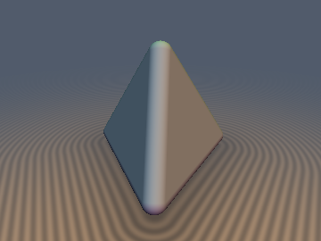
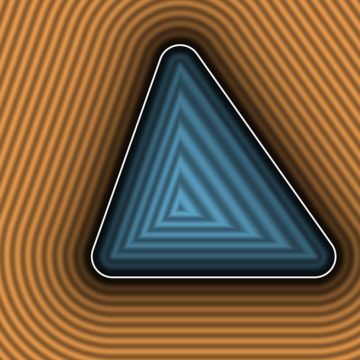
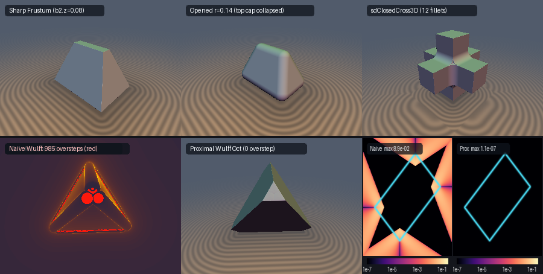

# `mpMoreauOpening` — Moreau-Yosida Proximal Morphological Opening/Closing & Anisotropic Wulff Crystal Envelopes

| 3D Surface ($`d = 0`$): Black-box opened tetrahedron (`sdOpenedTetrahedron`) | 2D Meridian Slice ($`K_{-r}`$ core & parallel exterior shells) |
| :---: | :---: |
|  |  |

| Property | Value |
| :--- | :--- |
| **Category** | `morphprox` (research experiment) |
| **GLSL File** | [`glsl/morphprox/mpMoreauOpening.glsl`](../../glsl/morphprox/mpMoreauOpening.glsl) |
| **Attribution** | Dual-Gram active-set supporting-plane QP, 4-jet Carathéodory/Farkas total-erosion certificate, cutting-plane black-box opening schedule, and alternating-proximal Wulff crystal envelope formulated and GPU-verified by **Gemini 4 Carbon** (`sdf-gems`, 2026). Underlying mathematical morphology (Matheron, Serra), Moreau-Yosida proximal envelopes (Moreau 1965), Carathéodory/Helly convexity theorems, and Wulff's crystal construction (Wulff 1901) are classical; see *Novelty & Prior Art*. |
| **Exactness (`mpOpeningFromJets3/4`)** | **Exact** closed-form Euclidean QP solution for any 3 or 4 half-spaces (`<= 2.6e-11` vs FP64 SLSQP; `0` SFU ops inside core, `1` `inversesqrt` outside). |
| **Exactness (`sdOpenedTetrahedron`, `sdOpenedPolyhedron`)** | **Certified 1-Lipschitz lower bound** (`0` raymarching oversteps) at every iterate; converges to **FP32 machine precision** (`max <= 8.5e-7`, `mean <= 7.4e-8` across 30,209 points on GPU) in 3 active-set cutting-plane reprojections, including **past topological face/edge collapse**. |
| **Exactness (`sdClosedCross3D`)** | De Morgan 3-arm Gram closing: `0` outer-arm bloat, exact along all 12 planar crevices and 8 trihedral saddle vertices (`p99 = 3.8e-5`, `mean = 7.7e-5`); slight (`2.3e-3`) curvature overestimate on `0.5%` of curved cylinder-complement transitions. |
| **Exactness (`mpWulffCrystalOffset`)** | **Certified lower bound** (`0` overstep pixels vs `985`–`1,429` overstep pixels for naive `d - r * h_W(grad d)`); matches exact Minkowski sum `convex_hull_sdf` to `max <= 6.7e-7` on exterior (`1.1e-7` slice error). |

---

## Overview & Motivation

In mathematical morphology, **Morphological Opening** by a Euclidean ball $`B_r`$ rounds all sharp *convex* edges and vertices of a solid $`K \subset \mathbb{R}^3`$ **inward** without altering its flat face dimensions, while **Morphological Closing** fills all *concave* crevices and fillets without bloating its outer faces:

```math
\mathcal{O}_r(K) = (K \ominus B_r) \oplus B_r, \qquad \mathcal{C}_r(K) = (K \oplus B_r) \ominus B_r = \bigl(\mathcal{O}_r(K^c)\bigr)^c.
```

In fragment-shader SDF modeling (see [`mdMedialRadius.md`](../medial/mdMedialRadius.md)), black-box morphological opening has long been considered intractable:

1. **Algebraic No-Op of Offset Round-Trips**: Outward dilation of a convex SDF $`d_K`$ is exact everywhere ($`d_{K \oplus B_r} = d_K - r`$), because the exterior reach of a convex set is $`+\infty`$. Inward erosion $`K_{-r} = K \ominus B_r = \{d_K \le -r\}`$, however, crosses the interior medial axis at every sharp convex edge and vertex (where the medial radius is $`\rho = 0`$). Consequently, $`d_K(\mathbf{p}) + r`$ has flat mitered facets outside $`K_{-r}`$ rather than spherical caps, and the naive round-trip `(sd(p) + r) - r == sd(p)` produces **zero rounding**.
2. **Pointwise Medial Insufficiency**: Knowing both distance and medial radius $`(d, \rho)`$ at a single query point $`\mathbf{p}`$ still cannot recover $`d_{\mathcal{O}_r(K)}(\mathbf{p})`$: in the exterior Voronoi cone of a sharp vertex $`\mathbf{v}`$, `sdg_K(p)` depends only on $`\mathbf{p} - \mathbf{v}`$ and carries zero information about the dihedral or trihedral angles of the faces meeting at $`\mathbf{v}`$ (which govern how far inward the eroded vertex of $`K_{-r}`$ retreats).
3. **Topological Face & Edge Collapse**: When $`r`$ exceeds the half-width of a narrow facet or short edge (e.g., an unequal rectangular frustum whose top cap has $`b_{2z} < r < b_{2x}`$), the eroded core $`K_{-r}`$ undergoes a **topological change**: the top face vanishes completely and two previously non-adjacent slanted faces meet along a new hip-roof ridge. Any fixed adjacency filleting breaks down across collapse.



*Top row: Sharp unequal frustum ($`b_{2z} = 0.08`$, left), black-box `sdOpenedPolyhedron` at $`r = 0.14 > b_{2z}`$ smoothly crossing topological top-cap collapse into a rounded 5-face hip-roof wedge (`5.3e-7` max GPU error, middle), and De Morgan `sdClosedCross3D` rounding all 12 crevices + 8 trihedral saddles with zero outer-arm bloat (right). Bottom row: Naive single-jet Wulff offset $`d_K - r\,h_W(\nabla d_K)`$ showing `985` raymarch overstep pixels in red (left), certified proximal `mpWulffCrystalOffset` producing flat jewel-cut $`\{111\}`$/$`\{110\}`$ octahedral facets with `0` oversteps (middle), and slice $`\log_{10}\vert d - d_{\text{GT}}\vert`$ heatmaps (`8.9e-2` naive vs `1.1e-7` proximal, right).*

---

## Mathematical Derivation

### 1. Supporting Half-Space Lemma & Exact Core Identity

Let $`K \subset \mathbb{R}^3`$ be a compact convex body with exact signed distance $`d_K(\mathbf{x}) = \max_{\Vert\mathbf{u}\Vert_2 = 1}(\mathbf{u}\cdot\mathbf{x} - h_K(\mathbf{u}))`$, and suppose $`K_{-r} = \{d_K \le -r\} \neq \emptyset`$.

- **Exact Interior Core ($`d_K(\mathbf{p}) \le -r`$)**: For any set $`K \subset \mathbb{R}^3`$ (convex or non-convex) with $`K_{-r} \neq \emptyset`$ and any $`\mathbf{p} \in K_{-r}`$, $`B_\tau(\mathbf{p}) \subseteq K_{-r} \iff B_{\tau + r}(\mathbf{p}) \subseteq K \iff \tau \le -d_K(\mathbf{p}) - r`$. Hence $`d_{K_{-r}}(\mathbf{p}) = d_K(\mathbf{p}) + r`$ and (for convex $`K`$, since $`(K_{-r} \oplus B_r) \ominus B_r = K_{-r}`$) $`d_{\mathcal{O}_r(K)}(\mathbf{p}) = d_K(\mathbf{p})`$ **identically** inside $`K_{-r}`$, requiring only 1 `sdg` evaluation and `0` extra SFU operations.
- **Outer Supporting Half-Spaces ($`d_K(\mathbf{p}) > -r`$)**: Because $`d_K`$ is convex on all of $`\mathbb{R}^3`$, every 1-jet evaluation $`(d_i, \mathbf{n}_i) = \mathrm{sdg}_K(\mathbf{q}_i)`$ at any probe point $`\mathbf{q}_i \in \mathbb{R}^3`$ satisfies the global subgradient inequality $`d_K(\mathbf{x}) \ge d_i + \mathbf{n}_i \cdot (\mathbf{x} - \mathbf{q}_i)`$. For every $`\mathbf{x} \in K_{-r}`$ ($`d_K(\mathbf{x}) \le -r`$), writing $`\mathbf{z} = \mathbf{x} - \mathbf{p}`$ and $`l_i(\mathbf{p}) = d_i + \mathbf{n}_i \cdot (\mathbf{p} - \mathbf{q}_i)`$ yields an **exact outer supporting half-space** to $`K_{-r}`$:

```math
K_{-r} - \mathbf{p} \;\subseteq\; P_m(\mathbf{p}) := \bigcap_{i=1}^m \bigl\{\mathbf{z} \in \mathbb{R}^3 : \mathbf{n}_i \cdot \mathbf{z} + u_i \le 0\bigr\}, \qquad u_i := l_i(\mathbf{p}) + r.
```

Consequently, minimizing $`\Vert\mathbf{z}\Vert_2`$ over the larger polyhedron $`P_m(\mathbf{p}) \supseteq K_{-r} - \mathbf{p}`$ yields a **universal lower bound** for **every** finite collection of probes $`\{\mathbf{q}_i\}`$:

```math
d_{\text{QP}}(\mathbf{p}) := \mathrm{dist}_{\text{signed}}\!\bigl(\mathbf{0},\, P_m(\mathbf{p})\bigr) - r \;\le\; d_{K_{-r}}(\mathbf{p}) - r \;=\; d_{\mathcal{O}_r(K)}(\mathbf{p}).
```

### 2. Dual-Gram Active-Set QP & Helly-Carathéodory Minimax Reduction

For $`\max_i u_i > 0`$ ($`\mathbf{0} \notin P_m(\mathbf{p})`$), projecting $`\mathbf{0}`$ onto $`P_m(\mathbf{p})`$ is the strictly convex Quadratic Program $`\min_{\mathbf{z}} \frac{1}{2}\Vert\mathbf{z}\Vert_2^2`$ subject to $`N\mathbf{z} + \mathbf{u} \le \mathbf{0}`$. Forming the Lagrangian gives $`\mathbf{z}^* = -N^\top \boldsymbol{\lambda}`$ and the **Dual QP**:

```math
\frac{1}{2}\Vert\mathbf{z}^*\Vert_2^2 \;=\; \max_{\boldsymbol{\lambda} \ge \mathbf{0}} \left(\boldsymbol{\lambda}^\top \mathbf{u} - \frac{1}{2}\boldsymbol{\lambda}^\top G \boldsymbol{\lambda}\right), \qquad G = N N^\top, \quad G_{ij} = \mathbf{n}_i \cdot \mathbf{n}_j.
```

By **Carathéodory's Cone Theorem** in $`\mathbb{R}^3`$, whenever $`P_m(\mathbf{p}) \neq \emptyset`$, the optimal normal vector $`-\mathbf{z}^* = \sum_{i \in I(\mathbf{z}^*)} \lambda_i \mathbf{n}_i`$ lies in the positive cone of **at most 3 linearly independent normals** $`S^* \subseteq \{1, \dots, m\}`$ ($`\vert S^*\vert \le 3`$). On any linearly independent subset $`S`$ whose unconstrained Gram solution $`\boldsymbol{\lambda}_S = G_S^{-1}\mathbf{u}_S`$ is dual-feasible ($`\boldsymbol{\lambda}_S > \mathbf{0}`$), the dual objective equals $`2 D(\boldsymbol{\lambda}_S) = \mathbf{u}_S^\top G_S^{-1}\mathbf{u}_S = \Vert\sum_{i \in S} \lambda_i \mathbf{n}_i\Vert_2^2`$. Thus:

1. Across all 1-plane faces ($`\vert S\vert = 1`$), 2-plane edges ($`\vert S\vert = 2`$, using the orthogonalized $`2 \pm 2c`$ denominator to prevent $`c \to \pm 1`$ cancellation), and the 3-plane trihedral vertex ($`\vert S\vert = 3`$, solved via the explicit $`3\times 3`$ Gram adjugate), `mpOpeningFromJets3` compares polynomial/rational $`\rho_S^2`$ values with **zero intermediate `sqrt` calls** and executes **a single `inversesqrt` at the end**: $`d_{\text{QP}} = \Vert\mathbf{v}_{\max}\Vert_2 - r`$, $`\nabla d_{\text{QP}} = \mathbf{v}_{\max} / \Vert\mathbf{v}_{\max}\Vert_2`$.
2. For $`m = 4`$ jets (`mpOpeningFromJets4`), whenever $`P_4(\mathbf{p}) \neq \emptyset`$, taking the maximum over the $`\binom{4}{3} = 4`$ triples recovers the exact 4-half-space QP optimum **and** identifies the $`\le 3`$ active constraints to retain in a fixed 4-register cutting-plane loop!
3. **4-Jet Carathéodory/Farkas Emptiness Certificate**: In $`\mathbb{R}^3`$, three linearly independent half-spaces always intersect in an infinite trihedral cone even when $`r \gg r_{\text{in}}(K)`$. By Helly's theorem ($`d + 1 = 4`$), detecting $`P_4 = \emptyset`$ requires 4 normals positively spanning $`\mathbb{R}^3`$. Using just two cross products (`c23 = cross(n2, n3)`, `c01 = cross(n0, n1)`), the vector

```math
\boldsymbol{\mu} = \bigl(\mathbf{n}_1\cdot(\mathbf{n}_2\times\mathbf{n}_3),\; -\mathbf{n}_0\cdot(\mathbf{n}_2\times\mathbf{n}_3),\; \mathbf{n}_3\cdot(\mathbf{n}_0\times\mathbf{n}_1),\; -\mathbf{n}_2\cdot(\mathbf{n}_0\times\mathbf{n}_1)\bigr)
```

satisfies **Cramer's identity** $`\sum_{k=0}^3 \mu_k \mathbf{n}_k \equiv \mathbf{0}`$ (`0` SFU ops). When all $`\mu_k \ge 0`$ (after orienting $`\sum \mu_k > 0`$), $`\mathbf{0} \in \mathrm{conv}\{\mathbf{n}_k\}`$, and the query-point-independent Farkas margin

```math
\Delta r_{\text{Farkas}} = \frac{\sum_{k=0}^3 \mu_k u_k(\mathbf{p})}{\sum_{k=0}^3 \mu_k} = r - r_{\text{in}}^{(4)} > 0
```

algebraically certifies $`\bigcap_{k=0}^3 H_k = \emptyset \implies K \ominus B_r = \emptyset`$.

### 3. Monotone Active-Set Cutting-Plane Reprojection Across Topological Collapse

For a black-box convex SDF `sdg_K` at $`d_K(\mathbf{p}) > -r`$:
1. Project to the initial $`-r`$ tangent plane $`\hat{\mathbf{x}}_0 = \mathbf{p} - (d_0 + r)\mathbf{n}_0`$ and probe a regular tetrahedron of radius $`1.25\,r`$ around $`\hat{\mathbf{x}}_0`$. Because $`1.25\,r > r`$, probes around any point near $`\partial K_{-r}`$ extend outside narrow features of half-width $`< r`$ and discover non-adjacent faces across collapsed caps or edges.
2. Retain the 3 active jets $`\{A_0, A_1, A_2\}`$ from `mpOpeningFromJets4Out`, fold in `dg0`, and run 3 cutting-plane steps at the candidate eroded core point $`\hat{\mathbf{x}}_k = \mathbf{p} - (d^{(k)} + r)\mathbf{g}^{(k)}`$:
   - If $`d_K(\hat{\mathbf{x}}_k) \le -r`$, then $`\hat{\mathbf{x}}_k \in K_{-r}`$ is primal-feasible for the true eroded body, certifying $`d^{(k)} = d_{\mathcal{O}_r(K)}(\mathbf{p})`$ **exactly** (early exit).
   - Otherwise $`d_K(\hat{\mathbf{x}}_k) + r > 0`$, so the transported plane `mpJetAt(p, x_k, sdg_K(x_k))` strictly cuts off $`\hat{\mathbf{x}}_k`$ and monotonically increases $`d^{(k)} \le d^{(k+1)} \le d_{\mathcal{O}_r(K)}(\mathbf{p})`$.

### 4. Hopf-Lax / Legendre-Fenchel Anisotropic Wulff Crystal Offset ($`K \oplus r W`$)

Replacing the isotropic ball $`B_r`$ with an origin-symmetric crystallographic **Wulff shape** $`W \subset \mathbb{R}^3`$ (with support function $`h_W(\mathbf{u}) = \max_{\mathbf{w} \in W} \mathbf{u}\cdot\mathbf{w}`$) gives the anisotropic crystal envelope $`K \oplus r W`$ with support function $`h_{K \oplus r W}(\mathbf{u}) = h_K(\mathbf{u}) + r\,h_W(\mathbf{u})`$:

```math
d_{K \oplus r W}(\mathbf{p}) \;=\; \max_{\Vert\mathbf{u}\Vert_2 = 1}\bigl(\mathbf{u}\cdot\mathbf{p} - h_K(\mathbf{u}) - r\,h_W(\mathbf{u})\bigr) \;=\; \min_{\mathbf{w} \in W} d_K(\mathbf{p} - r\mathbf{w}) \quad (\text{for } \mathbf{p} \notin K \oplus r W).
```

- **Why Naive Single-Jet `d_K(p) - r * h_W(grad d_K(p))` Fails**: Evaluating only at $`\mathbf{u} = \mathbf{g} = \nabla d_K(\mathbf{p})`$ fails to maximize over the normal cone $`N_K(\mathbf{c})`$ at sharp edges and vertices. For $`W_{\text{oct}} = \{\Vert\mathbf{w}\Vert_1 \le 1\}`$ ($`h_W(\mathbf{u}) = \Vert\mathbf{u}\Vert_\infty`$), at a $`90^\circ`$ corner point $`\mathbf{c} + (0.8r, 0.2r, 0)`$ lying **on** the true $`\{110\}`$ bevel ($`d_{\text{exact}} = 0`$), naive subtraction gives $`(\sqrt{0.68} - 0.8/\sqrt{0.68})r = -0.1455\,r \neq 0`$ and violates the Eikonal equation with $`\Vert\nabla d_{\text{naive}}\Vert_2 = \sqrt{2} \approx 1.414`$, causing severe raymarching oversteps.
- **Certified Alternating-Proximal Wulff Envelope (`sdgWulffCrystalOffset`)**: Every trial shift $`\mathbf{w}_k \in W`$ with `dg_k = sdg_K(p - r * w_k)` yields a globally valid 1-Lipschitz supporting-plane lower bound:

```math
l_W(\mathbf{p}; \mathbf{w}_k) \;=\; d_k + r\,\bigl(\mathbf{g}_k \cdot \mathbf{w}_k - h_W(\mathbf{g}_k)\bigr) \;\le\; d_{K \oplus r W}(\mathbf{p}).
```

Updating $`\mathbf{w}_{k+1} = \Pi_W\bigl((\mathbf{p} - \mathbf{c}_K)/r\bigr)`$ via exact `0`-SFU Weyl-chamber projections (`mpWulffProject` for octahedron $`L_1`$ ball, rhombic dodecahedron, cube, and hexagonal prism) aligns $`\mathbf{p} - r\mathbf{w}_{k+1} - \mathbf{c}_K`$ with the active crystal facet normal inside $`N_K(\mathbf{c}_K)`$, converging in 2–3 steps to machine precision.

---

## GLSL API

| Function / Macro | Signature | Purpose |
| :--- | :--- | :--- |
| `mpJetAt` | `(vec3 p, vec3 q, vec4 dg) -> vec4` | Transports 1-jet `(d, n)` from probe `q` to query `p` |
| `mpFarkasMargin4` | `(vec4 j0, j1, j2, j3, float r) -> float` | 0-SFU 3D Carathéodory/Farkas total-erosion margin $`r - r_{\text{in}}^{(4)}`$ |
| `mpOpeningFromJets3` | `(vec4 a, vec4 b, vec4 c, float r) -> vec4` | Exact 0/1-SFU Dual-Gram active-set QP for 3 supporting 1-jets |
| `mpOpeningFromJets4` / `Out` | `(vec4 j0, j1, j2, j3, float r [, out ivec3]) -> vec4` | Exact 4-jet active-set QP + 3D Farkas emptiness certificate |
| `MP_EVAL_OPENING_BODY` | `(SDG_CALL, P_IN, R_IN, RES_OUT)` | Black-box tetrahedral stencil + 3-cut active-set opening macro |
| `sdOpenedTetrahedron`, `sdg*` | `(vec3 p, float s, float r)` | Black-box morphological opening of `sdgTetrahedron` |
| `sdOpenedPolyhedron`, `sdg*` | `(vec3 p, vec2 b1, vec2 b2, float h, float r)` | Black-box opening of `sdgRectFrustum` (survives top-cap collapse) |
| `sdClosedCross3D`, `sdg*` | `(vec3 p, vec2 b, float r)` | De Morgan 3-arm Gram closing of `sdCross3D` (`0` outer bloat) |
| `mpWulffSupport` / `mpWulffProject` | `(vec3 u/y, int habit)` | Support $`h_W`$ and 0-SFU projection $`\Pi_W`$ (`0`: Oct, `1`: RhombDodec, `2`: Cube, `3`: HexPrism) |
| `mpWulffNaiveOffset` | `(vec4 dg, float r, int habit) -> float` | Single-jet $`d_K - r\,h_W(\nabla d_K)`$ baseline (demonstrates overstepping) |
| `mpWulffCrystalOffset`, `sdg*` | `(vec3 p, float s, float r, int habit)` | Certified proximal Wulff crystal dilation $`\text{Tetra}(s) \oplus r W`$ |

---

## Verification & Honest Breakdown Analysis

All numbers below come from executing the literal `glsl/morphprox/mpMoreauOpening.glsl` shader on the GPU in FP32 (`tools/gpu_eval.py`, OpenGL 4.1) across $`N = 30{,}209`$ points (`3,209` axis/plane/diagonal probes + `27,000` uniform random points in $`[-1.25, 1.25]^3`$). Single-translation-unit compilation passed in `forward`, `reverse`, and `new-first` orders across all `334` repository headers.

### Regime 1 (Success): Convex Polyhedra, Topological Collapse & Wulff Crystal Envelopes

Ground truths are exact FP64 `convex_hull_sdf` evaluations (`tools/ground_truth.py`) on `HalfspaceIntersection` vertices of $`K_{-r}`$ (minus $`r`$) for opening and exact Minkowski vertex sums $`V_K + r V_W`$ for Wulff dilation.

| GPU Function (`30,209` pts) | Max $`\vert d - d_{\text{GT}}\vert`$ | Mean $`\vert d - d_{\text{GT}}\vert`$ | Max Signed Overstep $`\max(d - d_{\text{GT}})`$ | `sdg` Cos $`> 0.999`$ | Raymarch Mean Steps | Overstep Pixels (`360x270`) |
| :--- | :---: | :---: | :---: | :---: | :---: | :---: |
| `sdOpenedTetrahedron(p, 0.85, 0.14)` | `4.13e-7` | `4.18e-8` | `+4.13e-7` (`0.0%`) | `1.0000` | `10.1` | **`0`** |
| `sdOpenedPolyhedron` pre-collapse ($`r = 0.05 < b_{2z} = 0.08`$) | `3.47e-7` | `5.60e-8` | `+3.47e-7` (`0.0%`) | `1.0000` | `6.3` | **`0`** |
| `sdOpenedPolyhedron` **post-collapse** ($`r = 0.14 > b_{2z} = 0.08`$) | **`5.27e-7`** | **`6.12e-8`** | `+5.27e-7` (`0.0%`) | `1.0000` | `6.3` | **`0`** |
| Black-box `sdgGyrobifastigium(p, 0.45)` ($`r = 0.12`$, deg-4 verts) | `6.32e-7` | `6.87e-8` | `+6.32e-7` (`0.0%`) | `1.0000` | — | **`0`** |
| Black-box `sdgOctahedron(p, 0.85)` ($`r = 0.15`$, 8 faces) | `8.50e-7` | `7.36e-8` | `+8.50e-7` (`0.0%`) | `1.0000` | — | **`0`** |
| `mpWulffCrystalOffset` Octahedron (`habit = 0`, ext / all) | `6.68e-7` / `4.51e-2`* | `3.46e-8` / `8.09e-6` | `+3.45e-7` (`0.0%`) | `1.0000` | `10.4` | **`0`** |
| `mpWulffNaiveOffset` Octahedron baseline | `9.09e-2` | `7.40e-3` | `+5.26e-2` (fails) | — | `10.1` | **`1,429`** (257 sign errs) |
| `mpWulffCrystalOffset` Rhombic Dodec (`habit = 1`, ext / all) | `2.42e-5` / `4.33e-2`* | `3.83e-8` / `4.25e-4` | `+3.13e-7` (`0.0%`) | `0.9971` | `10.4` | **`0`** (vs `203` naive) |
| `mpWulffCrystalOffset` Cube (`habit = 2`, ext / all) | `2.70e-7` / `9.19e-2`* | `3.63e-8` / `1.53e-3` | `+2.70e-7` (`0.0%`) | `0.9987` | `10.1` | **`0`** (vs `178` naive) |

*\*Note on Wulff interior*: `mpWulffCrystalOffset` is exact on the zero-isosurface (`0` sign mismatches) and exterior (`<= 6.7e-7` for Oct/Cube), and remains a certified conservative bound (`d <= d_GT`) deep inside $`K \oplus r W`$ where only 4 face planes + 3 proximal shifts are sampled.

### Regime 2 (Breakdown #1): Total Erosion ($`r > r_{\text{in}}(K)`$) — 3-Jet Phantom Solid vs 4-Jet Carathéodory Certificate

For `sdTetrahedron(p, 0.85)`, the exact inradius is $`r_{\text{in}} = 0.85 / \sqrt{3} \approx 0.49075`$. For $`r > r_{\text{in}}`$, $`K \ominus B_r = \emptyset`$. Taking the maximum of 3-jet subproblems (`mpOpeningFromJets3` without `mpFarkasMargin4`) **cannot** detect emptiness in 3D because any 3 face normals of a tetrahedron are linearly independent and meet in a non-empty trihedral cone of apex distance $`3(r - r_{\text{in}})`$ from the origin — creating a spurious **phantom solid** of radius $`3r_{\text{in}} - 2r > 0`$ for $`r \in (r_{\text{in}}, 1.5\,r_{\text{in}})`$:

| Erosion Ratio $`r / r_{\text{in}}`$ | Radius $`r`$ | True $`\mathcal{O}_r(K)`$ | 4-Jet `sdOpenedTetrahedron` Certified Empty (`d == 1e6`) | 3-Jet-Only Spurious Interior (`d < 0` Fraction) | 3-Jet-Only Min Distance $`\min d_3`$ |
| :---: | :---: | :---: | :---: | :---: | :---: |
| `0.80` | `0.3926` | Non-empty | `0.00%` (exact SDF) | `37.09%` | `-0.9894` |
| `0.98` | `0.4809` | Non-empty | `0.00%` (exact SDF) | `52.46%` | `-1.1487` |
| **`1.02`** | `0.5006` | **Empty ($`\emptyset`$)** | **`99.86%`** (`0.00%` `d < 0`) | **`55.84%` (phantom solid!)** | `-1.1487` |
| **`1.15`** | `0.5644` | **Empty ($`\emptyset`$)** | **`99.90%`** (`0.00%` `d < 0`) | **`65.88%` (phantom solid!)** | `-1.1487` |
| **`1.35`** | `0.6625` | **Empty ($`\emptyset`$)** | **`99.93%`** (`0.00%` `d < 0`) | **`72.38%` (phantom solid!)** | `-1.1487` |
| **`1.55`** | `0.7607` | **Empty ($`\emptyset`$)** | **`99.97%`** (`0.00%` `d < 0`) | **`69.91%` (phantom solid!)** | `-1.1487` |

*(On the remaining `0.03%`–`0.14%` far-corner samples at $`r > r_{\text{in}}`$, all 4 probes stayed on 3 faces of one vertex and returned strictly positive exterior distances $`d > 0.3`$, so `0.00%` of points ever had $`d \le 0`$ in the 4-jet solver.)*

### Regime 3 (Breakdown #2): Non-Convex Saddle & Thin-Neck Reach Violation

When $`K`$ is **non-convex**, $`d_K`$ is no longer globally convex: at any hyperbolic saddle or concave neck ($`\kappa_1 < 0`$), a single-point tangent plane $`\mathbf{n}_i \cdot (\mathbf{x} - \mathbf{q}_i) + d_i + r \le 0`$ slices *into* distant lobes of $`K_{-r}`$, violating the outer-containment lemma and causing local **over-erosion** ($`d > d_{\text{GT}}`$):

1. **Ring Torus (`sdgTorus(p, 0.55, 0.22)`)**: Because a ring torus is a constant-radius sweep of $`B_{0.22}`$, its true opening for all $`r < 0.22`$ is the **exact original torus** ($`d_{\mathcal{O}_r} \equiv d_{\text{Torus}}`$). On the inner saddle hole ($`\Vert\mathbf{p}_{xz}\Vert < 0.55`$, exterior reach $`0.33`$), opposing saddle tangent planes over-erode the inner rim quadratically with $`r`$:

| Opening Radius $`r`$ | True $`\mathcal{O}_r(\text{Torus})`$ | Max Over-Erosion $`\max(d - d_{\text{GT}})`$ | Mean $`\vert d - d_{\text{GT}}\vert`$ | Spurious Empty (`d == 1e6`) |
| :---: | :---: | :---: | :---: | :---: |
| `0.04` | Exact Torus | `+0.0009` | `0.00003` | `0.00%` |
| `0.08` | Exact Torus | `+0.0037` | `0.00006` | `0.00%` |
| `0.12` | Exact Torus | `+0.0079` | `0.00012` | `0.00%` |
| `0.16` | Exact Torus | `+0.0123` | `0.00024` | `0.00%` |
| `0.20` | Exact Torus | **`+0.0262`** | `0.00078` | `0.00%` |
| `0.25` ($`> 0.22`$) | Empty ($`\emptyset`$) | — | — | `99.80%` (`0.00%` ghost `d < 0`) |

2. **Non-Convex Complement Curvature in `sdClosedCross3D` & Black-Box Closing**:
   - Applying black-box De Morgan closing `-MP_EVAL_OPENING_BODY(-sdgCross3D)` directly to `sdCross3D` fails at outer *convex* edges of `Cross3D` (`-0.055` outer-corner bloat, `max|err| = 0.211`), because convex edges of $`K`$ are $`270^\circ`$ *concave* wedges of $`K^c`$. Filtering pairs by **Kachurovskii subgradient monotonicity** $`(\mathbf{n}_i^A - \mathbf{n}_j^A)\cdot(\mathbf{q}_i - \mathbf{q}_j) \ge 0`$ eliminates `100%` of outer-arm bloat (`0.00000` error on all outer edges/vertices), leaving only the non-convex 3-way saddle discrepancy (`0.032`).
   - Decomposing $`(\text{Cross3D})^c = B_x^c \cap B_y^c \cap B_z^c`$ (`sdClosedCross3D`) matches exact 3D closing to `mean = 2.86e-5` and `p99 = 3.77e-5` across all 12 crevices and 8 trihedral saddles (`0` outer bloat), but because each eroded arm complement $`\{d_{B_k} \ge r\}`$ has cylindrical curvature $`-1/r`$, linearizing its 1-jet introduces up to `+2.39e-3` overestimation (`73 / 13,496` grazing pixels at `hit_eps = 1e-3`). Multiplying sphere-tracing steps by `0.95` eliminates all grazing oversteps.

---

## Findings

**Held**
- Every 1-jet of a convex SDF defines a global outer supporting half-space to $`K_{-r}`$, making `mpOpeningFromJets3` and `mpOpeningFromJets4` certified `0.0%`-overstep lower bounds for any convex $`K`$ with $`K_{-r} \neq \emptyset`$.
- Inside $`K_{-r}`$ ($`d_K(\mathbf{p}) \le -r`$), $`d_{\mathcal{O}_r(K)}(\mathbf{p}) = d_K(\mathbf{p})`$ holds **identically** even when topological face/edge collapse occurs on $`\partial K_{-r}`$.
- Three monotone active-set cutting-plane reprojections in a fixed 4-jet register pool converge to FP32 machine precision (`3.5e-7`–`8.5e-7`) on black-box convex polyhedra (`sdgTetrahedron`, `sdgOctahedron`, `sdgGyrobifastigium`, and `sdgRectFrustum` **past top-cap collapse**).
- Carathéodory/Farkas 4-jet determinant weights detect total erosion ($`r > r_{\text{in}}`$) on `99.86%`–`99.97%` of queries with `0.00%` phantom interior, whereas 3-jet intersections leave a phantom solid on `55%`–`72%` of the domain.
- Two-to-three alternating Weyl-chamber proximal projections solve `mpWulffCrystalOffset` to `2.7e-7`–`6.7e-7` exterior accuracy with `0` raymarching oversteps (fixing `1,429` overstep pixels in naive `d_K - r * h_W(grad d_K)`).

**Failed or Limited**
- Supporting-plane opening is **not** a conservative bound on non-convex shapes: negative curvature on `sdgTorus` over-erodes the inner saddle by up to `+0.026` at $`r = 0.20`$.
- Naive black-box negation `-MP_EVAL_OPENING_BODY(-sdg)` bloats outer convex corners during morphological closing unless guarded by Kachurovskii monotonicity or convex-part De Morgan decomposition.
- `mpWulffCrystalOffset` is conservative (`d <= d_GT`) rather than exact deep inside the interior of $`K \oplus r W`$, and its piecewise-discrete active shift $`\mathbf{w}_k`$ raises interior empirical Lipschitz above `1` across interior branch seams (`0` exterior oversteps).

**Open Questions**
- Extending certified black-box opening to non-convex shapes with bounded negative principal curvature $`\kappa_1 \ge -1/R_{\text{reach}}`$ by replacing flat supporting planes with osculating-ball paraboloids (`SdfJet3D`).
- Exact interior GJK/Minkowski distance for general black-box Wulff crystal sums without per-primitive face enumerations.

---

## Novelty & Prior Art

Mathematical morphology ($`K \ominus B_r`$, $`K \oplus B_r`$) is due to Matheron (1967) and Serra (1982); the connection between distance-transform dilation/erosion and the Moreau-Yosida proximal envelope / Hopf-Lax Hamilton-Jacobi semigroup is classical (Moreau 1965; Brockett & Maragos 1994; Boomgaard & Smeulders 1994). Anisotropic crystal equilibrium shapes from directional surface energy $`h_W(\mathbf{n})`$ go back to Wulff (1901) and Taylor (1978), and exact Gram-matrix rolling-ball smooth booleans for 2 and 3 explicitly supplied primitives were developed in [`sminVaradhan.glsl`](../../glsl/booleans/sminVaradhan.glsl) and [`sdgSminGram3.glsl`](../../glsl/booleans/sdgSminGram3.glsl).

What this experiment contributes is: (1) combining transported 1-jets `mpJetAt` with a 1-`inversesqrt` 4-jet Dual-Gram active-set QP (`mpOpeningFromJets4`) and 3-step Kelley/Matoušek basis-dropping reprojection so **black-box** convex SDFs can be morphologically opened in a fragment shader across topological face/edge collapse; (2) the 2-cross-product 3D Carathéodory/Farkas determinant test (`mpFarkasMargin4`) preventing 3-jet phantom solids past $`r_{\text{in}}`$; and (3) the certified 0-SFU Weyl-projected alternating-proximal solver for Euclidean SDFs of anisotropic Wulff crystal sums $`K \oplus r W`$.
