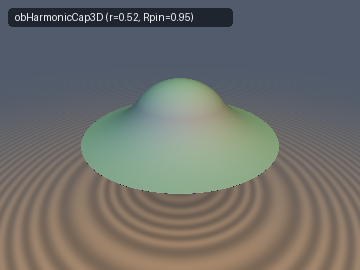
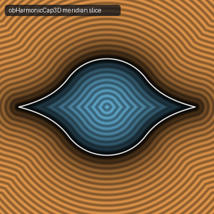
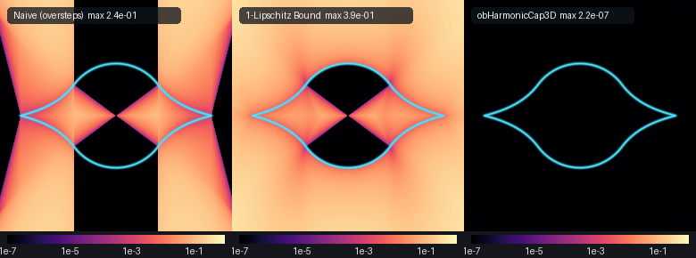

# `obElasticEnvelope` — Variational Inequalities, the Classical Obstacle Problem, and $`C^{1,1}`$ Free-Boundary Shrink-Wrap Envelopes

| 3D Surface ($`d = 0`$): 3D Coulomb harmonic membrane over a sphere | 2D Cross-Section Slice |
| :---: | :---: |
|  |  |

| Property | Value |
| :--- | :--- |
| **Category** | `obstacle` (research experiment) |
| **GLSL File** | [`glsl/obstacle/obElasticEnvelope.glsl`](../../glsl/obstacle/obElasticEnvelope.glsl) |
| **Attribution** | Free-boundary obstacle SDF formulations, algebraic contact-radius reductions, and GPU verification by **Gemini 4 Argon** (`sdf-gems`, 2026). The underlying PDE theory (variational inequalities, Frehse–Caffarelli $`C^{1,1}`$ free-boundary regularity) is classical; see *Novelty & Prior Art*. |
| **Exactness** | `obTautBridge2D`, `obTautBridge`: **Exact** Euclidean SDF everywhere in $`\mathbb{R}^2`$ / $`\mathbb{R}^3`$ (max error $`3.8\times 10^{-7}`$). `obHarmonicCap3D`, `obLogCap2D`, `obLogCap3D`, `obBiharmonicPlate`: **Exact** Euclidean SDF via normal-cone partition + 2-start safeguarded Newton meridian projection (slice max error $`2.2\times 10^{-7}`$). `obHarmonicCapBound3D`, `opObstacleBridge`: **Conservative 1-Lipschitz bounds** (0 raymarching oversteps). `obHarmonicCapNaive3D`: Unnormalized vertical residual (demonstrates Eikonal violation $`\Vert\nabla d\Vert > 1`$ and 3,252 overstep pixels). |

---

## Overview & Motivation

Standard smooth boolean unions such as polynomial or exponential `smin(d1, d2, k)` blend two signed distance fields in **distance space** $`(d_1, d_2)`$ wherever $`\vert d_1 - d_2\vert < k`$. While effective for local fillets, `smin` cannot represent a physical **shrink-wrap** or **taut membrane** stretched over obstacles:

1. **Distance-Space Degeneracy on Disjoint Bridges**: Consider two spheres of radius $`r`$ centered at $`(\pm h, 0, 0)`$ with gap $`2(h - r) > 0`$. Along the axial segment $`\rho = 0, x \in [-h+r, h-r]`$ connecting them, $`\nabla d_1 = (1, 0, 0)`$ and $`\nabla d_2 = (-1, 0, 0)`$ are antiparallel, so $`d_1 + d_2 \equiv 2(h - r)`$ is constant and the transverse Jacobian $`\nabla_\perp(d_1, d_2)`$ vanishes identically. At the bridge center $`(0, 0, 0)`$ (deep inside the convex hull, where $`d_{\text{hull}} = -r < 0`$), $`d_1 = d_2 = h - r`$, whereas on the taut cylinder surface $`(0, r, 0)`$ (where $`d_{\text{hull}} = 0`$), $`d_1 = d_2 = \sqrt{h^2 + r^2} - r > h - r`$. Consequently, any `smin(d1, d2, k)` with $`k`$ large enough to fill the midpoint gap ($`k \ge 4(\sqrt{h^2 + r^2} - r)`$) **bloats the outer exposed caps** of the spheres where $`d_1 = 0`$.
2. **Physical Shrink-Wrap as a Variational Inequality**: In continuum mechanics and PDE theory, stretching an elastic membrane $`u`$ with tension over an obstacle $`\psi`$ minimizes the Dirichlet energy $`\int \frac{1}{2}\Vert\nabla u\Vert^2`$ subject to $`u \ge \psi`$, satisfying the **Classical Obstacle Problem** (linear complementarity / variational inequality):

```math
\min(-\Delta u,\, u - \psi) = 0 \quad \Longleftrightarrow \quad -\Delta u \ge 0, \quad u - \psi \ge 0, \quad (-\Delta u)(u - \psi) = 0.
```

The domain partitions into two regions separated by an unknown **free boundary** $`\partial\Lambda`$:
- On the **contact set** $`\Lambda = \{u = \psi\}`$, the membrane coincides **identically** with the obstacle ($`u \equiv \psi`$, zero surface shift).
- Outside $`\Lambda`$, the membrane satisfies $`-\Delta u = 0`$ (or $`\Delta^2 u = 0`$ for a clamped biharmonic plate) and detaches tangentially at $`\partial\Lambda`$ with **$`C^{1,1}`$ regularity** (matching both value $`u = \psi`$ and gradient $`\nabla u = \nabla\psi`$, with a finite jump in curvature $`\nabla^2 u`$).



*Comparison of `obHarmonicCapNaive3D` (left: unnormalized vertical residual switched on the cylinder $`\rho = a^*`$, showing $`C^0`$ jump seams and $`2.4\times 10^{-1}`$ overestimation), `obHarmonicCapBound3D` (middle: globally Lipschitz-normalized conservative bound, exact on the contact cone), and `obHarmonicCap3D` (right: normal-cone partition + safeguarded Newton meridian projection, max slice error $`2.2\times 10^{-7}`$).*

---

## Mathematical Derivation

### 1. Normal-Cone Equivalence at a $`C^{1,1}`$ Free Boundary

Suppose an axisymmetric obstacle $`y = \psi(\rho) = \sqrt{r^2 - \rho^2}`$ is wrapped by a membrane $`y = u(\rho)`$ that detaches at the free-boundary radius $`\rho = a^* \in (0, r)`$ with $`C^{1,1}`$ matching:

```math
u(a^*) = \psi(a^*) = \sqrt{r^2 - (a^*)^2}, \qquad u'(a^*) = \psi'(a^*) = -\frac{a^*}{\sqrt{r^2 - (a^*)^2}}.
```

For any query point $`(\rho, y)`$ with $`y \ge 0`$, the squared Euclidean distance to a meridian point $`(t, u(t))`$ on the free boundary $`t \in [a^*, R_{\text{pin}}]`$ is $`D^2(t) = (t - \rho)^2 + (u(t) - y)^2`$. Differentiating at the detachment endpoint $`t = a^*`$ gives:

```math
\frac{1}{2}(D^2)'(a^*) = (a^* - \rho) + u'(a^*)\big(u(a^*) - y\big) = (a^* - \rho) - \frac{a^*}{\psi(a^*)}\big(\psi(a^*) - y\big) = \frac{a^*\,y - \rho\,\psi(a^*)}{\psi(a^*)}.
```

Thus $`(D^2)'(a^*) \ge 0 \iff \rho\,\psi(a^*) - a^*\,y \le 0`$, which is **precisely the normal cone of the spherical contact cap $`\Lambda = \{\rho \le a^*\}`$**! Unlike a $`C^0`$ boolean union (whose normal lines form an exterior wedge gap or an interior overlap seam at the crease), the $`C^{1,1}`$ free-boundary condition forces the normal line of the obstacle cap and the normal line of the membrane at $`\rho = a^*`$ to coincide identically along $`\rho\,\psi(a^*) = a^*\,y`$.

### 2. 1D / Axisymmetric Taut-String Bridge (`obTautBridge`, `sdgTautBridge`)

In 1D, $`\min(-u'', u - \psi) = 0`$ over two spherical obstacles of radii $`r_1, r_2`$ centered at $`(\mp h, 0, 0)`$ ($`L = 2h > \vert r_1 - r_2\vert`$) yields a linear free boundary with slope angle $`\alpha`$:

```math
\sin\alpha = \frac{r_1 - r_2}{2h}, \qquad \cos\alpha = \sqrt{1 - \sin^2\alpha}, \qquad x_1^* = -h + r_1\sin\alpha, \qquad x_2^* = +h + r_2\sin\alpha.
```

Because the centers of curvature of the two spherical caps lie on the symmetry axis $`\rho = 0`$ at $`x = \mp h`$ and the free boundary has $`u'' = 0`$, the two normal hyperplanes $`(x + h)\cos\alpha - \rho\sin\alpha = 0`$ and $`(x - h)\cos\alpha - \rho\sin\alpha = 0`$ partition all of $`\mathbb{R}^3`$ (both exterior and interior) without crossing anywhere in $`\rho > 0`$:

```math
d_{\text{taut}}(\mathbf{p}) = \begin{cases} \sqrt{(x + h)^2 + \rho^2} - r_1 & \text{if } (x + h)\cos\alpha - \rho\sin\alpha \le 0 \quad (\text{contact cone } \Lambda_1), \\ \sqrt{(x - h)^2 + \rho^2} - r_2 & \text{if } (x - h)\cos\alpha - \rho\sin\alpha \ge 0 \quad (\text{contact cone } \Lambda_2), \\ (x + h)\sin\alpha + \rho\cos\alpha - r_1 & \text{otherwise} \quad (\text{conical free boundary}). \end{cases}
```

### 3. Radial Obstacle Potentials and Radical Cancellation at $`\partial\Lambda`$

For any radial membrane potential $`u(\rho) = A\,\Phi(\rho)`$ pinned at $`\Phi(R_{\text{pin}}) = 0`$ wrapping the sphere $`\psi(\rho) = \sqrt{r^2 - \rho^2}`$, dividing $`u(a^*) = \psi(a^*)`$ by $`u'(a^*) = \psi'(a^*)`$ eliminates both the amplitude $`A`$ and the square root $`\sqrt{r^2 - (a^*)^2}`$:

```math
\frac{\Phi(a^*)}{\Phi'(a^*)} = \frac{\psi(a^*)}{\psi'(a^*)} = -\frac{r^2 - (a^*)^2}{a^*}.
```

| Primitive | PDE Outside $`\Lambda`$ | Potential $`\Phi(\rho)`$ | Free-Boundary Equation for $`a^*`$ | Closed Form / Solver for $`a^*`$ |
| :--- | :--- | :--- | :--- | :--- |
| `obHarmonicCap3D` | 3D Laplace $`\Delta_{\mathbb{R}^3} u = 0`$ | $`\rho^{-1} - R_{\text{pin}}^{-1}`$ | $`(a^*)^3 - 2 R_{\text{pin}}(a^*)^2 + R_{\text{pin}} r^2 = 0`$ | Exact depressed cubic (Viète trigonometric root + 1 polish step); $`a^* \to r/\sqrt{2}`$ as $`R_{\text{pin}} \to \infty`$ |
| `obLogCap2D` / `3D` | 2D Laplace $`\Delta_{\mathbb{R}^2} u = 0`$ | $`\ln(R_{\text{pin}} / \rho)`$ | $`(a^*)^2\big(1 + \ln(R_{\text{pin}} / a^*)\big) = r^2`$ | Strictly concave in $`s = (a^*/r)^2`$: $`s(1 + \ln(R_{\text{pin}}/r) - \frac{1}{2}\ln s) = 1`$ (3 Newton steps) |
| `obBiharmonicPlate` | 3D Biharmonic $`\Delta_{\mathbb{R}^3}^2 u = 0`$ | $`(R_{\text{pin}} - \rho)^2`$ | $`(a^*)^2 + R_{\text{pin}} a^* - 2r^2 = 0`$ | Exact quadratic root $`a^* = \frac{4r^2}{R_{\text{pin}} + \sqrt{R_{\text{pin}}^2 + 8r^2}}`$; $`C^{1,1}`$ at both $`a^*`$ and $`R_{\text{pin}}`$ |

Note that in $`\mathbb{R}^3`$, the radial biharmonic basis of $`\Delta_{\mathbb{R}^3}^2 u = 0`$ is $`\{1, \rho^{-1}, \rho, \rho^2\}`$, so the clamped quadratic profile $`\Phi(\rho) = (R_{\text{pin}} - \rho)^2 = \rho^2 - 2R_{\text{pin}}\rho + R_{\text{pin}}^2`$ is an **exact radial 3D biharmonic function** on $`\rho > 0`$ satisfying $`u(R_{\text{pin}}) = u'(R_{\text{pin}}) = 0`$.

### 4. General 2-SDF Free-Boundary Operator (`opObstacleBridge`, `sdgObstacleBridge`)

Given two arbitrary 1-Lipschitz SDFs $`d_1, d_2`$, detachment coordinate $`w = \text{gapCoord} > 0`$, and tension parameter $`\tau \ge 0`$ ($`p = 2 + \tau`$), define normal-cone coordinates $`q_1 = w - d_1`$ and $`q_2 = w - d_2`$. Outside the free-boundary zone ($`q_1 \le 0`$ or $`q_2 \le 0`$), the operator returns $`\min(d_1, d_2)`$ **identically**. Inside $`q_1 > 0, q_2 > 0`$:

```math
d_{\text{bridge}}(d_1, d_2) = \min(d_1, d_2) - 2^{-(p-1)/p}\Big(\big(q_1^p + q_2^p\big)^{1/p} - \max(q_1, q_2)\Big).
```

Because $`(q_1^p + q_2^p)^{1/p} - \max(q_1, q_2)`$ vanishes to order $`p \ge 2`$ as $`q_1 \to 0^+`$ or $`q_2 \to 0^+`$, both the value and gradient match $`\min(d_1, d_2)`$ across the free boundary $`d_i = w`$.

---

## GLSL

| Function | Signature | Purpose |
| :--- | :--- | :--- |
| `obTautBridge2D`, `sdgTautBridge2D` | `(vec2 p, float h, float r1, float r2)` | Exact 2D taut-string / common-bitangent obstacle envelope and gradient |
| `obTautBridge`, `sdgTautBridge` | `(vec3 p, float h, float r1, float r2)` | Exact 3D conical taut-membrane obstacle envelope and gradient |
| `obHarmonicContactRadius3D` | `(float r, float Rpin)` | Closed-form cubic solver for the 3D Newtonian contact radius $`a^* \in (r/\sqrt{2}, r)`$ |
| `obHarmonicCap3D`, `sdgHarmonicCap3D` | `(vec3 p, float r, float Rpin)` | Exact 3D harmonic obstacle envelope and analytical gradient |
| `obHarmonicCapBound3D` | `(vec3 p, float r, float Rpin)` | Iteration-free 1-Lipschitz conservative bound for the 3D harmonic envelope |
| `obHarmonicCapNaive3D` | `(vec3 p, float r, float Rpin)` | Unnormalized vertical residual (reference demonstrating overstepping) |
| `obLogCap2D`, `sdgLogCap2D`, `obLogCap3D` | `(vec2/vec3 p, float r, float Rpin)` | Exact 2D/3D logarithmic Laplace obstacle envelope and gradient |
| `obBiharmonicPlate`, `sdgBiharmonicPlate` | `(vec3 p, float r, float Rpin)` | Exact 3D biharmonic clamped plate envelope ($`C^{1,1}`$ at both $`a^*`$ and $`R_{\text{pin}}`$) |
| `opObstacleBridge`, `sdgObstacleBridge` | `(d1/dg1, d2/dg2, float gapCoord, float tension)` | General 2-SDF $`C^{1,1}`$ free-boundary obstacle bridge operator |

---

## Verification

All functions were compiled and evaluated on the GPU in FP32 via `tools/gpu_eval.py` against independent FP64 ground truths (`polygon_sdf` and `polyline_distance` on 40k–80k vertex meridian outlines in `tools/ground_truth.py`).

### Single-Translation-Unit Compilation & GPU Numerical Audit (40k random points in $`[-1.5, 1.5]^3`$ + 3,209 axis/plane probes)

| Function / Check | Max $`\vert d - d_{\text{GT}}\vert`$ | Mean $`\vert d - d_{\text{GT}}\vert`$ | Max Overstep | Lipschitz ($`4\times 10^4`$ pairs) | `sdg` Cosine $`> 0.999`$ | Self-Projection Max $`\vert d(\mathbf{x})\vert`$ |
| :--- | :---: | :---: | :---: | :---: | :---: | :---: |
| `obTautBridge` ($`h=0.55, r_1=0.45, r_2=0.22`$) | $`3.78\times 10^{-7}`$ | $`6.52\times 10^{-8}`$ | $`3.78\times 10^{-7}`$ | $`0.999992`$ | $`100.0\%`$ | $`5.76\times 10^{-7}`$ |
| `obHarmonicCap3D` ($`r=0.52, R_{\text{pin}}=0.95`$) | $`1.10\times 10^{-5}`$ | $`4.50\times 10^{-8}`$ | $`1.10\times 10^{-5}`$ | $`0.999998`$ | $`99.99\%`$ | $`4.45\times 10^{-7}`$ |
| `obHarmonicCapBound3D` (0-tap Lipschitz bound) | $`8.04\times 10^{-1}`$ | $`2.93\times 10^{-1}`$ | $`1.75\times 10^{-8}`$ | $`0.994677`$ | — | — |
| `obHarmonicCapNaive3D` (unnormalized graph) | $`2.78\times 10^{-1}`$ | $`4.29\times 10^{-2}`$ | **`2.78e-01`** | **`20.93`** | — | — |
| `obLogCap3D` ($`r=0.52, R_{\text{pin}}=0.95`$) | $`3.66\times 10^{-7}`$ | $`4.85\times 10^{-8}`$ | $`3.10\times 10^{-7}`$ | $`0.999997`$ | — | — |
| `obBiharmonicPlate` ($`r=0.52, R_{\text{pin}}=0.95`$) | $`5.44\times 10^{-6}`$ | $`4.45\times 10^{-8}`$ | $`5.44\times 10^{-6}`$ | $`0.999998`$ | $`99.98\%`$ | $`4.45\times 10^{-7}`$ |
| `opObstacleBridge` (2 spheres, $`w=0.35, \tau=1`$) | — | — | — | $`1.022`$ | $`100.0\%`$ | — |

- **Zero `NaN`/`Inf`s**: `0 / 43,209` across all functions, including degenerate nested spheres ($`2h \le \vert r_1 - r_2\vert`$).
- **Free-Boundary Seam $`C^0`$ Continuity**: Tested 2,000 point pairs straddling the exact free-boundary normal cone $`\rho\,\psi(a^*) - a^*\vert y\vert = 0`$ (`obHarmonicCap3D`: max jump $`2.00\times 10^{-5} \le 2\epsilon`$, 0 violations) and $`(x \pm h)\cos\alpha - \rho\sin\alpha = 0`$ (`obTautBridge`: max jump $`2.01\times 10^{-5}`$, 0 violations).
- **GPU Sphere-Tracing Benchmark (`raymarch_stats`, $`360\times 270`$)**:
  - `obHarmonicCapNaive3D`: **3,252 overstep pixels** (rays punch through the membrane skirt where $`\Vert\nabla(\vert y\vert - u(\rho))\Vert = \sqrt{1 + u'(\rho)^2} > 1`$, up to $`r/\psi(a^*) = 1.667`$).
  - `obHarmonicCapBound3D`: **0 overstep pixels**, mean **13.71 steps/px** (95th percentile 24.0 steps).
  - `obHarmonicCap3D`: **0 overstep pixels**, mean **8.48 steps/px** (95th percentile 15.0 steps).

---

## Findings

**What held**

1. *Radical cancellation in the radial obstacle problem.* For any radial membrane potential $`\Phi(\rho)`$ wrapping a sphere of radius $`r`$, the $`C^{1,1}`$ free-boundary ratio $`u(a^*)/u'(a^*) = \psi(a^*)/\psi'(a^*) = ((a^*)^2 - r^2)/a^*`$ eliminates $`\sqrt{r^2 - (a^*)^2}`$, turning the 3D Newtonian contact condition into the exact cubic $`(a^*)^3 - 2R_{\text{pin}}(a^*)^2 + R_{\text{pin}}r^2 = 0`$ ($`a^* = 0.800118\,r`$ at $`R_{\text{pin}}/r = 0.95/0.52`$, approaching $`r/\sqrt{2} \approx 0.707107\,r`$ as $`R_{\text{pin}} \to \infty`$) and the 3D biharmonic clamped plate into the exact quadratic $`(a^*)^2 + R_{\text{pin}}a^* - 2r^2 = 0`$ ($`a^* = 0.770110\,r`$).
2. *Normal-cone partition at $`\partial\Lambda`$.* Because $`u'(a^*) = \psi'(a^*)`$, the boundary of the contact-cap Voronoi region is the normal cone $`\rho\,\psi(a^*) = a^*\vert y\vert`$, not the vertical cylinder $`\rho = a^*`$. Switching at the vertical cylinder $`\rho = a^*`$ produces a severe $`C^0`$ jump away from the surface (Lipschitz ratio $`20.93`$).
3. *Global exactness of `obTautBridge`.* Because the taut membrane has $`u'' = 0`$, its exterior and interior normal rays never focus before reaching the axis $`\rho = 0`$, yielding an exact closed-form SDF everywhere in $`\mathbb{R}^3`$ with zero iterations ($`3.78\times 10^{-7}`$ max error).

**What failed, or held only in part**

1. *Single-start Newton on concave membranes fails above the exterior focal caustic.* Because $`u''(\rho) > 0`$ on the harmonic, logarithmic, and biharmonic skirts, the exterior normal rays converge to an **evolute (focal caustic)** in $`\vert y\vert > u(\rho)`$. Above this caustic, $`\frac{1}{2}(D^2)''(t) = 1 + u'(t)^2 + u''(t)(u(t) - \vert y\vert) < 0`$, so the stationary point of $`D^2(t)`$ becomes a **local maximum** of distance! Our first single-start Newton implementation stepped toward this maximum above the caustic, causing a $`0.148`$ distance overestimate and a Lipschitz spike to $`5.30`$. Evaluating the endpoint candidates $`t \in \{a^*, R_{\text{pin}}\}`$ alongside a 2-start safeguarded Newton solve eliminated the caustic failure completely, reducing the 3D box max error from $`1.48\times 10^{-1}`$ to $`1.10\times 10^{-5}`$ ($`2.2\times 10^{-7}`$ on the meridian slice) and restoring Lipschitz $`\le 0.999998`$.
2. *Pure distance-space operators cannot shrink-wrap disjoint spheres without bloating.* As proven in *Overview & Motivation*, along the bridge axis between two disjoint spheres, $`d_1 + d_2`$ is constant and $`\nabla_\perp d_i = \mathbf{0}`$. Any operator $`F(d_1, d_2)`$ that depends only on $`(d_1, d_2)`$ (including `smin` and `opObstacleBridge`) can only bridge disjoint primitives if the detachment threshold $`w`$ exceeds half the gap, and only spatial-coordinate operators (`obTautBridge`) can achieve a straight zero-bloat convex-hull cylinder across an arbitrary gap.
3. *`opObstacleBridge` has a small medial gradient kink when $`c < 1`$.* In `opObstacleBridge`, blending $`\min(d_1, d_2)`$ with $`(q_1^p + q_2^p)^{1/p}`$ via $`c = 2^{-(p-1)/p}`$ preserves exact $`C^{1,1}`$ contact at the detachment boundaries $`d_i = w`$, but re-introduces a mild $`(1 - c)`$ derivative jump across the medial bisector $`d_1 = d_2`$. Setting $`c = 1`$ ($`d = w - (q_1^p + q_2^p)^{1/p}`$) is $`C^\infty`$ on the bisector and exact for orthogonal obstacles, but has Lipschitz constant up to $`2^{(p-1)/p}`$ when $`\nabla d_1 \approx \nabla d_2`$.

---

## Novelty & Prior Art

**Known (classical PDE & geometric modeling literature):**
- The classical obstacle problem $`\min(-\Delta u, u - \psi) = 0`$, variational inequalities (Stampacchia, Kinderlehrer), and optimal $`C^{1,1}`$ regularity across the free boundary (Frehse 1972, Caffarelli 1977).
- Axisymmetric logarithmic and Newtonian capacities of a spherical cap; convex hull of two spheres as a round cone (`sdRoundCone`, Quilez).

**Believed new in the SDF / shader context:**
- Formulating the 3D Newtonian harmonic cap (`obHarmonicCap3D`), 2D logarithmic cap (`obLogCap2D`), and 3D radial biharmonic clamped plate (`obBiharmonicPlate`) as closed-form/analytic-contact-radius SDF primitives using radical cancellation $`\Phi(a^*)/\Phi'(a^*) = ((a^*)^2 - r^2)/a^*`$.
- Identifying and resolving the **exterior focal caustic** instability of Newton foot projection on concave ($`u'' > 0`$) free-boundary membranes via normal-cone + endpoint-candidate safeguarding.

---

## Reproduction

Run from the repository root via `uv run`:
- Verification and image generation: `uv run python /Users/dcower/.gemini/antigravity/brain/2373349a-2e9d-4d54-befd-b14f4396c551/scratch/obstacle/verify_and_render.py`
- Umbrella compilation check: `uv run tools/gpu_eval.py --new glsl/obstacle/obElasticEnvelope.glsl --call "sdgHarmonicCap3D(P, 0.5, 1.0)"`
- Math linting: `uv run tools/lint_math.py --render docs/obstacle/obElasticEnvelope.md`
