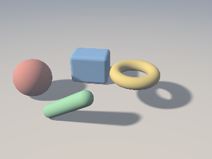
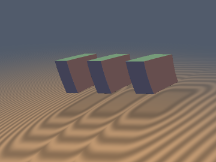
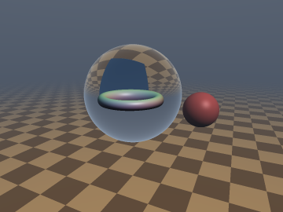
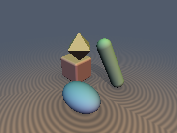
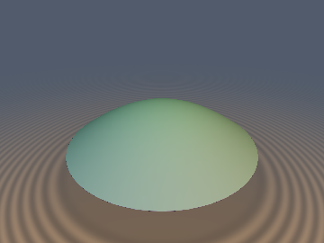
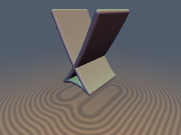
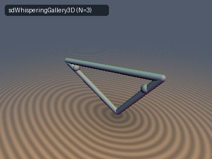

# 10. Ray Space, Wavefronts & Accelerated Tracing

[**← Back to Main `sdf-gems` README**](../../README.md) · **GLSL Headers**: [`glsl/optics/`](../../glsl/optics/) (7 headers)

Non-standard raymarching and optical geometry: marching-free ray-clearance fields, finite-speed-of-light retarded tracing, closed-form curved rays in gradient-index media, cached convex Lipschitz bounds, Fermat–Snell refracted wavefronts, Legendrian swallowtail caustics, and integrable billiard porisms.

## Contents

- **Ray-Space Clearance, Relativistic / GRIN Tracing & Cached Bounds** (4)
- **Refracted Wavefronts, Legendrian Caustics & Dynamical Billiards** (3)

## Ray-Space Clearance, Relativistic / GRIN Tracing & Cached Bounds

| Preview | Function | Summary |
| :---: | :--- | :--- |
|  | [**`rcPrimitives`**](rcPrimitives.md) [`glsl`](../../glsl/optics/rcPrimitives.glsl) · **Exact** (torus iterative) / Approximate shading | **Also**: `rcSphere`, `rcCapsule`, `rcBox`, `rcRoundBox`, `rcTorus`, `rcSoftShadow`, `rcPenumbra`. Ray-clearance fields `vec2(C, t*)`: signed closest approach or deepest penetration of a ray with no marching; exact union under `min`, 1-Lipschitz under ray translation, and 0-tap soft shadows (approximate, not faster than a 32-step march in the test scene) |
|  | [**`stRetardedTrace`**](stRetardedTrace.md) [`glsl`](../../glsl/optics/stRetardedTrace.glsl) · **Exact** (uniform motion) / Bound | **Also**: `stLorentzToRest`, `stDoppler`, `stRetardedStep2`, `stRotatingStep`, `stGalileanAim`. Retarded-time sphere tracing with a finite speed of light: exact Galilean re-aim and Lorentz rest-frame trace (Terrell rotation, Doppler factor), plus conservative first- and second-order steps for rotating and oscillating bodies (0 overstep measured) |
|  | [**`grCurvedRays`**](grCurvedRays.md) [`glsl`](../../glsl/optics/grCurvedRays.glsl) · **Exact** paths / Conservative march | **Also**: `grFishEyeAdvance`, `grLuneburgAdvance`, `grCircleSphere`, `grCirclePlane`, `grFishEyeMarch`, `grLuneburgTauStep`. Closed-form curved rays in Maxwell fish-eye (circles) and Luneburg (ellipse arcs) media, sphere-traced along the curve with no ODE solver, plus analytic circle–sphere and circle–plane hits; 0 oversteps on 20k rays per medium at about straight-ray step counts |
|  | [**`lcBounds`**](lcBounds.md) [`glsl`](../../glsl/optics/lcBounds.glsl) · Certified bounds (convex-only where stated) | **Also**: `lcLower`, `lcUpperClosest`, `lcLowerConvex`, `lcIntervalConvex`, `lcRayStepConvex`, `lcRaySpanConvex`, `lcRaySkip`. Two-sided bounds on an exact SDF from cached samples (value, normal, closest point); the convex half-space ray step needs 2.6–2.9x fewer steps with no overstep on convex bodies, and is invalid on non-convex ones or with inside samples near the medial axis |

## Refracted Wavefronts, Legendrian Caustics & Dynamical Billiards

| Preview | Function | Summary |
| :---: | :--- | :--- |
|  | [**`fmRefractedWavefront`**](fmRefractedWavefront.md) [`glsl`](../../glsl/optics/fmRefractedWavefront.glsl) · **Exact** | **Also**: `fmgRefractedWavefront`, `fmRefractedLens`, `fmgRefractedLens`. Exact Euclidean SDF and analytical gradient of non-paraxial Snell-refracted optical wavefronts $`(T(\mathbf{p}) - t_0)/n_2`$ via the Envelope Theorem ($`\Vert\nabla d\Vert \equiv 1`$), 0-iteration aperture rim Voronoi cone, and 1-`inversesqrt` Halley solver |
|  | [**`ctLegendrianWavefront`**](ctLegendrianWavefront.md) [`glsl`](../../glsl/optics/ctLegendrianWavefront.glsl) · **Exact** | **Also**: `ctParabolaMultiSDF2D`, `ctParabolaWavefront2D`, `ctEllipseWavefront2D`, `sdSwallowtailPocket2D`, `sdSwallowtailWavefront3D`, `sdSemiCubicalEvolute2D`, `sdParaboloidCaustic3D`. Multi-valued Legendrian wavefront sheets $`(d_1 \le d_2 \le d_3)`$ past the medial shock, Huygens cusp stationarity, Arnold $`A_3`$ swallowtail pockets, and Darboux-convex evolute caustics |
|  | [**`biPonceletCaustic`**](biPonceletCaustic.md) [`glsl`](../../glsl/optics/biPonceletCaustic.glsl) · **Exact** (exterior) / Bound | **Also**: `biEllipseCausticParam`, `biEllipsoidCaustics`, `sdPonceletTriangle2D`, `sdPonceletPolygon2D`, `sdWhisperingGallery3D`, `sdConfocalWaveguide3D`. Jacobi-Chasles confocal billiard caustic invariants, 0-trig Cayley Poncelet porism closed polygons ($`N=3,4,6`$ with invariant perimeter $`L_N`$), and 2-`sqrt` 1-Lipschitz confocal whispering-gallery waveguides |
